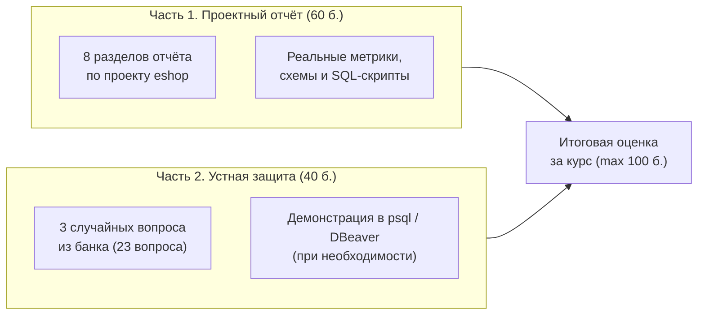

# Форма и критерии зачёта

**Дисциплина:** Администрирование баз данных  
**Форма контроля:** Зачёт (с оценкой)  
**Неделя:** 13 (последнее занятие курса)  
**Максимальный балл:** 100 баллов (порог сдачи — 55 баллов)

---

## Навигация и структура зачёта

Зачёт проходит в одно занятие и состоит из двух взаимосвязанных частей:



1. **[Часть 1. Проектный отчёт (60 баллов)](#часть-1-проектный-отчёт-60-баллов)** — сводный аналитический документ `eshop_project_report.md`, формируемый студентом на протяжении всех лабораторных работ курса (лаб. 01–10).
2. **[Часть 2. Устная защита (40 баллов)](#часть-2-устная-защита-40-баллов)** — ответы на 3 вопроса из банка вопросов с демонстрацией понимания архитектуры, механизмов СУБД и практических решений.
3. **[Банк вопросов с самопроверкой](#банк-вопросов-для-самопроверки-и-защиты)** — 23 вопроса с прямыми ссылками на лекции, лабораторные работы, статьи wiki и эталонными тезисами для самоконтроля.
4. **[Шкала оценивания и правила сдачи](#шкала-оценок-и-правила-сдачи)**.

---

## Часть 1. Проектный отчёт (60 баллов)

### Что такое проектный отчёт

Отчёт по проекту **eshop** — это портфолио системного аналитика и администратора БД, подтверждающее освоение всех практических навыков курса. 
Отчёт оформляется в виде единого Markdown-файла `eshop_project_report.md` в корне репозитория студента по шаблону:
- 📄 **Шаблон отчёта:** [wiki/artifacts/project-report.md](../wiki/artifacts/project-report.md)
- 📌 **Итоговое занятие и требования к защите:** [Лабораторная работа №10](../labs/lab_10/lab_10.md)

> ⚠️ **Главное требование:** Отчёт не должен быть пересказом теории. Он обязан содержать **реальные артефакты из вашей базы данных**: фактические замеры времени выполнения (`EXPLAIN ANALYZE`), вывод утилит (`flyway info`), созданные политики безопасности, ER-диаграммы и обоснования принятых проектных решений.

### Структура отчёта, привязка к работам и критерии оценивания

| № | Раздел отчёта | Баллы | Источник данных (Лабораторные) | База знаний (Wiki) | Критерии оценивания раздела |
|---|---------------|:-----:|--------------------------------|--------------------|-----------------------------|
| 1 | **Актуальная схема БД и ERD** | **8** | [Лаб. 01](../labs/lab_01/lab_01.md), [Лаб. 02](../labs/lab_02/lab_02.md), [Лаб. 09](../labs/lab_09/lab_09.md), [Лаб. 10](../labs/lab_10/lab_10.md) | [Схема eshop](../wiki/course/eshop-schema.md), [ERD](../wiki/concepts/erd.md), [Нормализация](../wiki/concepts/normalization.md) | Mermaid-диаграмма отражает все таблицы схемы `eshop` после миграций V001–V008 (`customers`, `orders`, `order_items`, `products`, `categories`, `promo_codes`). Кардинальности связей (`1:N`, `N:M`) указаны верно; типы ключей (PK/FK) и назначение полей описаны. |
| 2 | **Ролевая модель и RLS** | **8** | [Лабораторная работа №02](../labs/lab_02/lab_02.md) | [Матрица доступа](../wiki/artifacts/access-matrix.md), [Привилегии](../wiki/concepts/privileges.md), [RBAC/ABAC](../wiki/concepts/access-control-models.md) | Описаны 4 роли (`eshop_readonly`, `eshop_app`, `analyst_ivanova`, `app_backend`). Заполнена матрица привилегий (`CONNECT`, `USAGE`, `SELECT`, `INSERT/UPDATE`). Приведен рабочий SQL-код RLS-политики по региональному ограничению и объяснен принцип default-deny. |
| 3 | **Регламент резервного копирования** | **8** | [Лаб. 03](../labs/lab_03/lab_03.md), [Лаб. 04](../labs/lab_04/lab_04.md) | [Политика бэкапов](../wiki/artifacts/backup-policy.md), [Резервное копирование](../wiki/concepts/backup-recovery.md), [PITR](../wiki/concepts/pitr.md) | Заполнена регламентная таблица 4 уровней (логический, кластерный, физический `pg_basebackup`, непрерывный WAL-архив). Четко сформулированы целевые показатели **RPO** и **RTO** для eshop и приведён порядок действий при аварии. |
| 4 | **Мониторинг состояния БД** | **6** | [Лабораторная работа №05](../labs/lab_05/lab_05.md) | [Отчёт о здоровье БД](../wiki/artifacts/db-health-report.md), [Мониторинг](../wiki/concepts/monitoring.md), [Bloat](../wiki/concepts/bloat.md) | Приведены реальные метрики из `pg_stat_database` и `pg_stat_user_tables`: cache hit ratio (%), процент мёртвых строк (`dead_pct`), долгие транзакции. Сформулированы критические пороги для алертинга. |
| 5 | **Анализ запросов и оптимизация** | **8** | [Лаб. 06](../labs/lab_06/lab_06.md), [Лаб. 07](../labs/lab_07/lab_07.md) | [Анализ EXPLAIN](../wiki/artifacts/explain-analysis.md), [Обоснование PgBouncer](../wiki/artifacts/pgbouncer-justification.md), [Индексы](../wiki/concepts/indexes.md) | Заполнена сравнительная таблица «до/после индекса» на синтетическом датасете (200k заказов). Приведены планы `EXPLAIN (ANALYZE, BUFFERS)`. Обоснован выбор частичного/составного индекса и необходимость пулера соединений PgBouncer. |
| 6 | **Управление миграциями Flyway** | **8** | [Лаб. 09](../labs/lab_09/lab_09.md), [Лаб. 10](../labs/lab_10/lab_10.md) | [Migration Plan](../wiki/artifacts/migration-plan.md), [Flyway](../wiki/tools/flyway.md), [Workflow миграций](../wiki/procedures/migration-workflow.md) | Представлен вывод команды `flyway info`: все миграции V001–V008 имеют статус `Success` / `Applied`. Приложен Migration Plan для V003. Описан регламент версионирования представлений через `R__`. |
| 7 | **Информационная безопасность (ИБ)** | **6** | [Лабораторная работа №08](../labs/lab_08/lab_08.md) | [Чек-лист ИБ](../wiki/artifacts/security-checklist.md), [Безопасность](../wiki/concepts/security.md), [pgAudit](../wiki/tools/pgaudit.md) | Заполнен чек-лист ИБ. Описана конфигурация pgAudit (`write, ddl, role`) с примером строки из лога. Указана категория ПДн по 152-ФЗ, обоснованы меры защиты (TLS/hostssl, шифрование полей через `pgcrypto`). |
| 8 | **Zero-Downtime и Rollback** | **8** | [Лабораторная работа №10](../labs/lab_10/lab_10.md) | [Zero-Downtime паттерны](../wiki/procedures/zero-downtime.md), [Стратегии отката](../wiki/procedures/rollback-strategies.md) | Заполнена сравнительная таблица опасных и безопасных DDL-операций. Описан учебный инцидент с миграцией V005 и обосновано решение через Forward Rollback (V006) вместо небезопасного отката. |

### Порядок сдачи и публикации отчётов (GitHub / GitVerse)

> 🛑 **Внимание:** Файлы отчётов **не нужно отправлять преподавателю на почту или загружать zip-архивами в LMS!**  
> Сдача всех материалов курса организована через контроль версий Git и платформы **GitHub** или **GitVerse**.

**Алгоритм сдачи проектного отчёта:**
1. **Клонирование:** Вы клонируете базовый учебный репозиторий курса на свой рабочий компьютер.
2. **Создание своего репозитория:** Создаёте собственный **публичный (Public)** репозиторий на платформе **GitHub** ([github.com](https://github.com/)) или **GitVerse** ([gitverse.ru](https://gitverse.ru/)).
3. **Размещение отчётов:**
   - В корне проекта размещается итоговый отчёт: `eshop_project_report.md`.
   - В каталоге `reports/` сохраняются все промежуточные отчёты и чек-листы по выполненным лабораторным работам (лаб. 01–10).
   - В каталоге `migrations/` сохраняются все написанные SQL-миграции Flyway (`V001`–`V008`).
4. **Публикация (Push):** Перенаправляете remote `origin` на свой репозиторий, фиксируете изменения коммитом и выполняете `git push -u origin main`.
5. **Сдача ссылки:** В форму сдачи в LMS вставляется **только ссылка на ваш публичный репозиторий** (или прямой URL файла `eshop_project_report.md` в вашем репозитории).

📖 **Подробное руководство:**  
Полная пошаговая инструкция со всеми консольными командами, настройкой токенов и решением проблем описана в Вики:  
👉 **[Пошаговый сценарий: сдача отчётов через GitHub / GitVerse](../wiki/cheatsheets/git.md#пошаговый-сценарий-сдача-отчётов-через-github--gitverse)**.

> **Срок сдачи:** Ссылка на репозиторий отправляется в LMS до начала зачётного занятия. За несвоевременную сдачу применяется штраф: −10 баллов за каждое занятие просрочки.

---

## Часть 2. Устная защита (40 баллов)

Устная защита проводится индивидуально во время зачёта. Преподаватель выбирает **3 вопроса** из банка вопросов (по одному из разных тематических блоков). Студент дает развернутый устный ответ и при необходимости подтверждает его в терминале `psql` или в интерфейсе DBeaver.

### Критерии оценки каждого вопроса (максимум 13–14 баллов):

| Баллы | Уровень ответа | Характеристика ответа |
|:-----:|:--------------|-----------------------|
| **13–14** | Отличный | Полный, исчерпывающий ответ с пониманием внутренних механизмов СУБД, физических процессов на диске/в памяти, указанием точных команд, параметров конфигурации и архитектурных компромиссов. |
| **10–12** | Хороший | Правильный ответ по существу, понимание терминов и логики работы, но без углубления в детали реализации или с мелкими неточностями в синтаксисе параметров. |
| **6–9** | Удовлетворительный | Частичный или поверхностный ответ: названо назначение утилиты/механизма, но не раскрыты причины его работы, допущены ошибки в практических сценариях. |
| **0–5** | Неудовлетворительный | Непонимание сути концепции, грубые ошибки, неспособность объяснить ключевые термины вопроса. |

---

## Банк вопросов для самопроверки и защиты

Используйте этот раздел для подготовки к защите. Каждый вопрос снабжён прямыми ссылками на лекции, лабораторные работы и wiki-статьи, а также блоком **самопроверки**, который можно раскрыть для проверки своих знаний.

```
Содержание банка вопросов:
├── Блок А. Архитектура и установка (Вопросы 1–4)
├── Блок Б. Роли и разграничение доступа (Вопросы 5–8)
├── Блок В. Резервное копирование и восстановление (Вопросы 9–12)
├── Блок Г. Мониторинг и оптимизация производительности (Вопросы 13–16)
├── Блок Д. Миграции схемы и стратегии отката (Вопросы 17–20)
└── Блок Е. Информационная безопасность и аудит (Вопросы 21–23)
```

---

### Блок А. Архитектура и установка

#### Вопрос 1. Что такое WAL? Зачем PostgreSQL записывает изменения дважды? Как WAL связан с PITR?
- 📚 **Лекции:** [Лекция 1 (§2 Архитектура, WAL)](../lectures/lec_01/lec_01.md) · [Лекция 5 (§4 WAL-архивирование)](../lectures/lec_05/lec_05.md) · [Лекция 6 (§2 PITR)](../lectures/lec_06/lec_06.md)
- 🛠️ **Лабораторные:** [Лабораторная 03 (WAL-архивирование)](../labs/lab_03/lab_03.md) · [Лабораторная 04 (PITR на практике)](../labs/lab_04/lab_04.md)
- 📖 **Wiki:** [WAL и MVCC](../wiki/concepts/wal-mvcc.md) · [Архитектура PostgreSQL](../wiki/concepts/postgresql-architecture.md) · [PITR](../wiki/concepts/pitr.md)

<details>
<summary><b>🔍 Самопроверка и ключевые тезисы ответа</b></summary>

1. **Что такое WAL:** *Write-Ahead Logging* (журнал предзаписи) — последовательный append-only журнал транзакций, расположенный в каталоге `pg_wal/` (файлы по 16 МБ). Фиксирует все изменения данных до того, как они попадут в страницы таблиц на диске.
2. **Зачем писать дважды:**
   - Изменение сначала пишется последовательно на диск в WAL (быстрый последовательный ввод-вывод + `fsync`), а страницы таблицы в `shared_buffers` помечаются «грязными» (*dirty pages*).
   - Сброс страниц данных на диск в файлы каталога `base/` откладывается до контрольной точки (*checkpoint*) или работы `bgwriter` (минимизация медленного случайного ввода-вывода).
   - Это гарантирует свойства **ACID** (в первую очередь Durability — долговечность) при высокой скорости работы. При внезапном сбое питания СУБД восстанавливается (*crash recovery*), накатывая записи WAL от последней контрольной точки.
3. **Связь с PITR:** *Point-In-Time Recovery* опирается на непрерывное архивирование сегментов WAL (`archive_command`). Имея базовый снимок файлов (`pg_basebackup`) и непрерывную цепочку WAL, можно восстановить состояние БД на любую секунду в прошлом или именованную точку сохранения, повторив транзакции.
</details>

---

#### Вопрос 2. Объясните структуру PGDATA: что хранится в base/, pg_wal/, pg_hba.conf, postgresql.auto.conf?
- 📚 **Лекции:** [Лекция 2 (§3 Структура каталогов и конфигурация)](../lectures/lec_02/lec_02.md)
- 🛠️ **Лабораторные:** [Лабораторная 01 (Установка и структура файлов)](../labs/lab_01/lab_01.md) · [Лабораторная 02](../labs/lab_02/lab_02.md)
- 📖 **Wiki:** [Архитектура PostgreSQL](../wiki/concepts/postgresql-architecture.md) · [Инструмент psql](../wiki/tools/psql.md)

<details>
<summary><b>🔍 Самопроверка и ключевые тезисы ответа</b></summary>

1. `base/` — основной каталог с файлами данных баз данных по умолчанию. Внутри расположены подкаталоги, названные по OID баз данных (`SELECT oid, datname FROM pg_database;`). Внутри них находятся файлы таблиц и индексов (по номерам `relfilenode`), сегментированные по 1 ГБ.
2. `pg_wal/` — каталог журнала упреждающей записи. Содержит 16-мегабайтные бинарные сегменты WAL, используемые для crash recovery, репликации и PITR.
3. `pg_hba.conf` — *Host-Based Authentication*. Конфигурационный файл контроля доступа на сетевом уровне. Задает правила: `TYPE` (local/host/hostssl), `DATABASE`, `USER`, `ADDRESS`, `METHOD` (scram-sha-256, md5, reject). Читается сверху вниз до первого совпадения.
4. `postgresql.auto.conf` — файл параметров конфигурации, создаваемый и перезаписываемый СУБД при выполнении SQL-команд `ALTER SYSTEM SET param = value;`. Имеет приоритет над `postgresql.conf`. Редактировать его вручную не рекомендуется.
</details>

---

#### Вопрос 3. Чем postmaster отличается от backend? Сколько backend-процессов будет при 50 соединениях?
- 📚 **Лекции:** [Лекция 1 (§2 Процессы PostgreSQL)](../lectures/lec_01/lec_01.md) · [Лекция 9 (§3 Connection Pooling)](../lectures/lec_09/lec_09.md)
- 🛠️ **Лабораторные:** [Лабораторная 05 (Мониторинг сессий)](../labs/lab_05/lab_05.md) · [Лабораторная 07 (PgBouncer)](../labs/lab_07/lab_07.md)
- 📖 **Wiki:** [Архитектура PostgreSQL](../wiki/concepts/postgresql-architecture.md) · [Connection Pooling](../wiki/concepts/connection-pooling.md) · [PgBouncer](../wiki/tools/pgbouncer.md)

<details>
<summary><b>🔍 Самопроверка и ключевые тезисы ответа</b></summary>

1. **postmaster (главный процесс postgres):** Родительский процесс сервера. Слушает входящие соединения на сетевом порту (5432), проверяет базовые правила аутентификации, порождает обслуживающие процессы (*backend*) под каждого клиента, запускает и контролирует служебные процессы (checkpointer, bgwriter, walwriter, autovacuum launcher, stats collector).
2. **backend (обслуживающий процесс):** Отдельный процесс операционной системы, выделяемый сервером под конкретное клиентское подключение (архитектура *process-per-connection*). Выполняет парсинг, планирование и исполнение SQL-запросов клиента. Владеет собственной памятью (`work_mem`, `temp_buffers`) и разделяет общий буферный пул (`shared_buffers`).
3. **При 50 соединениях:** Ровно **50 backend-процессов** (плюс служебные демоны).
4. **Проблема:** Каждый backend потребляет от 5 до 15+ МБ ОЗУ и создает нагрузку на планировщик ОС при переключении контекста. При росте соединений до сотен/тысяч СУБД деградирует, поэтому на практике перед базой ставят пул соединений (**PgBouncer**).
</details>

---

#### Вопрос 4. Что такое MVCC? Почему DELETE не освобождает место сразу?
- 📚 **Лекции:** [Лекция 1 (§2 MVCC)](../lectures/lec_01/lec_01.md) · [Лекция 4 (§4 Изоляция транзакций)](../lectures/lec_04/lec_04.md) · [Лекция 7 (§2 Dead tuples и VACUUM)](../lectures/lec_07/lec_07.md)
- 🛠️ **Лабораторные:** [Лабораторная 05 (Эксперимент dead_pct и VACUUM)](../labs/lab_05/lab_05.md)
- 📖 **Wiki:** [WAL и MVCC](../wiki/concepts/wal-mvcc.md) · [Bloat (раздувание)](../wiki/concepts/bloat.md) · [Изоляция транзакций](../wiki/concepts/transaction-isolation.md)

<details>
<summary><b>🔍 Самопроверка и ключевые тезисы ответа</b></summary>

1. **Что такое MVCC:** *Multi-Version Concurrency Control* — многоверсионное управление конкурентным доступом. Позволяет читателям не блокировать писателей, а писателям не блокировать читателей. В каждой строке (*tuple*) хранятся служебные атрибуты заголовка: `xmin` (ID транзакции создания) и `xmax` (ID транзакции изменения/удаления).
2. **Почему DELETE не освобождает место:**
   - Физического удаления строки со страницы таблицы не происходит.
   - СУБД лишь записывает текущий номер транзакции в поле `xmax` удаляемой строки. Строка помечается мёртвой (*dead tuple*).
   - **Причина 1:** Если транзакция завершится ошибкой или `ROLLBACK`, строку не придётся восстанавливать — она снова станет видимой.
   - **Причина 2:** Параллельные транзакции со старыми снимками данных (*snapshots*) должны продолжать видеть эту строку до своего завершения.
3. **Как и когда освобождается место:** Мертвые кортежи вычищаются процессом `VACUUM` / `autovacuum`, который делает место свободным для будущих записей (FSM — Free Space Map). Сжать файл и вернуть место ОС может только `VACUUM FULL` с монопольной блокировкой таблицы.
</details>

---

### Блок Б. Роли и разграничение доступа

#### Вопрос 5. Объясните иерархию привилегий: CONNECT → USAGE → SELECT. Что будет, если выдать SELECT, но не USAGE?
- 📚 **Лекции:** [Лекция 4 (§1–§2 Привилегии и схемы)](../lectures/lec_04/lec_04.md)
- 🛠️ **Лабораторные:** [Лабораторная 02 (Ролевая модель eshop)](../labs/lab_02/lab_02.md)
- 📖 **Wiki:** [Привилегии и права](../wiki/concepts/privileges.md) · [Модели управления доступом](../wiki/concepts/access-control-models.md) · [Матрица доступа](../wiki/artifacts/access-matrix.md)

<details>
<summary><b>🔍 Самопроверка и ключевые тезисы ответа</b></summary>

1. **Иерархия доступа в PostgreSQL («принцип трёх замков»):**
   - `CONNECT ON DATABASE <db>` — право открыть TCP-сессию к конкретной базе данных кластера.
   - `USAGE ON SCHEMA <schema>` — право зайти в схему и транслировать имена объектов в их внутренние идентификаторы (OID). Без USAGE объекты внутри схемы недоступны для поиска.
   - `SELECT ON TABLE <schema.table>` — право читать кортежи из конкретной таблицы.
2. **Что произойдет, если есть SELECT, но нет USAGE на схему:**
   - Пользователь успешно подключится к БД, но при запросе `SELECT * FROM schema.table;` получит ошибку:
     `ERROR: permission denied for schema <schema_name>`.
   - Доступ к таблице невозможен в обход схемы, в которой она расположена.
</details>

---

#### Вопрос 6. Что такое ALTER DEFAULT PRIVILEGES и чем оно отличается от GRANT ON ALL TABLES?
- 📚 **Лекции:** [Лекция 4 (§2 Схемы и default privileges)](../lectures/lec_04/lec_04.md)
- 🛠️ **Лабораторные:** [Лабораторная 02 (Настройка ролей)](../labs/lab_02/lab_02.md)
- 📖 **Wiki:** [Привилегии и права](../wiki/concepts/privileges.md) · [Матрица доступа](../wiki/artifacts/access-matrix.md)

<details>
<summary><b>🔍 Самопроверка и ключевые тезисы ответа</b></summary>

1. `GRANT ... ON ALL TABLES IN SCHEMA public TO role;` — действует **только на те таблицы, которые уже существуют** в схеме в момент выполнения команды. Если завтра вы добавите новую таблицу через миграцию, прав на неё у роли не будет!
2. `ALTER DEFAULT PRIVILEGES` — задает постоянные правила для **будущих объектов**, которые будут создаваться в схеме.
3. **Критический нюанс `FOR ROLE`:** Дефолтные права привязываются к создателю объекта:
   ```sql
   ALTER DEFAULT PRIVILEGES FOR ROLE flyway_user IN SCHEMA public
   GRANT SELECT ON TABLES TO eshop_readonly;
   ```
   Если таблицу создаст не `flyway_user`, а `postgres`, дефолтное правило не сработает, если оно не было определено для `postgres`.
</details>

---

#### Вопрос 7. Объясните RLS: что происходит при ALTER TABLE ... ENABLE ROW LEVEL SECURITY без политик?
- 📚 **Лекции:** [Лекция 4 (§3 Row-Level Security)](../lectures/lec_04/lec_04.md)
- 🛠️ **Лабораторные:** [Лабораторная 02 (RLS-политики)](../labs/lab_02/lab_02.md)
- 📖 **Wiki:** [Привилегии](../wiki/concepts/privileges.md) · [Безопасность БД](../wiki/concepts/security.md)

<details>
<summary><b>🔍 Самопроверка и ключевые тезисы ответа</b></summary>

1. **Что такое RLS:** *Row-Level Security* — гранулярное ограничение видимости и изменения строк таблицы на основе предикатов безопасности (например, принадлежность аналитика региону: `region = current_setting('app.current_region', true)`).
2. **Что произойдет при включении RLS без создания политик:**
   - Включается режим запрета по умолчанию (*default-deny*).
   - Обычные пользователи (не суперпользователи и не владельцы таблицы), даже обладая правом `GRANT SELECT`, при запросе к таблице увидят **0 строк** (пустой набор результатов). Попытки `INSERT/UPDATE/DELETE` закончатся ошибкой нарушения прав.
3. **Кто игнорирует RLS:** `superuser` и владелец таблицы (*table owner*) по умолчанию обходят RLS (если не включен флаг `ALTER TABLE ... FORCE ROW LEVEL SECURITY`).
</details>

---

#### Вопрос 8. Как работает scram-sha-256 в pg_hba.conf? Почему trust опасен?
- 📚 **Лекции:** [Лекция 2 (§3 Конфигурация)](../lectures/lec_02/lec_02.md) · [Лекция 3 (§2 Аутентификация)](../lectures/lec_03/lec_03.md) · [Лекция 11 (§3 Безопасность)](../lectures/lec_11/lec_11.md)
- 🛠️ **Лабораторные:** [Лабораторная 01](../labs/lab_01/lab_01.md) · [Лабораторная 08 (ИБ)](../labs/lab_08/lab_08.md)
- 📖 **Wiki:** [Безопасность БД](../wiki/concepts/security.md) · [Чек-лист ИБ](../wiki/artifacts/security-checklist.md)

<details>
<summary><b>🔍 Самопроверка и ключевые тезисы ответа</b></summary>

1. **scram-sha-256:** Современный протокол аутентификации на основе вызова и ответа (*Salted Challenge Response Authentication Mechanism*).
   - Пароль никогда не передается по сети (даже в захешированном виде).
   - На сервере хранятся криптографические ключи `StoredKey` и `ServerKey`, вычисленные с уникальной солью и тысячами итераций SHA-256.
   - Протокол защищает от перехвата трафика, словарных атак и replay-атак (в отличие от устаревшего `md5`).
2. **Почему trust категорически опасен:** Метод `trust` полностью отключает проверку подлинности клиента. Любой процесс или пользователь, пришедший с разрешённого сетевого адреса, может представиться кем угодно (например, `-U postgres`) и получить полный бесконтрольный доступ суперпользователя к серверу. В production-средах метод `trust` недопустим.
</details>

---

### Блок В. Резервное копирование и восстановление

#### Вопрос 9. Чем pg_dump отличается от pg_basebackup? Когда какой инструмент использовать?
- 📚 **Лекции:** [Лекция 5 (§1–§3 Бэкапы)](../lectures/lec_05/lec_05.md)
- 🛠️ **Лабораторные:** [Лабораторная 03 (Бэкапы)](../labs/lab_03/lab_03.md) · [Лабораторная 04 (Восстановление)](../labs/lab_04/lab_04.md)
- 📖 **Wiki:** [Резервное копирование](../wiki/concepts/backup-recovery.md) · [pg_dump](../wiki/tools/pg-dump.md) · [pg_basebackup](../wiki/tools/pg-basebackup.md) · [Политика бэкапов](../wiki/artifacts/backup-policy.md)

<details>
<summary><b>🔍 Самопроверка и ключевые тезисы ответа</b></summary>

1. **pg_dump (логический бэкап):**
   - Выгружает SQL-скрипт или сжатый бинарный архив (`-Fc`) для **одной конкретной базы данных**. Содержит DDL-команды создания схемы и данные в формате COPY.
   - *Плюсы:* переносимость между разными мажорными версиями и архитектурами ОС; возможность восстановить отдельную таблицу (`pg_restore -t`).
   - *Минусы:* медленное восстановление больших баз (требуется заново строить индексы и прогонять DDL); не бэкапит глобальные объекты кластера (роли, tablespaces).
2. **pg_basebackup (физический бэкап):**
   - Побитовая копия всех файлов каталога данных `PGDATA` **всего кластера целиком**.
   - *Плюсы:* максимально быстрое снятие и восстановление (бинарное копирование); служит основой для создания реплик и процедур PITR.
   - *Минусы:* нельзя выбрать одну базу или одну таблицу; восстанавливается только на идентичную мажорную версию и платформу.
3. **Когда что применять:** `pg_dump` — для аналитических выгрузок, тестовых стендов и миграций на новые версии. `pg_basebackup` в связке с WAL-архивированием — промышленный стандарт для критичных production-систем с жесткими требованиями к RTO/RPO.
</details>

---

#### Вопрос 10. Что нужно сделать для PITR? Перечислите шаги: что в postgresql.conf, что в PGDATA?
- 📚 **Лекции:** [Лекция 5 (§4 WAL-архивирование)](../lectures/lec_05/lec_05.md) · [Лекция 6 (§2 PITR)](../lectures/lec_06/lec_06.md)
- 🛠️ **Лабораторные:** [Лабораторная 03](../labs/lab_03/lab_03.md) · [Лабораторная 04 (Восстановление PITR)](../labs/lab_04/lab_04.md)
- 📖 **Wiki:** [PITR](../wiki/concepts/pitr.md) · [Failover Runbook](../wiki/procedures/failover-runbook.md) · [Резервное копирование](../wiki/concepts/backup-recovery.md)

<details>
<summary><b>🔍 Самопроверка и ключевые тезисы ответа</b></summary>

1. **Предварительно в работающей БД (`postgresql.conf`):**
   - `wal_level = replica` (или `logical`).
   - `archive_mode = on`.
   - `archive_command = 'cp %p /mnt/wal_archive/%f'` (сохранение заполненных сегментов WAL в надежное хранилище).
2. **Шаги восстановления на целевой момент времени:**
   1. Остановить СУБД.
   2. Очистить каталог `PGDATA` и развернуть базовую физическую копию (`pg_basebackup`).
   3. Очистить `pg_wal/` внутри восстановленного каталога (чтобы не мешать накатыванию архива).
   4. Создать пустой триггерный файл `recovery.signal` в корне `PGDATA` (указывает серверу запуститься в режиме восстановления).
   5. В `postgresql.conf` (или `postgresql.auto.conf`) прописать:
      - `restore_command = 'cp /mnt/wal_archive/%f %p'`
      - `recovery_target_time = '2026-11-01 14:00:00'` (или `recovery_target_name = 'my_point'`)
      - `recovery_target_action = 'pause'` (приостановить базу в целевой точке для проверки корректности данных).
   6. Запустить PostgreSQL, проверить состояние через `SELECT pg_is_in_recovery();`, снять базу с паузы вызовом `SELECT pg_wal_replay_resume();`.
</details>

---

#### Вопрос 11. Зачем нужен pg_dumpall --globals-only? Почему без него pg_restore может завершиться с ошибкой?
- 📚 **Лекции:** [Лекция 5 (§2 pg_dumpall и роли)](../lectures/lec_05/lec_05.md)
- 🛠️ **Лабораторные:** [Лабораторная 03 (Глобальные объекты)](../labs/lab_03/lab_03.md) · [Лабораторная 04](../labs/lab_04/lab_04.md)
- 📖 **Wiki:** [pg_dump](../wiki/tools/pg-dump.md) · [Резервное копирование](../wiki/concepts/backup-recovery.md)

<details>
<summary><b>🔍 Самопроверка и ключевые тезисы ответа</b></summary>

1. **Что такое глобальные объекты:** Роли пользователей (`CREATE ROLE`), их пароли, членство в группах и табличные пространства (*tablespaces*) принадлежат не отдельной базе, а всему кластеру PostgreSQL в целом.
2. **Почему pg_dump их не сохраняет:** Команда `pg_dump` выгружает данные строго в рамках одной базы. При этом в дампе присутствуют инструкции смены владельца и прав (`ALTER TABLE ... OWNER TO analyst_ivanova;`, `GRANT SELECT TO ...`).
3. **Причина ошибки `pg_restore`:** Если накатывать дамп на свежий пустой кластер, где пользователи еще не созданы, `pg_restore` упадет с множественными ошибками вида `ERROR: role "analyst_ivanova" does not exist`. В итоге таблицы создадутся с дефолтным владельцем, а права доступа не применятся.
4. **Решение:** Перед восстановлением баз всегда накатывается скрипт глобальных объектов:
   ```bash
   pg_dumpall --globals-only -f globals.sql
   psql -f globals.sql
   ```
</details>

---

#### Вопрос 12. Что такое RPO и RTO? Как они связаны с выбором метода резервного копирования?
- 📚 **Лекции:** [Лекция 5 (§1 Метрики аварийного восстановления)](../lectures/lec_05/lec_05.md) · [Лекция 10 (§1 HA и SLA)](../lectures/lec_10/lec_10.md)
- 🛠️ **Лабораторные:** [Лабораторная 03 (Регламент бэкапов)](../labs/lab_03/lab_03.md)
- 📖 **Wiki:** [Резервное копирование](../wiki/concepts/backup-recovery.md) · [Политика бэкапов](../wiki/artifacts/backup-policy.md) · [Высокая доступность](../wiki/concepts/high-availability.md)

<details>
<summary><b>🔍 Самопроверка и ключевые тезисы ответа</b></summary>

1. **RPO (Recovery Point Objective):** Допустимый объем потерь данных, измеряемый во времени. Отвечает на вопрос: *«За какой период времени данные допустимо безвозвратно потерять при катастрофе?»* (например, не более 5 минут данных).
2. **RTO (Recovery Time Objective):** Допустимое время простоя системы. Отвечает на вопрос: *«За какое время база данных должна быть полностью восстановлена и готова к обслуживанию запросов?»* (например, сервис должен ожить не более чем через 30 минут).
3. **Связь со стратегией резервного копирования:**
   - **RPO = 24 часа:** Достаточно одного ночного логического дампа `pg_dump`. Потеря транзакций за день считается допустимой.
   - **RPO ≈ 0 (минуты/секунды):** Обязателен физический бэкап `pg_basebackup` + непрерывное архивирование WAL (PITR), либо потоковая репликация (*streaming replication*).
   - **RTO = несколько часов:** Допустимо медленное восстановление из сжатых SQL/custom-архивов `pg_restore`.
   - **RTO < 1 минуты:** Никакой бэкап не спасёт; требуется High Availability кластер с автоматическим переключением (*failover*) на готовую реплику (например, **Patroni**).
</details>

---

### Блок Г. Мониторинг и оптимизация

#### Вопрос 13. Какие признаки в pg_stat_activity указывают на блокировку? Как снять блокировку?
- 📚 **Лекции:** [Лекция 7 (§1 Мониторинг и pg_stat_activity)](../lectures/lec_07/lec_07.md)
- 🛠️ **Лабораторные:** [Лабораторная 05 (Поиск и снятие блокировок)](../labs/lab_05/lab_05.md)
- 📖 **Wiki:** [Блокировки и конкурентность](../wiki/concepts/locks-concurrency.md) · [Мониторинг БД](../wiki/concepts/monitoring.md)

<details>
<summary><b>🔍 Самопроверка и ключевые тезисы ответа</b></summary>

1. **Признаки блокировки в `pg_stat_activity`:**
   - `wait_event_type = 'Lock'` (процесс ожидает освобождения блокировки тяжелого уровня).
   - `wait_event = 'relation'` / `'tuple'` / `'transactionid'`.
   - Долгое нахождение процесса в `state = 'active'` с неизменным `query_start`.
   - Наличие параллельной сессии в состоянии `state = 'idle in transaction'` — транзакция открыла замок и уснула, не сделав `COMMIT`/`ROLLBACK`.
   - Использование функции `pg_blocking_pids(pid)`: возвращает список PID процессов, удерживающих запрашиваемый ресурс.
2. **Как снять зависшую блокировку:**
   - *Мягкая отмена запроса:* `SELECT pg_cancel_backend(<pid>);` (посылает сигнал SIGINT; прерывает текущий выполняемый запрос клиента, сохраняя соединение).
   - *Принудительное завершение:* `SELECT pg_terminate_backend(<pid>);` (посылает сигнал SIGTERM; жестко обрывает сетевую сессию процесса).
</details>

---

#### Вопрос 14. Что такое dead_pct и как его уменьшить? Что будет, если отключить autovacuum?
- 📚 **Лекции:** [Лекция 7 (§2 Dead tuples и VACUUM)](../lectures/lec_07/lec_07.md) · [Лекция 9 (§2 Autovacuum bloat)](../lectures/lec_09/lec_09.md)
- 🛠️ **Лабораторные:** [Лабораторная 05 (Эксперимент dead_pct)](../labs/lab_05/lab_05.md) · [Лабораторная 07 (Тюнинг autovacuum)](../labs/lab_07/lab_07.md)
- 📖 **Wiki:** [Bloat (раздувание)](../wiki/concepts/bloat.md) · [Мониторинг БД](../wiki/concepts/monitoring.md) · [Отчёт о здоровье БД](../wiki/artifacts/db-health-report.md)

<details>
<summary><b>🔍 Самопроверка и ключевые тезисы ответа</b></summary>

1. **Что такое dead_pct:** Доля «мертвых» версий строк (*dead tuples*) в отношении к общему числу строк таблицы:
   $$\text{dead\_pct} = \frac{n\_dead\_tup}{n\_live\_tup + n\_dead\_tup} \times 100\%$$
   Берётся из системного представления `pg_stat_user_tables`.
2. **Как уменьшить:**
   - Штатно: запустить команду `VACUUM ANALYZE <table>;` (помечает мертвые кортежи как свободное пространство внутри страниц для будущих вставок, не блокируя читателей и писателей).
   - Радикально (при сильном раздувании): `VACUUM FULL <table>;` или утилита `pg_repack` (физически перестраивает таблицу на диске, освобождая место операционной системе; `VACUUM FULL` требует монопольной блокировки `ACCESS EXCLUSIVE`).
3. **Последствия отключения autovacuum:**
   - Катастрофическое раздувание таблиц и индексов (*bloat*), увеличение объема базы в разы.
   - Замедление операций последовательного сканирования (*Seq Scan*) и вымывание полезных данных из кэша `shared_buffers`.
   - Устаревание статистики планировщика `ANALYZE`, ведущее к выбору катастрофически неоптимальных планов выполнения запросов.
   - Остановка работы кластера из-за переполнения счетчика транзакций (*Transaction ID Wraparound Failure*).
</details>

---

#### Вопрос 15. Объясните: что означает Seq Scan vs Index Scan в EXPLAIN. Когда планировщик предпочтёт Seq Scan?
- 📚 **Лекции:** [Лекция 8 (§2 Узлы плана EXPLAIN)](../lectures/lec_08/lec_08.md)
- 🛠️ **Лабораторные:** [Лабораторная 06 (EXPLAIN ANALYZE на 200k строк)](../labs/lab_06/lab_06.md) · [Лабораторная 07 (Индексы)](../labs/lab_07/lab_07.md)
- 📖 **Wiki:** [Индексы в PostgreSQL](../wiki/concepts/indexes.md) · [Анализ EXPLAIN](../wiki/artifacts/explain-analysis.md)

<details>
<summary><b>🔍 Самопроверка и ключевые тезисы ответа</b></summary>

1. **Seq Scan (Sequential Scan):** Полное последовательное чтение всех страниц таблицы с диска от начала до конца.
2. **Index Scan:** Двухэтапный обход: сначала поиск нужных листовых узлов в B-дереве индекса для получения `TID` (идентификаторов кортежей `block_num:offset`), затем точечные чтения соответствующих страниц таблицы на диске (*heap fetch*).
3. **Когда планировщик выберет Seq Scan при наличии индекса:**
   - **Маленькая таблица:** Таблица занимает мало страниц (например, до 10–20 страниц). Прочитать их подряд быстрее, чем совершать дополнительные случайные чтения узлов индекса.
   - **Низкая селективность (запрос возвращает много строк):** Если фильтру `WHERE status = 'delivered'` соответствует 85% строк таблицы, Index Scan потребует огромного количества случайных дисковых чтений (*random I/O*). Последовательное чтение подряд (*sequential I/O*) будет значительно дешевле по стоимости (`cost`).
   - **Использование функций над полями:** Например, `WHERE lower(email) = '...'` при отсутствии функционального индекса.
</details>

---

#### Вопрос 16. Что такое work_mem? Почему нельзя поставить 1 GB глобально при 50 соединениях?
- 📚 **Лекции:** [Лекция 2 (§3 Память PostgreSQL)](../lectures/lec_02/lec_02.md) · [Лекция 8 (§2 Сортировки и work_mem)](../lectures/lec_08/lec_08.md) · [Лекция 9 (§3 Connection Pooling)](../lectures/lec_09/lec_09.md)
- 🛠️ **Лабораторные:** [Лабораторная 06 (Sort Method в EXPLAIN)](../labs/lab_06/lab_06.md)
- 📖 **Wiki:** [Архитектура PostgreSQL](../wiki/concepts/postgresql-architecture.md) · [Connection Pooling](../wiki/concepts/connection-pooling.md)

<details>
<summary><b>🔍 Самопроверка и ключевые тезисы ответа</b></summary>

1. **Что такое work_mem:** Объем оперативной памяти, выделяемый для **каждой отдельной операции сортировки или хеширования** внутри запроса (`ORDER BY`, `DISTINCT`, `Hash Join`, `Hash Aggregate`, оконные функции). Если памяти не хватает, операция сбрасывает промежуточные данные во временные файлы на диске (*Sort Method: external merge Disk*).
2. **Почему нельзя 1 GB глобально при 50 клиентах:**
   - Память `work_mem` выделяется **не на сессию**, а **на каждую операцию** в дереве плана запроса!
   - Один сложный запрос с тремя соединениями `Hash Join` и двумя сортировками может использовать `5 × work_mem`.
   - Если 50 клиентов одновременно выполнят сложные запросы:
     $$50 \text{ клиентов} \times 4 \text{ узла} \times 1\text{ GB} = 200\text{ GB ОЗУ!}$$
   - Сервер мгновенно исчерпает физическую память, и операционная система вызовет **OOM Killer** (*Out of Memory Killer*), который принудительно убьет главный процесс `postgres`, обрушив весь кластер.
3. **Правильный подход:** Глобальный `work_mem` настраивается на безопасном уровне (16–64 МБ), а для тяжелых аналитических задач память повышается локально внутри конкретной сессии: `SET work_mem = '512MB';`.
</details>

---

### Блок Д. Миграции и rollback

#### Вопрос 17. Зачем Flyway использует flyway_schema_history? Что произойдёт, если изменить уже применённый V-файл?
- 📚 **Лекции:** [Лекция 12 (§1–§3 Flyway и версионирование)](../lectures/lec_12/lec_12.md)
- 🛠️ **Лабораторные:** [Лабораторная 09 (Flyway, validate, repair)](../labs/lab_09/lab_09.md)
- 📖 **Wiki:** [Flyway](../wiki/tools/flyway.md) · [Workflow миграций](../wiki/procedures/migration-workflow.md) · [План миграции](../wiki/artifacts/migration-plan.md)

<details>
<summary><b>🔍 Самопроверка и ключевые тезисы ответа</b></summary>

1. **Зачем таблица flyway_schema_history:**
   - Это служебная таблица метаданных в целевой БД, служащая единым источником правды о версиях схемы.
   - Хранит: номер версии (`version`), описание (`description`), тип скрипта, имя файла, контрольную сумму CRC32 (`checksum`), пользователя, дату наката, время исполнения и флаг успеха (`success`).
2. **Что произойдет при изменении примененного V-файла:**
   - При следующем вызове `flyway migrate` или `flyway validate` Flyway пересчитает чексумму локального файла и сравнит её с записью в таблице базы.
   - Обнаружив несовпадение контрольных сумм, Flyway выбросит фатальную ошибку:
     `Validate failed: Migration checksum mismatch for migration version X ... Applied to database: <old_crc>, Resolved locally: <new_crc>`.
   - Накат миграций полностью заблокируется.
3. **Правило:** Версионные файлы миграций (`V*`) **неизменяемы (immutable)** после применения. Любые правки оформляются только новой миграцией с повышением версии.
</details>

---

#### Вопрос 18. Объясните forward rollback: почему он предпочтительнее undo-скрипта?
- 📚 **Лекции:** [Лекция 13 (§2 Стратегии отката)](../lectures/lec_13/lec_13.md)
- 🛠️ **Лабораторные:** [Лабораторная 10 (§1.2 Forward rollback)](../labs/lab_10/lab_10.md)
- 📖 **Wiki:** [Стратегии отката](../wiki/procedures/rollback-strategies.md) · [Flyway](../wiki/tools/flyway.md)

<details>
<summary><b>🔍 Самопроверка и ключевые тезисы ответа</b></summary>

1. **Что такое forward rollback (накат вперёд):** При возникновении ошибки или дефекта в релизной миграции база не откатывается назад. Вместо этого немедленно выпускается и накатывается новая корректирующая миграция со следующим порядковым номером (например, миграция V005 вызвала сбой → выпускается миграция `V006__fix_issue.sql`).
2. **Почему forward rollback предпочтительнее undo-скриптов:**
   - **Сохранение данных:** За время нахождения дефектного релиза в проде пользователи успели записать новые данные. Попытка механического отката назад (`DROP COLUMN`) уничтожит накопленные данные клиентов.
   - **Непрерывность истории Flyway:** История миграций остаётся строгой, монотонно возрастающей последовательностью без разрывов и сбросов версий.
   - **Надежность тестирования:** Исправление накатом вперед тестируется по стандартному конвейеру CI/CD точно так же, как обычный релиз, тогда как обратные undo-скрипты часто тестируются поверхностно.
   - **Лицензионная независимость:** Механизм отката Undo (`U-файлы`) доступен только в коммерческой версии Flyway Teams/Enterprise, тогда как forward rollback работает в бесплатной Community-версии.
</details>

---

#### Вопрос 19. Почему ALTER TABLE orders ADD COLUMN val TEXT NOT NULL без DEFAULT может заблокировать таблицу (до PG11)?
- 📚 **Лекции:** [Лекция 13 (§3 Zero-downtime паттерны)](../lectures/lec_13/lec_13.md)
- 🛠️ **Лабораторные:** [Лабораторная 10 (§2.1 ADD NOT NULL safely)](../labs/lab_10/lab_10.md)
- 📖 **Wiki:** [Zero-Downtime паттерны](../wiki/procedures/zero-downtime.md)

<details>
<summary><b>🔍 Самопроверка и ключевые тезисы ответа</b></summary>

1. **Без DEFAULT на непустой таблице:** Запрос сразу упадет с ошибкой: `column "val" contains null values`, так как существующие строки не могут содержать NULL в NOT NULL колонке.
2. **Если указан DEFAULT на версиях до PostgreSQL 11:**
   - СУБД была обязана физически переписать каждую страницу таблицы на диске, добавив значение по умолчанию в каждую существующую строку.
   - На всё время тяжелой перезаписи гигабайтных файлов на таблицу накладывалась строжайшая монопольная блокировка `ACCESS EXCLUSIVE`.
   - Любые другие запросы на чтение и запись блокировались в очереди, приводя к полному простою приложения (*downtime*).
3. **Как это делается в режиме Zero-Downtime (3 шага):**
   1. Добавить колонку без ограничения: `ADD COLUMN val TEXT DEFAULT '...'` (в PG 11+ это меняет только метаданные в каталоге).
   2. Заполнить существующие исторические данные порциями (*batches*).
   3. Добавить ограничение через `ADD CONSTRAINT ... NOT NULL NOT VALID;` с последующей фоновой валидацией `VALIDATE CONSTRAINT` (не удерживает длительных эксклюзивных локов).
</details>

---

#### Вопрос 20. Почему flyway clean должен быть отключён (cleanDisabled=true) в production?
- 📚 **Лекции:** [Лекция 12 (§2 Параметры flyway.toml)](../lectures/lec_12/lec_12.md)
- 🛠️ **Лабораторные:** [Лабораторная 09 (Настройка flyway.toml)](../labs/lab_09/lab_09.md)
- 📖 **Wiki:** [Flyway](../wiki/tools/flyway.md) · [Workflow миграций](../wiki/procedures/migration-workflow.md)

<details>
<summary><b>🔍 Самопроверка и ключевые тезисы ответа</b></summary>

1. **Что делает flyway clean:** Полностью уничтожает все объекты во всех схемах целевой базы данных: удаляет таблицы, представления, триггеры, типы данных и саму историю миграций (`DROP SCHEMA ... CASCADE`).
2. **Почему cleanDisabled=true обязателен:**
   - Защита от человеческой ошибки и сбоя автоматики: случайный запуск скрипта разработчиком с боевой строкой подключения или запуск тестов не на том контуре мгновенно превратит промышленную базу в пустое место.
   - Флаг `cleanDisabled = true` блокирует выполнение команды `clean` на уровне движка Flyway, делая катастрофический сценарий невозможным.
</details>

---

### Блок Е. Информационная безопасность и аудит

#### Вопрос 21. Что аудирует pgAudit при pgaudit.log = 'write, ddl, role'? Приведите пример строки из лога.
- 📚 **Лекции:** [Лекция 11 (§2 Аудит и pgAudit)](../lectures/lec_11/lec_11.md)
- 🛠️ **Лабораторные:** [Лабораторная 08 (Настройка pgAudit)](../labs/lab_08/lab_08.md)
- 📖 **Wiki:** [pgAudit](../wiki/tools/pgaudit.md) · [Аудит БД](../wiki/concepts/audit.md) · [Безопасность БД](../wiki/concepts/security.md)

<details>
<summary><b>🔍 Самопроверка и ключевые тезисы ответа</b></summary>

1. **Что входит в классы событий:**
   - `write` — регистрирует DML-операции изменения данных: `INSERT`, `UPDATE`, `DELETE`, `TRUNCATE` (при этом `SELECT` не логируется, предотвращая гигабайтное раздувание логов).
   - `ddl` — регистрирует любые команды изменения схемы данных: `CREATE TABLE`, `ALTER TABLE`, `DROP`, `RENAME`.
   - `role` — фиксирует команды управления пользователями и полномочиями: `CREATE ROLE`, `ALTER ROLE`, `GRANT`, `REVOKE`.
2. **Пример строки из лога PostgreSQL:**
   ```text
   2026-11-01 12:45:01 MSK [12345]: [3-1] user=app_backend,db=eshop LOG:  AUDIT: SESSION,1,1,WRITE,UPDATE,TABLE,public.customers,"UPDATE customers SET region = 'SPb' WHERE id = 10",<not logged>
   ```
3. **Что содержится в записи:** Метка времени, PID процесса, имя пользователя и базы, тип аудита (`SESSION` или `OBJECT`), номер оператора, класс команды (`WRITE`), тип операции (`UPDATE`), тип и имя целевого объекта (`TABLE, public.customers`), и точный текст SQL-запроса.
</details>

---

#### Вопрос 22. Чем ssl=on + hostssl в pg_hba.conf лучше, чем просто ssl=on?
- 📚 **Лекции:** [Лекция 11 (§3 TLS и шифрование соединений)](../lectures/lec_11/lec_11.md)
- 🛠️ **Лабораторные:** [Лабораторная 08 (TLS-сертификаты и hostssl)](../labs/lab_08/lab_08.md)
- 📖 **Wiki:** [Безопасность БД](../wiki/concepts/security.md) · [Чек-лист ИБ](../wiki/artifacts/security-checklist.md)

<details>
<summary><b>🔍 Самопроверка и ключевые тезисы ответа</b></summary>

1. `ssl = on` в `postgresql.conf` — включает **техническую возможность** шифрования соединений на сервере (сервер загружает сертификат и ключ). Однако он не запрещает клиентам подключаться открытым текстом!
2. Если в `pg_hba.conf` останется тип записи `host`:
   - Клиент с параметром `sslmode=disable` подключится без шифрования.
   - Аутентификационные данные, пароли и передаваемые персональные данные пойдут по корпоративной сети в открытом виде и могут быть перехвачены атакой Man-in-the-Middle (MITM) или сетевым дампом (Wireshark).
3. **Преимущество `hostssl`:** Сервер **принудительно отвергает** любые попытки установить незашифрованное TCP-соединение. Клиенты обязаны использовать TLS, гарантируя конфиденциальность сетевого трафика.
</details>

---

#### Вопрос 23. Что такое персональные данные по 152-ФЗ? К какой категории относятся ФИО + email + телефон в eshop?
- 📚 **Лекции:** [Лекция 11 (§4 Законодательство и 152-ФЗ)](../lectures/lec_11/lec_11.md)
- 🛠️ **Лабораторные:** [Лабораторная 08 (Анализ 152-ФЗ и чек-лист)](../labs/lab_08/lab_08.md)
- 📖 **Wiki:** [Безопасность БД](../wiki/concepts/security.md) · [Чек-лист ИБ](../wiki/artifacts/security-checklist.md)

<details>
<summary><b>🔍 Самопроверка и ключевые тезисы ответа</b></summary>

1. **Определение по 152-ФЗ:** Персональные данные (ПДн) — любая информация, относящаяся к прямо или косвенно определенному или определяемому физическому лицу (субъекту ПДн).
2. **Категории ПДн:**
   - *Специальные:* расовая/национальная принадлежность, политические взгляды, религиозные убеждения, состояние здоровья, интимная жизнь.
   - *Биометрические:* отпечатки пальцев, радужка глаза, фотоизображение лица для идентификации.
   - *Общедоступные:* опубликованные с согласия субъекта (справочники, телефонные книги).
   - *Иные (общие):* все остальные данные.
3. **Категория данных в eshop:** Набор «ФИО + email + телефон» в таблице `customers` относится к категории **иных (общих) персональных данных**.
4. **Необходимые меры защиты:** Поскольку совокупность позволяет однозначно идентифицировать личность гражданина, система классифицируется по уровню защищенности (УЗ-3/УЗ-4), что требует:
   - Шифрования каналов связи (`hostssl`).
   - Разграничения доступа к номерам телефонов/паспортам (через расширение `pgcrypto` или RLS).
   - Обязательного ведения аудита доступа (`pgAudit`).
   - Размещения первичных баз данных на серверах, физически расположенных на территории РФ (требование 242-ФЗ).
</details>

---

## Шкала оценок и правила сдачи

| Итоговый балл (max 100) | Оценка (дифф. зачёт) | Зачёт без оценки |
|:-----------------------:|:--------------------:|:----------------:|
| **85 – 100** | **Отлично** | Зачтено |
| **70 – 84** | **Хорошо** | Зачтено |
| **55 – 69** | **Удовлетворительно** | Зачтено |
| **0 – 54** | **Неудовлетворительно** | Не зачтено |

> ℹ️ **Пояснение к ведомости:**
> - При форме контроля **«Дифференцированный зачёт» (зачёт с оценкой)** в ведомость выставляется академическая оценка: *«Отлично»*, *«Хорошо»* или *«Удовлетворительно»*.
> - При форме контроля **«Зачёт» (бинарный)** при итоговой сумме ≥ 55 баллов выставляется *«Зачтено»*, при сумме < 55 баллов — *«Не зачтено»*.

---

## Условия допуска к зачёту

1. **Выполнение чек-листов всех 10 лабораторных работ.** Защита лабораторных работ подтверждается фиксацией чек-листов преподавателем в LMS до зачётной недели.
2. **Предоставление ссылки на персональный репозиторий:** Ссылка на публичный репозиторий на GitHub или GitVerse с файлом `eshop_project_report.md`, папкой с отчётами `reports/` и миграциями `migrations/` должна быть сдана в LMS до начала зачётного занятия.
3. **Рабочее локальное окружение:** На зачёте студент должен иметь работающий экземпляр PostgreSQL с базой `eshop`, настроенным Flyway и установленным DBeaver.

---

## Разрешённые и запрещённые материалы

### Разрешено использовать:
- Собственный проектный отчёт `eshop_project_report.md`.
- Клиент DBeaver с подключением к учебной базе данных `eshop`.
- Консоль psql / PowerShell с настроенными утилитами PostgreSQL и Flyway.
- Собственный репозиторий с миграциями `V001–V008`.

### Запрещено использовать:
- Сеть Интернет и поисковые системы во время ответов на устные вопросы.
- Помощь сторонних лиц и чужие отчеты/скрипты.
- Генеративные ИИ-ассистенты во время проведения устной защиты.
