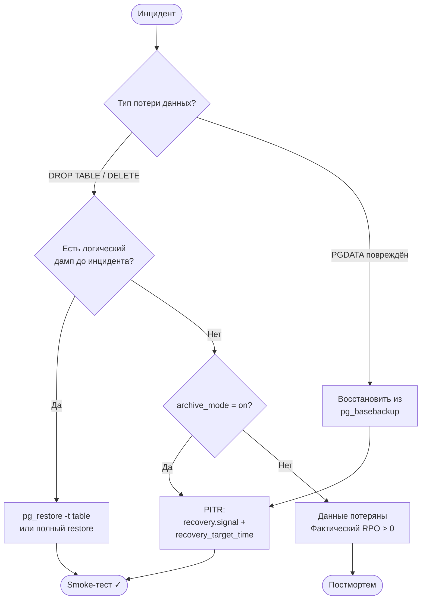

# Лабораторная работа №4
## Восстановление базы eshop. PITR. Failover Runbook

**Неделя:** 6  
**Ориентировочное время:** 2 занятия (≈ 4 ак. ч.)

---

## Цель работы

- Выполнить выборочное и полное восстановление базы из логического дампа.
- Симулировать PITR: восстановление на момент до «случайного» DROP TABLE.
- Составить Failover Runbook для базы `eshop`.

---

## Предварительные требования

- Завершена лаб. 03: дампы и WAL-архив настроены, база `eshop` содержит 3 заказа и 4 позиции.
- Прочитана [Лек. 06 — Восстановление, PITR, Failover](../../lectures/lec_06/lec_06.md).
- Все окна DBeaver/psql, подключённые к `eshop`, закрыты перед шагами, где база пересоздаётся.

> **`\c` — метакоманда psql.** В DBeaver она не работает. Если вы используете DBeaver, переключайтесь на нужную базу через отдельное соединение, а не командой `\c`.

> **Командная строка (PowerShell).** Задайте переменную пути один раз на сеанс:
> ```powershell
> $pg = "C:\Program Files\PostgreSQL\18\bin"
> ```
> Команды `pg_restore`, `createdb`, `dropdb`, `psql` в этой работе запускаются через PowerShell.

---

## Часть 1. Восстановление из логического дампа

### 1.1. Симулировать катастрофу

```sql
-- Подключиться к eshop под postgres
\c eshop

-- «Случайно» удалить таблицу
DROP TABLE order_items;

-- Проверить
\dt
-- order_items — исчезла
```

### 1.2. Выборочное восстановление одной таблицы

```powershell
# Восстановить только order_items из custom-дампа
& "$pg\pg_restore.exe" -h localhost -U postgres -d eshop -t order_items C:\backup\eshop\<имя_вашего_дампа>.dump
```

```sql
-- Проверить
SELECT COUNT(*) FROM order_items;    -- должно вернуть 4
```

> **Ограничение `-t`.** Флаг восстанавливает таблицу и данные, но **не** восстанавливает первичный ключ, индексы, внешние ключи, триггеры и `DEFAULT`/последовательность. `COUNT(*)` будет верным, а следующий `INSERT` без `id` — упадёт. Полное восстановление одной таблицы со всеми объектами — через оглавление дампа (`pg_restore -L`), см. лекцию 6. В этой работе состояние `eshop` полностью восстанавливается в п. 3.5.

### 1.3. Полное восстановление в новую базу

```powershell
# Создать тестовую базу-приёмник
& "$pg\createdb.exe" -h localhost -U postgres eshop_restore_test

# Восстановить полностью
& "$pg\pg_restore.exe" -h localhost -U postgres -d eshop_restore_test -Fc C:\backup\eshop\<имя_вашего_дампа>.dump --verbose
```

```sql
-- Подключиться к eshop_restore_test и проверить
\c eshop_restore_test
SELECT COUNT(*) FROM customers;     -- 3
SELECT COUNT(*) FROM orders;        -- 3
SELECT COUNT(*) FROM order_items;   -- 4
```

### 1.4. Типичные ошибки и решения

```powershell
# Ошибка: "role does not exist"
# Решение: сначала восстановить глобальные объекты
& "$pg\psql.exe" -h localhost -U postgres -f C:\backup\eshop\globals.sql

# Ошибка: "database already exists"
# Решение: пересоздать базу
& "$pg\dropdb.exe"     -h localhost -U postgres eshop_restore_test
& "$pg\createdb.exe"   -h localhost -U postgres eshop_restore_test
& "$pg\pg_restore.exe" -h localhost -U postgres -d eshop_restore_test -Fc C:\backup\eshop\<имя_вашего_дампа>.dump
```

---

## Часть 2. Дерево решений для восстановления



---

## Часть 3. Симуляция восстановления на момент времени (учебная)

> **Важно.** Это упрощённая симуляция: мы восстанавливаемся из логического дампа, а не применяем WAL. Настоящий PITR требует `pg_basebackup` + WAL-архив и выполняется на отдельном экземпляре (п. 3.4). Цель части — понять, как выбрать момент до ошибки и как действовать, не откатывая production.

### 3.1. Зафиксировать «точку до катастрофы»

```sql
\c eshop
-- Запомнить текущее время
SELECT now() AS safe_point;
-- Например: 2024-09-01 15:30:00+03
```

### 3.2. Выполнить «деструктивную миграцию»

```sql
-- Симулировать плохую миграцию
DELETE FROM order_items;
DELETE FROM orders;
-- Зафиксировать время после катастрофы
SELECT now() AS disaster_time;
```

### 3.3. Восстановление из дампа

> Дамп из лаб. 03 снят **до** `DELETE`. Поэтому восстановление вернёт состояние на момент дампа, а не ровно на `safe_point`. Это и есть фактический RPO логического бэкапа: всё, что изменилось после дампа, потеряно.

```sql
-- Пересоздать тестовую базу-приёмник
\c postgres
DROP DATABASE IF EXISTS eshop_restore_test;
CREATE DATABASE eshop_restore_test;
```

```powershell
& "$pg\pg_restore.exe" -h localhost -U postgres -d eshop_restore_test -Fc C:\backup\eshop\<имя_вашего_дампа>.dump
```

```sql
\c eshop_restore_test
SELECT COUNT(*) FROM orders;        -- 3 — состояние на момент дампа
-- Сравните с safe_point и disaster_time: что именно потеряно?
```

### 3.4. Процедура настоящего PITR (описательно)

Настоящий PITR выполняют **на отдельном экземпляре**, а не на работающем production:

```text
1. Развернуть pg_basebackup в отдельный каталог (например, C:\pitr\data).
2. Создать файл recovery.signal в этом каталоге.
3. В postgresql.auto.conf добавить:
   port = 5433
   archive_mode = off
   restore_command = 'copy "C:\\backup\\eshop\\wal_archive\\%f" "%p"'
   recovery_target_time = '<время до ошибки>+03'
   recovery_target_action = 'pause'
4. Запустить экземпляр: pg_ctl -D C:\pitr\data start
5. Дождаться сообщения о достижении цели; экземпляр доступен только для чтения.
6. Проверить данные: SELECT count(*) FROM orders;
7. Если данные верны:
   - перенести нужные строки в production; или
   - выполнить SELECT pg_wal_replay_resume(), если этот экземпляр станет рабочим.
8. Остановить временный экземпляр.
```

> **Почему `pause`, а не `promote`.** `pause` останавливает recovery на цели и позволяет проверить данные. `promote` сразу переводит экземпляр в рабочий режим и начинает новую timeline — путь назад к другой точке восстановления закрывается.
>
> **Почему `archive_mode = off`.** Иначе временный экземпляр запишет WAL новой timeline в боевой архив.

Убедитесь, что `archive_mode` был включён **до** катастрофы: без архива WAL PITR невозможен.

### 3.5. Вернуть `eshop` в исходное состояние

После деструктивной симуляции в `eshop` удалены заказы. Чтобы следующая лабораторная работа (мониторинг) шла на ожидаемых данных, восстановите базу полностью из **custom-дампа** (`-Fc`) лаб. 03:

```powershell
# Закройте все окна DBeaver/psql, подключённые к eshop
& "$pg\dropdb.exe"   -h localhost -U postgres eshop
& "$pg\createdb.exe" -h localhost -U postgres eshop
& "$pg\pg_restore.exe" -h localhost -U postgres -d eshop -Fc C:\backup\eshop\<имя_вашего_дампа>.dump
```

```sql
-- Проверить
\c eshop
SELECT (SELECT count(*) FROM customers)   AS customers,    -- 3
       (SELECT count(*) FROM orders)      AS orders,       -- 3
       (SELECT count(*) FROM order_items) AS order_items;  -- 4
\d order_items
-- Убедиться, что PK, FK и индексы на месте
```

> Если `dropdb` сообщает «database is being accessed by other users», закройте соединения DBeaver и повторите. Это же правило пригодится в реальной эксплуатации.

---

## Часть 4. Failover Runbook: роль аналитика

DBA пишет и исполняет технические шаги runbook. Задача аналитика — **проверить, что runbook полный**, заполнить контактный блок и понимать, какие шаги требуют его участия (смоук-тест приложения, коммуникация с бизнесом).

### 4.1. Изучить готовый шаблон runbook

Создайте файл `C:\backup\eshop\failover_runbook.md` с содержимым:

```markdown
## Failover Runbook: eshop production

### Контакты
| Роль              | Имя | Телефон/Telegram |
|-------------------|-----|------------------|
| DBA on-call       |     |                  |
| Разработчик       |     |                  |
| Аналитик (вы)     |     |                  |
| Руководитель      |     |                  |

> Заполните таблицу — в реальном инциденте на поиск контакта нет времени.

### Признаки отказа (кто что замечает)

| Признак                                          | Кто первый видит     |
|--------------------------------------------------|----------------------|
| Приложение выдаёт "connection refused" или "FATAL" | Мониторинг / DevOps |
| Пользователи жалуются: «не могу войти»           | Аналитик             |
| PostgreSQL не отвечает на порту 5432             | DBA                  |
| Отчёт пустой или данные устарели                 | Аналитик             |

### Сценарий A: Повреждение данных (DROP TABLE / плохой UPDATE)

#### Шаги DBA (информационно — понять, что делает DBA):
1. Зафиксировать точное время инцидента.
2. Проверить: есть ли pg_dump до инцидента? → да → `pg_restore -t <table>`
3. Если дампа нет, есть WAL-архив → PITR: `recovery_target_time = '<время>'`
4. После восстановления: `SELECT COUNT(*) FROM orders;` — проверить количество строк.
5. `flyway info` — если Flyway уже внедрён (лаб. 09), убедиться, что статус миграций корректен.

#### Шаги аналитика (выполняете вы):
- [ ] Сообщить пользователям: «Ведутся технические работы, ориентировочное время — [N] минут».
- [ ] После восстановления: запустить smoke-тест — войти в приложение, создать тестовый заказ, проверить отчёт.
- [ ] Зафиксировать фактические потери данных (сколько транзакций утеряно).

### Сценарий B: Отказ сервера

#### Шаги DBA (информационно):
1. Попытаться перезапустить: `pg_ctl start`; проверить логи.
2. Если PGDATA недоступен → восстановить из `pg_basebackup`.
3. Применить WAL-архив → `recovery_target_time = <время>` → запустить PG.
4. Проверить: `SELECT pg_last_xact_replay_timestamp();`

#### Шаги аналитика (выполняете вы):
- [ ] Коммуникация с бизнесом: эскалация, обновление статуса каждые 15 минут.
- [ ] Подготовить список затронутых операций для постмортема.
- [ ] Smoke-тест после восстановления.

### После восстановления
- Зафиксировать: время начала, время конца, фактическое RPO (потери данных).
- Постмортем в течение 24 часов.
- Обновить контакты и признаки отказа в этом runbook.
```

### 4.2. Контрольные вопросы к runbook

Разберите эти вопросы письменно в конце runbook (раздел «Вопросы аналитика к DBA»):

1. Как я узнаю, что восстановление завершено и данные целостны?
2. На каком этапе я могу сообщить пользователям, что система работает?
3. Какие данные могут быть потеряны при PITR? Как об этом сообщить бизнесу?
4. Как часто проводится тестовое восстановление из бэкапа (backup drill)? Кто участвует?

---

## Часть 5. Проверка стратегии восстановления

Ответьте на вопросы (письменно, в конце runbook):

| Сценарий                                 | Ваш метод восстановления   | Ожидаемое RTO   |
| ---------------------------------------- | -------------------------- | --------------- |
| Удалена одна таблица (`DROP TABLE`)      | ?                          | ?               |
| Удалены все строки (`DELETE FROM ...`)   | ?                          | ?               |
| Отказ диска (PGDATA недоступен)          | ?                          | ?               |
| Плохая миграция 2 часа назад             | ?                          | ?               |

---

## Чек-лист «работа зачтена»

- [ ] `order_items` восстановлена выборочно из дампа: COUNT(*) = 4.
- [ ] `eshop_restore_test` создана, полное восстановление выполнено, данные совпадают.
- [ ] `eshop` возвращена в исходное состояние (3 заказа, 4 позиции, PK/FK на месте).
- [ ] `failover_runbook.md` создан: контактная таблица заполнена, разделы «шаги аналитика» содержат чек-листы.
- [ ] Контрольные вопросы (4.2) разобраны письменно в разделе «Вопросы аналитика к DBA».
- [ ] Таблица сценариев (часть 5) заполнена.

---

## Самостоятельное задание

1. Добавьте в `eshop` 100 случайных заказов:
   ```sql
   INSERT INTO orders (customer_id, status, total_amount)
   SELECT (random()*2+1)::int, 'pending', random()*5000
   FROM   generate_series(1, 100);
   ```
2. Создайте новый дамп.
3. «Случайно» удалите все заказы со статусом `pending`.
4. Восстановите только эти заказы из дампа (подсказка: `pg_restore --data-only -t orders`).

---

## Ссылки

- pg_restore: https://www.postgresql.org/docs/current/app-pgrestore.html
- PITR: https://www.postgresql.org/docs/current/continuous-archiving.html#BACKUP-PITR-RECOVERY
- recovery.signal: https://www.postgresql.org/docs/current/recovery-config.html
