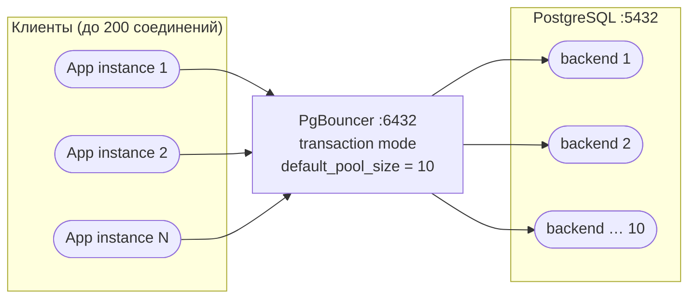

# Лабораторная работа №7
## Индексы, autovacuum, PgBouncer для eshop
 
**Неделя:** 9  
**Ориентировочное время:** 2 занятия (≈ 4 ак. ч.)  
**Среда:** Windows, PowerShell, PostgreSQL 18, DBeaver / psql
 
---
 
## Цель работы
 
- Создавать частичные, составные и функциональные индексы под конкретные запросы.
- Контролировать autovacuum и настраивать его для активных таблиц.
- Установить и настроить PgBouncer, переключить подключение на пул соединений.
---
 
## Предварительные требования
 
- Завершена лаб. 06: база наполнена (20 000 / 1 000 / 200 000 / 600 000 строк), индексы из п. 2.4 созданы, `pg_stat_statements` подключён.
- Прочитана лек. 09.
- Роль `app_backend` из лаб. 02 существует (пароль `backend_pass_2024`), через роль `eshop_app` у неё есть `SELECT` на `orders`.
- Работа выполняется под `postgres` в базе `eshop` (часть 3 — под `app_backend`).
> **DBeaver.** Все шаги частей 1–2 выполняйте в режиме **auto-commit**.
> `CREATE INDEX CONCURRENTLY` и `VACUUM` не работают внутри транзакции.
>
> **psql в PowerShell.** Каталог `bin` PostgreSQL обычно не добавлен в `PATH`. Задайте переменную один раз на сеанс:
>
> ```powershell
> $pg = "C:\Program Files\PostgreSQL\18\bin"
> & "$pg\psql.exe" --version
> ```
 
---
 
## Часть 0. Подготовка данных
 
### 0.1. Проверить исходное состояние
 
```sql
SELECT (SELECT count(*) FROM customers)   AS customers,     -- 20 000
       (SELECT count(*) FROM products)    AS products,      --  1 000
       (SELECT count(*) FROM orders)      AS orders,        -- 200 000
       (SELECT count(*) FROM order_items) AS order_items;   -- 600 000
```
 
Если значения меньше — выполните скрипт наполнения из лаб. 06 («Наполнение базы тестовыми данными»).
 
```sql
SELECT tablename, indexname, indexdef
FROM   pg_indexes
WHERE  schemaname = 'public'
  AND  tablename IN ('orders', 'order_items', 'customers', 'products')
ORDER  BY 1, 2;
```
 
Ожидаемо: ключи (`*_pkey`, `customers_email_key`) и индексы из лаб. 06, п. 2.4:
`idx_customers_region`, `idx_orders_created_at`, `idx_orders_customer_id`, `idx_order_items_order`. Их **не удаляйте**.
 
Если есть индекс по `orders(status)` (самостоятельное задание 3 лаб. 06), удалите его: иначе в шаге 1.1 не будет Seq Scan.
 
```sql
DROP INDEX IF EXISTS <имя_индекса_по_status>;
```
 
### 0.2. Реалистичное распределение статусов
 
В лаб. 06 статусы распределены поровну, по 20 %. На 20 % строк индекс по `status` не помогает — это вывод самостоятельного задания 3 лаб. 06.
В реальном магазине активных заказов мало, а доставленных большинство. Перераспределите статусы (скрипт целиком, `Alt+X`):
 
```sql
SELECT setseed(0.42);   -- одинаковые данные у всех студентов
 
UPDATE orders o
SET    status = CASE
                    WHEN g.r < 0.02 THEN 'pending'      --  2 %
                    WHEN g.r < 0.05 THEN 'processing'   --  3 %
                    WHEN g.r < 0.10 THEN 'shipped'      --  5 %
                    WHEN g.r < 0.95 THEN 'delivered'    -- 85 %
                    ELSE                 'cancelled'    --  5 %
                END
FROM   (SELECT id, random() AS r FROM orders) AS g
WHERE  g.id = o.id;
 
VACUUM ANALYZE orders;   -- UPDATE оставил 200 000 мёртвых версий строк; ANALYZE обновляет статистику
 
SELECT status, count(*) FROM orders GROUP BY status ORDER BY 2 DESC;
```
 
Ожидаемо: `delivered` ≈ 170 000, `shipped` и `cancelled` ≈ 10 000, `processing` ≈ 6 000, `pending` ≈ 4 000.
 
> `random()` вычисляется один раз на строку в подзапросе `g`, поэтому все ветки `CASE` сравнивают одно и то же значение.
 
---
 
## Часть 1. Индексы
 
> В PostgreSQL 18 `EXPLAIN ANALYZE` выводит `Buffers` по умолчанию. Параметр `BUFFERS` оставлен для совместимости с PG 16–17.
>
> Сравнивайте не только `actual time`, но и `Buffers: shared hit/read`. Время зависит от кэша и колеблется между запусками,
> а количество прочитанных страниц стабильно.
 
### 1.1. Запрос без индекса
 
```sql
EXPLAIN (ANALYZE, BUFFERS)
SELECT * FROM orders WHERE status = 'pending';
```
 
Запишите: тип узла = ___, `actual time` = ___ ms, `Buffers: shared hit` = ___
 
Ожидаемо: `Seq Scan` или `Parallel Seq Scan` с `Rows Removed by Filter` ≈ 196 000 — прочитана вся таблица ради 2 % строк.
 
### 1.2. Обычный B-tree индекс
 
```sql
CREATE INDEX idx_orders_status ON orders(status);
 
EXPLAIN (ANALYZE, BUFFERS)
SELECT * FROM orders WHERE status = 'pending';
 
SELECT pg_size_pretty(pg_relation_size('idx_orders_status')) AS size_full;
```
 
Тип узла теперь: ___, `actual time` = ___ ms, Buffers = ___. Размер индекса: ___
 
Скорее всего, вы увидите **Bitmap Heap Scan** с вложенным **Bitmap Index Scan**, а не Index Scan:
 
| Узел              | Когда выбирается                                                         |
|-------------------|--------------------------------------------------------------------------|
| Seq Scan          | Нужна большая доля строк таблицы                                         |
| Bitmap Heap Scan  | Строк сотни–тысячи: индекс собирает карту страниц, потом страницы читаются по порядку |
| Index Scan        | Строк мало, или нужен порядок индекса (`ORDER BY … LIMIT`)                |
| Index Only Scan   | Все нужные столбцы есть в индексе, страницы таблицы читать не нужно      |
 
### 1.3. Частичный индекс
 
Активные заказы (`pending`, `processing`) — самая частая выборка, но их всего 5 %.
Частичный индекс хранит только эти строки, поэтому он меньше:
 
```sql
DROP INDEX idx_orders_status;
 
CREATE INDEX idx_orders_active ON orders(status)
    WHERE status IN ('pending', 'processing');
 
SELECT pg_size_pretty(pg_relation_size('idx_orders_active')) AS size_partial;
 
EXPLAIN (ANALYZE, BUFFERS)
SELECT * FROM orders WHERE status = 'pending';
-- Планировщик доказывает, что status = 'pending' входит в условие индекса, и использует его
 
EXPLAIN (ANALYZE, BUFFERS)
SELECT * FROM orders WHERE status = 'delivered';
-- Seq Scan: 'delivered' не входит в частичный индекс, и это 85 % таблицы
```
 
Размер полного индекса: ___, частичного: ___. Во сколько раз меньше: ___
 
> Частичный индекс используется, только если условие запроса **логически входит** в условие индекса.
> Для `WHERE status = $1` с параметром, который неизвестен при планировании, он может не использоваться.
 
### 1.4. Составной индекс: порядок столбцов
 
Типичный запрос менеджера: новые заказы за последние 30 дней.
Условие на `status` — равенство (≈ 2 % строк), на `created_at` — диапазон (≈ 4 % строк). Вместе — ≈ 0,1 %, около 160 заказов.
 
**До составного индекса** (работают `idx_orders_created_at` из лаб. 06 и `idx_orders_active` из 1.3):
 
```sql
EXPLAIN (ANALYZE, BUFFERS)
SELECT * FROM orders
WHERE  status = 'pending'
  AND  created_at >= now() - INTERVAL '30 days';
```
 
Запишите план. Возможен `BitmapAnd`: планировщик объединяет два индекса, каждый из которых возвращает тысячи строк.
 
**Составной индекс (равенство первым, диапазон вторым):**
 
```sql
CREATE INDEX idx_orders_status_created ON orders(status, created_at);
 
EXPLAIN (ANALYZE, BUFFERS)
SELECT * FROM orders
WHERE  status = 'pending'
  AND  created_at >= now() - INTERVAL '30 days';
```
 
| Вариант | Узел и индекс | Buffers (hit + read) | Execution Time, мс |
|---------|---------------|----------------------|--------------------|
| До: одностолбцовые индексы |  |  |  |
| После: `(status, created_at)` |  |  |  |
 
Правило: **сначала столбцы с равенством, потом столбец с диапазоном**.
В индексе `(status, created_at)` записи `pending` за 30 дней лежат подряд: индекс читает ≈ 160 записей.
 
**Проверка правила (опционально).** Создайте индекс с обратным порядком и повторите запрос:
 
```sql
CREATE INDEX idx_orders_created_status ON orders(created_at, status);
EXPLAIN (ANALYZE, BUFFERS) SELECT * FROM orders
WHERE status = 'pending' AND created_at >= now() - INTERVAL '30 days';
DROP INDEX idx_orders_created_status;
```
 
Индекс `(created_at, status)` просматривает все ≈ 8 000 заказов за 30 дней и отбрасывает остальные статусы.
Если планировщик его не выбрал — это тоже ответ: он оценил этот индекс дороже, чем `(status, created_at)`.
 
### 1.5. CREATE INDEX CONCURRENTLY (безопасное создание в production)
 
Обычный `CREATE INDEX` берёт блокировку `SHARE`: чтение работает, запись в таблицу ждёт до конца построения.
`CONCURRENTLY` не блокирует запись, но работает дольше: таблица читается дважды, и команда ждёт завершения текущих транзакций.
Внутри транзакции команда не выполняется.
 
В лаб. 06 (самостоятельное задание 4) найден внешний ключ без индекса: `order_items.product_id`.
Таблица `order_items` — самая большая в базе (600 000 строк). Создайте индекс без блокировки записи:
 
```sql
CREATE INDEX CONCURRENTLY idx_order_items_product ON order_items(product_id);
```
 
Проверить, что индекс корректный:
 
```sql
SELECT c.relname AS index_name,
       i.indisvalid,      -- false = индекс не используется планировщиком
       i.indisready
FROM   pg_index i
JOIN   pg_class c ON c.oid = i.indexrelid
WHERE  i.indrelid = 'order_items'::regclass
ORDER  BY 1;
```
 
Если `indisvalid = false` (построение прервалось), индекс нужно удалить и создать заново:
 
```sql
DROP INDEX CONCURRENTLY idx_order_items_product;
```
 
Запрос, которому помогает этот индекс, — продажи одного товара:
 
```sql
EXPLAIN (ANALYZE, BUFFERS)
SELECT count(*), sum(quantity) FROM order_items WHERE product_id = 42;
-- До индекса: Parallel Seq Scan по 600 000 строк. После: Bitmap Heap Scan по ≈ 600 строкам
```
 
### 1.6. Функциональный индекс (индекс по выражению)
 
Индекс по `email` не помогает запросу `WHERE LOWER(email) = …`: в индексе лежат исходные значения, а не результат `LOWER`.
Нужен индекс по **выражению**:
 
Пользователь ввёл email с заглавными буквами: `C42@Example.com`. В базе хранится `c42@example.com`.
 
```sql
-- Без индекса по выражению: индекс customers_email_key не подходит
EXPLAIN (ANALYZE, BUFFERS)
SELECT * FROM customers WHERE LOWER(email) = LOWER('C42@Example.com');
 
CREATE INDEX idx_customers_email_lower ON customers(LOWER(email));
ANALYZE customers;   -- собрать статистику по выражению
 
-- С индексом по выражению
EXPLAIN (ANALYZE, BUFFERS)
SELECT * FROM customers WHERE LOWER(email) = LOWER('C42@Example.com');
 
-- Поиск без LOWER
EXPLAIN (ANALYZE, BUFFERS)
SELECT * FROM customers WHERE email = 'C42@Example.com';
```
 
| Запрос | Узел и индекс | Строк найдено |
|--------|---------------|---------------|
| `LOWER(email) = …` без индекса по выражению |  |  |
| `LOWER(email) = …` с индексом по выражению |  |  |
| `email = …` |  |  |
 
Ожидаемо:
 
- запрос 1 — `Seq Scan` по 20 000 строк, найдена 1 строка;
- запрос 2 — `Index Scan using idx_customers_email_lower`, найдена 1 строка;
- запрос 3 — `Index Scan using customers_email_key`, найдено **0 строк**: регистр не совпадает.
  Индекс по `LOWER(email)` этому запросу не подходит.
> **Когда применять:** условие `WHERE` содержит функцию над столбцом: `LOWER`, `DATE_TRUNC`, `jsonb->>'key'` и т. п.
> Выражение в запросе должно **точно совпадать** с выражением в индексе.
> Выражение с оператором берут в двойные скобки: `CREATE INDEX ON t ((data->>'key'));`
 
### 1.7. Неиспользуемые индексы
 
```sql
SELECT s.relname      AS table_name,
       s.indexrelname AS index_name,
       pg_size_pretty(pg_relation_size(s.indexrelid)) AS index_size,
       s.idx_scan
FROM   pg_stat_user_indexes s
JOIN   pg_index i ON i.indexrelid = s.indexrelid
WHERE  s.idx_scan = 0
  AND  NOT i.indisunique                                          -- PK и UNIQUE нужны для ограничений
  AND  NOT EXISTS (SELECT 1 FROM pg_constraint c WHERE c.conindid = s.indexrelid)
ORDER  BY pg_relation_size(s.indexrelid) DESC;
```
 
Запишите найденные индексы: ___
 
> **Осторожно:** индексы, созданные в этой лабе, будут иметь `idx_scan = 0`, пока их не использует запрос.
> На production решение об удалении принимают по статистике за несколько недель, включая отчётные дни.
 
---
 
## Часть 2. Autovacuum
 
Autovacuum запускает очистку таблицы, когда мёртвых строк больше порога:
 
```
порог = autovacuum_vacuum_threshold + autovacuum_vacuum_scale_factor × reltuples
      = 50 + 0.2 × reltuples   (по умолчанию)
```
 
Для `orders` (200 000 строк) это ~40 000 мёртвых строк. Для активной таблицы это слишком поздно.
 
### 2.1. Текущий порог и проверка
 
```sql
SELECT s.n_live_tup,
       s.n_dead_tup,
       round(50 + 0.2  * c.reltuples) AS threshold_default,
       round(50 + 0.01 * c.reltuples) AS threshold_tuned,
       s.autovacuum_count,
       s.last_autovacuum
FROM   pg_stat_user_tables s
JOIN   pg_class c ON c.oid = s.relid
WHERE  s.relname = 'orders';
```
 
Запишите `autovacuum_count` = ___ и `threshold_default` = ___
 
> Autovacuum мог уже срабатывать на этой таблице раньше (после наполнения в лаб. 06 или UPDATE в части 0).
> Поэтому следите за ростом `autovacuum_count`, а не за `last_autovacuum`.
> Ручной `VACUUM` из части 0 увеличивает `vacuum_count`, а не `autovacuum_count`.
 
Создайте ~1000 мёртвых строк:
 
```sql
-- Обновляется индексированный столбец, поэтому UPDATE не HOT и оставляет мёртвую версию
UPDATE orders SET created_at = created_at + INTERVAL '1 second'
WHERE  id % 200 = 0;
```
 
Подождите 2 минуты (`autovacuum_naptime` = 1 мин) и повторите запрос 2.1.
 
Результат: `n_dead_tup` ≈ 1000, `autovacuum_count` **не изменился** — порог ~40 000 не достигнут.
 
> `n_dead_tup` может оказаться немного меньше числа обновлённых строк:
> PostgreSQL очищает часть мёртвых версий «по ходу» при чтении страниц (pruning).
 
### 2.2. Настройка autovacuum для таблицы
 
Снизьте порог для активной таблицы:
 
```sql
ALTER TABLE orders SET (
    autovacuum_vacuum_scale_factor  = 0.01,   -- 1 % вместо 20 %
    autovacuum_analyze_scale_factor = 0.005   -- 0.5 % вместо 10 %
);
 
SELECT relname, reloptions FROM pg_class WHERE relname = 'orders';
```
 
Порог теперь ~2050. Создайте ещё ~4000 мёртвых строк:
 
```sql
UPDATE orders SET created_at = created_at + INTERVAL '1 second'
WHERE  id % 50 = 0;
```
 
Подождите 1–2 минуты. Можно наблюдать за работой autovacuum:
 
```sql
SELECT pid, relid::regclass AS table_name, phase
FROM   pg_stat_progress_vacuum;
```
 
Повторите запрос 2.1. Ожидаемо: `autovacuum_count` вырос на 1, `n_dead_tup` упал почти до 0.
 
| Момент | n_dead_tup | autovacuum_count |
|--------|------------|------------------|
| До обновлений |  |  |
| После 1000 обновлений (порог 20 % ≈ 40 000) |  |  |
| После ещё 4000 обновлений (порог 1 % ≈ 2050) |  |  |
 
### 2.3. Ручной VACUUM ANALYZE
 
```sql
VACUUM (ANALYZE, VERBOSE) orders;
```
 
Для всей базы — утилита `vacuumdb` (PowerShell):
 
```powershell
& "$pg\vacuumdb.exe" -h localhost -U postgres -d eshop --analyze --verbose
```
 
---
 
## Часть 3. PgBouncer
 
> **Подготовка преподавателя.** Проверьте установку PgBouncer на учебном компьютере **до занятия**.
> Нужны права администратора Windows и доступ в интернет.
 
### 3.1. Установка
 
**Основной способ — Stack Builder (сборка EDB):**
 
1. Пуск → PostgreSQL 18 → **Application Stack Builder** (от имени администратора).
2. Выберите сервер `PostgreSQL 18 on port 5432`.
3. Раздел **Add-ons, tools and utilities** → **pgBouncer**.
4. В мастере укажите: хост `localhost`, роль `postgres`, её пароль, порт PostgreSQL `5432`, порт PgBouncer `6432`.
Если в Stack Builder нет пакета для PG 18, скачайте установщик EDB PgBouncer с сайта EnterpriseDB и запустите его от имени администратора.
 
Найдите файлы конфигурации и службу:
 
```powershell
Get-ChildItem "C:\Program Files", "C:\Program Files (x86)" -Recurse -Filter pgbouncer.ini `
    -ErrorAction SilentlyContinue | Select-Object FullName
 
Get-Service *bouncer*
```
 
Запишите: путь к `pgbouncer.ini` = ___, имя службы = ___
 
### 3.2. Настройка pgbouncer.ini
 
Откройте `pgbouncer.ini` в редакторе **от имени администратора**.
Установщик уже записал пути к лог-файлу и рабочему каталогу — их не меняйте. Задайте или измените параметры:
 
```ini
[databases]
eshop = host=127.0.0.1 port=5432 dbname=eshop
 
[pgbouncer]
listen_addr          = 127.0.0.1
listen_port          = 6432
auth_type            = scram-sha-256
; полный путь к userlist.txt рядом с pgbouncer.ini
auth_file            = <каталог pgbouncer.ini>\userlist.txt
 
pool_mode            = transaction
max_client_conn      = 200
default_pool_size    = 10
min_pool_size        = 2
reserve_pool_size    = 5
reserve_pool_timeout = 5
 
; DBeaver (JDBC) при подключении передаёт этот параметр.
; Без строки ниже PgBouncer отклоняет подключение: unsupported startup parameter
ignore_startup_parameters = extra_float_digits
 
; Подготовленные запросы на уровне протокола (драйверы JDBC, Npgsql); по умолчанию 200 с PgBouncer 1.24
max_prepared_statements = 200
 
log_connections      = 1
log_disconnections   = 1
 
; Административная консоль
admin_users          = pgbouncer_admin
```
 
> Параметр `pidfile` и ключ запуска `-d` на Windows не используются: PgBouncer работает как служба.
 
### 3.3. Файл пользователей userlist.txt
 
Получите SCRAM-хэш пароля `app_backend` (под `postgres`, в DBeaver или psql):
 
```sql
SELECT format('"%s" "%s"', rolname, rolpassword) AS userlist_line
FROM   pg_authid
WHERE  rolname = 'app_backend';
```
 
Строка должна начинаться так: `"app_backend" "SCRAM-SHA-256$4096:…"`.
Если хэш начинается с `md5`, пароль задан в старом формате. Задайте пароль заново: `ALTER ROLE app_backend PASSWORD '…';`
 
Создайте `userlist.txt` в каталоге `pgbouncer.ini` (PowerShell от имени администратора):
 
```powershell
$dir = "<каталог pgbouncer.ini>"
@(
    '"app_backend" "SCRAM-SHA-256$4096:...вставьте строку целиком..."'
    '"pgbouncer_admin" "admin_pass"'
) | Set-Content -Path "$dir\userlist.txt" -Encoding ascii
```
 
> **Кодировка.** В Windows PowerShell 5.1 `-Encoding utf8` записывает метку BOM в начало файла.
> PgBouncer не распознаёт первую строку с BOM, и пользователь `app_backend` «не существует».
> Используйте `-Encoding ascii` или Блокнот (UTF-8 без BOM).
>
> Строку с хэшем берите в **одинарные** кавычки: в двойных PowerShell подставит переменные вместо `$4096` и т. п.
 
Пароль `pgbouncer_admin` хранится открытым текстом. Это допустимо только в учебной среде.
 
Перезапустите службу:
 
```powershell
Restart-Service <имя службы из 3.1>
Get-Service <имя службы из 3.1>     # Status = Running
```
 
Если служба не запустилась, смотрите лог-файл PgBouncer (путь `logfile` в `pgbouncer.ini`).
 
### 3.4. Архитектура
 

 
### 3.5. Подключение и административная консоль
 
```powershell
# Подключение через PgBouncer: порт 6432 вместо 5432
& "$pg\psql.exe" -h 127.0.0.1 -p 6432 -U app_backend -d eshop -c "SELECT count(*) FROM orders;"
```
 
Откройте **окно A** — интерактивный сеанс через PgBouncer. Оставьте его открытым:
 
```powershell
& "$pg\psql.exe" -h 127.0.0.1 -p 6432 -U app_backend -d eshop
```
 
В **окне Б** откройте административную консоль. Используйте psql: DBeaver к консоли PgBouncer не подключается.
 
```powershell
& "$pg\psql.exe" -h 127.0.0.1 -p 6432 -U pgbouncer_admin -d pgbouncer
```
 
```sql
SHOW POOLS;     -- пул eshop/app_backend: cl_active = 1 (окно A), sv_idle / sv_active
SHOW CLIENTS;
SHOW SERVERS;
SHOW STATS;
```
 
Запишите из `SHOW POOLS`: `cl_active` = ___, `sv_active` + `sv_idle` = ___
 
> Сеанс `psql -c` закрывается сразу после запроса, поэтому в `SHOW POOLS` он не виден.
> Для `cl_active > 0` нужен открытый сеанс (окно A).
 
Подключение из DBeaver: создайте копию подключения к `eshop` с портом **6432** и пользователем `app_backend`.
 
### 3.6. Нагрузочный тест: 50 клиентов → 10 соединений
 
Создайте сценарий для `pgbench` и запустите 50 клиентов через PgBouncer на 30 секунд:
 
```powershell
Set-Content -Path "$env:TEMP\select.sql" -Encoding ascii `
    -Value "SELECT count(*) FROM orders WHERE status = 'pending';"
 
$env:PGPASSWORD = "backend_pass_2024"   # пароль app_backend из лаб. 02
& "$pg\pgbench.exe" -h 127.0.0.1 -p 6432 -U app_backend -d eshop `
    -n -c 50 -j 4 -T 30 -f "$env:TEMP\select.sql"
```
 
`-n` отключает VACUUM служебных таблиц pgbench: в `eshop` их нет.
 
**Пока тест идёт**, в DBeaver под `postgres` (порт 5432) выполните:
 
```sql
SELECT count(*) AS backends
FROM   pg_stat_activity
WHERE  usename = 'app_backend';
```
 
И в окне Б: `SHOW POOLS;` — смотрите `cl_active`, `cl_waiting`, `sv_active`.
 
Повторите тест **напрямую** в PostgreSQL (порт 5432) и снова посчитайте `backends`:
 
```powershell
& "$pg\pgbench.exe" -h 127.0.0.1 -p 5432 -U app_backend -d eshop `
    -n -c 50 -j 4 -T 30 -f "$env:TEMP\select.sql"
Remove-Item Env:PGPASSWORD
```
 
| Подключение | Клиентов | Backend-процессов PostgreSQL | tps | latency average, ms |
|-------------|----------|------------------------------|-----|---------------------|
| Через PgBouncer :6432 | 50 |  |  |  |
| Напрямую :5432        | 50 |  |  |  |
 
Через PgBouncer backend-процессов должно быть не больше 15 (`default_pool_size` 10 + `reserve_pool_size` 5).
 
### 3.7. Ограничения transaction mode
 
В transaction mode клиент получает серверное соединение только на время транзакции.
Следующая транзакция того же клиента может пойти через **другое** соединение.
 
Откройте окна A и Б — оба через PgBouncer (`-p 6432 -U app_backend`).
 
**Эксперимент 1. SET «утекает» к другому клиенту**
 
```sql
-- Окно A
SELECT pg_backend_pid();
SET work_mem = '64MB';
 
-- Окно Б
SELECT pg_backend_pid();   -- часто тот же PID, что в окне A
SHOW work_mem;             -- 64MB: настройку клиента A получил клиент Б
```
 
Причина: `SET` изменил параметр **серверного соединения**. Соединение вернулось в пул и досталось клиенту Б.
В transaction mode PgBouncer по умолчанию не сбрасывает параметры сеанса между клиентами.
 
Верните значение: `RESET ALL;`
 
> Если PID в окнах разные, повторите `SELECT pg_backend_pid();` и `SHOW work_mem;` в окне Б 2–3 раза.
 
**Эксперимент 2. SQL-команда PREPARE**
 
```sql
-- Окно A: подготовить запрос (транзакция закончилась, соединение вернулось в пул)
PREPARE q(int) AS SELECT id, status FROM orders WHERE id = $1;
 
-- Окно Б: занять это соединение открытой транзакцией
BEGIN;
SELECT pg_backend_pid();
 
-- Окно A: выполнить подготовленный запрос — он попадёт на другое соединение
EXECUTE q(1);
-- ERROR: prepared statement "q" does not exist
 
-- Окно Б
COMMIT;
```
 
> **Важно.** С PgBouncer 1.21 подготовленные запросы **на уровне протокола** (их отправляют драйверы JDBC, Npgsql, psycopg)
> работают в transaction mode, если `max_prepared_statements > 0`. SQL-команды `PREPARE` / `EXECUTE` по-прежнему не поддерживаются.
 
Также в transaction mode не работают: `LISTEN` / `NOTIFY`, временные таблицы, которые живут дольше транзакции,
сессионные advisory-блокировки (`pg_advisory_lock`).
 
---
 
## Часть 4. Обоснование архитектурного изменения
 
Составьте документ `pgbouncer_justification.md` на основе **своих** измерений из 3.6:
 
```markdown
## Обоснование введения PgBouncer для eshop
 
### Проблема
- 50 одновременных клиентов открывают 50 соединений к PostgreSQL (измерено: ___ backend-процессов).
- Каждое соединение — отдельный процесс Windows. Оценка: 5–10 МБ памяти на процесс.
  50 × ___ МБ = ___ МБ.
 
### Решение
- PgBouncer, pool_mode = transaction, default_pool_size = 10, reserve_pool_size = 5.
 
### Эффект (измерено pgbench, 50 клиентов, 30 с)
| Показатель                    | Напрямую :5432 | Через PgBouncer :6432 |
|-------------------------------|----------------|-----------------------|
| Backend-процессов PostgreSQL  |                |                       |
| tps                           |                |                       |
| Средняя задержка, мс          |                |                       |
 
### Ограничения
- SQL-команды PREPARE/EXECUTE не поддерживаются; подготовленные запросы драйверов — при max_prepared_statements > 0.
- SET действует на серверное соединение и может перейти к другому клиенту. Используйте SET LOCAL внутри транзакции.
- Не работают LISTEN/NOTIFY, сессионные advisory-блокировки, временные таблицы вне транзакции.
- Дополнительный компонент: нужен мониторинг (SHOW POOLS) и отказоустойчивость.
```
 
> Учебный тест с простым запросом может показать tps через PgBouncer **ниже**, чем напрямую: добавляется один сетевой переход.
> Выигрыш PgBouncer — в числе процессов и памяти, а на production — в защите от исчерпания `max_connections`.
> Запишите фактические числа и объясните их.
 
---
 
## Чек-лист «работа зачтена»
 
- [ ] Статусы перераспределены (`pending` ≈ 2 %), выполнен `VACUUM ANALYZE orders`.
- [ ] Частичный индекс `idx_orders_active` создан; его размер сравнён с полным; `EXPLAIN` для `'pending'` показывает `Bitmap Index Scan` или `Index Scan` по `idx_orders_active`.
- [ ] `idx_orders_status_created` создан; планы до и после сравнены по Buffers; объяснено правило порядка столбцов.
- [ ] `idx_order_items_product` создан через `CONCURRENTLY`, `indisvalid = true`.
- [ ] Показано, что `idx_customers_email_lower` используется только для `LOWER(email) = …`.
- [ ] `autovacuum_vacuum_scale_factor = 0.01` выставлен на `orders`; показан рост `autovacuum_count` после превышения нового порога.
- [ ] PgBouncer запущен на порту 6432; `SELECT count(*)` через 6432 работает.
- [ ] `SHOW POOLS` показывает пул `eshop` с `cl_active > 0`.
- [ ] Таблица из 3.6 заполнена; через PgBouncer backend-процессов ≤ 15.
- [ ] `pgbouncer_justification.md` создан с измеренными числами.
---
 
## Самостоятельное задание
 
1. Создайте функциональный индекс `ON products(LOWER(name))` и проверьте, что запрос
   `WHERE LOWER(name) = 'товар 42'` его использует. Таблица `products` маленькая (1000 строк), поэтому для проверки
   выполните запрос после `SET enable_seqscan = off;` и затем `RESET enable_seqscan;`.
   Объясните, почему без индекса по выражению индекс по `name` не может быть использован.
2. Переключите PgBouncer в режим `session` (`pool_mode = session`, перезапуск службы).
   Повторите эксперименты 1 и 2 из 3.7. Объясните, почему теперь `PREPARE` работает, а `SET` не переходит к другому клиенту.
   Повторите тест 3.6: сколько backend-процессов теперь и сколько клиентов ждут (`cl_waiting`)?
3. Сведите в таблицу режимы session / transaction / statement: когда соединение возвращается в пул,
   что работает, что не работает, типичное применение.
---
 
## Ссылки
 
- Индексы PostgreSQL: https://www.postgresql.org/docs/current/indexes.html
- Частичные индексы: https://www.postgresql.org/docs/current/indexes-partial.html
- Индексы по выражениям: https://www.postgresql.org/docs/current/indexes-expressional.html
- CREATE INDEX CONCURRENTLY: https://www.postgresql.org/docs/current/sql-createindex.html#SQL-CREATEINDEX-CONCURRENTLY
- Autovacuum: https://www.postgresql.org/docs/current/routine-vacuuming.html#AUTOVACUUM
- pgbench: https://www.postgresql.org/docs/current/pgbench.html
- PgBouncer, настройки: https://www.pgbouncer.org/config.html
- PgBouncer, ограничения режимов: https://www.pgbouncer.org/features.html
- EDB PgBouncer для Windows: https://www.enterprisedb.com/docs/pgbouncer/1/installing/windows/
