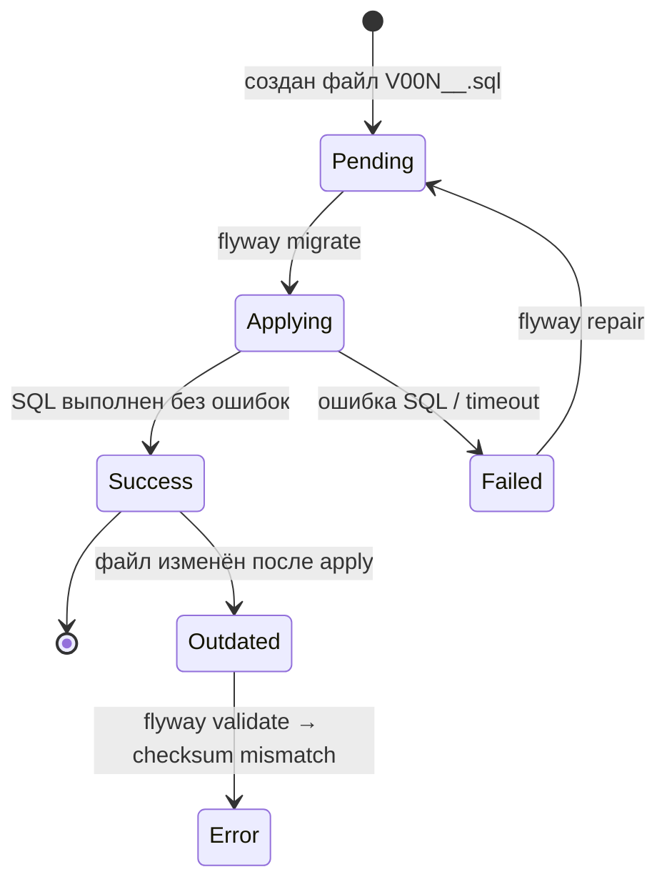

# Лабораторная работа №9
## Flyway: миграции схемы eshop. Migration Plan и Runbook

**Неделя:** 12  
**Ориентировочное время:** 2 занятия (≈ 4 ак. ч.)

---

## Цель работы

- Формализовать схему `eshop` через Flyway-миграции.
- Освоить цикл: plan → validate → migrate → info → repair.
- Написать Migration Plan и Runbook для производственного деплоя изменений схемы.

---

## Предварительные требования

- Завершена лаб. 02: база `eshop` с таблицами и ролями существует.
- Прочитана [Лек. 12 — Версионирование схемы БД. Flyway. Migration Plan. Runbook](../../lectures/lec_12/lec_12.md) (§3 Именование, §4 Конфигурация, §5 Команды, §8 Migration Plan).
- Установлен Flyway CLI — см. [wiki/tools/flyway.md](../../wiki/tools/flyway.md).

---

## Жизненный цикл миграции Flyway



Диаграмма показывает путь **версионной миграции** (`V002__...sql`, `V003__...sql`) от создания файла до успешного применения, а также две проблемные ситуации: ошибку выполнения SQL и изменение уже применённого файла.

> **Условность диаграммы.** `Applying`, `Outdated` и `Error` здесь — поясняющие этапы, а не буквальные названия статусов команды `flyway info`. В частности, изменение применённой V-миграции приводит к ошибке проверки контрольной суммы, а не к её автоматическому повторному выполнению. Переход `Failed → Pending` тоже упрощён: одного `repair` недостаточно без устранения причины сбоя.

### 1. Pending: файл найден, но ещё не применён

Разработчик создаёт SQL-файл, например `V002__add_products_category.sql`, и помещает его в каталог из настройки `locations`. Имя содержит версию, двойное подчёркивание и описание изменения. Команда `flyway info` сопоставляет найденные файлы с таблицей истории `flyway_schema_history`.

Если миграция доступна для выполнения и ещё не применена, она отображается как `Pending`. Само создание файла и команда `info` **не изменяют схему БД**. В этой работе сначала выполняется `baseline` версии 1, поэтому первой новой миграцией будет V002. Baseline только фиксирует начальную версию: он не проверяет соответствие существующей схемы SQL-файлам и не создаёт резервную копию.

### 2. Applying: Flyway выполняет SQL

Команда `flyway migrate` проверяет историю и, при включённом `validateOnMigrate`, согласованность применённых миграций с файлами. Затем выполняет ожидающие версионные миграции в порядке версий: V002, V003 и далее. Если проверка обнаружит несовпадение контрольной суммы, выполнение новых миграций остановится до запуска их SQL.

Во время выполнения действуют обычные правила PostgreSQL: DDL может ожидать блокировки, SQL может завершиться ошибкой, а соединение — оборваться. Поэтому перед миграцией важно проверить целевую БД, права пользователя, план изменений и способ восстановления, а не только корректность имени файла.

### 3. Success: изменение применено и записано в историю

После успешного выполнения Flyway сохраняет в `flyway_schema_history` сведения о миграции: версию, описание, имя скрипта, контрольную сумму (`checksum`), время выполнения и результат. Следующий вызов `migrate` пропустит эту V-миграцию: **успешная версионная миграция выполняется один раз в каждой БД**.

Проверка результата состоит из двух частей:

- `flyway info` подтверждает, что миграция зарегистрирована как `Success`;
- SQL-проверки подтверждают результат для предметной области: таблицы и столбцы созданы, данные заполнены, ограничения работают.

Статус `Success` означает, что скрипт выполнился без ошибки, но сам по себе не доказывает, что изменение решает задачу правильно.

### 4. Failed: выполнение прервано ошибкой

При синтаксической ошибке, нарушении ограничения или другой ошибке выполнение останавливается. Сначала нужно прочитать сообщение Flyway и PostgreSQL, затем проверить фактическое состояние объектов и историю миграций.

**Особенность PostgreSQL:** обычная SQL-миграция по умолчанию выполняется в транзакции. Если она завершается ошибкой, её изменения и запись о её выполнении обычно откатываются вместе. В таком случае в истории может не быть строки `success = false`, а `info` снова покажет миграцию как `Pending`. После исправления ещё не применённого файла достаточно повторить `migrate`.

Если миграция выполнялась вне транзакции, например содержала `CREATE INDEX CONCURRENTLY` с соответствующей настройкой выполнения, часть изменений может остаться в БД. Тогда порядок действий такой:

1. Выяснить, какие команды успели выполниться и что осталось в БД.
2. Согласованно устранить последствия и причину сбоя.
3. При наличии неуспешной записи в истории выполнить `flyway repair` с теми же настройками и каталогами миграций.
4. Повторить `flyway migrate` и проверить результат.

> **`repair` исправляет метаданные, а не схему.** Он может удалить неуспешные записи и согласовать контрольные суммы истории с локальными файлами, но не откатывает SQL и не исправляет данные. Не запускайте его автоматически после любой ошибки: сначала установите причину и убедитесь, что используете правильные файлы миграций.

### 5. Изменение применённого файла: checksum mismatch

Если после успешного применения V002 изменить её файл, сохранённая контрольная сумма перестанет совпадать с вычисленной. Команда `flyway validate` обнаружит это расхождение. При `validateOnMigrate = true` оно также заблокирует следующий `migrate`.

Правильное действие зависит от причины:

- **Файл изменили случайно** — восстановить исходную применённую версию из Git и повторить `validate`.
- **Нужно изменить схему или данные** — оставить старый файл неизменным и создать новую V-миграцию со следующей свободной версией.

Не следует использовать `repair` только для того, чтобы скрыть `checksum mismatch`: обновление контрольной суммы в истории **не выполнит изменённый SQL**, и история может перестать отражать реальное состояние БД.

### 6. Чем отличается repeatable-миграция

Для файла `R__orders_summary_view.sql` действует другое правило: он выполняется при первом обнаружении, а затем повторно при изменении контрольной суммы. В рамках `migrate` такие миграции выполняются после ожидающих версионных миграций. Поэтому их SQL должен допускать повторный запуск; в этой работе используется `CREATE OR REPLACE VIEW`.

Изменение R-файла — штатный способ обновить представление, а изменение уже применённого V-файла — нарушение неизменности истории.

**Рабочая последовательность для этой лабораторной:** создать файл → `info` → `validate` → `migrate` → `info` → SQL-проверки результата. Команда `repair` — инструмент разбора отдельных сбоев, а не обязательный этап каждого успешного запуска.

---

## Часть 1. Установка и настройка Flyway

### 1.1. Установка Flyway CLI (Windows)

> **Командная строка (PowerShell).** Полная инструкция — [wiki/tools/flyway.md](../../wiki/tools/flyway.md). Краткие шаги:

1. Скачайте ZIP последнего релиза Flyway CLI с сайта Red Gate:  
   https://documentation.red-gate.com/flyway/reference/usage/command-line  
   (кнопка **Download** → Community → Windows ZIP)
2. Распакуйте архив, например в `C:\tools\flyway-10`. Убедитесь, что файл `flyway.cmd` находится **непосредственно** в этой папке: архив может содержать вложенную папку с номером версии. В командах ниже замените путь на фактическую папку с `flyway.cmd`.
3. Добавьте путь в `PATH` одним из двух способов.

   **Вариант A — только для текущего пользователя (без прав администратора):** в обычном PowerShell выполните:

   ```powershell
   $flywayPath = 'C:\tools\flyway-10'  # папка с flyway.cmd
   $userPath = [Environment]::GetEnvironmentVariable('PATH', 'User')
   [Environment]::SetEnvironmentVariable(
       'PATH',
       (@($userPath, $flywayPath) | Where-Object { $_ }) -join ';',
       'User'
   )
   ```

   **Вариант B — для всех пользователей:** откройте PowerShell через **«Запуск от имени администратора»** и выполните:

   ```powershell
   $flywayPath = 'C:\tools\flyway-10'  # папка с flyway.cmd
   $machinePath = [Environment]::GetEnvironmentVariable('PATH', 'Machine')
   [Environment]::SetEnvironmentVariable(
       'PATH',
       (@($machinePath, $flywayPath) | Where-Object { $_ }) -join ';',
       'Machine'
   )
   ```

   > **Ошибка «Запрошенный доступ к реестру запрещен».** Изменение `Machine`-переменной требует прав администратора. Запустите PowerShell от имени администратора либо используйте вариант A с областью `User`. Выберите один вариант; повторный запуск добавит путь ещё раз.

4. Закройте PowerShell, откройте **новое** окно и проверьте:
   ```powershell
   flyway --version
   ```
   Если команда не найдена, проверьте путь к `flyway.cmd` и убедитесь, что открыли новое окно. Проверить запуск без изменения `PATH` можно по полному пути:
   ```powershell
   & 'C:\tools\flyway-10\flyway.cmd' --version
   ```
5. Flyway выведет установленную версию. В курсе проверена ветка 10.x; для более новых версий при расхождениях сверяйтесь с [wiki/tools/flyway.md](../../wiki/tools/flyway.md).

### 1.2. Структура проекта

Создайте структуру папок:

```
eshop-migrations/
├── flyway.toml
└── migrations/
    ├── V002__add_products_category.sql
    └── V003__create_promo_codes.sql
```

> **Почему нет `V001`.** Существующая схема `eshop` фиксируется командой `baseline -baselineVersion=1`: Flyway создаёт запись версии 1 и считает всё до неё уже применённым. Отдельный файл `V001__create_schema.sql` в этом сценарии не нужен (и не должен применяться).

> **Повторный запуск лабораторной.** Если `categories`, `promo_codes` или `flyway_schema_history` уже существуют с прошлого раза, baseline/migrate упадут. Верните схему в исходное состояние (при закрытых соединениях):
> ```sql
> DROP TABLE IF EXISTS flyway_schema_history;
> ALTER TABLE products DROP COLUMN IF EXISTS category_id;
> DROP TABLE IF EXISTS categories CASCADE;
> ALTER TABLE orders DROP COLUMN IF EXISTS promo_code_id;
> DROP TABLE IF EXISTS promo_codes CASCADE;
> DROP VIEW IF EXISTS orders_summary;
> ```
> После этого повторите baseline и миграции.

### 1.3. flyway.toml

```toml
[environments.default]
url      = "jdbc:postgresql://localhost:5432/eshop"
user     = "postgres"
password = "your_postgres_password"
locations = ["filesystem:./migrations"]

[flyway]
cleanDisabled    = true
validateOnMigrate = true
outOfOrder       = false
```

> `cleanDisabled = true` обязателен в production: защита от случайного `flyway clean`, который удалит все данные. Замените `your_postgres_password` на пароль роли `postgres`; не коммитьте реальный пароль в git.

---

## Часть 2. Baseline: фиксируем существующую схему

К началу этой работы база `eshop` уже содержит таблицы `customers`, `products`, `orders` и другие объекты, созданные в предыдущих лабораторных. Однако Flyway ещё не управлял этой базой и не имеет истории её изменений. Он не может определить по существующим таблицам, какие SQL-скрипты ранее выполнялись вручную.

Команда **`baseline`** задаёт начальную точку отсчёта: мы объявляем, что существующая схема соответствует выбранной версии. В этой работе это **версия 1**. Это решение принимает разработчик или администратор, а Flyway только регистрирует его.

При выполнении `baseline -baselineVersion=1` Flyway:

1. Создаёт служебную таблицу `flyway_schema_history`, если её ещё нет.
2. Добавляет в неё запись типа `BASELINE` с версией `1` и указанным описанием.
3. При последующих запусках `migrate` не выполняет версионные миграции с версиями **меньше или равными 1**. Новые изменения начинаются с версии выше baseline — у нас это V002, затем V003.

Например:

| Объект или файл | Что произойдёт после baseline версии 1 |
|-----------------|---------------------------------------|
| Существующие таблицы и данные | Останутся без изменений |
| `V001__create_schema.sql`, если такой файл есть | Не будет выполнен: его версия входит в baseline |
| `V002__add_products_category.sql` | Будет выполнен при следующем `migrate`, если ещё не применён |
| `V003__create_promo_codes.sql` | Будет выполнен после V002 |

> **Важно:** baseline — это отметка в истории, а не сохранение схемы. Команда не создаёт таблицы предметной области, не выполняет их SQL, не проверяет соответствие существующей схемы версии 1 и не делает резервную копию. Для восстановления нужна отдельная резервная копия, например созданная через `pg_dump`.

Поэтому перед baseline проверьте, что подключение ведёт именно в учебную БД `eshop` и в ней есть ожидаемые объекты из предыдущих работ. Если выполнить baseline на пустой базе, исходные таблицы не появятся, а V002 завершится ошибкой при обращении к отсутствующей таблице `products`.

**В нашем сценарии файл V001 не нужен:** начальная схема уже создана вручную. Но это также означает, что одних V002 и V003 недостаточно для развёртывания базы с нуля — сначала потребуется отдельно создать исходную схему или восстановить её из резервной копии.

### 2.1. Базирование

```bash
# Зафиксировать текущее состояние как версию 1
flyway -configFiles=flyway.toml baseline -baselineVersion=1 -baselineDescription="initial_eshop_schema"
```

```sql
-- Проверить в БД: таблица истории
SELECT * FROM flyway_schema_history ORDER BY installed_rank;
```

Ожидается запись с `version = '1'`, `type = 'BASELINE'`, `description = 'initial_eshop_schema'` и `success = true`. Это подтверждает регистрацию начальной точки, а не выполнение SQL-миграции V001.

Затем выполните:

```powershell
flyway -configFiles=flyway.toml info
```

Если файлы V002 и V003 уже созданы, они должны отображаться как `Pending`. Если файлов пока нет, они появятся в выводе после создания. Сам `baseline` их не запускает — для применения изменений нужна отдельная команда `migrate`.

### 2.2. Первая настоящая миграция: добавить категорию товаров

Создайте `migrations/V002__add_products_category.sql`:

```sql
-- V002: добавить категории товаров

CREATE TABLE categories (
    id   SERIAL PRIMARY KEY,
    name TEXT NOT NULL UNIQUE
);

INSERT INTO categories (name) VALUES
    ('Электроника'),
    ('Периферия'),
    ('Аксессуары');

ALTER TABLE products ADD COLUMN category_id INTEGER REFERENCES categories(id);

-- Категория по цене: работает и для 3 товаров из лаб. 02,
-- и для 1000 товаров после перенаполнения в лаб. 06.
-- Так миграция не зависит от конкретных названий товаров.
UPDATE products SET category_id = CASE
    WHEN price >= 5000 THEN 1   -- Электроника
    WHEN price >= 1000 THEN 2   -- Периферия
    ELSE 3                       -- Аксессуары
END
WHERE category_id IS NULL;

COMMENT ON TABLE categories IS 'Категории товаров';
```

```bash
# Проверить: Flyway увидит новую миграцию, но не выполнит её
flyway -configFiles=flyway.toml info

# Выполнить
flyway -configFiles=flyway.toml migrate

# Проверить статус
flyway -configFiles=flyway.toml info
```

```sql
-- Убедиться, что таблица создана и данные на месте
SELECT p.name, c.name AS category
FROM   products p
JOIN   categories c ON c.id = p.category_id
ORDER  BY p.id
LIMIT  10;

-- Ни один товар не остался без категории
SELECT count(*) AS products_without_category
FROM   products
WHERE  category_id IS NULL;   -- ожидается 0
```

### 2.3. Вторая миграция: промокоды

Создайте `migrations/V003__create_promo_codes.sql`:

```sql
-- V003: промокоды для заказов

CREATE TABLE promo_codes (
    id           SERIAL PRIMARY KEY,
    code         TEXT NOT NULL UNIQUE,
    discount_pct NUMERIC(5,2) NOT NULL CHECK (discount_pct BETWEEN 1 AND 99),
    valid_until  DATE,
    is_active    BOOLEAN NOT NULL DEFAULT TRUE
);

ALTER TABLE orders ADD COLUMN promo_code_id INTEGER REFERENCES promo_codes(id);

INSERT INTO promo_codes (code, discount_pct, valid_until) VALUES
    ('WELCOME10', 10.00, '2025-12-31'),
    ('SALE20',    20.00, '2024-10-01');
```

```bash
flyway -configFiles=flyway.toml migrate
flyway -configFiles=flyway.toml info
```

---

## Часть 3. Специальные ситуации

### 3.1. Repeatable migration (R__): пересоздание представления

**Repeatable-миграция** — SQL-файл без номера версии, который Flyway выполняет при первом обнаружении, а затем повторно, если изменилось его содержимое. Повторное выполнение происходит **при следующем вызове `flyway migrate`**, а не сразу после сохранения файла.

Такие миграции удобно использовать для объектов, у которых нужно хранить актуальное определение: представлений (`VIEW`), функций и процедур. Например, вместо цепочки V005, V006 и V007 для небольших изменений одного отчётного представления можно поддерживать его полное определение в одном R-файле.

**Именование:** `R__описание.sql` — буква `R`, два подчёркивания и описание; номера версии нет. В нашем примере файл называется `R__orders_summary_view.sql`.

| Свойство | Версионная миграция `V002__...sql` | Repeatable-миграция `R__...sql` |
|----------|-----------------------------------|-------------------------------|
| Когда выполняется | Один раз при переходе к новой версии | При первом запуске и после изменения контрольной суммы |
| Можно ли менять после применения | Нет: следующие изменения оформляют новой V-миграцией | Да: изменение файла готовит его к повторному выполнению |
| Порядок выполнения | По возрастанию версий | После всех ожидающих V-миграций; между R-файлами — по описанию в имени |
| Требования к SQL | Описывает отдельный шаг изменения | Должен допускать повторное выполнение |

При запуске `migrate` Flyway вычисляет контрольную сумму файла и сравнивает её с последним успешным выполнением этой R-миграции в `flyway_schema_history`:

- **Файл ещё не выполнялся** — выполнить его и записать результат в историю.
- **Контрольная сумма не изменилась** — пропустить файл, повторный запуск не нужен.
- **Контрольная сумма изменилась** — выполнить файл заново и добавить новую запись в историю. Предыдущие выполнения остаются в истории; в `info` можно увидеть статусы `Outdated` и `Superseded` для устаревших выполнений.

> Flyway отслеживает файл, а не изменения данных или объектов в БД. Если в `orders` появились новые заказы, но R-файл не изменился, миграция не перезапускается. Обычное представление всё равно покажет актуальные данные при следующем `SELECT`: оно хранит определение запроса, а не копию его результата. Если же представление вручную удалить из БД, неизменённый R-файл сам по себе не станет ожидающей миграцией.

**Почему здесь `CREATE OR REPLACE VIEW`, а не `CREATE VIEW`?** При первом выполнении представление создаётся, а при повторном — обновляется его определение. Обычный `CREATE VIEW` при втором запуске завершился бы ошибкой «объект уже существует». По той же причине в R-файлах нельзя бездумно использовать `INSERT`: при повторении он может продублировать данные или нарушить уникальность.

В PostgreSQL `CREATE OR REPLACE VIEW` не позволяет произвольно менять структуру существующего представления: имена, порядок и типы уже имеющихся столбцов должны сохраняться; новые столбцы можно добавлять в конец. Удаление или несовместимое изменение столбцов требует отдельного плана с учётом зависимых объектов, обычно с использованием V-миграции.

Создайте `migrations/R__orders_summary_view.sql`:

```sql
-- R__orders_summary_view: сводное представление заказов (пересоздаётся при изменении)

CREATE OR REPLACE VIEW orders_summary AS
SELECT c.name AS customer_name,
       c.region,
       o.status,
       COUNT(*)        AS order_count,
       SUM(o.total_amount) AS total_revenue
FROM   customers c
JOIN   orders o ON o.customer_id = c.id
GROUP  BY c.name, c.region, o.status;
```

```bash
flyway -configFiles=flyway.toml migrate
flyway -configFiles=flyway.toml info
```

### 3.2. Validate: проверить, что миграции не изменились

```bash
flyway -configFiles=flyway.toml validate
```

Теперь вручную измените любую строку в `V002__add_products_category.sql` и повторите:

```bash
flyway -configFiles=flyway.toml validate
# Ошибка: checksum mismatch for V002
```

**Вывод:** миграции после применения НЕЛЬЗЯ редактировать. Верните исходный файл.

### 3.3. Repair: привести в порядок историю после сбоя

```bash
# Если миграция упала, в flyway_schema_history осталась строка success = false
flyway -configFiles=flyway.toml repair
```

> **Что делает `repair`.** Удаляет записи о неудачных миграциях и пересчитывает checksums уже применённых файлов. Он **не откатывает** SQL, который успел выполниться, и **не исправляет** данные. Если миграция упала после `CREATE TABLE`, таблица может остаться в базе — её нужно привести в порядок вручную или новой миграцией. После `repair` команда `migrate` снова попытается применить тот же файл; поэтому файл должен быть исправлен (или удалён, если выпущена корректирующая миграция).

---

## Часть 4. Migration Plan и Runbook

### 4.1. Migration Plan

**Migration Plan (план миграции)** — документ, который объясняет, **что меняем в БД, зачем, с какими рисками и как проверим результат**. SQL-файл описывает команды для СУБД, а план помогает человеку принять решение: можно ли безопасно выполнять эти команды в выбранном окружении.

План готовят **до применения миграции в целевой среде**, обычно вместе с SQL-файлом в одном merge request (MR). В этой лабораторной V003 уже была выполнена в учебной БД: используйте полученный опыт для подготовки плана её будущего деплоя в другую среду. Повторно применять V003 в той же БД ради заполнения документа не нужно.

**Чем план отличается от Runbook:**

| Документ | Основной вопрос | Пример для V003 |
|----------|-----------------|----------------|
| Migration Plan | Что меняем, почему это допустимо и что делать при проблемах? | Добавляем промокоды; оцениваем блокировки `orders`, совместимость и восстановление |
| Runbook | Кто, когда и в каком порядке выполняет действия? | Проверить подключение → сделать backup → выполнить команды → проверить результат |

План не должен просто пересказывать SQL. В нём важно разобрать следующие вопросы:

1. **Цель и границы.** Какую возможность даёт изменение? Какие таблицы затрагивает? Для V003 — хранение промокодов и необязательная ссылка на промокод в заказе; сам расчёт скидки миграция не реализует.
2. **Исходное состояние.** Какая версия уже применена? Есть ли нужные таблицы и права? Не созданы ли новые объекты вручную? План должен явно назвать условия, без которых запуск запрещён.
3. **Влияние и риски.** Будут ли блокировки, изменение существующих данных, несовместимость со старым приложением? Формулировка «риск низкий» без объяснения недостаточна.
4. **Критерии успеха.** Какие запросы выполним и какой результат ожидаем? «Ошибок не было» — более слабая проверка, чем подтверждение структуры, данных и записи в истории.
5. **Действия при сбое.** Что произойдёт при ошибке внутри транзакции? Что делать, если миграция успешна, но приложение работает неправильно? Кто принимает решение о восстановлении или корректирующей миграции?

**Особенности V003, которые нужно учесть в плане:**

- `CREATE TABLE promo_codes` создаёт новую небольшую таблицу, а `INSERT` добавляет две строки.
- `ALTER TABLE orders ADD COLUMN ... REFERENCES ...` затрагивает существующую таблицу и требует блокировок. Даже короткая DDL-команда может долго ждать, если другие транзакции удерживают несовместимые блокировки. В production время ожидания и длительность проверяют на похожем объёме данных и задают допустимые пределы.
- Новый столбец допускает `NULL`, поэтому старые заказы не требуют промокода. Но совместимость приложения всё равно проверяют: например, `INSERT INTO orders VALUES (...)` без списка столбцов может сломаться после добавления столбца.
- Наличие промокодов не означает, что скидка уже применяется. Даты `valid_until` в учебной V003 фиксированные и могут быть в прошлом; это нужно учитывать отдельно при функциональном тестировании.

Создайте файл `migration_plan_V003.md` рядом с `flyway.toml`. Ниже — пример структуры. Замените поля в квадратных скобках своими значениями и отмечайте пункты только после фактической проверки. Пример предполагает, что таблицы находятся в схеме `public`.

````markdown
## Migration Plan: V003 — Промокоды

**Файл миграции:** V003__create_promo_codes.sql  
**Автор:** [Имя]  
**Целевая среда / БД / схема:** [среда] / eshop / public  
**Дата и окно деплоя:** [дата, время и часовой пояс]  
**Ответственный за запуск и решение об остановке:** [Имя]  
**Тип:** DDL + DML (CREATE TABLE + ALTER TABLE + INSERT)

### Цель
Добавить справочник промокодов и возможность связать заказ с промокодом.
Расчёт скидки и изменение сумм существующих заказов в эту миграцию не входят.

### Предусловия
- Проверено подключение к нужной БД и схеме.
- Baseline версии 1 зарегистрирован, V002 успешно применена.
- Таблица orders существует; promo_codes и orders.promo_code_id ещё не созданы.
- У роли миграции есть права на создание таблицы и изменение orders.
- flyway validate проходит; flyway info показывает V003 как Pending.
- Набор ожидающих миграций проверен: migrate без target выполнит не только V003,
  если в каталоге есть и другие ожидающие V- или R-миграции.
- Определены резервная копия и порядок восстановления: [где, кем и как проверены].

### Изменения и риски
| Объект | Операция | Влияние и меры |
|--------|----------|---------------|
| promo_codes | CREATE TABLE и INSERT двух строк | Новый объект; проверить ограничения и значения |
| orders | ADD COLUMN promo_code_id с внешним ключом | Возможны ожидание и удержание блокировок; проверить активные транзакции и совместимость приложения |

Существующие заказы сохраняются; новый столбец для них будет NULL.
Допустимое время ожидания блокировки: [значение и способ настройки].
Допустимая длительность миграции: [значение по результатам пробного запуска].
При превышении лимитов или ошибке проверки: остановиться и вызвать ответственного,
не повторять команды вслепую.

### Проверка после деплоя
```sql
-- Ожидаются 2 строки: WELCOME10 со скидкой 10 и SALE20 со скидкой 20.
SELECT code, discount_pct, valid_until, is_active
FROM public.promo_codes
ORDER BY code;

-- Ожидается 1 строка: integer, YES (NULL разрешён).
SELECT column_name, data_type, is_nullable
FROM information_schema.columns
WHERE table_schema = 'public'
  AND table_name = 'orders'
  AND column_name = 'promo_code_id';

-- Ожидается внешний ключ promo_code_id -> promo_codes(id).
SELECT conname, pg_get_constraintdef(oid) AS definition
FROM pg_constraint
WHERE conrelid = 'public.orders'::regclass
  AND contype = 'f';

-- Ожидается успешная запись именно для файла V003.
SELECT version, description, success
FROM public.flyway_schema_history
WHERE script = 'V003__create_promo_codes.sql';
```

Дополнительно: flyway info подтверждает Success для V003, flyway validate проходит.
Проверка совместимости: [как подтвердили, что заказы без промокода по-прежнему работают].
Фактические результаты и время выполнения: [заполнить после деплоя].

### Стратегия при сбое и откат
- При ошибке SQL в обычном транзакционном выполнении PostgreSQL изменения V003
  обычно откатываются целиком. Проверить объекты и историю до повторного запуска;
  repair нужен не автоматически, а только по результатам разбора состояния.
- Если V003 успешно применена, но обнаружен дефект, предпочтительно выпустить
  новую корректирующую V-миграцию, не изменяя уже применённый файл.
- Удаление promo_code_id и promo_codes уничтожит связи и данные промокодов.
  Такой откат допустим только после оценки зависимостей, сохранения нужных данных
  и согласования с ответственным. Это не штатное действие «при любой ошибке».
- Ручное удаление объектов не отменяет успешную V003 в истории Flyway.
  repair не является undo и не сделает V003 снова ожидающей.
- Если выбран возврат из резервной копии, восстановить согласованное состояние
  данных, схемы и истории Flyway по проверенной процедуре, учитывая потерю
  изменений после момента копирования: [ссылка на процедуру и согласование].

### MR-чек-лист
- [ ] Имя файла корректно: V003__create_promo_codes.sql.
- [ ] SQL и план прошли ревью.
- [ ] Миграция проверена на отдельной БД с исходным состоянием после V002.
- [ ] Учтены блокировки, права и совместимость приложения.
- [ ] cleanDisabled = true; реальные пароли не попали в Git.
- [ ] flyway validate прошёл; проверен список ожидающих миграций.
- [ ] Заданы проверяемые критерии успеха и действия при сбое.
- [ ] Согласованы резервное копирование, восстановление и ответственный.
````

> **Идемпотентность и Flyway.** V003 не обязана выдерживать повторное ручное выполнение: успешную V-миграцию Flyway повторно не запускает. Поэтому отсутствие `IF NOT EXISTS` само по себе не ошибка. Важнее, чтобы ожидаемое исходное состояние было определено, а поведение при неуспешном выполнении — понятно и проверено.

**Что сдавать:** заполненный план с конкретной средой, рисками, ожидаемыми результатами SQL-проверок и выбранной стратегией восстановления. Не оставляйте в итоговом документе отметки о проверках, которые фактически не выполнялись.

### 4.2. Runbook деплоя

```markdown
## Runbook: деплой V003 на production

### Подготовка
1. Сделать pg_dump -Fc eshop -f backup_pre_v003.dump
2. Убедиться: flyway info — нет Failed миграций
3. Уведомить команду в Slack/Telegram о начале деплоя

### Выполнение
4. flyway validate — нет ошибок checksum
5. flyway migrate
6. Проверить: flyway info — V003 статус Success

### Проверка
7. SQL из Migration Plan «Проверка после деплоя»
8. Smoke-тест приложения: добавить промокод, применить к заказу

### Откат (если что-то пошло не так)
9. psql -c "ALTER TABLE orders DROP COLUMN IF EXISTS promo_code_id;"
10. psql -c "DROP TABLE IF EXISTS promo_codes;"
11. flyway repair
12. Восстановить из backup_pre_v003.dump если нужно

### После деплоя
13. Уведомить команду: деплой завершён
14. Закрыть тикет
```

---

## Чек-лист «работа зачтена»

- [ ] `flyway.toml` создан с `cleanDisabled = true`.
- [ ] `flyway baseline` выполнен; `flyway_schema_history` содержит запись.
- [ ] V002 и V003 применены; `flyway info` показывает Success для обоих.
- [ ] `R__orders_summary_view` создан; view `orders_summary` существует.
- [ ] `flyway validate` выявляет изменённый файл (checksum mismatch).
- [ ] `migration_plan_V003.md` и runbook заполнены.

---

## Самостоятельное задание

1. Напишите миграцию `V004__add_customer_loyalty_points.sql`: добавьте в `customers` поле `loyalty_points INTEGER DEFAULT 0`. Составьте Migration Plan.
2. В отдельной учебной БД внесите синтаксическую ошибку в ещё не применённую V004 → запустите `flyway migrate` → проверьте историю и фактическое состояние БД → исправьте файл и повторите запуск. Если осталась неуспешная запись, разберитесь с последствиями и при необходимости используйте `repair`.
3. Почему имя файла миграции `V004_add_customer.sql` (одно подчёркивание) является ошибкой?

### Краткое решение

**1. Миграция** `migrations/V004__add_customer_loyalty_points.sql`:

```sql
ALTER TABLE customers
ADD COLUMN loyalty_points INTEGER DEFAULT 0;
```

Краткий Migration Plan: цель — хранить баллы покупателей; изменение — новый столбец `customers.loyalty_points`; риск — ожидание блокировки `customers`; до запуска проверить backup и совместимость приложения. После деплоя проверить `flyway info` и столбец:

```sql
SELECT column_name, data_type, column_default
FROM information_schema.columns
WHERE table_schema = 'public'
  AND table_name = 'customers'
  AND column_name = 'loyalty_points';
```

Ожидается одна строка: тип `integer`, значение по умолчанию `0`. Столбец допускает `NULL`: `DEFAULT` сам по себе не запрещает его. При проблемах после успешного применения предпочтительна новая корректирующая миграция; удаление столбца приведёт к потере накопленных баллов.

**2. Ошибка и исправление.** До первого успешного применения временно замените `ALTER` на `ALTERX` и выполните `flyway -configFiles=flyway.toml migrate`. Проверьте сообщение об ошибке, `flyway info` и историю:

```sql
SELECT version, script, success
FROM flyway_schema_history
WHERE script = 'V004__add_customer_loyalty_points.sql';
```

В PostgreSQL при обычном транзакционном выполнении ошибка обычно откатывает миграцию вместе с записью в истории: строки `Failed` может не быть. Верните правильный SQL и снова выполните `migrate`, затем проверьте `info` и запрос выше. Если неуспешная запись всё же осталась, сначала проверьте и устраните последствия в БД; затем при необходимости выполните `flyway -configFiles=flyway.toml repair` с теми же настройками и повторите `migrate`. `repair` не откатывает SQL и может обновлять контрольные суммы в истории.

**3. Имя файла.** По умолчанию Flyway разделяет версию и описание **двумя** подчёркиваниями: `V004__add_customer.sql`. Файл с одним подчёркиванием не соответствует шаблону и может быть проигнорирован или вызвать ошибку проверки имени — в зависимости от настроек Flyway.

---

## Ссылки

- Установка Flyway (Windows): [wiki/tools/flyway.md](../../wiki/tools/flyway.md)
- Flyway CLI: https://documentation.red-gate.com/flyway/reference/usage/command-line
- flyway.toml: https://documentation.red-gate.com/flyway/reference/configuration
- Naming convention: https://documentation.red-gate.com/flyway/flyway-concepts/migrations/versioned-migrations
