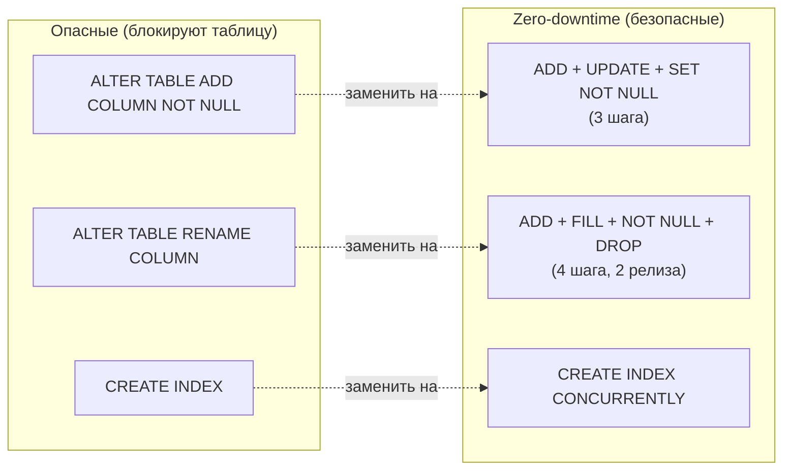

# Лабораторная работа №10
## Rollback, zero-downtime паттерны. Итоговая защита проекта eshop

**Неделя:** 13  
**Ориентировочное время:** 2 занятия (≈ 4 ак. ч.)

---

## Цель работы

- Применить forward rollback и undo-скрипты для проблемных миграций.
- Реализовать zero-downtime паттерны: переименование колонки, ADD NOT NULL, CREATE INDEX CONCURRENTLY.
- Подготовить и защитить итоговый отчёт по проекту `eshop`.

---

## Предварительные требования

- Завершена лаб. 09: Flyway настроен, миграции V002–V003 применены. V004 — самостоятельное задание, может отсутствовать.
- Прочитана [Лек. 13 — Rollback-стратегии. Обслуживание БД. Управление изменениями](../../lectures/lec_13/lec_13.md) (§2 Стратегии отката, §3 Zero-downtime).

---

> **Командная строка (PowerShell).** Задайте переменную пути один раз на сеанс:
> ```powershell
> $pg = "C:\Program Files\PostgreSQL\18\bin"
> ```
> Команды `psql`, `vacuumdb`, `reindexdb`, `pg_dump` в этой работе запускаются через PowerShell.

## Часть 1. Rollback: forward rollback

### 1.1. Симуляция плохой миграции

Создайте `migrations/V005__bad_migration.sql`:

```sql
-- V005: ПЛОХАЯ миграция — добавляем NOT NULL без значения по умолчанию
ALTER TABLE orders ADD COLUMN manager_id INTEGER NOT NULL;
-- Ошибка: существующие строки не имеют значения manager_id
```

```bash
flyway -configFiles=flyway.toml migrate
# Ошибка: column "manager_id" of relation "orders" contains null values
```

```bash
flyway -configFiles=flyway.toml info
# V005 — Failed
```

### 1.2. Forward rollback (рекомендуемый подход)

Вместо попытки «откатить» — выпускаем корректирующую миграцию. Но сначала нужно **убрать неудачную V005 из набора миграций**, иначе `migrate` снова попытается её выполнить и снова упадёт.

Создайте `migrations/V006__fix_manager_id.sql`:

```sql
-- V006: исправляем V005 — добавляем колонку и заполняем её безопасно
ALTER TABLE orders ADD COLUMN IF NOT EXISTS manager_id INTEGER;

-- 0 — служебное значение «менеджер не назначен»; в реальной схеме
-- здесь должен быть FK на таблицу managers.
UPDATE orders SET manager_id = 0 WHERE manager_id IS NULL;

ALTER TABLE orders ALTER COLUMN manager_id SET NOT NULL;
```

```powershell
# Команды выполняются из каталога проекта eshop-migrations
# 1. Убедиться, что V005 упала и колонки manager_id нет
flyway -configFiles=flyway.toml info
& "$pg\psql.exe" -h localhost -U postgres -d eshop -c "SELECT column_name FROM information_schema.columns WHERE table_name='orders' AND column_name='manager_id';"

# 2. Отозвать неудачную миграцию: переименовать файл, чтобы Flyway её не видел
Rename-Item migrations\V005__bad_migration.sql migrations\V005__bad_migration.sql.bak -Force

# 3. Удалить failed-запись из истории и применить V006
flyway -configFiles=flyway.toml repair
flyway -configFiles=flyway.toml migrate
flyway -configFiles=flyway.toml info
```

> **Почему нельзя просто выполнить `repair` + `migrate`.** `repair` удаляет запись о неудаче, после чего `migrate` снова видит файл V005 и снова его выполняет. Пока V005 остаётся в каталоге миграций, перейти к V006 невозможно. Поэтому неудачную миграцию отзывают (переименовывают/удаляют), а исправление выпускают следующим номером.

В истории должно быть: V005 отсутствует (или помечена `DELETED`), V006 — `Success`.

### 1.3. Undo-скрипт (альтернатива)

Flyway Undo — только в Flyway Teams. Альтернативный путь — откатить изменение вручную, если корректирующая миграция ещё не выпущена:

```sql
-- U005 (вручную): откат неудачной V005
ALTER TABLE orders DROP COLUMN IF EXISTS manager_id;
```

После выполнения undo-скрипта вручную:

```bash
flyway -configFiles=flyway.toml repair
```

> **Что делает `repair`.** Удаляет failed-запись из истории. Он не откатывает SQL и не исправляет данные. Если V005 уже добавила колонку, её нужно удалить вручную (как выше).

---

## Часть 2. Zero-downtime паттерны

> В production нельзя останавливать приложение на время миграции. Используем паттерны, безопасные при работающем трафике.

### 2.1. ADD NOT NULL (3-шаговый паттерн)

**Задача:** добавить `orders.confirmed_at TIMESTAMPTZ NOT NULL`.

```sql
-- Шаг 1: добавить колонку с DEFAULT (быстро, без перезаписи всех строк)
ALTER TABLE orders ADD COLUMN confirmed_at TIMESTAMPTZ DEFAULT now();

-- Шаг 2: заполнить существующие строки (в production — батчами)
UPDATE orders SET confirmed_at = created_at WHERE confirmed_at IS NULL;

-- Шаг 3: добавить ограничение NOT NULL (быстро, т.к. данные уже заполнены)
ALTER TABLE orders ALTER COLUMN confirmed_at SET NOT NULL;
ALTER TABLE orders ALTER COLUMN confirmed_at DROP DEFAULT;
```

**Почему нельзя за один шаг?**
```sql
-- Этот запрос заблокирует таблицу на всё время заполнения строк:
ALTER TABLE orders ADD COLUMN confirmed_at TIMESTAMPTZ NOT NULL DEFAULT now();
-- В PostgreSQL 11+ это мгновенно из-за оптимизации DEFAULT в системный каталог,
-- но для pre-PG11 или при необходимости явного контроля — 3-шаговый вариант надёжнее.
```

Создайте миграцию `V007__add_confirmed_at_safe.sql` с этим кодом.

### 2.2. RENAME COLUMN (4-шаговый паттерн)

**Задача:** переименовать `customers.name` → `customers.full_name`.

```sql
-- Шаг 1: добавить новую колонку
ALTER TABLE customers ADD COLUMN full_name TEXT;

-- Шаг 2: заполнить
UPDATE customers SET full_name = name;

-- Шаг 3: добавить NOT NULL
ALTER TABLE customers ALTER COLUMN full_name SET NOT NULL;

-- Шаг 4: переключить зависимое представление с name на full_name
-- (иначе DROP COLUMN name упадёт: представление orders_summary из лаб. 09
--  зависит от старой колонки)
CREATE OR REPLACE VIEW orders_summary AS
SELECT c.full_name AS customer_name,
       c.region,
       o.status,
       COUNT(*)            AS order_count,
       SUM(o.total_amount) AS total_revenue
FROM   customers c
JOIN   orders o ON o.customer_id = c.id
GROUP  BY c.full_name, c.region, o.status;

-- Шаг 5: убрать старую колонку (когда все клиенты перешли на full_name)
ALTER TABLE customers DROP COLUMN name;
```

> **В production** шаги 3 и 4 выполняются в разных релизах: сначала оба столбца живут параллельно, приложение читает `full_name`, затем убирают `name`.

Создайте миграцию `V008__rename_customer_name.sql`.

> **Упрощение для учебной работы.** В одном файле V008 выполняются все шаги. В production шаги 3–5 выносят в отдельный релиз: приложение сначала переключают на `full_name`, убеждаются, что ошибок нет, и только потом удаляют `name`.
>
> **Не забудьте про R__-миграцию.** В `R__orders_summary_view.sql` из лаб. 09 остаётся `c.name`. После V008 представление в базе уже использует `full_name` (иначе `DROP COLUMN name` упал бы). Если позже вы измените R__-файл и Flyway перезапустит его, старый текст с `c.name` упадёт. Обновите файл R__ на `c.full_name` в том же релизе.

### 2.3. CREATE INDEX CONCURRENTLY

> **Командная строка (PowerShell).**

```powershell
# Индекс на большой таблице без блокировки записи
& "$pg\psql.exe" -h localhost -U postgres -d eshop -c "CREATE INDEX CONCURRENTLY idx_orders_total_amount ON orders(total_amount DESC);"
```

```sql
-- Проверить, что индекс VALID (не INVALID)
SELECT c.relname AS index_name, i.indisvalid
FROM   pg_class c
JOIN   pg_index i ON i.indexrelid = c.oid
WHERE  c.relname = 'idx_orders_total_amount';
-- indisvalid = true — всё хорошо

-- Если indisvalid = false — удалить и пересоздать:
-- DROP INDEX CONCURRENTLY idx_orders_total_amount;
-- CREATE INDEX CONCURRENTLY ...;
```

### 2.4. Сводная таблица паттернов



| Операция                 | Опасный способ            | Zero-downtime способ                           |
| ------------------------ | ------------------------- | ---------------------------------------------- |
| ADD NOT NULL column      | Один ALTER TABLE          | ADD + UPDATE + SET NOT NULL (3 шага)           |
| RENAME COLUMN            | ALTER TABLE RENAME        | ADD + FILL + NOT NULL + DROP (2 релиза)        |
| CREATE INDEX             | CREATE INDEX              | CREATE INDEX CONCURRENTLY                      |
| DROP TABLE               | DROP TABLE                | RENAME → убрать FK → DROP (3 релиза)           |
| Изменить тип колонки     | ALTER COLUMN TYPE         | ADD + migrate + DROP (контролируемая пауза)    |

---

## Часть 3. Обслуживание и итоговое состояние базы

### 3.1. Полная VACUUM + REINDEX

> **Командная строка (PowerShell).** Перед `VACUUM FULL` закройте все окна DBeaver/psql, подключённые к `eshop`: команда требует `ACCESS EXCLUSIVE` и не начнётся, пока есть другие сессии.

```powershell
& "$pg\vacuumdb.exe" -h localhost -U postgres -d eshop --full --analyze --verbose

& "$pg\reindexdb.exe" -h localhost -U postgres -d eshop --concurrently --verbose
```

### 3.2. Статус всех миграций

```bash
flyway -configFiles=flyway.toml info
```

Скопируйте вывод в файл `final_flyway_status.txt`.

### 3.3. Итоговый слепок схемы

> **Командная строка (PowerShell).**

```powershell
& "$pg\pg_dump.exe" -h localhost -U postgres --schema-only eshop -f eshop_final_schema.sql
```

---

## Часть 4. Итоговая защита проекта

### 4.1. Структура отчёта

Подготовьте отчёт `eshop_project_report.md`:

```markdown
## Итоговый отчёт: проект eshop

**Студент:** ___  
**Группа:** ___  
**Дата:** ___

### 1. Описание базы данных
- Назначение eshop
- ERD (вставьте Mermaid-диаграмму из лаб. 02, обновлённую с новыми таблицами)

### 2. Ролевая модель
- Список ролей и их назначение (из лаб. 02)
- RLS: какие политики настроены

### 3. Резервное копирование
- Регламент (из лаб. 03)
- RPO / RTO для eshop (ваши целевые значения)

### 4. Мониторинг
- Ключевые метрики: cache hit ratio, dead_pct, idle in transaction
- Пороговые значения для алертов

### 5. Производительность
- Какие индексы созданы и почему
- Изменения настроек autovacuum
- Итог: используется ли PgBouncer? Почему?

### 6. Информационная безопасность
- pgAudit: что аудируется
- TLS: включён?
- Шифрование: какие поля зашифрованы
- Соответствие 152-ФЗ: категория ПДн, меры защиты

### 7. Управление миграциями
- Список всех Flyway-миграций (версия + описание)
- Один инцидент: что пошло не так, как восстановили

### 8. Zero-downtime
- Какие паттерны применили в лаб. 10
- Почему «опасный» способ неприемлем в production

### 9. Итоги и выводы
Что нового узнали. Что применимо на вашей текущей/будущей работе.
```

### 4.2. Вопросы для устной защиты

Преподаватель задаёт 3–5 вопросов из списка:

1. Чем `pg_dump` отличается от `pg_basebackup`? Когда что выбрать?
2. Что произойдёт, если `autovacuum` отключить на 1 неделю?
3. Объясните MVCC: почему `DELETE` не сразу освобождает место?
4. В чём разница между Seq Scan и Index Scan? Когда планировщик выбирает Seq Scan?
5. Что такое `pg_hba.conf`? Порядок обработки правил.
6. Почему `flyway clean` отключён в production?
7. Что такое WAL? Зачем PostgreSQL пишет изменения дважды?
8. Объясните: почему `ADD COLUMN NOT NULL DEFAULT` могло заблокировать таблицу в PG 10?
9. Какие события аудирует pgAudit в вашей конфигурации?
10. Что такое PITR? В каком сценарии он нужен?

---

## Чек-лист «работа зачтена»

- [ ] V006–V008 (исправление, ADD NOT NULL, RENAME COLUMN) — applied, Success; V005 отозвана.
- [ ] `idx_orders_total_amount` создан CONCURRENTLY; `indisvalid = true`.
- [ ] `vacuumdb --full` выполнен; `reindexdb --concurrently` выполнен.
- [ ] `flyway info` — все актуальные миграции Applied/Success; failed-записей нет.
- [ ] `eshop_project_report.md` — все разделы заполнены.
- [ ] Устная защита: ответы на 3 вопроса преподавателя.

---

## Ссылки

- Undo migrations: https://documentation.red-gate.com/fd/undo-migrations-184127461.html
- ADD NOT NULL safely: https://www.depesz.com/2018/05/10/waiting-for-postgresql-11-fast-alter-table-add-column-with-a-non-null-default/
- Zero-downtime рецепты: https://gist.github.com/jcoleman/1e6ad1bf8de454c166da94b67537758
- VACUUM FULL: https://www.postgresql.org/docs/current/sql-vacuum.html
