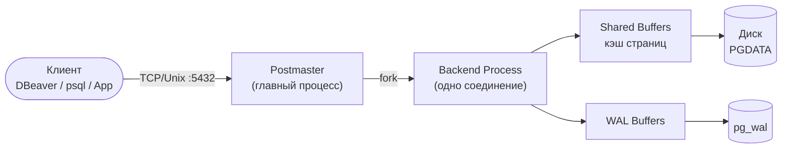
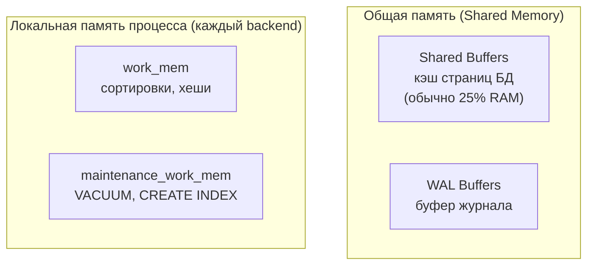
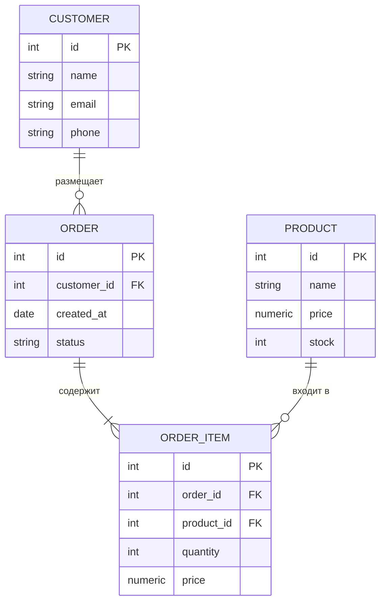
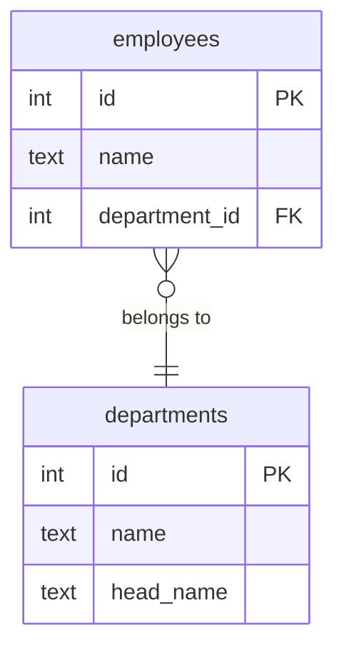

# Лекция 1. Роль DBA в команде. Архитектура PostgreSQL. Коммуникация в команде

**Неделя:** 1  
**Версия PostgreSQL:** 18  
**Практика:** лабораторная работа №1 «Установка PostgreSQL и DBeaver»  
**Сквозной проект:** база `eshop` (клиенты, товары, заказы, позиции заказов)

---

## Цель лекции

По итогам лекции студент:

- понимает роль DBA в продуктовой команде, зоны ответственности аналитика, разработчика и DevOps и умеет находить точки пересечения;
- знает архитектуру PostgreSQL на уровне, достаточном для осмысленного разговора с DBA: процессы, разделяемая память, локальная память backend, каталог `PGDATA`, журнал WAL;
- понимает, зачем нужны ERD и нормализация, и умеет читать схему в нотации Crow's Foot;
- умеет выбрать корректный тип данных PostgreSQL и объяснить последствия ошибки выбора;
- умеет локализовать проблему пользователя и оформить тикет к DBA так, чтобы инцидент диагностировался с первого раза.

---

## Зачем это системному аналитику

Системный аналитик — связующее звено между бизнесом и командой разработки. Он переводит потребность пользователя в техническое задание и первым получает жалобы вида «всё зависло», «данные пропали», «отчёт не открывается».

Представим типичный рабочий день. Менеджер пишет: «Срочно! Личный кабинет не показывает заказы». Если аналитик не понимает архитектуру PostgreSQL, он задаст вопрос «а что случилось?» и получит в ответ «не знаю, всё сломалось». Если понимает — он спросит: «Проблема у одного пользователя или у всех? Заказы не видны вообще или видна старая версия? Ошибка появляется сразу или через несколько секунд?» Это разные гипотезы: права доступа, репликационный лаг, таймаут пула соединений. Разные гипотезы — разные адресаты задачи.

Знание ролей и зон ответственности помогает ставить задачи корректному человеку, не тратя время на «пинг-понг» между DBA и разработчиком. ERD — язык, на котором аналитик общается с DBA при проектировании схемы: без этого навыка migration plan будет возвращаться на доработку снова и снова.

> **Ключевая мысль лекции.** Аналитик не администрирует базу, но именно он определяет, какие данные и в каком виде в неё попадут. Большинство проблем производительности и безопасности закладывается не в SQL-коде, а в требованиях и модели данных.

---

## 1. Вводный кейс

> **Кейс из практики.**  
> Интернет-магазин `eshop` запустил новый раздел «История заказов». Требование звучало так: «Пользователь должен видеть все свои заказы за всё время, включая позиции, статусы и суммы».  
>  
> Через неделю после релиза:
> - экран открывается 8–12 секунд;
> - в часы пик появляются ошибки `timeout expired`;
> - DBA сообщает, что сервер выполняет по 101 запросу на одно открытие экрана;
> - разработчик отвечает: «На тестовой базе с 10 заказами всё летает».

**Вопросы аудитории:**
1. Где в этом кейсе ошибка аналитика, а где — разработчика?
2. Почему тестовая база «врёт»?
3. Какие три артефакта нужно было согласовать до разработки, чтобы проблема не возникла?

К концу лекции мы вернёмся к этому кейсу и разберём его по слоям: требования → модель данных → архитектура → коммуникация.

---

## 2. Роли в команде, работающей с БД

В продуктовой команде вопросами базы данных занимаются несколько ролей одновременно. Системному аналитику важно понимать зоны ответственности каждой, чтобы ставить задачи правильному человеку и говорить на одном языке.

| Роль | Зона ответственности | С кем взаимодействует |
|---|---|---|
| **DBA** | Установка, конфигурация, резервное копирование, восстановление, права доступа, мониторинг, оптимизация запросов | Разработчик, аналитик, DevOps |
| **Системный аналитик** | Требования к данным, модель предметной области, migration plan, приёмка изменений схемы | DBA, разработчик, бизнес-заказчик |
| **Разработчик** | SQL-запросы, ORM, скрипты миграций, unit-тесты | DBA, аналитик |
| **DevOps / SRE** | CI/CD pipeline, запуск `flyway migrate`, мониторинг инфраструктуры | DBA, разработчик |
| **Пользователь / бизнес** | Формулировка потребностей, приёмка результата | Аналитик |

> Подробнее о том, как аналитик взаимодействует с каждой ролью и какие артефакты передаёт, — в статье [Роли команды](../../wiki/roles/team-roles.md).

### 2.1. Где пересекаются аналитик и DBA

Ключевые точки пересечения, где аналитик обязан говорить с DBA на одном языке:

1. **Проектирование схемы.** Аналитик предлагает модель, DBA оценивает реализуемость, производительность и стоимость хранения.
2. **Migration plan.** Аналитик пишет документ, DBA делает review SQL-скриптов и оценивает блокировки.
3. **Управление доступом.** Аналитик формулирует, кому нужны какие права; DBA реализует `GRANT`/`REVOKE` и правила `pg_hba.conf`.
4. **Инциденты.** Пользователь приходит к аналитику с проблемой; аналитик локализует и передаёт DBA с фактами, а не с эмоциями.
5. **Оценка производительности.** Аналитик ставит требования по SLA и объёму данных; DBA проверяет план запроса и индексы.

### 2.2. Чего аналитик не делает

- Не выдаёт себе `SUPERUSER` «для удобства».
- Не выполняет `DROP`, `TRUNCATE` и `UPDATE` без `WHERE` на production.
- Не перезапускает сервер и не меняет `postgresql.conf` без DBA.
- Не «чинит» инцидент ИБ самостоятельно: это уничтожает следы.

---

## 3. Архитектура PostgreSQL

### 3.1. Клиент-серверная модель

PostgreSQL работает по классической клиент-серверной архитектуре. Клиент (DBeaver, psql, приложение) подключается к серверу по TCP (порт 5432 по умолчанию) или через Unix-сокет. Сервер для каждого соединения порождает отдельный процесс-обработчик (**backend process**).



**Что происходит при подключении нового клиента:**

1. `postmaster` принимает TCP-соединение.
2. Проверяет правила `pg_hba.conf`: откуда пришёл клиент, к какой базе, под какой ролью, какой метод аутентификации.
3. Выполняет `fork()` и создаёт отдельный backend-процесс.
4. Backend аутентифицирует роль и обслуживает SQL-запросы до отключения клиента.

Именно поэтому «каждое соединение — отдельный процесс» — не абстракция, а физическая причина, по которой PostgreSQL плохо переносит тысячи одновременно открытых соединений. Подробнее — в статье [Архитектура PostgreSQL](../../wiki/concepts/postgresql-architecture.md).

### 3.2. Процессы сервера

| Процесс | Роль |
|---|---|
| **postmaster** | Главный процесс; принимает входящие соединения и порождает backend-процессы, следит за их состоянием |
| **backend** | Обслуживает одно клиентское соединение; выполняет SQL, работает с кэшем |
| **bgwriter** | Асинхронно сбрасывает «грязные» страницы из `shared_buffers` на диск |
| **WAL writer** | Записывает журнал предзаписи (WAL) на диск |
| **checkpointer** | Периодически создаёт контрольные точки: синхронизирует память и диск, ограничивает время crash recovery |
| **autovacuum launcher / workers** | Очищают мёртвые версии строк после `UPDATE`/`DELETE`, обновляют статистику планировщика |
| **wal sender / wal receiver** | Передают и принимают WAL при репликации (лекция 10) |

> **Аналитику достаточно запомнить три вещи.** Backend — это процесс на соединение. Checkpoint — это про диск и восстановление после сбоя. Autovacuum — это про мёртвые строки и bloat.

### 3.3. Память: разделяемая и локальная



- **`shared_buffers`** — сколько RAM PostgreSQL использует как кэш страниц. Типичное значение — 25% RAM сервера. Это общий кэш для всех соединений.
- **`work_mem`** — память **на одну операцию** сортировки или хеш-соединения, а не на соединение целиком. При сложном запросе с несколькими узлами сортировки каждый узел получает свой `work_mem`, и это умножается на число параллельных соединений.

> **Опасный расчёт.** 50 соединений × 5 узлов сортировки × 64 MB = 16 GB. Именно поэтому «поставьте `work_mem` побольше» — плохой совет без анализа нагрузки. Значение выше 16–32 MB требует обдумывания и мониторинга.

- **`WAL Buffers`** — буфер для журнала предзаписи перед записью на диск.
- **`maintenance_work_mem`** — память для обслуживающих операций: `VACUUM`, `CREATE INDEX`, `ALTER TABLE`. На время миграции её можно поднять, но не глобально «на всякий случай».

### 3.4. Хранение данных на диске (PGDATA)

```
PGDATA/
├── base/               ← базы данных (каждая — отдельная папка по OID)
│   ├── 1/              ← системная БД template1
│   └── 16384/          ← пользовательская БД (OID)
├── global/             ← объекты уровня кластера (роли, pg_database)
├── pg_wal/             ← файлы WAL (журнал предзаписи, сегменты по 16 МБ)
├── log/                ← файлы логов сервера (настраивается log_directory)
├── pg_tblspc/          ← симлинки на табличные пространства
├── postgresql.conf     ← основной файл конфигурации
├── pg_hba.conf         ← правила аутентификации клиентов
├── pg_ident.conf       ← маппинг системных пользователей на роли БД
├── postgresql.auto.conf ← параметры из ALTER SYSTEM; перекрывает postgresql.conf
├── postmaster.pid      ← PID главного процесса; отсутствует, когда сервер остановлен
└── PG_VERSION          ← мажорная версия кластера
```

> **Правило безопасности.** Никогда не редактировать файлы в `base/` и `pg_wal/` вручную — это повреждает кластер. Конфигурационные `.conf` редактировать можно, но лучше через `ALTER SYSTEM` и `pg_reload_conf()`.

### 3.5. Иерархия объектов

```
Кластер PostgreSQL (один экземпляр СУБД, один PGDATA)
└── База данных (CREATE DATABASE)
    └── Схема (CREATE SCHEMA)
        ├── Таблица
        ├── Представление (VIEW)
        ├── Функция
        └── Индекс
```

Важно: **роли (пользователи) существуют на уровне кластера**, а не базы данных. Привилегии на объекты — на уровне базы. Одна роль может работать в нескольких базах, если ей выданы соответствующие права.

### 3.6. Write-Ahead Log (WAL)

WAL — журнал предзаписи. Каждое изменение данных сначала записывается в WAL, и только потом применяется к файлам данных. Это гарантирует:

- **Durability** (надёжность): при сбое данные восстанавливаются из WAL.
- **Репликацию**: standby-сервер воспроизводит WAL от primary.
- **PITR**: архив WAL позволяет восстановиться на любой момент времени.

> **Параметр `synchronous_commit`** определяет, ждать ли подтверждения записи WAL на диск перед ответом клиенту. `on` (по умолчанию) — максимальная надёжность; `off` — выше скорость, но при сбое возможна потеря последних нескольких транзакций (данные не повредятся, но последние записи могут быть утеряны). Это ключевой параметр компромисса «надёжность/производительность». Подробнее о WAL и MVCC — в статье [WAL и MVCC](../../wiki/concepts/wal-mvcc.md).

---

## 4. Обзор PostgreSQL

### 4.1. Краткая история

PostgreSQL берёт начало от проекта POSTGRES (Беркли, 1986); в 1996 году переименован и получил полноценный SQL. Каждая major-версия поддерживается **5 лет**; минорные (патчи безопасности) выходят ежеквартально. Актуальные версии: https://www.postgresql.org/support/versioning/

### 4.2. Ключевые возможности

- **ACID-транзакции** с уровнями изоляции (`Read Committed`, `Repeatable Read`, `Serializable`).
- **MVCC** (Multi-Version Concurrency Control) — читатели не блокируют писателей.
- **Расширяемость** — пользовательские типы, операторы, индексные методы, расширения.
- **Полнотекстовый поиск**, поддержка `JSON`/`JSONB`, массивы, диапазонные типы.
- **Логическая и физическая репликация** из коробки.
- **Row-Level Security** (RLS) — политики безопасности на уровне строк.
- **Расширения без изменения ядра**: PostGIS, pgvector, TimescaleDB, pgAudit, Citus.

### 4.3. Политика поддержки версий

PostgreSQL поддерживает каждую major-версию **5 лет**. Минорные версии (патчи безопасности и исправления) выходят ежеквартально. Для курса используется PostgreSQL 18; локальная среда должна совпадать с production по мажорной версии.

### 4.4. Экосистема расширений

| Расширение | Назначение |
|---|---|
| **PostGIS** | Геоданные и пространственные запросы |
| **pgvector** | Векторный поиск для AI/ML и RAG |
| **TimescaleDB** | Временные ряды, метрики, IoT |
| **pgAudit** | Аудит SQL-операций (лекция 11) |
| **pg_stat_statements** | Статистика выполнения запросов (лекции 7–8) |
| **pgcrypto** | Шифрование данных в колонках (лекция 11) |
| **Citus** | Горизонтальное масштабирование |

---

## 5. Диаграммы сущность-связь (ERD)

ERD (Entity-Relationship Diagram) — основной инструмент документирования структуры данных. Аналитик использует ERD при проектировании схемы, составлении migration plan и в коммуникации с DBA.

> Подробный разбор нотаций, инструментов и типовых ошибок — в статье [ERD](../../wiki/concepts/erd.md).

### 5.1. Нотация «Воронья лапка» (Crow's Foot)

Самая распространённая нотация ERD. Каждая таблица — прямоугольник; линии показывают связи. Конец линии у сущности означает кардинальность (сколько записей участвует):

| Символ на конце линии | Смысл |
|---|---|
| `\|\|` | Ровно один (обязательно) |
| `\|o` / `o\|` | Ноль или один (необязательно) |
| `}\|` / `\|{` | Один или много (обязательно) |
| `}o` / `o{` | Ноль или много (необязательно) |

Читать связь нужно **с двух сторон**:

- `CUSTOMER ||--o{ ORDER` — «у клиента ноль или много заказов; каждый заказ принадлежит ровно одному клиенту».
- `ORDER ||--|{ ORDER_ITEM` — «у заказа один или много позиций; каждая позиция принадлежит ровно одному заказу».

### 5.2. Пример ERD в Mermaid (нотация Crow's Foot)

Упрощённая схема интернет-магазина:



> **Типичная ошибка новичка.** Нарисовать `ORDER ||--|| ORDER_ITEM` («заказ содержит ровно одну позицию»). Это ломает модель: заказ может содержать много позиций. Кардинальность — не украшение диаграммы, а контракт, который затем превращается в `FOREIGN KEY` и ограничения.

### 5.3. Как читать ERD при работе с DBA

При получении migration plan или review MR с миграцией аналитик проверяет:

| Вопрос при чтении ERD | Что проверять в SQL-скрипте |
|---|---|
| Есть ли первичный ключ у каждой таблицы? | `PRIMARY KEY` или `GENERATED ALWAYS AS IDENTITY` |
| Корректны ли кардинальности связей? | `FOREIGN KEY ... REFERENCES`, `ON DELETE`-правило |
| Нет ли циклических зависимостей? | Порядок `CREATE TABLE` / `DROP TABLE` |
| Соответствуют ли типы данных требованиям? | `VARCHAR` vs `TEXT`, `NUMERIC(p,s)` vs `FLOAT` |
| Есть ли индекс на внешнем ключе? | `CREATE INDEX` по `FK`-колонке (иначе `DELETE` родителя сканирует дочернюю таблицу) |

### 5.4. Инструменты для ERD

| Инструмент | Подход | Ссылка |
|---|---|---|
| **Mermaid** | Код → диаграмма; встраивается в Markdown/GitLab/GitHub | https://mermaid.js.org/syntax/entityRelationshipDiagram.html |
| **PlantUML** | Текстовый DSL; мощнее Mermaid | https://plantuml.com/ie-diagram |
| **DBeaver** | Автогенерация ERD из существующей схемы | ПКМ по схеме → **ER Diagram** |
| **draw.io** | Визуальный редактор; экспорт в PNG/SVG | https://www.drawio.com |
| **dbdiagram.io** | DSL-язык (DBML); быстрое создание ERD онлайн | https://dbdiagram.io |

> **Практика →** [Лаб. 01, часть 4 — подключение к `eshop` и просмотр схемы](../../labs/lab_01/lab_01.md).  
> ERD проекта `eshop` целиком — в статье [Схема eshop](../../wiki/course/eshop-schema.md).

---

## 6. Нормализация и типы данных

### 6.1. Нормальные формы (кратко)

Нормализация — процесс проектирования реляционной схемы, устраняющий дублирование и аномалии при изменении данных.

| Форма | Условие | Типичная аномалия, которую устраняет |
|---|---|---|
| **1НФ** | Все атрибуты атомарны (нет списков, нет вложенных таблиц) | «Телефоны через запятую» в одной ячейке |
| **2НФ** | 1НФ + каждый неключевой атрибут полностью зависит от всего составного ключа | Дублирование данных при составном PK |
| **3НФ** | 2НФ + нет транзитивных зависимостей между неключевыми атрибутами | Изменение города тянет изменение индекса |
| **BCNF** | Для каждой функциональной зависимости `X → Y` детерминант `X` является суперключом | Остаточные аномалии в редких случаях |

**Практическое правило:** для большинства OLTP-схем достаточно 3НФ. Денормализация (намеренное нарушение) применяется для аналитики (OLAP) или кэширующих таблиц — только при доказанной необходимости и с фиксацией причины в документации.

> Полный разбор с примерами и упражнениями — в статье [Нормализация](../../wiki/concepts/normalization.md).

#### Пример: нарушение 3НФ

```
orders(id, customer_id, customer_city, customer_region)
```

`customer_city → customer_region` — транзитивная зависимость.  
Решение: вынести `city_id → region` в справочник `cities`.

#### Упражнение: найдите нарушение

Дана таблица:

```
employees(id, name, department_id, department_name, department_head_name)
```

**Вопрос 1.** В какой нормальной форме эта таблица?

<details><summary>Ответ</summary>

Таблица в **2НФ**: ключ простой (`id`), но `department_name` и `department_head_name` транзитивно зависят от `department_id`, а не от `id` напрямую — нарушение **3НФ**.

</details>

**Вопрос 2.** Какие аномалии возможны при переименовании отдела?

<details><summary>Ответ</summary>

**Аномалия обновления:** переименование отдела требует `UPDATE` во всех строках сотрудников этого отдела.  
**Аномалия удаления:** удаляем всех сотрудников отдела — теряем информацию об отделе и его руководителе.

</details>

**Вопрос 3.** Как разбить таблицу на 3НФ?

<details><summary>Ответ</summary>

Вынести `departments(id, name, head_name)`, в `employees` оставить только `department_id FK`.



</details>

### 6.2. Ключевые типы данных PostgreSQL

Выбор типа влияет на размер строки, точность вычислений и производительность индексов.

| Задача | Рекомендуемый тип | Почему |
|---|---|---|
| Целые идентификаторы | `BIGSERIAL` / `BIGINT GENERATED ALWAYS AS IDENTITY` | Запас диапазона; `SERIAL` устарел |
| Денежные суммы | `NUMERIC(p, s)` | Точная арифметика; `FLOAT` даёт ошибки округления |
| Произвольный текст | `TEXT` | В PostgreSQL нет штрафа за `TEXT` vs `VARCHAR(n)` |
| Дата + время с часовым поясом | `TIMESTAMPTZ` | Хранит в UTC, отдаёт с учётом `TimeZone` сеанса |
| Дата + время без часового пояса | `TIMESTAMP` | Только если вы точно знаете, что часовой пояс не нужен |
| Логические значения | `BOOLEAN` | Не используйте `CHAR(1)` или `SMALLINT` |
| UUID как PK | `UUID` | Удобен в распределённых системах; `gen_random_uuid()` |
| JSON-документ | `JSONB` | Бинарный; поддерживает индексы GIN; `JSON` только для хранения «как есть» |

> **Антипаттерн:** `VARCHAR(255)` везде — характерная ошибка из мира MySQL. В PostgreSQL `TEXT` семантически идентичен и проще в сопровождении.

> **Ловушка с деньгами.** `NUMERIC` — правильный выбор для сумм. Если аналитик в требованиях пишет «цена, дробное число», разработчик может взять `FLOAT`, и через месяц бухгалтерия найдёт расхождение в копейках на отчёте.

---

## 7. Коммуникация DBA–аналитик–пользователь

### 7.1. Типичные проблемы, с которыми пользователи приходят к аналитику

| Жалоба пользователя | Возможная причина на уровне БД | Кто решает |
|---|---|---|
| «Отчёт строится очень долго» | Медленный запрос, отсутствие индекса | DBA + разработчик |
| «Данные не сохраняются / откатились» | Ошибка транзакции, нарушение constraint | Разработчик |
| «Не могу войти / нет прав» | Отсутствие роли или привилегий, правило `pg_hba.conf` | DBA |
| «Дублируются записи» | Нарушение логики уникальности | Аналитик + разработчик |
| «Всё зависло» | Блокировка, долгая транзакция, deadlock | DBA |
| «Данные пропали» | `DELETE` без `WHERE`, ошибка миграции | DBA + аналитик |
| «Соединение разрывается / timeout» | Исчерпан `max_connections`, пул соединений | DBA + DevOps |
| «Нет места на диске» | Раздулись WAL-файлы или bloat таблиц | DBA |

### 7.2. Алгоритм локализации проблемы

Прежде чем эскалировать проблему к DBA, аналитик должен собрать первичную информацию:

```
1. Воспроизвести проблему:
   — Это происходит всегда или иногда?
   — На каком конкретном действии / данных?

2. Уточнить контекст:
   — Когда началось? Были ли изменения в системе?
   — Какие данные затронуты (таблица, период)?

3. Собрать артефакты:
   — Скриншот / текст ошибки целиком
   — Время возникновения (точное, с часовым поясом!)
   — Имя пользователя / роль в системе
   — Версию PostgreSQL (SELECT version();)

4. Сформулировать тикет → передать DBA
```

> **Правило одного вопроса.** Если после прочтения тикета DBA не может начать работу без уточняющего вопроса — тикет оформлен плохо. Хороший тикет отвечает на вопросы «что», «где», «когда», «при каких условиях» и «что уже пробовали».

### 7.3. Шаблон тикета к DBA

```markdown
Тема: [Кратко суть проблемы, например: "Отчёт по продажам выполняется > 5 мин"]

Среда: production / staging / local
Время возникновения: 2026-09-02 14:35 MSK
Частота: постоянно / периодически
Версия PostgreSQL: <вывод SELECT version();>
Был ли деплой / миграция непосредственно перед проблемой: да / нет / не знаю

Описание:
  Пользователь <имя/роль> сообщает, что <что происходит>.
  Воспроизводится при <условие>.

Ожидаемое поведение:
  <что должно происходить>

Фактическое поведение / текст ошибки:
  <скопировать сообщение об ошибке целиком>

Затронутые объекты:
  — БД: <имя базы>
  — Таблица / объект: <имя>
  — Пользователь БД: <роль>

Приоритет: критично / высокий / обычный
Дедлайн: <если есть>
```

> **Практика →** [Лаб. 01 — установка PostgreSQL и DBeaver](../../labs/lab_01/lab_01.md). В части 1 вы поднимаете локальную среду, без которой невозможно воспроизвести ни одну проблему.

### 7.4. Эскалация инцидента ИБ

Если проблема связана с безопасностью (подозрительный доступ, утечка, несанкционированные изменения):

1. **Не пытаться исправить самостоятельно** — это может уничтожить следы инцидента. Не удалять лог-файлы, не изменять данные, не перезапускать сервис без согласования со службой ИБ.
2. Зафиксировать время, пользователя, действие.
3. Передать в **службу ИБ** и **DBA одновременно**.
4. DBA может временно заблокировать доступ подозрительному пользователю.
5. Не сообщать об инциденте публично до завершения расследования.

---

## 8. Разбор вводного кейса

Вернёмся к «Истории заказов»:

1. **Где ошибка аналитика?**  
   Требование «показать все заказы за всё время с позициями» не ограничило объём выборки и не задало сценарий загрузки. На больших данных это гарантирует тяжёлый запрос. Нужно было согласовать пагинацию, лимит истории и число запросов на экран (проблема N+1 разбирается в лекции 8).
2. **Почему тестовая база «врёт»?**  
   На 10 заказах любой запрос быстрый. Производительность — функция объёма данных, индексов и плана запроса. Тестовая среда должна содержать реалистичный объём или хотя бы реалистичное распределение.
3. **Какие три артефакта нужно было согласовать до разработки?**  
   ERD (какие связи и кардинальности), требования к объёму и росту данных (capacity), и migration plan / контракт API с числом запросов на экран.

---

## 9. Итоги лекции

После этой лекции студент умеет:

- **Объяснить зоны ответственности** DBA, аналитика и разработчика и назвать 5 точек пересечения.
- **Описать архитектуру PostgreSQL**: что делают `postmaster`, backend, `bgwriter`, `autovacuum`; чем `shared_buffers` отличается от `work_mem`.
- **Прочитать ERD** в нотации Crow's Foot: определить кардинальность связей, найти FK и PK, выявить денормализацию.
- **Применить нормальные формы**: объяснить 1НФ/2НФ/3НФ на примере; выбрать подходящий тип данных (`NUMERIC` vs `FLOAT`, `TEXT` vs `VARCHAR(n)`, `TIMESTAMPTZ` vs `TIMESTAMP`).
- **Оформить тикет к DBA** по стандартному шаблону: среда, время, артефакты, ожидаемое vs фактическое.

---

## Контрольные вопросы

1. Какие роли в продуктовой команде работают с базой данных? Чем зона ответственности DBA отличается от зоны разработчика?
2. Что такое `postmaster` и зачем он нужен? Что происходит при новом подключении клиента?
3. Чем `shared_buffers` отличается от `work_mem`? Почему большое значение `work_mem` опасно при высоком числе соединений?
4. Где в `PGDATA` хранятся файлы WAL? Зачем WAL нужен при репликации?
5. Что такое аномалия обновления? Приведите пример из схемы `orders`.
6. Почему в PostgreSQL лучше использовать `TEXT` вместо `VARCHAR(255)`?
7. Студент получил тикет «отчёт строится очень долго». Какие первые три вопроса он должен задать пользователю перед эскалацией к DBA?
8. В какой нормальной форме таблица `orders(id, customer_id, customer_city, customer_region)`? Как её исправить?

---

## Ссылки

**Обязательно перед лаб. 01:**
- Документация PostgreSQL — архитектура: https://www.postgresql.org/docs/current/overview.html
- Процессы и память: https://www.postgresql.org/docs/current/processes.html

**Для углубления:**
- ERD в Mermaid: https://mermaid.js.org/syntax/entityRelationshipDiagram.html
- Политика поддержки версий: https://www.postgresql.org/support/versioning/

**Нормативная база курса:**
- Профстандарт 06.011 (Минтруд РФ): https://mintrud.gov.ru/docs/2512

**Wiki:**
- [Архитектура PostgreSQL](../../wiki/concepts/postgresql-architecture.md)
- [ERD](../../wiki/concepts/erd.md)
- [Нормализация](../../wiki/concepts/normalization.md)
- [Роли команды](../../wiki/roles/team-roles.md)
- [Схема eshop](../../wiki/course/eshop-schema.md)
