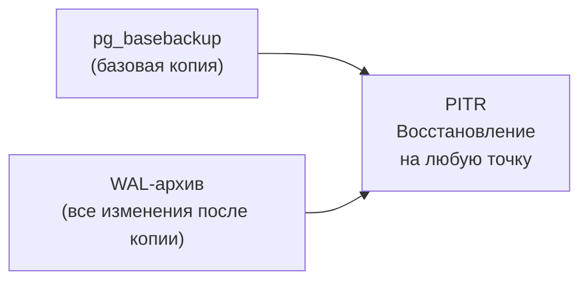

# Лекция 5. Резервное копирование: pg_dump, pg_basebackup, WAL-архивирование

**Неделя:** 5  
**Версия PostgreSQL:** 18  
**Практика:** лабораторная работа №3 «Резервное копирование базы данных eshop»

---

## Цель лекции

По итогам лекции студент:

- знает параметры надёжности RPO и RTO и умеет применять их при обсуждении стратегии бэкапа с DBA;
- понимает разницу между логическим и физическим резервным копированием и не путает «дамп» с «копией кластера»;
- знает команды `pg_dump`, `pg_dumpall`, `pg_basebackup` и их основные параметры;
- понимает роль WAL-архивирования в обеспечении PITR;
- умеет проверить, что резервная копия действительно восстанавливается.

---

## Зачем это системному аналитику

Резервное копирование кажется «темой DBA». Но именно аналитик формулирует требование: «сколько данных мы можем потерять» и «как быстро сервис должен вернуться». Без числовых RPO/RTO DBA не может выбрать стратегию: ежедневный `pg_dump`, `pg_basebackup` + WAL-архив или реплику.

Аналитик также отвечает за то, чтобы требования к бэкапу попали в контракт сопровождения и в runbook. Фраза «бэкапы делаются» ничего не гарантирует: бэкап, который ни разу не восстанавливали, — это не бэкап, а надежда.

> **Ключевая мысль.** RPO — это про данные, RTO — про время. Их нельзя заменить словами «как можно быстрее» и «ничего не терять». Это два числа, которые бизнес согласует, а DBA реализует.

---

## 1. Вводный кейс

> **Кейс из практики.**  
> В `eshop` каждую ночь делали `pg_dump -Fc` и складывали файл на тот же сервер, где работает PostgreSQL. В сопровождении было написано: «Резервное копирование настроено, RPO — 1 час».  
>  
> В пятницу вечером диск вышел из строя вместе с каталогом `PGDATA` и папкой `/backup`.  
> DBA нашёл последнюю копию — недельной давности, на внешнем диске, который забыли обновить.  
> Восстановление заняло 9 часов, потеряно 5 дней заказов.  
>  
> На разборе выяснилось:
> - `pg_dump` не содержит ролей и табличных пространств;
> - копия лежала на том же диске, что и база;
> - восстановление ни разу не тестировали;
> - `archive_mode` был выключен, поэтому PITR был невозможен.

**Вопросы аудитории:**
1. Какие два требования были сформулированы неверно?
2. Почему ежедневный `pg_dump` не даёт RPO = 1 час?
3. Что нужно было настроить, чтобы восстановиться на момент за 5 минут до сбоя?

---

## 2. RPO и RTO: параметры надёжности

Прежде чем настраивать резервное копирование, нужно договориться о требованиях:

| Параметр | Расшифровка | Пример |
|---|---|---|
| **RPO** | Recovery Point Objective — допустимая потеря данных (в единицах времени) | «Допустимо потерять не более 1 часа транзакций» |
| **RTO** | Recovery Time Objective — допустимое время восстановления сервиса | «Сервис должен быть восстановлен за 4 часа» |

**Зависимость от стратегии:**

| Стратегия | Достижимый RPO | Достижимый RTO |
|---|---|---|
| Ручной `pg_dump` раз в сутки | до 24 часов | часы (время `pg_restore`) |
| `pg_dump` каждый час | до 1 часа | часы |
| `pg_basebackup` + WAL-архив (PITR) | секунды / минуты | 1–4 часа (зависит от объёма WAL) |
| Streaming replication (standby) | секунды | минуты (переключение) |

> **Задача аналитика:** договориться с бизнесом о требованиях RPO/RTO и передать их DBA в виде числовых значений. «Как можно быстрее» — не требование.

### 2.1. Как объяснить RPO бизнесу

RPO — это ответ на вопрос: «Если catastrophe случится в 14:37, какие заказы мы готовы потерять?»  
Если бизнес говорит «ни одного», это RPO = 0 и требует синхронной репликации (лекция 10), а не ежедневного дампа.

### 2.2. Как объяснить RTO бизнесу

RTO — это ответ на вопрос: «Сколько времени магазин может быть недоступен, пока мы восстанавливаемся?»  
Если ответ «5 минут», нужна реплика с автоматическим failover, а не восстановление из дампа.

---

## 3. Логические дампы: `pg_dump`

`pg_dump` создаёт логический экспорт — набор SQL-команд для воссоздания объектов и данных.

> Подробный справочник по форматам, флагам и типичным ошибкам — в статье [pg_dump](../../wiki/tools/pg-dump.md).

### 3.1. Форматы

| Формат | Флаг | Характеристики |
|---|---|---|
| Plain SQL | `-Fp` | Читаемый текстовый файл; восстанавливается через `psql` |
| Custom (binary) | `-Fc` | Сжатый; поддерживает выборочное восстановление и параллельный `pg_restore` |
| Directory | `-Fd` | Папка с файлами; лучший для параллельного дампа (`-j N`) |
| Tar | `-Ft` | Tar-архив; менее гибкий |

**Рекомендация:** использовать custom-формат (`-Fc`) — сжатие + выборочное восстановление.

### 3.2. Основные команды

```bash
# Полный дамп базы в custom-формате (рекомендуется)
pg_dump -h localhost -U postgres -Fc myapp_prod -f myapp_prod_$(date +%Y%m%d).dump

# Только схема (без данных)
pg_dump -h localhost -U postgres --schema-only myapp_prod -f schema.sql

# Только данные (без схемы)
pg_dump -h localhost -U postgres --data-only myapp_prod -f data.sql

# Конкретная таблица
pg_dump -h localhost -U postgres -t orders myapp_prod -f orders.sql

# Исключить таблицу (например, большой аудит-лог)
pg_dump -h localhost -U postgres --exclude-table=audit_log myapp_prod -f noaudit.dump

# Параллельный дамп в directory-формате (быстрее на многоядерных серверах)
pg_dump -h localhost -U postgres -Fd -j 4 myapp_prod -f myapp_dump_dir/
```

### 3.3. Что `pg_dump` не сохраняет

- **Роли и их пароли** — глобальные объекты кластера.
- **Табличные пространства** — только ссылки на них.
- **Статистику планировщика** — в PostgreSQL 18 появился флаг `--with-statistics`, но по умолчанию статистика не выгружается.
- **Состояние WAL** — дамп не является точкой для PITR.

### 3.4. Ограничения логического дампа

- Не включает глобальные объекты кластера: **роли и табличные пространства** — для них нужен `pg_dumpall`.
- При восстановлении большой БД — медленно: нужно заново построить все индексы.
- Нельзя восстановить «на момент времени» (нет PITR).
- Дамп — это **согласованный снимок на момент начала**, а не «непрерывная копия». Всё, что изменилось после старта, в него не попадает.

---

## 4. Дамп кластера: `pg_dumpall`

`pg_dumpall` создаёт дамп **всего кластера PostgreSQL**, включая глобальные объекты (роли, пароли, табличные пространства), которые `pg_dump` не захватывает.

```bash
# Полный дамп кластера (только plain SQL)
pg_dumpall -h localhost -U postgres -f cluster_full.sql

# Только глобальные объекты (роли, табличные пространства)
pg_dumpall -h localhost -U postgres --globals-only -f globals.sql
```

> При полном восстановлении кластера с нуля: сначала `psql -f globals.sql` (роли), затем `pg_restore` или `psql` для каждой базы.

> **Практика →** [Лаб. 03, часть 1 — `pg_dump` и `pg_dumpall --globals-only`](../../labs/lab_03/lab_03.md).

---

## 5. Физическое резервное копирование: `pg_basebackup`

`pg_basebackup` создаёт **физическую копию всего PGDATA-каталога** — двоичный снимок на уровне файловой системы.

> Подробный справочник по `pg_basebackup`, инкрементальным копиям и проверке — в статье [pg_basebackup](../../wiki/tools/pg-basebackup.md).

### 5.1. Когда использовать `pg_basebackup`

| Сценарий | `pg_dump` | `pg_basebackup` |
|---|---|---|
| Выборочное восстановление одной таблицы | ✓ | — |
| Быстрое полное восстановление большой базы | — | ✓ |
| Основа для PITR | — | ✓ |
| Инициализация реплики | — | ✓ |
| Переносимость между ОС / версиями | ✓ | — |

### 5.2. Команды

```bash
# Физическая копия в директорию (онлайн, без остановки сервера)
pg_basebackup -h localhost -U replication_user -D /backup/basebackup/ -Fp -Xs -P

# С упаковкой в tar + gzip
pg_basebackup -h localhost -U replication_user -D /backup/ -Ft -z -Xs -P
# -D   — куда сохранить
# -Fp  — формат plain (файловая иерархия как PGDATA)
# -Ft  — формат tar
# -Xs  — включить WAL-файлы, нужные для восстановления
# -P   — показывать прогресс
# -z   — gzip-сжатие (только с -Ft)
```

### 5.3. Требования

```sql
-- Роль для репликации
CREATE ROLE replication_user REPLICATION LOGIN PASSWORD 'secret';
```

```
# pg_hba.conf
host    replication    replication_user    127.0.0.1/32    scram-sha-256
```

> **Права.** `pg_basebackup` требует роль с атрибутом `REPLICATION` (или суперпользователя). Это отдельная привилегия: обычная роль приложения не должна иметь возможности снять весь кластер.

### 5.4. Что важно помнить о физической копии

- Копия **привязана к версии** PostgreSQL и архитектуре. Перенести её с PostgreSQL 18 на 17 нельзя.
- Копия содержит **весь кластер**, а не одну базу.
- Без WAL-архива восстановление вернёт данные на момент окончания копии.
- Копия должна лежать **не на том же диске**, что и `PGDATA`.

---

## 6. WAL-архивирование: основа PITR

### 6.1. Как это работает

WAL-архивирование — непрерывная копия журналов предзаписи в отдельное хранилище. В сочетании с `pg_basebackup` позволяет восстановить базу **на любой момент времени**.



### 6.2. Настройка WAL-архивирования

```ini
# postgresql.conf
wal_level           = replica
archive_mode        = on
archive_command     = 'cp %p /mnt/wal_archive/%f'
# Для S3:
# archive_command   = 'aws s3 cp %p s3://mybucket/wal/%f'
archive_timeout     = 300       # форсировать ротацию WAL каждые 5 минут
```

`%p` — полный путь к WAL-файлу, `%f` — только имя файла.

> **Почему `archive_timeout` важен.** Если база почти не пишет, WAL-сегмент может заполняться часами и не попасть в архив. Тогда RPO фактически равен этому времени. `archive_timeout = 300` ограничивает задержку пятью минутами, даже при низкой нагрузке.

### 6.3. Проверка архивирования

```sql
SELECT * FROM pg_stat_archiver;
-- last_archived_wal     — последний успешно заархивированный WAL
-- failed_count > 0      — ошибка: archive_command не работает!

-- Принудительно переключить WAL-файл
SELECT pg_switch_wal();
```

> **Типичная ошибка.** `archive_command` настроен, но каталог архива недоступен или переполнен. PostgreSQL продолжает писать WAL локально, `pg_wal` растёт, а `failed_count` увеличивается. Если не мониторить `pg_stat_archiver`, это обнаружится только при попытке восстановления — когда уже поздно.

> **Практика →** [Лаб. 03, часть 3 — настройка `archive_mode` и проверка `pg_stat_archiver`](../../labs/lab_03/lab_03.md).

---

## 7. Стратегия резервного копирования

### 7.1. Трёхуровневая стратегия

| Уровень | Инструмент | Частота | Назначение |
|---|---|---|---|
| Полный бэкап | `pg_basebackup` | Еженедельно | Базовая точка для PITR; полное восстановление |
| Логический дамп | `pg_dump` | Ежедневно | Выборочное восстановление таблиц; переносимость |
| WAL-архив | `archive_command` | Непрерывно | PITR: восстановление с точностью до транзакции |

### 7.2. Правило 3-2-1

- **3** копии данных
- на **2** различных носителях/системах хранения
- **1** копия — вне площадки (offsite / cloud)

### 7.3. Почему одного уровня недостаточно

- Только `pg_dump` → нет PITR, медленное восстановление, нет ролей.
- Только `pg_basebackup` → восстановление на момент копии, потеря изменений после.
- Только WAL-архив → нечего восстанавливать, нет базовой копии.
- Только реплика → защищает от отказа сервера, но не от логической ошибки (`DROP TABLE` мгновенно уезжает на реплику).

---

## 8. Проверка резервной копии

```bash
# Проверить целостность custom-дампа
pg_restore --list myapp_prod_20240901.dump | head -30

# Полноценная проверка: восстановить в тестовую базу
createdb myapp_test_restore
pg_restore -d myapp_test_restore -Fc myapp_prod_20240901.dump

# Проверить количество строк в ключевых таблицах
psql -d myapp_test_restore -c "SELECT COUNT(*) FROM orders;"
```

> **Задача аналитика:** при постановке требований указывать **частоту проверки** восстановления. Нетестируемый бэкап обнаруживается только в момент катастрофы.

### 8.1. Что должно быть в регламенте проверки

| Пункт | Пример |
|---|---|
| Частота | Ежемесячно — `pg_restore`; ежеквартально — PITR |
| Стенд | Отдельный экземпляр, не production |
| Критерий успеха | Счётчики строк совпадают, время ≤ RTO |
| Ответственный | DBA |
| Фиксация | Запись в журнале проверок с датой и результатом |

> **Практика →** [Лаб. 03, часть 4 — восстановление дампа в тестовую базу](../../labs/lab_03/lab_03.md).

---

## 9. Разбор вводного кейса

1. **Какие два требования были неверны?**  
   RPO = 1 час при ежедневном дампе — недостижим. И «резервное копирование настроено» без проверки восстановления — не требование, а лозунг.
2. **Почему ежедневный `pg_dump` не даёт RPO = 1 час?**  
   Дамп фиксирует состояние на момент запуска. Всё, что произошло после, в нём отсутствует. RPO при ежедневном дампе — до 24 часов.
3. **Что нужно для восстановления на момент за 5 минут до сбоя?**  
   `pg_basebackup` + непрерывный WAL-архив + `archive_mode = on`. Это и есть PITR (лекция 6).

---

## 10. Итоги лекции

После этой лекции студент умеет:

- **Согласовать RPO/RTO** с бизнесом и объяснить, какой метод бэкапа их обеспечивает.
- **Выполнить `pg_dump -Fc`** и проверить результат через `pg_restore --list`.
- **Объяснить**, зачем нужен `pg_dumpall --globals-only` и что произойдёт без него при переносе на новый сервер.
- **Снять физическую копию** через `pg_basebackup -Fp -Xs -P` и объяснить содержимое папки.
- **Настроить WAL-архивирование**: `archive_mode=on`, `archive_command`, проверить через `pg_stat_archiver`.
- **Составить регламент** резервного копирования по правилу 3-2-1 с конкретными частотой и сроком хранения.

---

## Контрольные вопросы

1. Чем RPO отличается от RTO? Приведите пример требования для интернет-магазина.
2. Почему `pg_dump` не подходит как единственный инструмент для RPO = 5 минут?
3. Что не сохраняет `pg_dump` и почему для переноса кластера нужен `pg_dumpall --globals-only`?
4. Чем `-Fc` лучше `-Fp` при восстановлении большой базы?
5. Зачем нужен `archive_timeout`, если `archive_command` уже настроен?
6. Что произойдёт, если `archive_command` перестанет работать, а мониторинга `pg_stat_archiver` нет?
7. Почему реплика не заменяет резервную копию? Приведите сценарий.
8. Как проверить, что бэкап восстанавливается, не трогая production?

---

## Ссылки

- `pg_dump`: https://www.postgresql.org/docs/current/app-pgdump.html
- `pg_dumpall`: https://www.postgresql.org/docs/current/app-pg-dumpall.html
- `pg_basebackup`: https://www.postgresql.org/docs/current/app-pgbasebackup.html
- WAL-архивирование: https://www.postgresql.org/docs/current/continuous-archiving.html
- `pg_stat_archiver`: https://www.postgresql.org/docs/current/monitoring-stats.html#MONITORING-PG-STAT-ARCHIVER-VIEW

**Wiki:**
- [Резервное копирование и восстановление](../../wiki/concepts/backup-recovery.md)
- [pg_dump](../../wiki/tools/pg-dump.md)
- [pg_basebackup](../../wiki/tools/pg-basebackup.md)
- [PITR](../../wiki/concepts/pitr.md)
- [Регламент бэкапов (шаблон)](../../wiki/artifacts/backup-policy.md)
