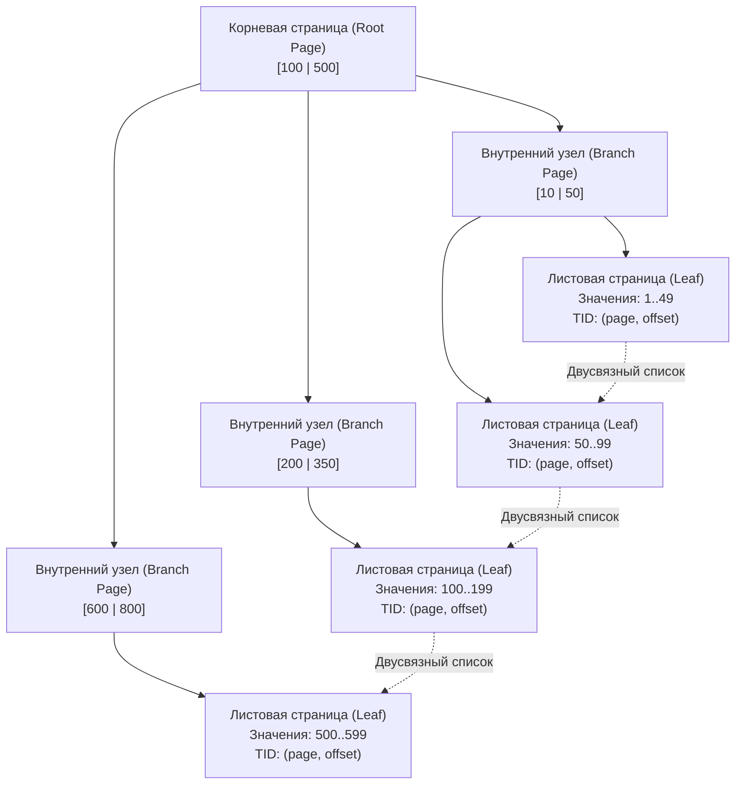
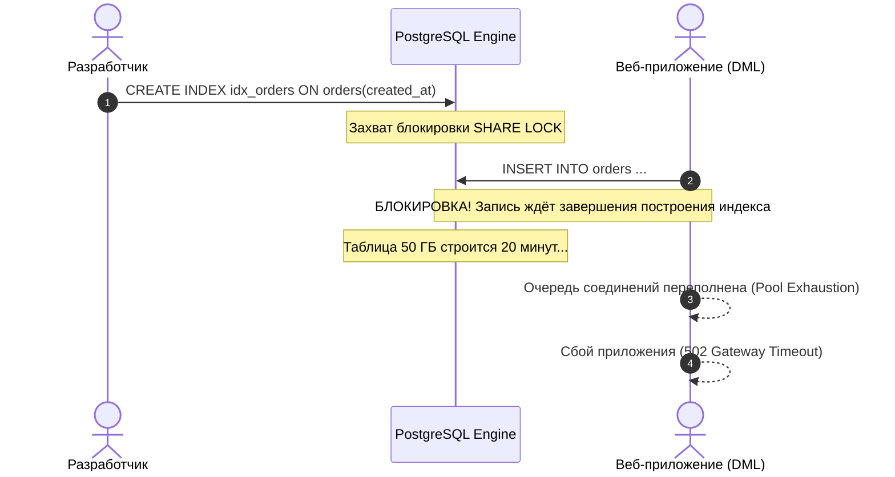
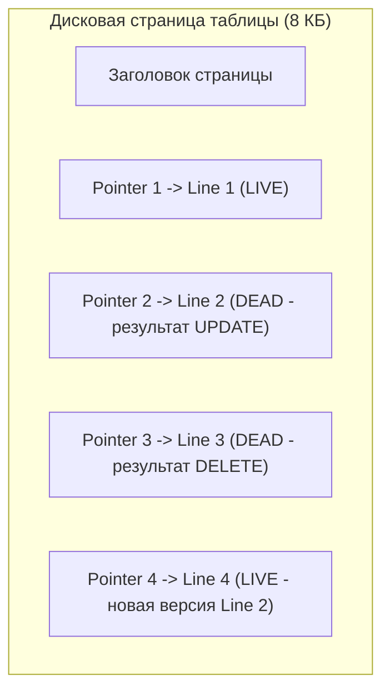
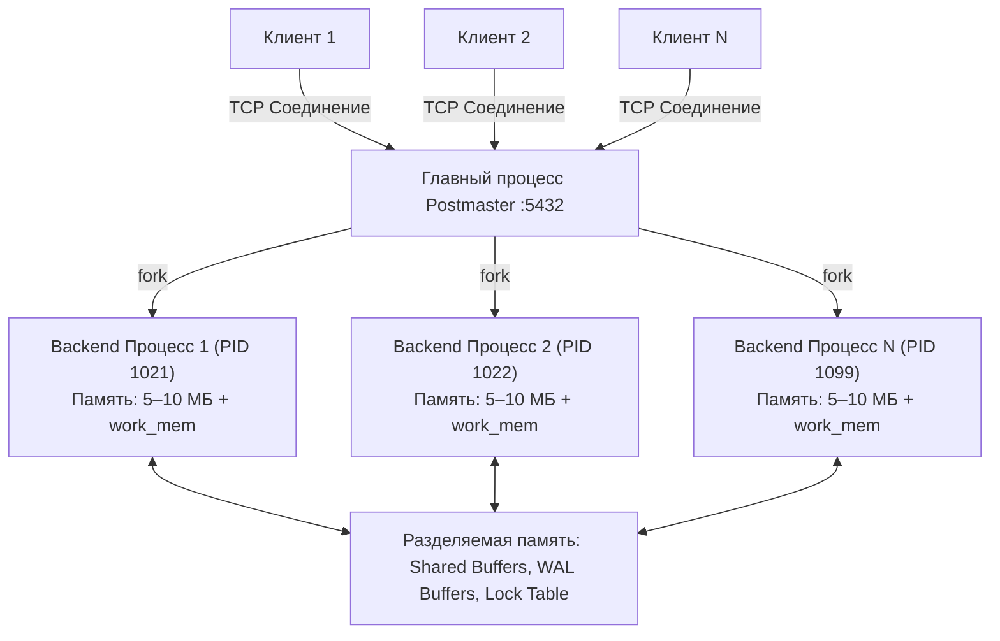
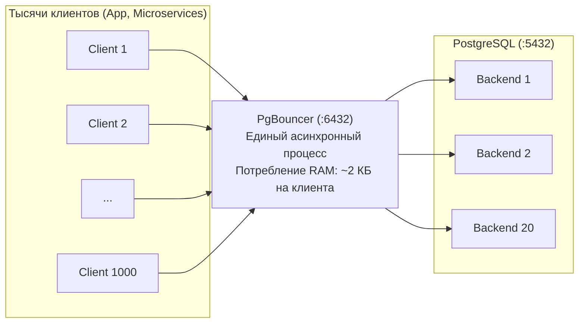
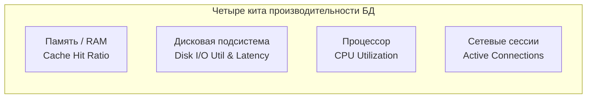

# Лекция 9. Оптимизация производительности. Индексы. Connection Pooling. Обоснование модернизации

**Неделя:** 9  
**Версия PostgreSQL:** 18  
**Практика:** лабораторная работа №7 «Индексы, autovacuum, PgBouncer для eshop»  
**Данные в примерах:** учебная база данных `eshop` (20 000 клиентов, 1 000 товаров, 200 000 заказов, 600 000 позиций)

---

## Цель лекции

По итогам лекции студент:

- понимает физическую природу индексов PostgreSQL (B-tree, GIN, GiST, BRIN), умеет выбирать правильный тип индекса и строить эффективные составные, частичные и функциональные индексы;
- знает механизм работы `CREATE INDEX CONCURRENTLY`, понимает природу блокировок DDL и умеет диагностировать невалидные и неиспользуемые индексы;
- понимает влияние MVCC на производительность (накопление мёртвых версий строк, bloat таблицы и индексов), математику порогов autovacuum и принципы его точечной настройки;
- понимает процессную модель PostgreSQL (fork на соединение), обосновывает необходимость пула соединений, различает режимы PgBouncer (`session`, `transaction`, `statement`) и знает ограничения транзакционного режима;
- владеет методологией Capacity Planning и умеет составлять строгое технико-экономическое обоснование модернизации программно-аппаратного обеспечения (ПАО) для руководства и бизнеса.

---

## Зачем это системному аналитику и архитектору

Оптимизация производительности традиционно считается епархией администраторов баз данных (DBA) и backend-разработчиков. Однако на практике **до 70–80% проблем с производительностью закладываются на этапах системного анализа и архитектурного проектирования**:

1. **Непродуманные сценарии поиска:** требование «сделать фильтрацию без учёта регистра по любому фрагменту строки» или «поиск по произвольному полю в неструктурированном JSON» без понимания механизмов индексирования гарантирует падение производительности в production.
2. **Игнорирование жизненного цикла данных:** если аналитик не заложил статусную модель (например, что 85% заказов архивные, а активных всего 5%), разработчики создадут тяжеловесный индекс на миллионы строк вместо компактного частичного индекса.
3. **Архитектура подключений микросервисов:** запуск 50 реплик микросервиса, каждая из которых открывает собственный пул из 20 соединений, порождает 1000 процессов PostgreSQL. Сервер начнёт тратить все ресурсы процессора на переключение контекста и синхронизацию разделяемой памяти, даже если запросы элементарные.
4. **Защита бюджета на инфраструктуру:** аналитик и архитектор должны уметь переводить технические метрики («P95 вырос до 4 секунд, disk I/O util 85%») на язык бизнес-обоснования модернизации оборудования и архитектуры.

---

## 1. Вводный кейс

> **Кейс из практики:**  
> Интернет-магазин `eshop` запустил сезонную распродажу. Через 15 минут после старта сайт начал выдавать ошибки `502 Bad Gateway` и `FATAL: remaining connection slots are reserved for non-replication superuser connections`.  
> Одновременно мониторинг зафиксировал:  
> - CPU БД загружен на 98%, при этом реальный объём полезных запросов упал втрое;  
> - размер таблицы `orders` вырос с 250 МБ до 1.8 ГБ, хотя новых строк добавилось всего 15 000;  
> - простейший запрос менеджеров «показать ожидающие заказы» (`WHERE status = 'pending'`) выполняется 12 секунд вместо обычных 15 миллисекунд;  
> - попытка разработчиков накатить индекс командой `CREATE INDEX idx_orders_status ON orders(status);` полностью «повесила» обработку заказов на 40 минут.

**Вопросы аудитории:**
1. Почему создание индекса остановило приём заказов, если это операция чтения структуры?
2. Почему таблица выросла в 7 раз при добавлении всего 15 тысяч заказов?
3. Почему сервер задохнулся от количества соединений, хотя суммарное число активных пользователей было умеренным?

К концу лекции мы разберём физические причины каждого из этих сбоев и сформулируем комплексное архитектурное решение.

---

## 2. Индексы PostgreSQL: устройство, виды и стратегия применения

### 2.1. Как устроен B-tree и почему он используется по умолчанию

Когда мы пишем `CREATE INDEX ON table(column);`, PostgreSQL без дополнительных указаний создаёт **B-tree (сбалансированное дерево)**. Это вариация $B^+$-дерева, оптимизированная для работы с дисковыми страницами фиксированного размера (по умолчанию 8 КБ).



**Ключевые свойства B-tree в PostgreSQL:**
1. **Сбалансированность:** глубина дерева от корня до любого листа строго одинакова (обычно 2–4 уровня даже для десятков миллионов строк). Поиск конкретного ключа требует всего 2–4 чтения страниц (O(log N)).
2. **Листовые страницы связаны двусвязным списком:** это делает B-tree идеальным для диапазонных запросов (`BETWEEN`, `<`, `>`, `>=`). Найдя начальный элемент за O(log N), планировщик просто последовательно читает соседние листовые страницы.
3. **Хранение TID (Tuple Identifier):** каждый элемент листовой страницы содержит проиндексированное значение и указатель `(номер_блока, номер_смещения)` на физическую строку в таблице (Heap).

**Поддерживаемые операторы:** `=`, `<`, `<=`, `>`, `>=`, `BETWEEN`, `IN`, а также поиск по префиксу строки: `LIKE 'префикс%'` (при условии текстовой сортировки по правилам C-locale или при использовании классов операторов `text_pattern_ops`).

---

### 2.2. Специализированные типы индексов

Хотя B-tree универсален, существуют типы данных и операции, где его сложность и структура неэффективны:

| Тип индекса                            | Физический принцип                                                                                                                    | Для чего идеален                                                                                                             | Когда бесполезен                                                                          |
| -------------------------------------- | ------------------------------------------------------------------------------------------------------------------------------------- | ---------------------------------------------------------------------------------------------------------------------------- | ----------------------------------------------------------------------------------------- |
| **B-tree**                             | Сбалансированное многолучевое дерево поиска                                                                                           | Равенство, диапазоны, сортировка (`ORDER BY`), поиск префикса                                                                | Полнотекстовый поиск, поиск элементов внутри массивов или JSON, геометрические координаты |
| **Hash**                               | Хэш-таблица на диске (с PG 10 пишется в WAL и безопасна при авариях)                                                                  | Строго равенство (`=`). Чуть компактнее B-tree при длинных строках                                                           | Диапазоны (`<`, `>`), сортировка, `LIKE`                                                  |
| **GIN** *(Generalized Inverted Index)* | **Инвертированный индекс**: ключ — это элемент (слово, ключ JSON, элемент массива), значение — список строк (TID), где он встречается | Массивы (`tags @> '{sale}'`), поля JSONB (`attributes @> '{"color": "red"}'`), полнотекстовый поиск (`to_tsvector`)          | Обычные скалярные значения, диапазонные сравнения чисел/дат                               |
| **GiST** *(Generalized Search Tree)*   | Сбалансированное дерево иерархических деревьев (R-tree). Узлы хранят ограничивающие объёмы (Bounding Box)                             | Геометрия и ГИС (PostGIS: «найти объекты в радиусе 1 км»), интервальные типы (`tsrange`, непересекающиеся бронирования)      | Точное равенство простых скалярных типов                                                  |
| **BRIN** *(Block Range Index)*         | Хранит только **минимум и максимум** значений для диапазона страниц таблицы (по умолчанию 128 страниц = 1 МБ)                         | Сверхбольшие таблицы (сотни гигабайт) с **физически упорядоченными данными** (логи, временные ряды, метрики по `created_at`) | Неупорядоченные данные, частые `UPDATE`/`DELETE`, таблицы малого и среднего размера       |

> **Инженерная памятка по BRIN:**  
> Индекс BRIN по таблице событий размером 100 ГБ может занимать всего **несколько мегабайт** (вместо 20–30 ГБ у B-tree). Но он работает только тогда, когда новые записи дописываются строго в конец (`APPEND-ONLY`), и данные на диске естественно упорядочены по времени.

---

### 2.3. Специальные виды B-tree индексов

В реальных проектах типовая ошибка — индексировать столбцы «в лоб». PostgreSQL предоставляет три мощных инструмента адаптации B-tree под конкретные бизнес-запросы.

#### 1. Частичный (Partial) индекс
Индекс строится только по тем строкам таблицы, которые удовлетворяют предикату `WHERE`.

*Пример из `eshop`:*  
В таблице `orders` на 200 000 строк 85% заказов находятся в статусе `delivered`, 5% — `cancelled`, и только 5% — активные (`pending`, `processing`). Менеджеры ежеминутно запрашивают список заказов в обработке:

```sql
-- Полный индекс хранит 200 000 записей (размер ~5.5 МБ)
CREATE INDEX idx_orders_status ON orders(status);

-- Частичный индекс хранит только 10 000 записей (размер ~250 КБ)
CREATE INDEX idx_orders_active ON orders(status)
WHERE status IN ('pending', 'processing');
```

**Преимущества частичного индекса:**
- **Размер в 10–20 раз меньше:** индекс целиком помещается в кэш RAM (`shared_buffers`).
- **Нулевые накладные расходы при вставке завершённых заказов:** при `INSERT` или `UPDATE` архивных строк индекс не модифицируется, экономя операции I/O.
- **Ограничение:** оптимизатор выберет этот индекс **только** если условие запроса логически влечет за собой условие индекса. Если приложение формирует параметризованный запрос `WHERE status = $1`, планировщик на этапе составления generic-плана не сможет доказать безопасность индекса и выберет последовательное сканирование (`Seq Scan`).

#### 2. Индекс по выражению (Functional index)
Индекс хранит не значение поля таблицы, а вычисленный результат детерминированной функции.

*Пример:* поиск клиента по email без учёта регистра:
```sql
-- Запрос приложения:
SELECT * FROM customers WHERE lower(email) = lower('Client@Example.com');

-- Обычный B-tree индекс на customers(email) здесь БЕСПОЛЕЗЕН:
-- в B-tree лежат исходные строки, а функция lower() применяется на лету.

-- Решение: функциональный индекс
CREATE INDEX idx_customers_email_lower ON customers(lower(email));
ANALYZE customers;
```

> **Важно:** выражение в `WHERE` должно **символ в символ** совпадать с выражением в определении индекса. Если в индексе указано `lower(email)`, запрос `WHERE lower(email::text)` индекс не использует.

#### 3. Составной (Composite) индекс и правило порядка колонок
Составной индекс строится по нескольким колонкам: `CREATE INDEX ON orders(status, created_at);`.

Строки в таком индексе физически упорядочены **сначала по первому столбцу, а внутри одинаковых значений первого — по второму**:

```text
('cancelled',  '2026-01-01')
('cancelled',  '2026-01-02')
...
('pending',    '2026-10-01')  <-- Точка входа для status = 'pending'
('pending',    '2026-10-15')
('pending',    '2026-10-20')  <-- Диапазон дат сканируется подряд
...
('shipped',    '2026-02-01')
```

**Золотое правило составного индекса:**  
> **Сначала идут столбцы, используемые в условиях строгого равенства (`=`), а затем — столбец, используемый в диапазоне (`<`, `>`, `BETWEEN`).**

Если запрос ищет: `WHERE status = 'pending' AND created_at >= now() - INTERVAL '30 days'`:
- Индекс `(status, created_at)`: планировщик мгновенно позиционируется на первый `pending` за нужную дату и последовательно читает ровно те несколько листовых страниц, где лежат подходящие строки.
- Индекс `(created_at, status)`: планировщику придётся перебрать **все** заказы за последние 30 дней (все статусы) и отфильтровать лишние.

---

### 2.4. Безопасное создание индексов: `CREATE INDEX CONCURRENTLY`

В production-базах данных выполнение обычного `CREATE INDEX` — частая причина аварий:



**Обычный `CREATE INDEX`:**
- Захватывает блокировку уровня `SHARE`.
- Разрешает параллельный `SELECT`, но **полностью блокирует любые `INSERT`, `UPDATE`, `DELETE`** на таблице до окончания построения.

**`CREATE INDEX CONCURRENTLY`:**
- Строит индекс без блокировки записи (захватывает только мягкую `SHARE UPDATE EXCLUSIVE`).
- Приложение продолжает беспрепятственно выполнять `INSERT`, `UPDATE`, `DELETE`.

**Цена и механизм работы `CONCURRENTLY`:**
1. Работает в **два прохода** по таблице:
   - Проход 1: создаётся скелет индекса, фиксируются текущие строки.
   - Ожидание: процесс ждёт завершения всех транзакций, которые могли изменять таблицу.
   - Проход 2: дочитываются строки, изменённые во время первого прохода.
2. Не может выполняться внутри блока транзакции (`BEGIN ... COMMIT`).
3. Работает в 2–3 раза дольше обычного создания.

**Проблема `INVALID`-индексов:**  
Если при построении `CONCURRENTLY` произошёл сбой (разрыв соединения, deadlock, нехватка места на диске), в каталоге остаётся **невалидный индекс**. Он **не используется оптимизатором для чтения**, но **продолжает замедлять все операции записи**, так как PostgreSQL вынужден поддерживать его целостность!

*Диагностика и устранение невалидных индексов:*
```sql
-- Поиск невалидных индексов
SELECT c.relname AS index_name,
       i.indisvalid,
       i.indisready
FROM   pg_index i
JOIN   pg_class c ON c.oid = i.indexrelid
WHERE  NOT i.indisvalid;

-- Исправление: сначала удалить фоново, затем пересоздать
DROP INDEX CONCURRENTLY idx_orders_created;
CREATE INDEX CONCURRENTLY idx_orders_created ON orders(created_at);
```

---

### 2.5. Аудит и очистка неиспользуемых индексов

Каждый индекс имеет свою цену:
- Замедление `INSERT`: при каждой вставке новой строки сервер обязан вставить элемент в каждое B-tree таблицы.
- Замедление `UPDATE`: если обновляется проиндексированное поле, обновляется индекс; если не проиндексированное — ломается механизм HOT (Heap-Only Tuples).
- Лишний расход дискового пространства и кэша памяти.

*Запрос для поиска неиспользуемых индексов:*
```sql
SELECT s.schemaname,
       s.relname AS table_name,
       s.indexrelname AS index_name,
       pg_size_pretty(pg_relation_size(s.indexrelid)) AS index_size,
       s.idx_scan
FROM   pg_stat_user_indexes s
JOIN   pg_index i ON i.indexrelid = s.indexrelid
WHERE  s.idx_scan = 0                          -- индекс ни разу не использовался
  AND  NOT i.indisunique                       -- исключаем первичные и уникальные ключи
  AND  NOT EXISTS (
       SELECT 1 FROM pg_constraint c 
       WHERE c.conindid = s.indexrelid
  )
ORDER  BY pg_relation_size(s.indexrelid) DESC;
```

> **Предостережение аналитику:** нельзя удалять индекс с `idx_scan = 0`, если статистика сбрасывалась недавно или если этот индекс предназначен для редких отчётов (например, ежемесячный расчёт налогов или годовое закрытие периода). Аудит проводят на статистике, накопленной за недели продуктивной эксплуатации.

---

## 3. MVCC, Bloat и роль Autovacuum в производительности

### 3.1. Физика многоверсионности: почему строки «умирают»

PostgreSQL реализует изоляцию транзакций через **MVCC (Multi-Version Concurrency Control)**. Главный принцип: *«читатели не блокируют писателей, а писатели не блокируют читателей»*.

Цена этого принципа — специфика модификации данных:
- **`INSERT`:** физически записывает новую версию строки (`tuple`) со служебным полем `xmin = текущий_XID`.
- **`DELETE`:** **не удаляет** строку физически! Он лишь помечает её: проставляет в служебное поле `xmax` номер текущей транзакции. Для будущих транзакций строка становится невидимой, но остаётся на диске.
- **`UPDATE`:** в PostgreSQL физически эквивалентен связке **`DELETE` старой версии + `INSERT` новой версии**. Старая версия строки объявляется «мёртвой» (`dead tuple`), а новая записывается на свободное место страницы.



**Что такое Bloat (раздувание):**  
Если мёртвые строки не очищать вовремя, таблица начинает «пухнуть». Например, в таблице реально 100 000 актуальных строк, но из-за постоянных `UPDATE` в ней накопилось 900 000 мёртвых версий.  
**Последствия Bloat:**
1. Запросы `Seq Scan` читают с диска в 10 раз больше страниц, тратя I/O и вымывая полезные данные из оперативной памяти (`shared_buffers`).
2. Раздуваются B-tree индексы, так как они ссылаются на мёртвые версии строк.
3. Деградирует точность планировщика: устаревшая статистика ведёт к выбору неоптимальных соединений таблиц (`Nested Loop` вместо `Hash Join`).

---

### 3.2. Математика Autovacuum

Фоновый процесс **Autovacuum** отвечает за очистку мёртвых версий строк (освобождение места внутри страниц для повторного использования) и запуск `ANALYZE` (обновление статистики).

Он просыпается каждые `autovacuum_naptime` (по умолчанию 1 минута) и проверяет условие:

$$\text{Порог запуска VACUUM} = \text{autovacuum\_vacuum\_threshold} + (\text{autovacuum\_vacuum\_scale\_factor} \times \text{reltuples})$$

Параметры по умолчанию в PostgreSQL:
- `autovacuum_vacuum_threshold = 50` строк.
- `autovacuum_vacuum_scale_factor = 0.2` (то есть **20%** от объёма таблицы).

**Ловушка масштаба (The Scale Factor Trap):**
- Для маленькой таблицы на 1 000 строк порог: $50 + 0.2 \times 1000 = 250$ строк. Очистка запускается быстро и регулярно.
- Для таблицы `orders` на 200 000 строк порог: $50 + 0.2 \times 200\,000 = 40\,050$ мёртвых строк.
- Для продуктовой таблицы истории платежей на 50 000 000 строк порог: $50 + 0.2 \times 50\,000\,000 = \mathbf{10\,000\,050}$ **мёртвых строк!**

Таблица должна накопить **10 миллионов мёртвых строк**, прежде чем сервер соизволит запустить очистку. К этому моменту таблица успеет раздуться на десятки гигабайт, а последующий запуск VACUUM создаст колоссальную дисковую нагрузку.

---

### 3.3. Мониторинг и точечная настройка на уровне таблицы

Глобально менять `autovacuum_vacuum_scale_factor` в `postgresql.conf` для всего кластера рискованно. Правильный архитектурный подход — **точечная настройка параметров хранения (Storage Parameters)** для высоконагруженных таблиц:

```sql
-- Переопределение порогов для конкретной таблицы orders:
-- Запуск VACUUM при накоплении 1% мёртвых строк (вместо 20%)
-- Запуск ANALYZE при изменении 0.5% строк (вместо 10%)
ALTER TABLE orders SET (
    autovacuum_vacuum_scale_factor  = 0.01,
    autovacuum_analyze_scale_factor = 0.005
);
```

*Запрос диагностики состояния и очередей autovacuum:*
```sql
SELECT relname,
       n_live_tup,
       n_dead_tup,
       ROUND(n_dead_tup::numeric / NULLIF(n_live_tup + n_dead_tup, 0) * 100, 1) AS dead_pct,
       last_autovacuum,
       last_autoanalyze
FROM   pg_stat_user_tables
WHERE  n_dead_tup > 1000
ORDER  BY n_dead_tup DESC;
```

---

## 4. Connection Pooling и архитектура PgBouncer

### 4.1. Архитектура процессов PostgreSQL

В отличие от многих других СУБД (например, MS SQL Server или MySQL, использующих модель потоков/thread pool), **PostgreSQL исторически построен на процессной модели (Process-based Architecture)**:



**Анатомия клиентского подключения:**
1. При каждом новом входящем TCP-соединении главный процесс `postmaster` выполняет системный вызов `fork()` и порождает **отдельный независимый процесс ОС (Backend)**.
2. Каждый backend-процесс аллоцирует **от 5 до 10 МБ собственной оперативной памяти** (под стек, структуры сессии, кэш метаданных) ещё до выполнения первого SQL-запроса.
3. При выполнении сортировок и хэш-таблиц процесс дополнительно выделяет память под `work_mem`.
4. Если приложение держит 1 000 одновременных подключений:
   - $1\,000 \times 10\text{ МБ} \approx 10\text{ ГБ}$ памяти тратится **просто на факт удержания соединений**;
   - Планировщик ОС тратит огромное количество циклов CPU на переключение контекста (*context switching*) между тысячей процессов;
   - Начинается конкуренция за разделяемые блокировки во внутренних структурах ядра PostgreSQL (`ProcArrayLock`).

**Вывод:** PostgreSQL спроектирован так, чтобы наилучшая производительность достигалась при **небольшом числе активных процессов** (сопоставимом с числом ядер процессора: от $1.5 \times \text{CPU}$ до $4 \times \text{CPU}$).

---

### 4.2. Роль Connection Pooler и режимы работы PgBouncer

**PgBouncer** — легковесный прокси-сервер пула соединений, написанный на языке C на базе асинхронного цикла событий `libevent`. Он слушает отдельный порт (по умолчанию 6432), принимает тысячи клиентских соединений и перенаправляет их запросы в небольшой фиксированный пул реальных соединений к PostgreSQL.



#### Сравнение режимов работы пула

| Режим                              | Когда серверное соединение возвращается в пул             | Совместимость с кодом                                                               | Эффективность мультиплексирования                                               | Где применять                                                        |
| ---------------------------------- | --------------------------------------------------------- | ----------------------------------------------------------------------------------- | ------------------------------------------------------------------------------- | -------------------------------------------------------------------- |
| **Session** *(сессионный)*         | Когда клиент закрывает TCP-сессию (`DISCONNECT`)          | **100% полная.** Работает всё: `SET`, временные таблицы, `LISTEN/NOTIFY`, `PREPARE` | Низкая. Не защищает от переполнения, если клиенты висят в `idle`                | Легаси-приложения, миграции, где невозможно исправить код приложения |
| **Transaction** *(транзакционный)* | Сразу после завершения транзакции (`COMMIT` / `ROLLBACK`) | **Высокая (90%+ современных приложений).**                                          | **Максимальная.** 1000 веб-воркеров легко обслуживаются 20–30 соединениями к БД | **Стандарт де-факто для Web / REST API / микросервисов**             |
| **Statement** *(позапросный)*      | Сразу после выполнения каждого отдельного SQL-запроса     | **Крайне низкая.** Многооператорные транзакции (`BEGIN ... COMMIT`) запрещены       | Экстремальная                                                                   | Специфические сервисы сбора метрик, аудита, одиночные `INSERT`-логи  |

---

### 4.3. Ограничения и подводные камни Transaction Mode

Транзакционный режим (`pool_mode = transaction`) разрывает постоянную привязку клиента к конкретному процессу PostgreSQL. Запрос №1 клиент выполняет через серверный процесс PID 1050, а следующий запрос №2 через 10 миллисекунд может попасть в процесс PID 1084.

Отсюда вытекают жесткие ограничения:

#### 1. Утечка параметров сессии (`SET`)
Если клиент выполнит команду `SET work_mem = '64MB';`, эта настройка применится к **серверному процессу** PostgreSQL. После завершения транзакции соединение возвращается в пул, и изменённое значение `work_mem` достанется **другому, совершенно случайному клиенту**!

> **Как правильно:**  
> Использовать локальные транзакционные параметры: `SET LOCAL work_mem = '64MB';` (сбрасывается автоматически при `COMMIT`) либо задавать параметры на уровне роли/базы данных.

#### 2. Серверные подготовленные запросы (`PREPARE / EXECUTE`)
Если выполнить SQL-команду `PREPARE my_query AS SELECT ...`, план запроса сохранится в памяти процесса PID 1050. Следующая команда `EXECUTE my_query` может пойти в процесс PID 1084, который выдаст фатальную ошибку: `ERROR: prepared statement "my_query" does not exist`.

> **Эволюция PgBouncer:**  
> Начиная с версии PgBouncer 1.21, появилась встроенная поддержка подготовленных операторов на уровне **бинарного протокола PostgreSQL** (Extended Query Protocol, который используют современные драйверы: Npgsql в .NET, JDBC в Java, asyncpg в Python, pgx в Go). Если в конфиге указан параметр `max_prepared_statements = 200`, PgBouncer сам отслеживает именованные запросы драйверов и прозрачно синхронизирует их между backend-процессами. Однако «сырые» SQL-команды `PREPARE / EXECUTE` по-прежнему не поддерживаются.

#### 3. Другие несовместимые механизмы
В режиме `transaction` категорически **не работают**:
- Временные таблицы (`CREATE TEMP TABLE`), живущие дольше одной транзакции;
- Механизм шины сообщений `LISTEN` и `NOTIFY`;
- Сессионные консультативные блокировки (`pg_advisory_lock`);
- Курсоры `WITH HOLD`.

---

## 5. Capacity Planning: выявление узких мест инфраструктуры

Capacity Planning (планирование ёмкости) — инженерный процесс прогнозирования момента, когда текущая программно-аппаратная конфигурация перестанет справляться с нагрузкой, и выбор наиболее дешёвого и надёжного способа модернизации.

### 5.1. Ключевые метрики и пороговые значения



| Метрика                      | Нормальное значение | Критический порог     | Физический смысл проблемы                                                                            | Что делать                                                                                                                   |
| ---------------------------- | ------------------- | --------------------- | ---------------------------------------------------------------------------------------------------- | ---------------------------------------------------------------------------------------------------------------------------- |
| **Cache Hit Ratio**          | > 99%               | **< 95%** (устойчиво) | Рабочий набор данных (*working set*) не помещается в RAM. Сервер постоянно читает с медленного диска | 1. Добавить RAM; <br/>2. Увеличить `shared_buffers`; <br/>3. Устранить тяжёлые `Seq Scan`                                    |
| **Disk I/O Utilization**     | < 50%               | **> 70–80%**          | Очередь к диску переполнена, задержки операций чтения/записи растут лавинообразно                    | 1. Перенос WAL на выделенный NVMe; <br/>2. Индексы под частые запросы; <br/>3. Переход на более быстрый RAID/дисковый массив |
| **Disk Write Latency (WAL)** | < 1–2 мс            | **> 10 мс**           | Задержка каждого `COMMIT`: транзакции ждут сброса журнала предзаписи на диск                         | Перенос каталога `pg_wal` на сверхбыстрый диск со сквозной записью                                                           |
| **CPU Utilization**          | 30–60%              | **> 75%**             | Процессор перегружен сложными вычислениями, хэшированием или context switching                       | 1. Оптимизация неэффективных планов; <br/>2. Введение пулера соединений; <br/>3. Апгрейд CPU / партиционирование             |
| **Active / Max Connections** | < 50%               | **> 80%**             | Риск исчерпания лимита подключений и отказа в обслуживании                                           | Внедрение PgBouncer в режиме `transaction`                                                                                   |
| **Свободное место на диске** | > 30%               | **< 15–20%**          | Угроза аварийной остановки БД при росте WAL или временных файлов сортировки                          | Расширение LVM/хранилища, автоархивация устаревших данных                                                                    |

---

### 5.2. Инструменты оценки размеров и точек роста

Системный аналитик и DBA должны контролировать распределение дискового пространства между таблицами и индексами:

```sql
-- Топ-10 таблиц кластера по суммарному размеру (данные + индексы)
SELECT relname AS table_name,
       pg_size_pretty(pg_total_relation_size(relid)) AS total_size,
       pg_size_pretty(pg_relation_size(relid))       AS table_data_size,
       pg_size_pretty(pg_indexes_size(relid))        AS indexes_size,
       ROUND(pg_indexes_size(relid)::numeric / 
             NULLIF(pg_total_relation_size(relid), 0) * 100, 1) AS index_share_pct
FROM   pg_stat_user_tables
ORDER  BY pg_total_relation_size(relid) DESC
LIMIT  10;
```

> **Диагностический сигнал:** если объём индексов (`indexes_size`) превышает объём самой таблицы в 2–3 раза, в схеме накопились дублирующие, избыточные или раздутые (bloated) индексы.

---

## 6. Обоснование модернизации ПАО (Программно-аппаратного обеспечения)

Инженерное предложение по модернизации должно отвечать на главный вопрос руководителя или финансового директора:  
*«Какую бизнес-выгоду принесёт закупка оборудования или изменение архитектуры, и почему нельзя обойтись текущей системой?»*

### 6.1. Принципы составления документа

1. **Никаких абстракций:** вместо «база стала работать лучше» писать: «время отклика корзины на перцентиле P95 снизилось с 4.2 с до 280 мс».
2. **Сравнение вариантов:** «купить больше серверов» vs «внедрить промежуточный пул соединений и оптимизировать узкие места».
3. **Оценка рисков и окна простоя:** честное указание времени недоступности сервиса при проведении работ.

---

### 6.2. Типовой шаблон и пример обоснования

```markdown
# Предложение по модернизации ПАО: СУБД интернет-магазина eshop

## 1. Проблема и текущее состояние
- **Текущая аппаратная конфигурация:** 2× Xeon E5-2630 (12 ядер / 24 потока), 128 GB RAM, HDD RAID-10 (SAS 10K).
- **Объём данных:** 2.4 TB, темп прироста: 80 GB / месяц.
- **Бизнес-проблема:** В часы пиковых распродаж 50 микросервисных приложений открывают до 900 одновременных подключений. Время оформления заказа деградирует до 4.2 секунд (P95), периодически возникают отказы в обслуживании (ошибки подключения к БД).

## 2. Ключевые метрики: Текущие vs Целевые
| Метрика | Текущее значение | Целевое значение | Метод измерения |
|---|---|---|---|
| Время формирования корзины (P95) | 4 200 мс | < 400 мс | APM / pg_stat_statements |
| Коэффициент попадания в кэш (Cache Hit) | 91.2% | > 99.0% | pg_stat_database |
| Утилизация дискового I/O | 85–92% (устойчиво) | < 50% | OS iostat / Prometheus |
| Физические backend-процессы PostgreSQL | 890 | 40–50 | pg_stat_activity |

## 3. Комплекс предлагаемых изменений

### Архитектурное решение (Программный уровень)
1. Развёртывание пулера соединений **PgBouncer** в режиме `pool_mode = transaction`.
   - *Эффект:* Сокращение физических процессов БД с 890 до 50 при сохранении способности обслуживать до 2 000 клиентов.
   - *Экономия RAM:* Высвобождение более 7 ГБ оперативной памяти, расходуемой на удержание сокетов.
2. Тюнинг параметров autovacuum для таблиц `orders` и `order_items` (`scale_factor = 0.01`).
   - *Эффект:* Ликвидация bloat и стабилизация времени последовательных сканирований.

### Аппаратная модернизация (Железо)
1. **Увеличение RAM со 128 GB до 512 GB:**
   - Позволит увеличить `shared_buffers` с 32 GB до 128 GB. Горячие таблицы и индексы полностью осядут в памяти; Cache Hit Ratio достигнет 99.2%.
2. **Перенос журнала предзаписи (WAL) на выделенный NVMe-накопитель корпоративного класса:**
   - Снижение задержки `fsync` при фиксации транзакций с 12–15 мс до < 0.8 мс.

## 4. Оценка стоимости, рисков и план внедрения
- **Ориентировочная стоимость оборудования:** 420 000 руб.
- **Сроки реализации:** 3 недели (тестирование PgBouncer на staging — 2 недели, поставка и монтаж — 1 неделя).
- **Окно технологического простоя:** 1.5 часа в ночное время (миграция данных и переключение сетевого трафика).
- **Риски и компенсация:**
  - *Риск:* Наличие в коде клиентских приложений команд `SET` и подготовленных выражений `PREPARE`.
  - *Минимизация:* Предварительный аудит журналов и включение `max_prepared_statements = 200` в PgBouncer.
```

---

## 7. Разбор вводного кейса

Вернёмся к проблемам интернет-магазина `eshop`, описанным в начале лекции:

1. **Почему создание индекса «повесило» обработку заказов?**  
   Команда `CREATE INDEX idx_orders_status ON orders(status);` взяла блокировку `SHARE LOCK`. Любая вставка нового заказа (`INSERT INTO orders`) встала в очередь ожидания. Поскольку заказы шли непрерывно, за считанные минуты скопилась очередь транзакций, которая исчерпала лимит `max_connections`.  
   *Как надо было:* использовать `CREATE INDEX CONCURRENTLY`.
2. **Почему таблица выросла в 7 раз при малом числе новых заказов?**  
   В ходе распродажи статусы заказов непрерывно обновлялись (`pending` → `processing` → `shipped`). Каждый `UPDATE` порождал мёртвую версию строки. Из-за высокого дефолтного порога (`scale_factor = 0.2` = 40 000 строк) autovacuum не запускался вовремя. Таблица подверглась сильному раздуванию (bloat).  
   *Как надо было:* заблаговременно выставить для таблицы `orders` низкий порог `autovacuum_vacuum_scale_factor = 0.01`.
3. **Почему упал сервер от нехватки соединений?**  
   Каждый веб-воркер приложения пытался открыть собственное постоянное соединение к базе. Нагрузка выросла — приложение подняло новые инстансы — суммарное число коннектов превысило лимит сервера.  
   *Как надо было:* установить **PgBouncer** в транзакционном режиме, ограничив реальные соединения с БД пулом из 20–30 коннектов.

---

## 8. Итоги лекции

После изучения материала лекции вы умеете:

1. **Осознанно выбирать структуру индекса:**  
   - B-tree — базовый выбор для равенств, диапазонов и сортировок;
   - GIN — для массивов, JSONB и полнотекстового поиска;
   - BRIN — для сверхбольших упорядоченных логов;
   - Частичные индексы — для высокоселективных подмножеств данных (активные заказы, необработанные задачи);
   - Индексы по выражению — для регистронезависимого поиска и вычисляемых полей.
2. **Безопасно управлять жизненным циклом индексов:** строить индексы на production через `CONCURRENTLY`, проверять флаг `indisvalid` и находить «мёртвые» неиспользуемые индексы через системную статистику.
3. **Управлять процессом очистки (Autovacuum):** понимать природу MVCC и bloat, рассчитывать пороги срабатывания и точечно конфигурировать критические таблицы через `reloptions`.
4. **Проектировать масштабируемую архитектуру подключений:** разворачивать и администрировать PgBouncer, настраивать транзакционный режим и защищать код от утечек состояния сессии.
5. **Готовить инженерные обоснования модернизации:** формировать проектные предложения с метриками P95, Cache Hit, IOPS и финансовой аргументацией.

---

> **Практическое закрепление материала:**  
> Переходите к выполнению [Лабораторной работы №7 — Индексы, autovacuum, PgBouncer для eshop](../../labs/lab_07/lab_07.md), где все разобранные механизмы отрабатываются на практике в среде PostgreSQL 18 и PowerShell.

---

## Литература и ссылки

- [Официальная документация PostgreSQL: Типы индексов](https://www.postgresql.org/docs/current/indexes-types.html)
- [Официальная документация: Безопасное создание индексов (CONCURRENTLY)](https://www.postgresql.org/docs/current/sql-createindex.html#SQL-CREATEINDEX-CONCURRENTLY)
- [Официальная документация: Настройка и механизмы Autovacuum](https://www.postgresql.org/docs/current/routine-vacuuming.html#AUTOVACUUM)
- [PgBouncer: Официальное руководство и параметры конфигурации](https://www.pgbouncer.org/config.html)
- [PgBouncer: Архитектурные особенности и ограничения режимов](https://www.pgbouncer.org/features.html)
