# Лекция 10. Отказоустойчивость и репликация PostgreSQL. Высокая доступность (HA). Patroni и Split-Brain

**Неделя:** 10  
**Версия PostgreSQL:** 18  
**Контекст темы:** Проектирование катастрофоустойчивых архитектур, непрерывность бизнеса (BCP), High Availability (HA) и масштабирование чтения  
**Данные в примерах:** распределённый кластер `eshop` (Primary в ЦОД-1 «Москва», Standby в ЦОД-2 «Санкт-Петербург», кворумный DCS-арбитр)

---

## Цель лекции

По итогам лекции студент:

- понимает фундаментальные концепции высокой доступности (High Availability, HA) и метрики непрерывности бизнеса (SLA, MTBF, MTTR, RTO, RPO), умеет трансформировать бизнес-требования руководства в инженерные параметры кластера;
- понимает физическую природу потоковой репликации PostgreSQL (WAL Sender, WAL Receiver, Startup process, LSN), структуру журнала предзаписи и механизм слотов репликации (Replication Slots);
- различает синхронный и асинхронный режимы репликации, умеет настраивать правила кворума (`synchronous_standby_names`), оценивать сетевые задержки (RTT) и влияние на задержку фиксации транзакций;
- знает особенности и ограничения режима чтения Hot Standby, механизмы разрешения конфликтов репликации (`max_standby_streaming_delay`, `hot_standby_feedback`) и архитектурные решения проблемы консистентности *Read-Your-Own-Writes*;
- различает физическую и логическую репликацию (Change Data Capture / pgoutput, публикации и подписки) и точно выбирает сценарии их применения;
- владеет архитектурой автоматического failover на базе Patroni и распределённого консенсуса (etcd / Raft), понимает физику катастрофы Split-Brain и методы её предотвращения (Fencing, STONITH, `pg_rewind`);
- умеет составлять строгое архитектурное соглашение и технические требования к отказоустойчивости (HA & SLA Specification) для передачи DBA и DevOps-инженерам.

---

## Зачем это системному аналитику и архитектору

Проектирование надежности и отказоустойчивости часто ошибочно воспринимается как зона ответственности системных администраторов, DevOps и DBA. Однако в реальных проектах **архитектурные просчёты аналитика и архитектора на этапе сбора требований и проектирования API способны свести на нет любые инвестиции в дорогостоящую инфраструктуру**:

1. **Иллюзия «100% доступности и нулевой потери данных»:** заказчик в ТЗ всегда требует «чтобы система никогда не падала и ни одна запись не терялась». Аналитик обязан профессионально снять эти невыполнимые ожидания через призму теоремы CAP/PACELC и показать бизнесу цену компромисса: синхронная репликация между удаленными городами увеличивает время отклика каждого платежа из-за законов физики и скорости распространения сигнала в оптоволокне.
2. **Проектирование разделения потоков чтения и записи (CQRS / Read Replicas):** архитектурное решение перенести тяжелые аналитические отчеты или поисковую выдачу каталога на Hot Standby требует проектирования поддержки репликационного лага. Если аналитик не заложил сценарий «пользователь оформил заказ, нажал F5 и не увидел его в личном кабинете», приложение признают дефектным, хотя база данных функционирует штатно.
3. **Разработка контрактов непрерывности бизнеса (SLA, RTO, RPO):** аналитик выступает переводчиком между финансовыми рисками простоя предприятия (стоимость часа простоя интернет-магазина в «Черную пятницу») и стоимостью архитектурных решений (Standalone vs Hot Standby vs Patroni Multi-DC).
4. **Управление сетевыми путями и топологией микросервисов:** архитектура подключения к базе данных (DNS-имена, виртуальные IP, балансировщики HAProxy, умные пулеры PgBouncer) закладывается на уровне спецификаций интеграции сервисов, а не в момент ночной аварии.

---

## 1. Вводный кейс

> **Кейс из практики:**  
> Федеральный интернет-магазин `eshop` развернул кластер PostgreSQL: основной сервер (Primary) находился в ЦОД «Москва», а резервный (Standby) — в ЦОД «Санкт-Петербург». Синхронизация данных осуществлялась через асинхронную потоковую репликацию. Для обеспечения высокой доступности системные администраторы написали Bash-скрипт с cron-проверкой: если standby в течение 10 секунд не может подключиться к порту 5432 primary, он автоматически выполняет команду `pg_ctl promote` и объявляет себя новым мастером, а локальный балансировщик переключает трафик.  
>  
> В 02:15 ночи магистральный оптоволоконный кабель между Москвой и Санкт-Петербургом был повреждён экскаватором во время дорожных работ. Связность между ЦОД полностью пропала.  
>  
> **Развитие событий:**  
> 1. Скрипт в Санкт-Петербурге не достучался до Москвы и в 02:15:12 успешно перевёл петербургский Standby в статус Primary. Локальные клиенты Северо-Западного региона начали оформлять заказы в Санкт-Петербурге.  
> 2. Московский Primary ни на секунду не прекращал работу: питание было в норме, локальные микросервисы Центрального региона продолжали непрерывно принимать заказы и генерировать платежи в Москве.  
> 3. В 04:30 кабель восстановили, сетевая связность вернулась.  
> 4. Инженеры обнаружили катастрофу: в обеих базах появились тысячи заказов с **одинаковыми первичными ключами (`id`)**, но совершенно разными клиентами, суммами и товарами. Репликация сломалась с фатальной ошибкой рассинхронизации таймлайнов (*diverged timelines*).  
> 5. Попытка объединить данные вручную привела к остановке операционной деятельности интернет-магазина на 18 часов. Убытки от отмененных заказов, компенсаций клиентам и ручного разбора транзакций превысили 12 миллионов рублей.

**Вопросы аудитории:**
1. Какая классическая системная ошибка проектирования распределённых систем привела к параллельной записи в два сервера (Split-Brain)?
2. Почему скрипты проверки доступности «по тайм-ауту» категорически неприменимы для переключения СУБД?
3. Какая третья компонента была жизненно необходима этой архитектуре для принятия однозначного решения о кворуме?
4. Как автоматически и безболезненно вернуть отставший сервер в строй после устранения аварии?

К концу лекции мы детально разберём физику распределённого консенсуса, архитектуру Patroni и сформируем отказоустойчивое решение, исключающее Split-Brain на системном уровне.

---

## 2. Концепция High Availability и метрики непрерывности бизнеса

Высокая доступность (High Availability, HA) — это свойство системы устранять единые точки отказа (SPOF — Single Point of Failure) и обеспечивать непрерывное функционирование сервиса при выходе из строя отдельных аппаратных или программных компонентов.

### 2.1. Метрики надёжности: RTO, RPO, MTBF, MTTR

При согласовании требований к инфраструктуре аналитик оперирует четырьмя ключевыми метриками:

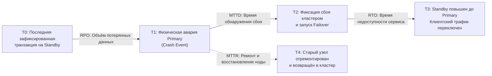

- **RPO (Recovery Point Objective) — допустимый объем потерь данных:**  
  Измеряется во времени. Показывает, за какой максимальный интервал данные могут быть безвозвратно утрачены в результате катастрофы.  
  - $RPO = 0$: ни одна подтвержденная транзакция не может быть потеряна (требует строгой синхронной репликации).  
  - $RPO = 5\text{ минут}$: допустимо потерять транзакции, зафиксированные за последние 5 минут до аварии.
- **RTO (Recovery Time Objective) — допустимое время восстановления сервиса:**  
  Максимальный интервал времени от момента физической аварии до момента, когда система снова готова принимать запросы пользователей.  
  - Ручной ввод резерва: $RTO = 1\dots4$ часа (DBA просыпается, подключается по VPN, анализирует логи, переключает DNS).  
  - Автоматический failover (Patroni): $RTO < 30\dots45$ секунд.
- **MTBF (Mean Time Between Failures):** среднее время безаварийной работы узла.
- **MTTR (Mean Time To Recovery):** среднее время, требуемое инженерам на починку и ввод в строй отказавшего аппаратного компонента.

---

### 2.2. Математика доступности («Девятки» SLA)

Параметр **SLA (Service Level Agreement)** фиксирует процент доступности системы в течение года:

$$\text{Downtime} = \text{Период} \times (1 - \text{SLA})$$

| SLA | Допустимый простой в год | Допустимый простой в месяц | Допустимый простой в неделю | Типовая архитектура СУБД |
|---|---|---|---|---|
| **99.0%** («две девятки») | 3.65 дня (87.6 ч) | 7.3 часа | 1.68 часа | Standalone-сервер + ночные бэкапы (pg_dump) |
| **99.9%** («три девятки») | 8.76 часа | 43.8 минуты | 10.1 минут | Primary + 1 Hot Standby (ручной failover по регламенту) |
| **99.95%** | 4.38 часа | 21.9 минут | 5.0 минут | Primary + Standby + автоматизированные скрипты переключения |
| **99.99%** («четыре девятки») | **52.6 минуты** | **4.38 минуты** | **1.01 минута** | **Кластер Patroni (Primary + 2 Standby + etcd кворум)** |
| **99.999%** («пять девяток») | **5.26 минуты** | **26 секунд** | **6 секунд** | Распределённый мульти-ЦОД кластер, синхронные кворумы, гео-резервирование |

> **Закон архитектурной стоимости:**  
> Каждый переход на следующую «девятку» увеличивает совокупную стоимость владения инфраструктурой (TCO) в геометрической прогрессии. Задача архитектора — не требовать 99.999% везде, а обосновать необходимый и достаточный уровень для конкретного класса бизнес-процессов.

---

## 3. Физическая потоковая репликация (Streaming Replication)

Потоковая репликация в PostgreSQL — это механизм физического тиражирования изменений на уровне байтов дисковых страниц базы данных в режиме реального времени.

### 3.1. Физика процессов и сетевого протокола

Потоковая репликация опирается на непрерывную передачу записей журнала предзаписи (**WAL — Write-Ahead Log**). На физическом уровне Standby — это сервер, который находится в состоянии **перманентного восстановления после аварии (Continuous Archive Recovery)**: он непрерывно накатывает на свои таблицы и индексы бинарные порции WAL, поступающие от Primary.

```mermaid
graph LR
    subgraph PrimaryNode["Primary Server (RW)"]
        BE[Backend процессы] -->|Транзакции DML| BP[Shared Buffers]
        BP -->|Генерация WAL| WB[WAL Buffers]
        WB -->|fsync| WAL[(pg_wal на диске)]
        WAL -->|Чтение сегментов| WS[Process: wal_sender]
    end

    subgraph Network["Сетевой канал (TCP порт 5432)"]
        WS -->|Поток WAL-записей + Heartbeats| WR
        WR -.->|Подтверждение LSN| WS
    end

    subgraph StandbyNode["Standby Server (Read-Only)"]
        WR[Process: wal_receiver] -->|Запись в локальный WAL| SWAL[(pg_wal реплики)]
        SWAL -->|Чтение LSN| ST[Process: startup engine]
        ST -->|Накатывание изменений| SBP[Shared Buffers / Heap & Indexes]
    end
```

**Анатомия конвейера репликации:**
1. **Primary: процесс `wal_sender`:** при установлении соединения от реплики Primary порождает выделенный backend-процесс `wal_sender`. Он считывает с диска (или напрямую из `wal_buffers`) новые порции журнала и отправляет их по протоколу репликации через TCP-сокет.
2. **Standby: процесс `wal_receiver`:** специализированный процесс на реплике, который держит TCP-соединение с Primary, принимает входящие байты WAL и немедленно записывает их на локальный диск в директорию `pg_wal`.
3. **Standby: процесс `startup`:** фоновый процесс движка восстановления, который последовательно разбирает записи WAL с локального диска реплики и физически изменяет дисковые страницы в оперативной памяти реплики (`shared_buffers`), воспроизводя вставку, удаление строк и модификацию индексов.

> **Инженерная памятка: базовая инициализация Standby**  
> В современном PostgreSQL (версии 12–18) инициализация реплики выполняется одной командой утилиты `pg_basebackup`:
> ```bash
> # Запуск на резервном сервере (Standby):
> pg_basebackup -h 10.0.1.10 -p 5432 -U repl_user \
>   -D /var/lib/postgresql/18/main \
>   -Fp -Xs -P -R --slot=standby_spb_slot
> ```
> Флаг **`-R`** (`--write-recovery-conf`):
> - автоматически создаёт триггерный маркерный файл `standby.signal` в каталоге данных;
> - прописывает параметры подключения к мастеру (`primary_conninfo`) и имя слота (`primary_slot_name`) в конфигурационный файл `postgresql.auto.conf`.  
> После запуска службы PostgreSQL обнаруживает `standby.signal` и стартует в режиме реплики.

---

### 3.2. Логические последовательные номера (LSN) и измерение лага

Вся координация в PostgreSQL привязана к **LSN (Log Sequence Number)** — 64-битному целому числу, представляющему собой байтовое смещение конкретной записи в непрерывном журнале WAL за всю историю кластера (формат: `16/B374D848`, где первая часть — номер файла, вторая — смещение внутри сегмента).

При прохождении изменений по конвейеру репликации фиксируются четыре контрольные точки LSN:

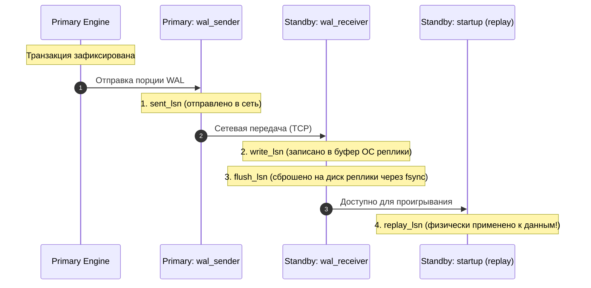

**Четыре грани отставания (Lag):**
- **Сетевой лаг:** разница между LSN текущей транзакции на Primary и `sent_lsn`. Возникает при перегрузке сетевого интерфейса.
- **Лаг передачи (Write lag):** разница между `sent_lsn` и `write_lsn`. Отражает задержку прохождения TCP-пакетов через сетевой маршрутизатор.
- **Лаг дискового сброса (Flush lag):** разница между `write_lsn` и `flush_lsn`. Показывает, успевает ли дисковая подсистема реплики делать `fsync` для журнала WAL.
- **Лаг применения (Replay lag):** разница между `flush_lsn` и `replay_lsn`. **Самый опасный вид лага:** данные уже физически находятся на диске реплики, но процесс `startup` не успевает их разобрать и применить. Читатели видят устаревшие данные.

*Запрос диагностики репликации на Primary:*
```sql
SELECT client_addr                    AS client_ip,
       application_name               AS standby_name,
       state,
       sync_state,
       -- Отставание в байтах между текущей позицией Primary и применением на реплике:
       pg_size_pretty(pg_wal_lsn_diff(pg_current_wal_lsn(), replay_lsn)) AS total_lag_bytes,
       -- Временные задержки этапов:
       write_lag,
       flush_lag,
       replay_lag
FROM   pg_stat_replication;
```

*Запрос диагностики состояния на Standby:*
```sql
-- Проверка режима восстановления и позиций LSN:
SELECT pg_is_in_recovery()              AS is_standby,
       pg_last_wal_receive_lsn()        AS received_lsn,
       pg_last_wal_replay_lsn()         AS replayed_lsn,
       pg_last_xact_replay_timestamp()  AS last_xact_replayed_at,
       now() - pg_last_xact_replay_timestamp() AS replication_delay;

-- Мониторинг процесса приёма WAL (wal_receiver):
SELECT status,
       sender_host,
       sender_port,
       slot_name,
       received_lsn,
       last_msg_receipt_time,
       latest_end_lsn
FROM   pg_stat_wal_receiver;
```

---

### 3.3. Слоты репликации (Replication Slots): надежность vs риск переполнения диска

Исторически Primary хранил сгенерированные WAL-файлы, руководствуясь параметром `wal_keep_size` (например, 10 ГБ).  
**Фатальный дефект `wal_keep_size`:** если Standby отключился на время сетевой аварии, а Primary успел сгенерировать 12 ГБ новых журналов, старые журналы **удаляются или перезаписываются**. После включения сети Standby выдаст фатальную ошибку: `requested WAL segment has already been removed`. Единственное спасение в такой ситуации — полное пересоздание реплики через тяжеловесный `pg_basebackup`.

Решение проблемы в современном PostgreSQL — **слоты физической репликации (Physical Replication Slots)**:

```sql
-- Создание постоянного слота репликации на Primary:
SELECT pg_create_physical_replication_slot('standby_spb_slot');
```

**Принцип работы слота:**
Primary гарантирует, что **ни один файл WAL не будет удалён с диска**, пока реплика, удерживающая данный слот, не подтвердит получение и сохранение этого файла (`flush_lsn`).

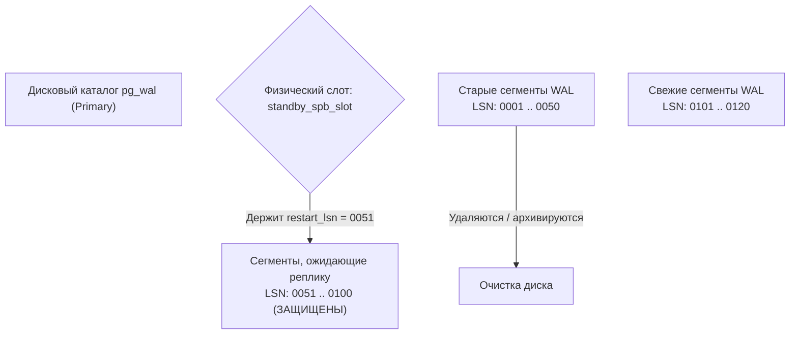

> **Критическое предостережение аналитику и DBA:**  
> Слот репликации спасает реплику от рассинхронизации, но несёт колоссальный риск для Primary. Если резервный сервер упал или недоступен в течение суток, Primary будет **бесконечно накапливать WAL на своём диске**. Когда свободное место в файловой системе `pg_wal` закончится (100% Disk Full), **основной сервер немедленно аварийно остановится (PANIC/SHUTDOWN)**!  
> В конфигурации обязательно ограничивают максимальный аппетит слота:
> ```ini
> # postgresql.conf на Primary:
> max_slot_wal_keep_size = 50GB  # Если отставание превысит 50 ГБ, слот аннулируется, защищая Primary от падения
> ```

---

## 4. Режимы синхронизации: Асинхронная vs Синхронная репликация

При выполнении команды `COMMIT` приложение ждёт ответа от базы данных: *«Транзакция успешно зафиксирована»*. Момент отправки этого подтверждения определяется режимом репликации.

### 4.1. Физика коммита и уровни подтверждения

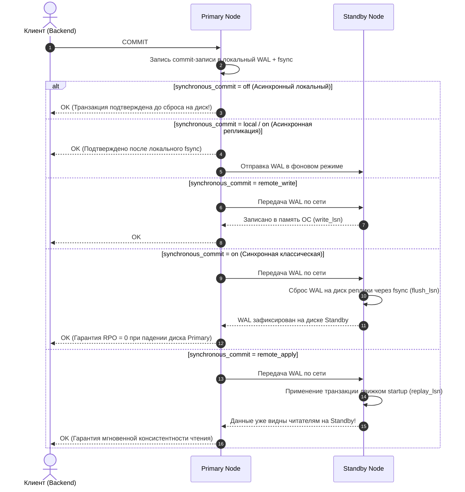

### 4.2. Сравнительный анализ режимов

| Режим `synchronous_commit` | Гарантия RPO | Влияние на задержку (Latency) записи | Что защищает при физическом отказе Primary |
|---|---|---|---|
| **`off`** | Секунды | Минимальная (ответ до физического сброса WAL на диск) | Ничего. Высокий риск потери последних транзакций даже при перезагрузке ОС |
| **`local` / `on` (асинхронная)** | Секунды (лаг сети) | Нулевое влияние сети (ждёт только локальный NVMe) | Локальные данные сохранены. При катастрофе ЦОД теряются транзакции в сетевом буфере |
| **`remote_write`** | Миллисекунды | $RTT + \text{сеть}$ | Данные ушли в ОЗУ реплики; защищает от отказа оборудования Primary, но уязвимо к одновременному отключению питания реплики |
| **`on` (синхронная)** | **Строго $RPO = 0$** | **$RTT + \text{fsync на Standby}$** | **Полная гарантия сохранения данных при физическом уничтожении Primary** |
| **`remote_apply`** | **Строго $RPO = 0$** | **$RTT + \text{время применения изменений}$** | Полное устранение лага чтения на реплике (клиент гарантированно видит свои данные на Hot Standby) |

---

### 4.3. Сетевые задержки (RTT) и влияние на пропускную способность

> **Физическое ограничение распределённых систем:**  
> Скорость распространения света в оптоволокне составляет около $200\,000\text{ км/с}$ (с учётом преломления и задержек в маршрутизаторах).  
> Между Москвой и Санкт-Петербургом (расстояние по кабелю ~700 км) минимальное время кругового обращения пакета (Round Trip Time, RTT) составляет **8–10 мс**.  
> Между Москвой и Франкфуртом RTT составляет **35–45 мс**.

Если включена строгая синхронная репликация (`synchronous_commit = on`), каждый последовательный вызов `COMMIT` будет блокировать клиентское соединение минимум на время RTT:

$$\text{Latency}_{\text{commit}} \ge \text{RTT} + \text{Disk\_Fsync}_{\text{standby}}$$

Если веб-приложение выполняет 100 операций записи подряд в одном потоке:
- На локальном NVMe диске (задержка 0.5 мс): выполнение займет $100 \times 0.5 = \mathbf{50\text{ мс}}$.
- При синхронной репликации Москва — Санкт-Петербург ($RTT = 10\text{ мс}$): выполнение займет $100 \times 10.5 = \mathbf{1\,050\text{ мс}}$ (замедление в 21 раз!).

**Вывод аналитика:** строгую синхронную репликацию применяют только в рамках одного ЦОД (RTT < 1 мс) или метро-кластера (RTT < 2–3 мс) для критически важных таблиц (балансы, счета), используя гибкую настройку на уровне транзакции:

```sql
-- Основная масса запросов идёт асинхронно
SET synchronous_commit = local;
INSERT INTO audit_logs VALUES (...);

-- Финансовый перевод выполняется с гарантией RPO = 0
BEGIN;
SET LOCAL synchronous_commit = on;
UPDATE accounts SET balance = balance - 1000 WHERE id = 12;
UPDATE accounts SET balance = balance + 1000 WHERE id = 45;
COMMIT;
```

---

### 4.4. Кворумная синхронизация

В кластерах из нескольких реплик недопустимо жестко привязываться к одному резервному серверу: если единственный синхронный Standby перезагружается, **все операции записи (`INSERT`, `UPDATE`, `DELETE`) на Primary встают колом**.

Для решения этой проблемы PostgreSQL поддерживает кворумные списки:

```ini
# postgresql.conf

# Приоритетный выбор: ждать первый доступный из списка
synchronous_standby_names = 'FIRST 1 (standby_spb, standby_kazan)'

# Кворумный выбор (любые 2 из 3 подтвердили фиксацию):
synchronous_standby_names = 'ANY 2 (standby_1, standby_2, standby_3)'
```

---

## 5. Hot Standby: чтение с реплики и конфликты репликации

Режим **Hot Standby** (`hot_standby = on`) разрешает выполнение запросов на чтение (`SELECT`, `EXPLAIN`, `COPY TO`) на резервном сервере. Это позволяет разгрузить Primary от тяжелых отчетов и поисковых запросов.

Однако совмещение непрерывного наката изменений и пользовательских чтений порождает физический конфликт.

### 5.1. Природа конфликтов репликации (Replication Conflicts)

На Primary работает очистка мусора MVCC (**Autovacuum**). Предположим:
1. На Primary процесс `VACUUM` удалил старые мертвые версии строк из страницы таблицы `orders` и сформировал WAL-запись: *«Очистить указатели на строке 4 в блоке 102»*.
2. В этот же момент аналитик на Standby запустил тяжелый отчет, который читает страницу 102 и в рамках изоляции транзакций рассчитывает прочитать именно ту версию строки, которую Primary уже стёр.
3. Процесс `startup` на Standby получает из WAL приказ немедленно стереть строку. Но он не может этого сделать, пока аналитик держит блокировку страницы!

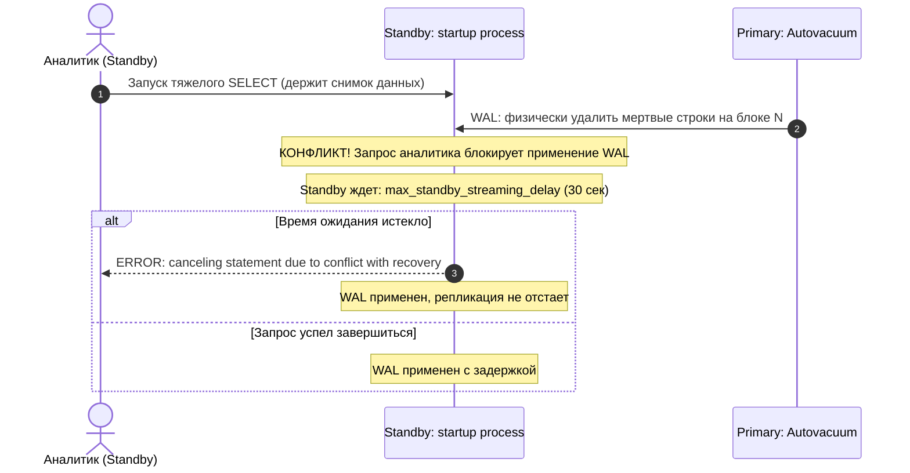

**Причины конфликтов:**
- `VACUUM` на Primary удаляет версии строк, которые пытается прочитать транзакция на Standby.
- DDL-команды на Primary (например, `ALTER TABLE ... DROP COLUMN` или `LOCK TABLE`) требуют эксклюзивной блокировки, конфликтующей с `SELECT` на Standby.
- Принудительное удаление базы данных или табличного пространства.

---

### 5.2. Управление конфликтами: параметры и компромиссы

PostgreSQL предоставляет два регулятора поведения:

#### 1. `max_standby_streaming_delay`
Определяет, сколько времени процесс наката WAL готов ждать завершения конфликтующего читающего запроса (по умолчанию 30 секунд).  
- Если запрос не успел за 30 секунд — он принудительно обрывается с ошибкой:  
  `ERROR: canceling statement due to conflict with recovery`.  
- Если выставить `-1` (ждать вечно) — длительные запросы аналитиков полностью остановят накат репликации. Реплика начнет отставать на часы, сводя на нет функцию резервного сервера для HA!

#### 2. `hot_standby_feedback`
Если включить этот параметр (`hot_standby_feedback = on`), Standby начинает по обратному сетевому каналу непрерывно сообщать Primary номер своей самой старой активной транзакции (`xmin`).  
- **Плюс:** Primary **запрещает своему Autovacuum очищать строки**, пока их читает любая транзакция на Standby. Ошибки конфликтов исчезают на 100%!  
- **Минус:** Если кто-то на реплике открыл сессию и забыл закрыть транзакцию, на **основном сервере Primary перестанет работать очистка мертвых строк**. Начнется катастрофическое раздувание таблиц (**Bloat**), падение производительности и деградация всего продуктивного кластера.

> **Инженерное правило архитектора:**  
> Никогда не используйте `hot_standby_feedback = on` на общих репликах, куда имеют доступ неконтролируемые пользователи или BI-системы. Для тяжелых аналитических отчетов выделяют отдельный аналитический контур (логическую реплику, DWH или физический standby с `max_standby_streaming_delay = -1`, намеренно исключенный из пула высокой доступности).

---

### 5.3. Проблема Read-Your-Own-Writes и архитектурные паттерны решения

При разделении трафика на запись (Primary) и чтение (Standby) возникает фундаментальная проблема распределенных систем:

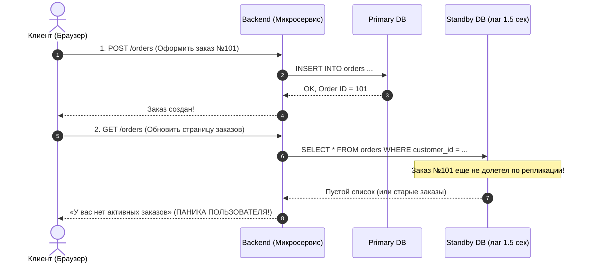

**Паттерны устранения:**
1. **Time-based Pinning (Сессионное залипание на запись):**  
   Если пользователь в рамках текущей веб-сессии совершил мутирующую операцию (POST/PUT/DELETE), все его запросы на чтение в течение следующих $N$ секунд (например, 5–10 секунд) принудительно направляются на **Primary**. По истечении интервала чтение снова возвращается на реплику.
2. **LSN-Token Based Routing (Токенизация позиции):**  
   При успешном `INSERT` Primary возвращает текущий LSN фиксации (`pg_current_wal_lsn()`). Бэкенд сохраняет этот токен в сессии пользователя (cookie или JWT-токене). При следующем запросе на чтение (`GET`) бэкенд проверяет позицию реплики: `SELECT pg_last_wal_replay_lsn() >= $1`. Если Standby ещё не догнал этот LSN, запрос направляется на Primary (либо бэкенд кратковременно ожидает догона реплики с таймаутом в 50–100 мс).
3. **CQRS разделение по контекстам:**  
   Критические для пользователя сущности (статус оплаты, профиль, корзина) читаются строго с Primary. Каталог товаров, фильтры, отзывы и история за прошлые месяцы читаются с реплик.

---

## 6. Логическая репликация: Change Data Capture и избирательное тиражирование

В отличие от физической репликации, которая слепо копирует байты дисковых блоков, **логическая репликация (Logical Replication)** работает на уровне прикладных событий данных: `INSERT`, `UPDATE`, `DELETE` конкретных строк.

Она построена по архитектурной модели **«Издатель — Подписчик» (Publisher — Subscriber)**.

### 6.1. Архитектура и механизм работы под капотом

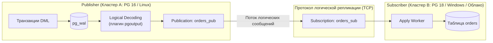

**Как это работает:**
1. На сервере-источнике (`Publisher`) параметр `wal_level` переводится в режим `logical`.
2. Встроенный механизм **Logical Decoding** непрерывно считывает журнал WAL и с помощью плагина вывода (по умолчанию `pgoutput`) декодирует внутренние бинарные структуры в логические потоки кортежей: *«В таблицу orders вставлена строка с id=50, total=1500»*.
3. Процесс `Apply Worker` на сервере-получателе (`Subscriber`) принимает эти сообщения и выполняет соответствующие DML-операции в своей локальной базе данных.

```sql
-- 1. На сервере-источнике (Publisher):
CREATE PUBLICATION pub_eshop_orders 
FOR TABLE orders, order_items;

-- 2. На сервере-приемнике (Subscriber):
-- Таблицы orders и order_items уже должны быть заранее созданы в схеме!
CREATE SUBSCRIPTION sub_eshop_orders
CONNECTION 'host=10.0.1.10 port=5432 dbname=eshop user=repl_user password=secret'
PUBLICATION pub_eshop_orders;
```

---

### 6.2. Физическая vs Логическая репликация: архитектурная матрица выбора

| Критерий | Физическая репликация (Streaming) | Логическая репликация (Logical) |
|---|---|---|
| **Уровень абстракции** | Блоки диска (1 в 1 побайтовая копия кластера) | Логические строки таблиц |
| **Версии PostgreSQL** | **Строго одинаковые** мажорные версии (например, только 18 -> 18) | **Любые версии** (можно реплицировать из PG 14 в PG 18) |
| **Операционные системы** | Одинаковая ОС, архитектура CPU и порядок байтов | Разные ОС (Linux -> Windows, x86 -> ARM) |
| **Выборочность** | Только весь кластер целиком со всеми БД | Отдельные базы, выбранные таблицы, фильтрация по строкам (`WHERE status = 'paid'`) |
| **Запись на реплике** | Строго Read-Only | **Read-Write** (на подписчике можно создавать свои таблицы, индексы, триггеры) |
| **Репликация DDL** | Полная (автоматически реплицирует `CREATE TABLE`, `INDEX`) | **Отсутствует** (схему нужно создавать и изменять вручную до репликации данных) |
| **Репликация Sequences** | Да | **Нет** (значения `nextval()` генераторов последовательностей не передаются) |
| **Основное назначение** | **High Availability, Failover, Disaster Recovery** | **Zero-Downtime апгрейд версий, витрины данных, интеграция с DWH / ClickHouse** |

---

## 7. Высокая доступность и автоматический Failover: Архитектура Patroni

Вернёмся к вводному кейсу: почему попытка сделать автоматическое переключение самописным скриптом привела к катастрофе?

### 7.1. Анатомия катастрофы Split-Brain и проблема распределенного консенсуса

**Split-Brain («раздвоение мозга»)** — состояние распределённого кластера, при котором из-за сетевой изоляции (Network Partition) два или более независимых узла одновременно считают себя активным мастером (Primary) и принимают операции записи от клиентов.

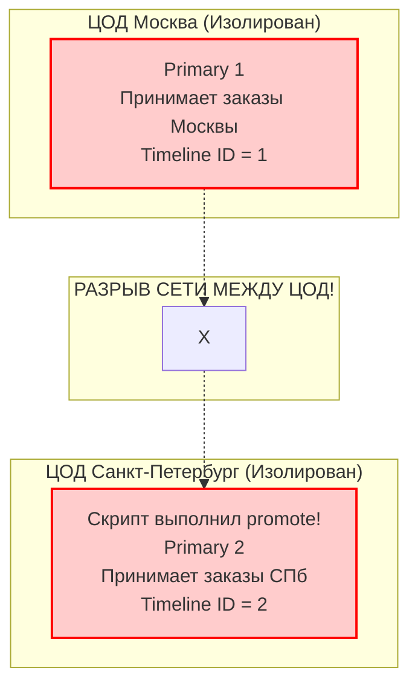

**Почему двухузловой кластер принципиально не может решить проблему Split-Brain:**  
Если сервер «Б» перестал видеть сервер «А», у него есть ровно две гипотезы:
1. Сервер «А» физически сгорел (нужно перехватывать роль Primary).
2. Сервер «А» жив и работает, но упала сеть между ними (перехватывать роль категорически нельзя!).

Имея всего **два участника**, сервер «Б» не в состоянии различить эти две ситуации.  
Для математически строгого решения требуется **третья независимая сторона — распределённый кворум (Consensus Quorum)**.

В распределённых системах действует закон кворума большинства:

$$\text{Quorum} = \left\lfloor \frac{N}{2} \right\rfloor + 1$$

- Для кластера из 3 узлов кворум = 2.
- Для кластера из 5 узлов кворум = 3.

При разрыве сети выжить имеет право **только тот сегмент, который видит строго больше половины участников кворума**. Меньшинство обязано добровольно изолировать себя от записи (**Fencing**).

---

### 7.2. Архитектура Patroni + etcd

**Patroni** — де-факто мировой индустриальный стандарт оркестрации высокой доступности PostgreSQL с открытым исходным кодом. Он использует распределённое хранилище конфигураций (**DCS — Distributed Consensus Store**, чаще всего **etcd** или **Consul**), работающее по алгоритму консенсуса **Raft**.

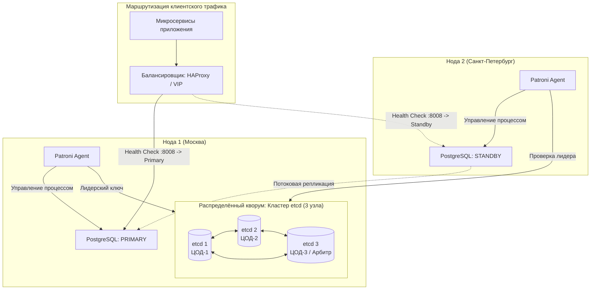

**Ключевые механизмы Patroni:**
1. **Лидерский ключ с ограниченным временем жизни (TTL):**  
   Primary-нода обязана непрерывно (каждые 10 секунд) обновлять лидерскую блокировку (Leader Lock) в etcd. Если узел завис или потерял сеть с etcd, через `ttl = 30s` etcd автоматически удаляет ключ.
2. **Безопасные выборы нового лидера:**  
   Оставшиеся ноды видят освобождение ключа. Но право бороться за лидерство получает **только тот Standby, у которого позиция LSN максимальна** (то есть имеет наименьший лаг данных).
3. **Fencing (Ограждение) и самоликвидация (Watchdog):**  
   Если старый Primary обнаруживает, что потерял связь с etcd и не может продлить аренду лидерского ключа, агент Patroni **принудительно переводит локальный PostgreSQL в Read-Only** либо инициирует экстренную перезагрузку ОС через аппаратный таймер ядра Linux (`/dev/watchdog` — STONITH: *Shoot The Other Node In The Head*).

---

### 7.3. Различие Failover и Switchover

В жизненном цикле кластера высокой доступности выделяют два принципиально разных сценария переключения:

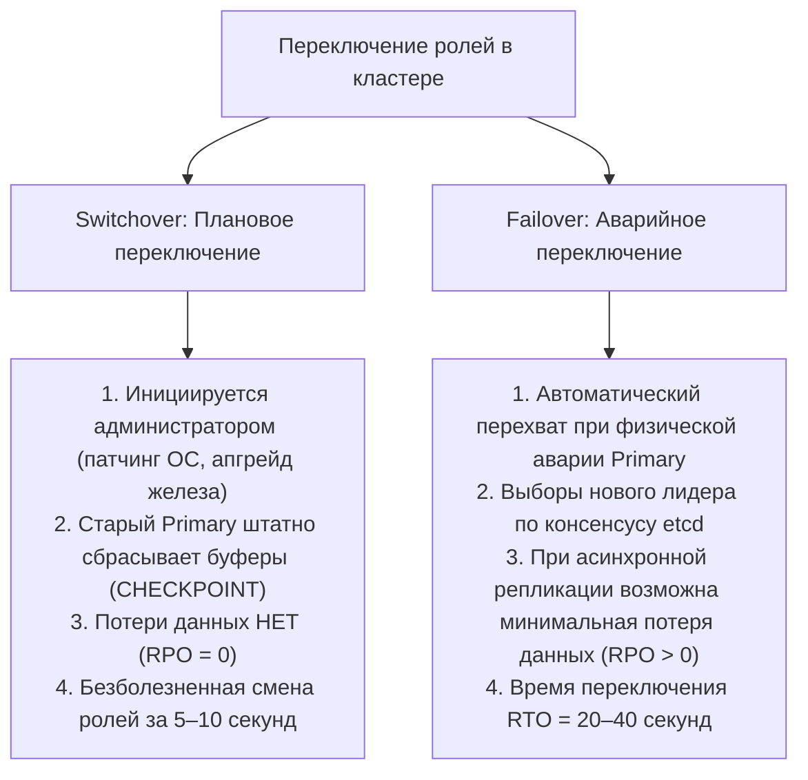

---

### 7.4. Механизм `pg_rewind`: исцеление рассинхронизированного узла

Вернемся к проблеме: старый Primary ожил после аварии, но во время изоляции на новый Primary уже успели записаться новые данные. В этот момент ветви журнала WAL разошлись (**Timeline Divergence**).

Раньше для возврата старого сервера в кластер требовалось полностью стереть его базу и заново перекачать сотни гигабайт по сети через `pg_basebackup`.

Утилита **`pg_rewind`** (которую Patroni вызывает автоматически) решает эту задачу за секунды:
1. Находит в журнале WAL точку бифуркации (момент, когда пути серверов разошлись).
2. Сравнивает карты дисковых блоков между серверами.
3. Скачивает с нового мастера **только те блоки данных, которые изменились с момента расхождения**.
4. «Отматывает» транзакции старого Primary назад и переводит его в режим обычного Standby, подключая к новому мастеру.

> **Обязательное условие работы `pg_rewind`:**  
> Чтобы утилита `pg_rewind` могла сопоставить дисковые блоки, кластер должен фиксировать полные образы страниц при изменении бит подсказок (hint bits). Для этого в `postgresql.conf` на **всех** узлах кластера обязательно должен быть включен параметр:
> ```ini
> wal_log_hints = on
> ```
> *(либо кластер изначально инициализирован с контрольными суммами страниц `initdb -k / --data-checksums`)*. Без этой настройки `pg_rewind` завершится фатальной ошибкой.

---

## 8. Архитектурный шаблон: Спецификация требований к отказоустойчивости (HA & SLA Specification)

При согласовании требований к инфраструктуре базы данных системный аналитик и архитектор оформляют спецификацию отказоустойчивости для инженерной команды эксплуатации (DBA, SRE):

```markdown
# Архитектурная спецификация отказоустойчивости СУБД: Сервис «Заказы и Платежи» (eshop)

## 1. Классификация критичности и бизнес-метрики
- **Бизнес-контекст:** Обработка клиентских корзин, транзакций оплат и складских резервов.
- **Класс критичности:** Tier-1 (Mission Critical).
- **Целевой SLA доступности:** 99.99% (суммарный неплановый простой не более 52 минут в год).
- **RTO (Recovery Time Objective):** не более 45 секунд при отказе любого аппаратного узла.
- **RPO (Recovery Point Objective):**
  - Финансовый контур (балансы, счета, проводки): RPO = 0 (потеря недопустима).
  - Пользовательский контур (корзины, сессии): RPO ≤ 1 секунда.

## 2. Физическая топология кластера
- **Количество узлов СУБД:** 3 ноды (1 Primary + 2 Hot Standby).
- **Размещение инфраструктуры:**
  - Нода 1: ЦОД «Москва-1» (Основной дата-центр).
  - Нода 2: ЦОД «Москва-2» (Резервный дата-центр, RTT к ЦОД-1 < 1.5 мс).
  - Нода 3: ЦОД «Санкт-Петербург» (Катастрофоустойчивая асинхронная реплика).
- **Распределённый кворум (DCS):**
  - Кластер etcd из 3 узлов (по одному агенту в каждом ЦОД для предотвращения Split-Brain).

## 3. Политика репликации и параметры PostgreSQL
- **Тип репликации:** Потоковая физическая (Streaming Replication) на базе слотов репликации.
- **Режим синхронизации:**
  - Нода 2 (Москва-2): Синхронная репликация в рамках метро-кластера.
    `synchronous_commit = on`
    `synchronous_standby_names = 'FIRST 1 (node_msk_2)'`
  - Нода 3 (СПб): Асинхронная репликация (для Disaster Recovery).
- **Защита от переполнения диска WAL:**
  `max_slot_wal_keep_size = 64GB`

## 4. Конфигурация высокой доступности (HA Orchestrator)
- **Оркестратор:** Patroni с драйвером `etcd3`.
- **Политика переключения:**
  - Автоматический failover: включен (`ttl = 30s`, `loop_wait = 10s`).
  - Сторожевой таймер (Fencing): включен аппаратный Linux Watchdog (`/dev/watchdog`).
  - Автоматическое восстановление старого мастера: включен `pg_rewind`.

## 5. Маршрутизация клиентских подключений
- **Точки входа:**
  - Пул пулеров PgBouncer (порт 6432, режим `transaction`).
  - L4-Балансировщики HAProxy с проверкой состояния HTTP REST API Patroni:
    - Порт 5000: Маппинг на активный Primary (`GET /primary` -> HTTP 200).
    - Порт 5001: Балансировка чтения между Standby (`GET /replica` -> HTTP 200).
- **Архитектурное правило чтения:**
  - Создание и модификация заказов: строго через порт 5000 (Primary).
  - Складские отчеты и аналитика: строго через порт 5001 (Standby).
```

---

## 9. Разбор вводного кейса

Вернемся к катастрофе интернет-магазина `eshop`, разобранной в начале лекции:

1. **Почему возник Split-Brain?**  
   Кластер состоял всего из двух изолированных серверов без внешнего независимого арбитра кворума. При разрыве сетевого кабеля петербургский сервер не мог отличить отказ московского сервера от локальной сетевой изоляции и ошибочно произвел `promote`.
2. **Почему cron-скрипты проверки «по тайм-ауту» смертельно опасны?**  
   Локальный скрипт проверяет только связность «точка-точка» со своей колокольни. Он не обладает авторитетом консенсуса большинства и не может принудительно выключить изолированный Primary (отсутствовал механизм Fencing/STONITH).
3. **Какая архитектура исключила бы аварию?**  
   Внедрение оркестратора **Patroni** и распределенного хранилища **etcd из 3 узлов** (два узла в ЦОД и один арбитр на независимой третьей площадке / в облаке). При обрыве связи Санкт-Петербург остался бы в меньшинстве (1 голос из 3), не смог бы захватить лидерский ключ в etcd и остался бы в безопасном режиме Read-Only.
4. **Как следовало лечить рассинхронизацию?**  
   Вместо 18 часов ручного сопоставления строк и конфликтующих первичных ключей, утилита `pg_rewind` под управлением Patroni откатила бы отставший сервер до точки бифуркации и перевела его в статус реплики за несколько минут.

---

## 10. Итоги лекции

После изучения материала лекции вы умеете:

1. **Формулировать требования к надежности на языке бизнеса и метрик:**  
   - Рассчитывать допустимые окна простоя на основе SLA («девяток» доступности);
   - Защищать требования к RTO (время восстановления) и RPO (объем потерь) перед заказчиком и менеджментом.
2. **Проектировать и настраивать потоковую репликацию:**  
   - Интерпретировать физические метрики `pg_stat_replication` (`sent_lsn`, `flush_lsn`, `replay_lsn`);
   - Рассчитывать отставание репликации в байтах и секундах, настраивать безопасные слоты репликации без риска исчерпания диска (`max_slot_wal_keep_size`).
3. **Осознанно выбирать и комбинировать уровни синхронизации:**  
   - Оценивать цену сетевого RTT и влияние `synchronous_commit = on` на скорость клиентских запросов;
   - Строить кворумные конфигурации `synchronous_standby_names` для защиты от зависания кластера.
4. **Проектировать масштабируемые сценарии чтения с Hot Standby:**  
   - Разрешать конфликты репликации и предотвращать bloat от `hot_standby_feedback`;
   - Архитектурно нейтрализовать эффект *Read-Your-Own-Writes* через сессионный роутинг и токенизацию LSN.
5. **Выбирать между физической и логической репликацией:**  
   - Использовать логическую репликацию для Zero-Downtime обновления мажорных версий СУБД, избирательной репликации витрин и выгрузки в аналитические хранилища.
6. **Проектировать катастрофоустойчивые HA-кластеры:**  
   - Обосновывать выбор Patroni + etcd, предотвращать Split-Brain через кворумы нечетного числа узлов, настраивать STONITH и восстановление через `pg_rewind`.

---

## Литература и ссылки

- [Официальная документация PostgreSQL: High Availability, Load Balancing, and Replication](https://www.postgresql.org/docs/current/high-availability.html)
- [Официальная документация: Потоковая репликация и Hot Standby](https://www.postgresql.org/docs/current/warm-standby.html)
- [Официальная документация: Мониторинг репликации (pg_stat_replication)](https://www.postgresql.org/docs/current/monitoring-stats.html#MONITORING-PG-STAT-REPLICATION-VIEW)
- [Официальная документация: Логическая репликация](https://www.postgresql.org/docs/current/logical-replication.html)
- [Официальная документация: Утилита pg_rewind](https://www.postgresql.org/docs/current/app-pgrewind.html)
- [Patroni: Архитектура высокой доступности и документация](https://patroni.readthedocs.io/en/latest/)
- [Martin Kleppmann: Designing Data-Intensive Applications (Глава 5: Репликация)](https://dataintensive.net/)
