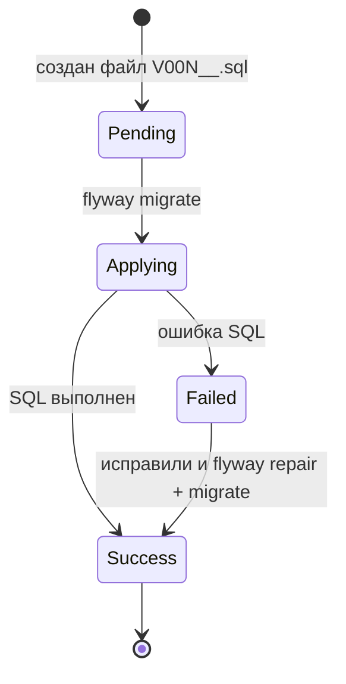
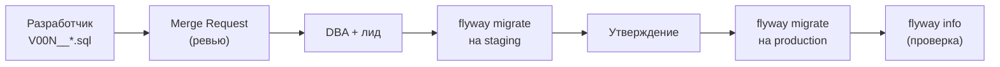

# Лекция 12. Версионирование схемы БД. Flyway. Migration Plan. Runbook

**Неделя:** 12  
**Версия PostgreSQL:** 18  
**Практика:** лабораторная работа №9 «Flyway: миграции схемы eshop. Migration Plan и Runbook»

---

## Цель лекции

По итогам лекции студент:

- понимает, зачем версионировать схему базы данных;
- знает соглашения об именовании файлов Flyway и порядок применения миграций;
- умеет работать с таблицей истории `flyway_schema_history` и командами `info`, `validate`, `migrate`, `repair`;
- умеет составить Migration Plan и Runbook для DBA;
- понимает MR-процесс для деплоя миграций и роль аналитика в нём.

---

## Зачем это системному аналитику

Схема базы данных — такой же артефакт разработки, как код. Если её изменения не версионируются, команда теряет контроль:

- «Кто добавил эту колонку?» — неизвестно;
- на dev, staging и production разные схемы;
- деплой в production превращается в ручную операцию «по памяти»;
- откат делается «как получится».

Аналитик — тот, кто описывает изменение схемы в терминах бизнеса и проверяет, что миграция безопасна. Migration Plan и Runbook — его артефакты. Без них DBA получает SQL-файл без контекста и либо откладывает деплой, либо выполняет его наугад.

> **Ключевая мысль.** Flyway не «делает миграции безопасными». Он делает их **воспроизводимыми**. Безопасность обеспечивают Migration Plan, review и понимание блокировок (лекции 4, 13).

---

## 1. Вводный кейс

> **Кейс из практики.**  
> В `eshop` колонку `customers.name` переименовали в `full_name`. Разработчик поправил код и вручную выполнил `ALTER TABLE ... RENAME COLUMN` на staging и production.  
>  
> Через месяц:
> - новый разработчик поднял локальную базу из старого дампа и получил ошибку: приложение ищет `full_name`, а в базе `name`;
> - на production обнаружилось, что миграция не попала в историю, и `flyway info` показывает «всё применено»;
> - при попытке накатить следующую миграцию Flyway упал на `validate`: checksum не совпадает;
> - откат делали вручную, потому что undo-скрипта не было.

**Вопросы аудитории:**
1. Почему «поправил руками на всех средах» — не версионирование?
2. Что именно проверяет `flyway validate` и почему он упал?
3. Какие артефакты нужно было создать до изменения?

---

## 2. Проблема: неуправляемые изменения схемы

| Без версионирования | С версионированием (Flyway) |
|---|---|
| «Кто добавил эту колонку?» | Git-история: кто, когда, зачем |
| Разные схемы в dev / staging / production | Одинаковое состояние на всех средах |
| Боязнь деплоя в production | Автоматизированный, воспроизводимый процесс |
| Откат вручную, по памяти | Явные undo-скрипты или forward rollback |

Инструменты версионирования схемы: **Flyway** (Java-совместимый, TOML/CONF-конфиг) и **Liquibase** (XML/YAML). Курс использует Flyway.

> Подробный справочник по установке и командам — в статье [Flyway](../../wiki/tools/flyway.md).

---

## 3. Flyway: соглашения об именовании

| Тип | Префикс | Пример | Назначение |
|---|---|---|---|
| Versioned | `V` | `V003__add_orders_idx.sql` | Применяется один раз; основной тип |
| Undo | `U` | `U003__add_orders_idx.sql` | Откат конкретной версии (Flyway Teams) |
| Repeatable | `R` | `R__refresh_mv_orders.sql` | Применяется при изменении содержимого |

**Важно:** разделитель — **двойное подчёркивание** (`__`). Одиночное — ошибка парсинга.

```
db/migration/
├── V001__init_schema.sql
├── V002__add_customer_email.sql
├── V003__add_orders_idx.sql
├── U003__add_orders_idx.sql
└── R__refresh_mv_orders.sql
```

### 3.1. Правила, которые нельзя нарушать

1. **Уже применённую V-миграцию нельзя редактировать.** Изменился файл — изменился checksum — `validate` падает. Исправление делается новой миграцией (`V004`).
2. **Номер версии — монотонный.** `V001`, `V002`, `V003`… Пропуски допустимы, но порядок должен быть понятен.
3. **Имя файла — латиница, цифры, подчёркивания.** Кириллица и пробелы создают проблемы в CI.
4. **Одна миграция — одно логическое изменение.** Не смешивайте `CREATE TABLE` и `ALTER TABLE` из разных задач.
5. **`R`-миграции — для представлений, функций, триггеров.** Они перезапускаются при изменении checksum. Для таблиц с данными это опасно.

### 3.2. Идемпотентность

Где возможно, используйте `IF NOT EXISTS` / `IF EXISTS`:

```sql
CREATE TABLE IF NOT EXISTS promo_codes (...);
CREATE INDEX IF NOT EXISTS idx_promo_codes_code ON promo_codes(code);
DROP TABLE IF EXISTS tmp_table;
```

> **Но не злоупотребляйте.** Идемпотентность не заменяет версионирование: Flyway всё равно должен знать, что миграция применена. Она помогает при ручном восстановлении и повторном запуске в dev.

---

## 4. Flyway: конфигурация

```toml
# flyway.toml
[flyway]
url       = "jdbc:postgresql://localhost:5432/myapp_prod"
user      = "flyway_user"
password  = "${FLYWAY_PASSWORD}"

locations = ["filesystem:db/migration"]
schemas   = ["public"]

cleanDisabled     = true    # ОБЯЗАТЕЛЬНО в production!
baselineOnMigrate = false
outOfOrder        = false
```

### 4.1. Разбор параметров

| Параметр | Зачем | Опасность ошибки |
|---|---|---|
| `url` | Подключение к БД | Указать не ту базу — применить миграции не туда |
| `user` | Роль миграций | Использовать `postgres` — избыточные права |
| `password` | Секрет | Хранить в git — утечка |
| `locations` | Где лежат файлы | Не тот путь — Flyway «не видит» миграции |
| `schemas` | Целевая схема | Не та схема — объекты создаются не там |
| `cleanDisabled` | Запрет `clean` | `false` в prod — случайное уничтожение схемы |
| `baselineOnMigrate` | Автоматический baseline | `true` без понимания — пропуск миграций |
| `outOfOrder` | Разрешить применять «пропущенные» версии | `true` — непредсказуемый порядок |

> **`cleanDisabled = true` — не рекомендация, а требование.** В лаб. 09 проверяется, что на staging/prod эта настройка включена. `flyway clean` удаляет все объекты схемы без подтверждения.

### 4.2. Секреты

Не храните пароль в `flyway.toml`. Варианты:

- переменная окружения `${FLYWAY_PASSWORD}`;
- секрет в CI/CD (Vault, GitLab CI variables, GitHub Secrets);
- отдельный конфиг, не попадающий в git.

> **Почему это важно.** Файл `flyway.toml` лежит в репозитории. Пароль в нём — это пароль в истории git навсегда. Даже удаление строки не убирает его из старых коммитов.

---

## 5. Команды Flyway

```bash
flyway migrate    # применить pending-миграции
flyway info       # показать статус миграций
flyway validate   # проверить целостность (checksum файлов vs БД)
flyway repair     # исправить failed-запись после ручного исправления
flyway clean      # удалить все объекты (только dev!)
flyway baseline   # создать baseline для существующей БД
```

### 5.1. Жизненный цикл



### 5.2. `baseline` для существующей базы

Если база уже существует и содержит объекты, Flyway не знает, какие миграции «уже применены». `baseline` создаёт маркер: «всё до версии N считается применённым».

```bash
flyway baseline -baselineVersion=4
```

> **Когда использовать.** При внедрении Flyway на существующий production. Нельзя «забыть» baseline и запустить `migrate`: Flyway попытается применить `V001` к непустой базе и упадёт (или, хуже, создаст дубликаты).

### 5.3. `repair`

`repair` нужен, когда миграция упала и в `flyway_schema_history` осталась запись `success = false`, а вы исправили проблему вручную.

```bash
flyway repair
flyway migrate
```

> **`repair` не откатывает изменения.** Он приводит в порядок таблицу истории и пересчитывает checksum. Данные и объекты он не трогает.

---

## 6. Таблица истории: `flyway_schema_history`

```sql
SELECT version, description, script, checksum,
       installed_on, success
FROM   flyway_schema_history
ORDER  BY installed_rank;
```

| Поле | Значение |
|---|---|
| `version` | Номер версии из имени файла |
| `description` | Описание из имени файла (после `__`) |
| `script` | Имя файла |
| `checksum` | Если файл изменён — `flyway validate` провалится |
| `installed_on` | Когда применена |
| `success` | `true` — OK; `false` — ошибка (нужен `flyway repair`) |

> **Что проверять аналитику.** Перед деплоем: все ли миграции `Success`, нет ли `Pending`, совпадает ли последняя версия с ожидаемой. После деплоя: появилась ли новая строка, `success = true`.

> **Практика →** [Лаб. 09, часть 2 — `flyway info` и `flyway_schema_history`](../../labs/lab_09/lab_09.md).

---

## 7. MR-процесс для миграций



### 7.1. Чек-лист для MR с миграцией

- [ ] Имя файла: `V` + номер + **двойное подчёркивание** + описание
- [ ] Транзакция явно обозначена или операция идемпотентна
- [ ] Для деструктивных операций есть undo-скрипт или план rollback
- [ ] Нет `flyway clean` без согласования
- [ ] Миграция прошла на staging без ошибок
- [ ] `flyway validate` на staging — OK
- [ ] Указано влияние на блокировки и время выполнения
- [ ] Обновлён Migration Plan

### 7.2. Кто что проверяет

| Роль | Что проверяет |
|---|---|
| Разработчик | Корректность SQL, идемпотентность, тесты |
| Аналитик | Соответствие бизнес-требованиям, Migration Plan, влияние на данные |
| DBA | Блокировки, время выполнения, откат, права |
| DevOps | Прогон в CI/CD, секреты, порядок применения |

> **Правило «двух глаз».** Миграция, меняющая схему production, должна быть проверена как минимум DBA и аналитиком. Один человек может пропустить и синтаксис, и бизнес-последствия.

---

## 8. Migration Plan

Migration Plan — документ, который описывает изменение схемы до его выполнения.

> Шаблон и пример — в статье [Migration Plan](../../wiki/artifacts/migration-plan.md).

````markdown
## Migration Plan: V003__add_orders_status_idx

### Цель
Добавить индекс по `orders.status` для ускорения выборок активных заказов.

### Скрипт
```sql
CREATE INDEX CONCURRENTLY idx_orders_status ON orders(status)
WHERE status IN ('pending', 'processing');
```

### Анализ влияния
- orders: 3.2 млн строк
- Время: 5–15 минут (CONCURRENTLY — без блокировки DML)
- Привилегии: CREATE INDEX для flyway_user — есть
- Размер: +~200 МБ

### Окно обслуживания
Не требуется (CONCURRENTLY).

### Rollback
```sql
DROP INDEX CONCURRENTLY idx_orders_status;
```

### Критерии успеха
- flyway info: версия 003 — Success
- `\d orders` содержит idx_orders_status
````

### 8.1. Что обязательно в Migration Plan

| Раздел | Зачем |
|---|---|
| Цель | Связать изменение с бизнес-задачей |
| Скрипт | Показать, что именно будет выполнено |
| Анализ влияния | Объём, время, блокировки, размер |
| Окно обслуживания | Нужен ли простой |
| Rollback | Что делать при ошибке |
| Критерии успеха | Как проверить, что всё прошло |

> **Антипаттерн.** Migration Plan из одной строки «добавить индекс». DBA не может оценить риск, а аналитик не может проверить результат.

### 8.2. Анализ влияния: что считать

- **Объём таблицы** — от него зависит время.
- **Блокировки** — `CREATE INDEX` блокирует запись, `CONCURRENTLY` — нет.
- **Время выполнения** — по тестовому прогону на копии.
- **Размер** — новый индекс займёт место.
- **Откат** — обратная операция и её стоимость.

---

## 9. Runbook для деплоя миграции

Runbook — пошаговая инструкция для конкретной среды. В отличие от Migration Plan, он отвечает на вопрос «как выполнять», а не «что и зачем менять».

> Шаблон — в статье [Deployment Runbook](../../wiki/artifacts/deployment-runbook.md), полный процесс — в [процедуре миграций](../../wiki/procedures/migration-workflow.md).

```markdown
## Runbook: деплой миграций в production

### Подготовка (за 30 минут)
1. `flyway info` на staging — всё Success
2. Предупредить поддержку о временном окне
3. Бэкап: pg_dump -Fc myapp_prod -f pre_migration_$(date +%Y%m%d_%H%M).dump

### Выполнение
1. `flyway info` — зафиксировать состояние
2. `flyway migrate`
3. `flyway info` — убедиться, что всё Success
4. Smoke-тест приложения

### Rollback (при ошибке)
1. `flyway repair` — сбросить failed-запись
2. Выполнить undo-скрипт вручную
3. `flyway repair` ещё раз

### Контакты
- DBA on-call: [контакт]
- Лид разработки: [контакт]
```

### 9.1. Почему runbook важнее памяти

В момент инцидента никто не помнит точный порядок команд. Runbook:

- снижает зависимость от конкретного человека;
- позволяет передать дежурство;
- фиксирует критерии успеха;
- обновляется после каждого деплоя.

> **Правило.** Если runbook не обновлялся после последнего инцидента, он устарел. Обновление — часть постмортема.

### 9.2. PowerShell-особенности

Если деплой идёт с Windows-машины:

```powershell
# Не направляйте вывод flyway в файл через > (UTF-16)
flyway info | Out-File -Encoding utf8 flyway_info.txt

# Пароль — через переменную окружения на время сеанса
$env:FLYWAY_PASSWORD = "***"
flyway migrate
Remove-Item Env:FLYWAY_PASSWORD
```

> **Практика →** [Лаб. 09, части 3–4 — Migration Plan и Runbook](../../labs/lab_09/lab_09.md).

---

## 10. Разбор вводного кейса

1. **Почему ручное изменение — не версионирование?**  
   Оно не оставляет следа в `flyway_schema_history`, не воспроизводится на новой среде и не проходит review. Схема на dev, staging и production расходится.
2. **Что проверяет `flyway validate`?**  
   Сверяет checksum файлов миграций с тем, что записан в таблице истории. Если файл изменили после применения — checksum не совпадёт, и `validate` упадёт.
3. **Какие артефакты нужны?**  
   Версионная миграция (`V00N__rename_name_to_full_name.sql`), Migration Plan с анализом блокировок, Runbook деплоя и план отката. Для переименования — 4-шаговый zero-downtime паттерн (лекция 13).

---

## 11. Итоги лекции

После этой лекции студент умеет:

- **Создать Flyway-проект**: `flyway.toml` с `cleanDisabled=true`, структуру папки `migrations/`.
- **Написать корректный V-файл**: двойное подчёркивание в имени, идемпотентность через `IF NOT EXISTS`.
- **Выполнить полный цикл**: `flyway baseline` → `migrate` → `info` → `validate` → `repair`.
- **Составить Migration Plan**: цель, скрипт, анализ влияния, rollback, критерии успеха.
- **Написать Runbook**: подготовка → выполнение → проверка → откат — и объяснить каждый шаг.

---

## Контрольные вопросы

1. Почему нельзя редактировать уже применённую V-миграцию? Что произойдёт при `validate`?
2. Чем `V`-миграция отличается от `R`-миграции? Для чего используют `R`?
3. Зачем нужен `flyway baseline` и что произойдёт, если его не сделать на существующей базе?
4. Что делает `flyway repair` и чего он **не** делает?
5. Почему `cleanDisabled = true` обязателен в production?
6. Чем Migration Plan отличается от Runbook?
7. Какие разделы Migration Plan обязательны для миграции, добавляющей индекс на таблицу в 3 млн строк?
8. Кто и что проверяет в MR с миграцией?

---

## Ссылки

- Flyway: https://flywaydb.org/documentation
- SQL Migrations: https://flywaydb.org/documentation/concepts/migrations#versioned-migrations
- Flyway Configuration: https://flywaydb.org/documentation/configuration/configfile

**Wiki:**
- [Flyway](../../wiki/tools/flyway.md)
- [Процесс миграций](../../wiki/procedures/migration-workflow.md)
- [Migration Plan (шаблон)](../../wiki/artifacts/migration-plan.md)
- [Deployment Runbook (шаблон)](../../wiki/artifacts/deployment-runbook.md)
- [Zero-downtime паттерны](../../wiki/procedures/zero-downtime.md)
