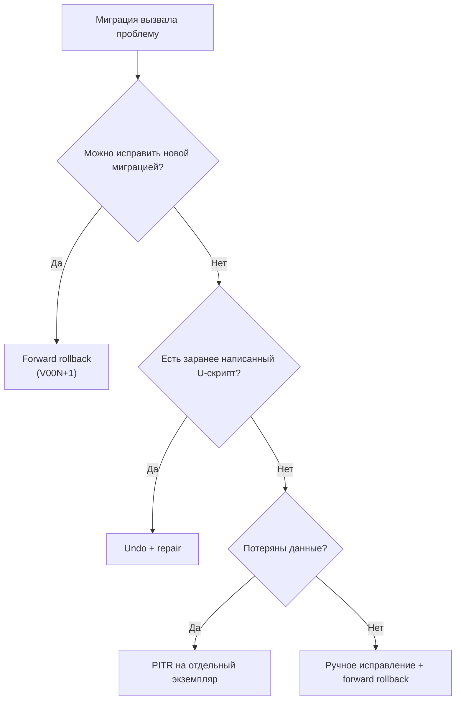

# Лекция 13. Rollback-стратегии. Обслуживание БД. Управление изменениями. Итог курса

**Неделя:** 13  
**Версия PostgreSQL:** 18  
**Практика:** лабораторная работа №10 «Rollback, zero-downtime паттерны. Итоговая защита проекта eshop»

---

## Цель лекции

По итогам лекции студент:

- знает три стратегии отката миграций и умеет выбрать подходящую;
- знает паттерны zero-downtime для опасных DDL-операций и понимает, почему они работают;
- знает инструменты планового обслуживания БД (`vacuumdb`, `reindexdb`, `pg_upgrade`);
- ориентируется в современном ландшафте СУБД и умеет составить roadmap внедрения новой технологии;
- умеет собрать итоговый отчёт по проекту и защитить архитектурные решения.

---

## Зачем это системному аналитику

К финалу курса аналитик умеет не только описывать требования, но и оценивать цену изменений. Любая миграция — это риск: она может заблокировать таблицу, уронить приложение или уничтожить данные. Аналитик должен:

- заранее спросить «как мы это откатим?»;
- понимать, какие DDL-операции опасны на большой таблице;
- отличать «обновить PostgreSQL» от «переписать приложение»;
- выбирать технологию под задачу, а не по моде.

> **Ключевая мысль.** Откат — это не признак неудачи. Это часть плана. Хорошая миграция проектируется вместе с откатом, а не после аварии.

---

## 1. Вводный кейс

> **Кейс из практики.**  
> В `eshop` вышла миграция `V007__change_order_total_type.sql`:
> ```sql
> ALTER TABLE orders ALTER COLUMN total_amount TYPE NUMERIC(12,2);
> ```
> На staging (10 000 заказов) она прошла за секунду. На production (3,2 млн заказов):
> - таблица `orders` заблокировалась на 40 минут;
> - приложение перестало принимать заказы;
> - очередь соединений исчерпала `max_connections`;
> - разработчик попытался откатить миграцию через `flyway undo`, но undo-скрипта не было;
> - пришлось поднимать PITR на отдельном экземпляре и переносить данные.

**Вопросы аудитории:**
1. Почему `ALTER COLUMN TYPE` опасен на большой таблице?
2. Какая стратегия отката должна была быть готова заранее?
3. Как переписать миграцию, чтобы она не блокировала запись?

---

## 2. Три стратегии отката миграций

Когда деплой миграции прошёл с ошибкой или привёл к неожиданному поведению приложения:

| Стратегия            | Суть                                           | Когда применять                   | Сложность |
| -------------------- | ---------------------------------------------- | --------------------------------- | --------- |
| **Forward rollback** | Написать новую миграцию, исправляющую ситуацию | Всегда пробовать в первую очередь | Низкая    |
| **Undo-скрипты (U)** | Выполнить заранее написанный `U{N}__*.sql`     | Когда undo написан до деплоя      | Средняя   |
| **PITR**             | Восстановить БД на момент до миграции          | Потеря данных; ничего другого нет | Высокая   |

> Подробное сравнение стратегий и чек-лист выбора — в статье [Стратегии отката](../../wiki/procedures/rollback-strategies.md).

### 2.1. Forward rollback (рекомендуемый подход)

```sql
-- V003 добавила колонку с неверным дефолтом
-- Forward rollback: V004 исправляет ситуацию

-- V004__fix_orders_discount_default.sql
ALTER TABLE orders ALTER COLUMN discount SET DEFAULT 0.0;
UPDATE orders SET discount = 0.0 WHERE discount IS NULL;
```

Преимущества: история изменений сохранена, Flyway не знает об ошибке, риск минимален.

> **Почему это лучший вариант.** База уже находится в новом состоянии. Откат назад требует либо undo (который может не сработать), либо PITR (который уничтожит данные). Движение вперёд сохраняет историю и не требует простоя.

### 2.2. Undo-скрипты

```sql
-- V003__add_discount_column.sql (версионная миграция)
ALTER TABLE orders ADD COLUMN discount NUMERIC(5,2) DEFAULT 0.10;

-- U003__add_discount_column.sql (undo)
ALTER TABLE orders DROP COLUMN discount;
```

Undo выполняется вручную (или через Flyway Teams):

```bash
flyway undo   # откатить последнюю версионную миграцию
```

> **Ограничение.** Undo не восстанавливает данные, которые были изменены после миграции. `DROP COLUMN` удалит колонку и все значения в ней. Если миграция была `UPDATE`, undo должен содержать обратный `UPDATE`, а он не всегда возможен.

### 2.3. PITR как последний рубеж

Применяется, когда:

- миграция уничтожила данные (`DROP` + `COMMIT`);
- forward rollback невозможен (нет копии данных до миграции).

```ini
# Восстановить на момент до миграции (см. лекцию 6)
recovery_target_time = '2024-09-01 14:29:00+03'  # 1 минуту до миграции
```

**Стоимость PITR:** потеря всех транзакций после точки восстановления, не только связанных с миграцией.

> **Правило.** PITR — это не «откат миграции». Это откат всей базы. Его выбирают, только когда цена потери данных меньше цены ручного восстановления.

### 2.4. Как выбрать стратегию



---

## 3. Zero-downtime паттерны

Некоторые DDL-операции блокируют таблицу. На production с высоким трафиком это недопустимо.

> Подробный разбор паттернов с примерами — в статье [Zero-downtime паттерны](../../wiki/procedures/zero-downtime.md).

### 3.1. Опасные и безопасные операции

| Операция                                   | Блокировка                                   | Альтернатива                                        |
| ------------------------------------------ | -------------------------------------------- | --------------------------------------------------- |
| `ADD COLUMN ... DEFAULT` (PostgreSQL < 11) | `ACCESS EXCLUSIVE` (долго)                   | PostgreSQL 11+ — мгновенно для константного default |
| `ADD COLUMN NOT NULL` без default          | `ACCESS EXCLUSIVE` + перепись таблицы        | 3-шаговый паттерн (см. ниже)                        |
| `CREATE INDEX`                             | `SHARE` (блокирует запись)                   | `CREATE INDEX CONCURRENTLY`                         |
| `DROP TABLE`                               | `ACCESS EXCLUSIVE`                           | 3-шаговый паттерн (переименование)                  |
| `ALTER COLUMN TYPE`                        | `ACCESS EXCLUSIVE` + перепись                | Новая колонка + триггер миграции данных             |
| `RENAME COLUMN`                            | `ACCESS EXCLUSIVE` (мгновенно, но блокирует) | 4-шаговый паттерн (см. ниже)                        |
| `VACUUM FULL`                              | `ACCESS EXCLUSIVE`                           | `pg_repack`                                         |
| `REINDEX`                                  | блокировка записи                            | `REINDEX ... CONCURRENTLY`                          |

> **Важно про `ADD COLUMN ... DEFAULT`.** В PostgreSQL 11+ добавление колонки с константным default не переписывает таблицу: значение хранится в метаданных. Но default с **волатильной** функцией (например, `random()`) требует заполнить каждую строку. `now()` — стабильная функция, поэтому для неё PostgreSQL тоже может применить fast default; проверяйте поведение на своей версии.

### 3.2. `ADD NOT NULL` без блокировки (3 шага)

```sql
-- Шаг 1 (V010): добавить колонку без NOT NULL
ALTER TABLE orders ADD COLUMN region TEXT;

-- Шаг 2 (V011): заполнить существующие строки + добавить CHECK constraint
UPDATE orders SET region = 'default' WHERE region IS NULL;
ALTER TABLE orders ADD CONSTRAINT orders_region_not_null
  CHECK (region IS NOT NULL) NOT VALID;
VALIDATE CONSTRAINT orders_region_not_null;  -- без ACCESS EXCLUSIVE

-- Шаг 3 (V012): установить NOT NULL (PostgreSQL знает, что constraint проверен)
ALTER TABLE orders ALTER COLUMN region SET NOT NULL;
ALTER TABLE orders DROP CONSTRAINT orders_region_not_null;
```

**Почему это работает:**

- `ADD COLUMN` без `NOT NULL` — быстрая операция, только метаданные.
- `UPDATE` заполняет строки порциями (можно батчами), не блокируя таблицу целиком.
- `CHECK ... NOT VALID` добавляет ограничение, не проверяя старые строки.
- `VALIDATE CONSTRAINT` проверяет строки без `ACCESS EXCLUSIVE`.
- `SET NOT NULL` использует уже проверенное ограничение и не сканирует таблицу.

> **На практике.** `UPDATE` большой таблицы лучше делать батчами по 10–50 тыс. строк с паузами, чтобы не раздувать WAL и не создавать bloat.

### 3.3. `RENAME COLUMN` без блокировки (4 шага)

```sql
-- Шаг 1: добавить новую колонку
ALTER TABLE users ADD COLUMN full_name TEXT;

-- Шаг 2: синхронизировать (триггер или backfill)
UPDATE users SET full_name = name;

-- Шаг 3: переключить приложение на новую колонку
--        (релиз приложения, которое пишет и читает full_name)

-- Шаг 4: удалить старую
ALTER TABLE users DROP COLUMN name;
```

**Почему не `RENAME COLUMN`:** переименование само по себе мгновенно, но требует `ACCESS EXCLUSIVE` и ломает старый код приложения. Если релиз приложения и миграция не атомарны, между ними возникает окно ошибок. 4-шаговый паттерн позволяет держать обе колонки и переключаться постепенно.

> **Триггер синхронизации.** В шаге 2 можно использовать триггер, который пишет `full_name` при изменении `name`. Тогда данные не разойдутся, пока приложение не перейдёт на новую колонку.

### 3.4. `DROP TABLE` без блокировки (3 шага)

```sql
-- Шаг 1: переименовать (откатить легко)
ALTER TABLE orders RENAME TO orders_deprecated;

-- Шаг 2: убедиться, что приложение не использует (мониторинг логов)

-- Шаг 3: удалить
DROP TABLE orders_deprecated;
```

> **Почему переименование помогает.** Если приложение всё ещё обращается к `orders`, ошибка появится сразу и её можно заметить. Удаление сразу — необратимо. Переименование оставляет путь назад.

### 3.5. `ALTER COLUMN TYPE` без блокировки

Прямое изменение типа переписывает таблицу и блокирует её. Безопасный паттерн:

1. Добавить новую колонку нужного типа.
2. Заполнить её преобразованными значениями (батчами).
3. Создать триггер, синхронизирующий старую и новую колонки.
4. Переключить приложение на новую колонку.
5. Удалить старую колонку и триггер.

> **Когда можно проще.** Некоторые изменения типа (`VARCHAR(50)` → `VARCHAR(100)`, `INT` → `BIGINT` на некоторых версиях) не требуют перезаписи. Проверяйте по документации и тестируйте на копии.

> **Практика →** [Лаб. 10, часть 2 — zero-downtime паттерны](../../labs/lab_10/lab_10.md).

---

## 4. Плановое обслуживание БД

### 4.1. `vacuumdb` и `reindexdb`

Ручные операции для сценариев, когда autovacuum не справляется:

```bash
# Полный VACUUM ANALYZE всей базы (занять может часы)
vacuumdb --analyze --verbose -d myapp_prod

# Только одна таблица
vacuumdb --analyze --verbose -d myapp_prod -t orders

# VACUUM FULL (перепись таблицы; требует ACCESS EXCLUSIVE)
# Только в окно обслуживания!
vacuumdb --full -d myapp_prod -t orders_deprecated

# Пересборка индексов
reindexdb -d myapp_prod              # вся база
reindexdb -d myapp_prod -t orders    # одна таблица
reindexdb -d myapp_prod -i idx_orders_created  # один индекс

# REINDEX CONCURRENTLY (без блокировки)
psql -d myapp_prod -c "REINDEX TABLE CONCURRENTLY orders;"
```

> **Когда нужен ручной `VACUUM`.** После массовых `UPDATE`/`DELETE`, после загрузки большой партии данных, перед `VACUUM FULL` или `pg_repack`, а также когда autovacuum не успевает из-за долгих транзакций.

### 4.2. `VACUUM` vs `VACUUM FULL`

|                                | `VACUUM`                                    | `VACUUM FULL`                      |
| ------------------------------ | ------------------------------------------- | ---------------------------------- |
| Блокировка                     | `SHARE UPDATE EXCLUSIVE` (не блокирует DML) | `ACCESS EXCLUSIVE` (блокирует всё) |
| Освобождает место внутри файла | Да                                          | Да                                 |
| Возвращает место ОС            | Нет (кроме пустых страниц в конце)          | Да                                 |
| Время                          | Секунды–минуты                              | Часы на большой таблице            |
| Когда                          | Регулярно                                   | Крайняя мера при bloat             |

> **Почему `VACUUM FULL` опасен.** Он переписывает таблицу целиком и держит `ACCESS EXCLUSIVE` всё время. На production это простой. Альтернатива — `pg_repack`, который работает онлайн, но требует свободного места и отдельного расширения.

### 4.3. `pg_upgrade`: обновление мажорной версии

`pg_upgrade` обновляет кластер PostgreSQL между мажорными версиями (например, 15 → 17) без полного `pg_dump`/`restore`.

> Подробный справочник и чек-лист — в статье [pg_upgrade](../../wiki/tools/pg-upgrade.md).

```bash
# Проверить совместимость (без изменений)
pg_upgrade \
  -b /usr/lib/postgresql/15/bin \
  -B /usr/lib/postgresql/17/bin \
  -d /var/lib/postgresql/15/main \
  -D /var/lib/postgresql/17/main \
  --check

# Выполнить обновление
pg_upgrade \
  -b /usr/lib/postgresql/15/bin \
  -B /usr/lib/postgresql/17/bin \
  -d /var/lib/postgresql/15/main \
  -D /var/lib/postgresql/17/main
```

**Ключевые шаги:**

1. Прочитать release notes и проверить несовместимости.
2. Сделать резервную копию (и проверить её).
3. Установить новую версию рядом со старой.
4. Запустить `pg_upgrade --check`.
5. Остановить старый кластер.
6. Выполнить `pg_upgrade`.
7. Запустить новый кластер, проверить, выполнить `ANALYZE`.
8. Обновить расширения (`ALTER EXTENSION ... UPDATE`).
9. Переключить приложение.

Альтернатива без downtime: логическая репликация на новую версию + переключение трафика (лекция 10).

> **Почему не «просто обновить пакет».** Мажорные версии меняют формат каталога и WAL. Минорные обновления (18.1 → 18.2) безопасны и не требуют `pg_upgrade`; мажорные (17 → 18) — требуют.

### 4.4. Плановое обслуживание: что и когда

| Задача                                   | Частота               | Инструмент                             |
| ---------------------------------------- | --------------------- | -------------------------------------- |
| `VACUUM ANALYZE` проблемных таблиц       | По необходимости      | `vacuumdb`                             |
| `REINDEX CONCURRENTLY` раздутых индексов | По необходимости      | `reindexdb` / SQL                      |
| Проверка бэкапа                          | Ежемесячно            | `pg_restore` в тестовую базу           |
| Тест PITR                                | Ежеквартально         | Отдельный экземпляр                    |
| Обновление минорной версии               | По выходу патча       | Пакетный менеджер                      |
| Обновление мажорной версии               | По политике поддержки | `pg_upgrade` или логическая репликация |

---

## 5. Современный ландшафт СУБД

> Подробный разбор категорий и критериев выбора — в статье [Ландшафт СУБД](../../wiki/concepts/dbms-landscape.md).

### 5.1. Категории СУБД

| Категория                | Представители                          | Когда применять                                    |
| ------------------------ | -------------------------------------- | -------------------------------------------------- |
| **Реляционные (OLTP)**   | PostgreSQL, MySQL, Oracle, SQL Server  | Транзакционные системы; сложные `JOIN`             |
| **NewSQL**               | CockroachDB, YugabyteDB, TiDB          | Горизонтальное масштабирование с SQL               |
| **Аналитические (OLAP)** | ClickHouse, DuckDB, BigQuery, Redshift | BI, хранилища данных, агрегаты по миллиардам строк |
| **HTAP (гибридные)**     | TiDB, SingleStore                      | OLTP + аналитика без ETL                           |
| **Документные**          | MongoDB, CouchDB                       | Гибкая схема; JSON-документы                       |
| **Ключ-значение**        | Redis, DynamoDB                        | Кэш, сессии, очереди                               |
| **Графовые**             | Neo4j, Apache AGE (PG extension)       | Социальные сети, маршрутизация                     |
| **Временные ряды**       | TimescaleDB (PG), InfluxDB             | IoT, метрики, трейдинг                             |
| **Векторные**            | pgvector (PG), Weaviate, Pinecone      | AI/ML, RAG, поиск по эмбеддингам                   |

### 5.2. PostgreSQL как платформа расширений

| Расширение  | Функциональность               |
| ----------- | ------------------------------ |
| PostGIS     | Геопространственная СУБД       |
| pgvector    | Векторная СУБД                 |
| TimescaleDB | Time-series СУБД               |
| Apache AGE  | Графовая СУБД                  |
| Citus       | Горизонтальное масштабирование |

> **Почему это важно.** Часто «нужна новая СУБД» — на самом деле «нужно расширение PostgreSQL». Это дешевле, чем новый кластер, но не всегда достаточно: для аналитики на миллиардах строк ClickHouse может быть лучше, а для векторов — специализированная БД.

### 5.3. Критерии выбора

| Критерий        | Вопрос                                         |
| --------------- | ---------------------------------------------- |
| Модель данных   | Реляционная, документная, графовая, векторная? |
| Нагрузка        | OLTP, OLAP, смешанная?                         |
| Масштаб         | Один сервер или горизонтальное шардирование?   |
| Консистентность | Нужны ли строгие транзакции?                   |
| Команда         | Кто будет эксплуатировать?                     |
| Экосистема      | Драйверы, инструменты, поддержка               |
| Стоимость       | Лицензии, облако, обучение                     |

### 5.4. Roadmap внедрения новой технологии

```markdown
## Roadmap: внедрение [Технологии]

| Этап | Срок | Результат |
|---|---|---|
| 1. Исследование | 2 недели | Выбор; оценка функциональность/зрелость/стоимость |
| 2. POC (dev) | 4 недели | Прототип; бенчмарк на реальных данных |
| 3. Pilot (staging) | 4 недели | Интеграция; нагрузочное тестирование |
| 4. Production | 2 недели | Деплой; мониторинг; runbook |
| 5. Ретроспектива | 1 неделя | Оценка результатов; обновление roadmap |
```

> **Антипаттерн.** «Внедрим, потому что модно». Новая СУБД — это новый набор навыков, инструментов, бэкапов и мониторинга. Её стоимость владения часто выше, чем кажется на POC.

---

## 6. Итоги курса

За 13 недель курс прошёл полный жизненный цикл работы с PostgreSQL глазами системного аналитика:

| Тема                                            | Неделя | Результат                                                    |
| ----------------------------------------------- | ------ | ------------------------------------------------------------ |
| Роль DBA, архитектура PostgreSQL                | 1–2    | Понимаю архитектуру; умею оформить тикет к DBA               |
| Роли, привилегии, схемы, RLS                    | 3–4    | Умею спроектировать ролевую модель и матрицу доступа         |
| Резервное копирование и восстановление          | 5–6    | Знаю RPO/RTO; понимаю PITR и failover runbook                |
| Мониторинг и анализ запросов                    | 7–8    | Умею читать `pg_stat_*`; понимаю `EXPLAIN`; знаю pgBadger    |
| Оптимизация, индексы, PgBouncer                 | 9      | Умею выбрать индекс; понимаю autovacuum; умею обосновать ПАО |
| Отказоустойчивость и репликация                 | 10     | Умею формулировать требования к HA                           |
| Информационная безопасность, pgAudit, 152-ФЗ    | 11     | Знаю требования ИБ; умею работать с pgAudit и TLS            |
| Flyway, Migration Plan, Runbook                 | 12     | Умею написать migration plan и runbook                       |
| Rollback-стратегии, обслуживание, ландшафт СУБД | 13     | Знаю zero-downtime паттерны; ориентируюсь в ландшафте СУБД   |

### 6.1. Что аналитик уносит из курса

1. **Язык общения с DBA:** RPO/RTO, блокировки, индексы, репликация, PITR.
2. **Набор артефактов:** ERD, матрица доступа, регламент бэкапов, failover runbook, migration plan, отчёт о состоянии БД.
3. **Понимание цены решений:** каждая новая таблица, индекс или микросервис — это нагрузка, риск и стоимость.
4. **Привычка проверять:** бэкап — восстановлением, миграцию — на staging, политику RLS — через `SET ROLE`.

> **Итоговая мысль.** Аналитик не заменяет DBA. Но аналитик, который понимает базу, делает команду быстрее и снижает число аварий — потому что требования становятся реалистичными, а изменения — предсказуемыми.

---

## 7. Разбор вводного кейса

1. **Почему `ALTER COLUMN TYPE` опасен?**  
   PostgreSQL переписывает все строки таблицы и держит `ACCESS EXCLUSIVE` на всё время переписи. На 3,2 млн строк это десятки минут блокировки и записи, и чтения.
2. **Какая стратегия отката должна была быть?**  
   План отката нужно было согласовать до деплоя: forward rollback (если проблема в данных) или обратная миграция типа. Но правильнее — не допускать блокировки: вынести изменение в отдельную колонку и переключить приложение постепенно.
3. **Как переписать миграцию?**  
   ```sql
   -- 1. Новая колонка нужного типа (быстро, только метаданные)
   ALTER TABLE orders ADD COLUMN total_amount_new NUMERIC(12,2);
   -- 2. Backfill батчами
   UPDATE orders SET total_amount_new = total_amount WHERE total_amount_new IS NULL;
   -- 3. Триггер синхронизации + релиз приложения
   -- 4. Удаление старой колонки после проверки
   ```
   Для 3,2 млн строк `UPDATE` делают батчами, чтобы не раздувать WAL и не создавать bloat.

---

## 8. Итоги лекции

После этой лекции студент умеет:

- **Выбрать стратегию отката**: forward rollback (предпочтительно) → undo-скрипт → PITR (крайняя мера).
- **Применить zero-downtime паттерн**: `ADD NOT NULL` (3 шага), `RENAME COLUMN` (4 шага), `CREATE INDEX CONCURRENTLY`.
- **Запустить `vacuumdb --full` и `reindexdb --concurrently`** для ручного обслуживания.
- **Объяснить разницу** между мажорными и минорными обновлениями PostgreSQL; назвать методы (`pg_upgrade` vs логическая репликация).
- **Оценить новую СУБД** для задачи: OLTP vs OLAP vs векторный поиск vs временные ряды.
- **Собрать итоговый отчёт** по проекту и защитить решения перед комиссией.

---

## Контрольные вопросы

1. Почему forward rollback считается предпочтительной стратегией? В каких случаях он невозможен?
2. Что произойдёт с данными при выполнении `U003__add_discount_column.sql` (`DROP COLUMN discount`)?
3. Почему `ALTER COLUMN TYPE` переписывает таблицу, а `ADD COLUMN` с константным `DEFAULT 0` — нет?
4. Объясните, зачем в 3-шаговом паттерне нужен `CHECK ... NOT VALID` и `VALIDATE CONSTRAINT`.
5. Почему `RENAME COLUMN` опасен, если он выполняется мгновенно?
6. Чем `VACUUM` отличается от `VACUUM FULL` по блокировкам и освобождению места?
7. Для чего нужен `pg_upgrade --check` и что будет, если его пропустить?
8. Как выбрать между PostgreSQL, ClickHouse и pgvector для конкретной задачи?

---

## Ссылки

- Flyway undo: https://flywaydb.org/documentation/command/undo
- `pg_upgrade`: https://www.postgresql.org/docs/current/pgupgrade.html
- `vacuumdb`: https://www.postgresql.org/docs/current/app-vacuumdb.html
- `reindexdb`: https://www.postgresql.org/docs/current/app-reindexdb.html
- Zero-downtime migrations: https://gist.github.com/jcoleman/1e6ad1bf8de454c166da94b67537758
- pgvector: https://github.com/pgvector/pgvector

**Wiki:**
- [Стратегии отката](../../wiki/procedures/rollback-strategies.md)
- [Zero-downtime паттерны](../../wiki/procedures/zero-downtime.md)
- [Ландшафт СУБД](../../wiki/concepts/dbms-landscape.md)
- [pg_upgrade](../../wiki/tools/pg-upgrade.md)
- [Итоговый отчёт (шаблон)](../../wiki/artifacts/project-report.md)
- [Схема eshop](../../wiki/course/eshop-schema.md)
