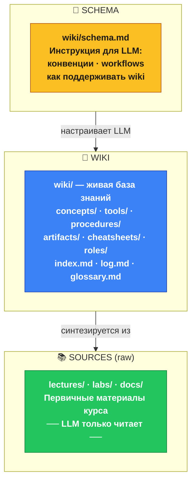
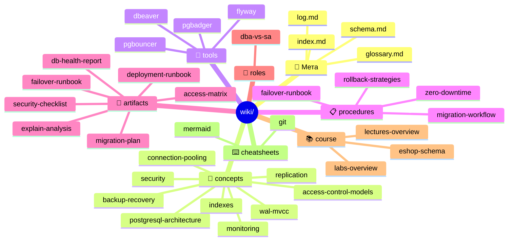
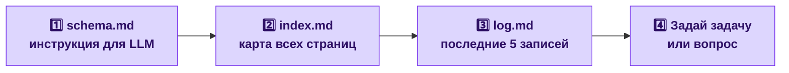
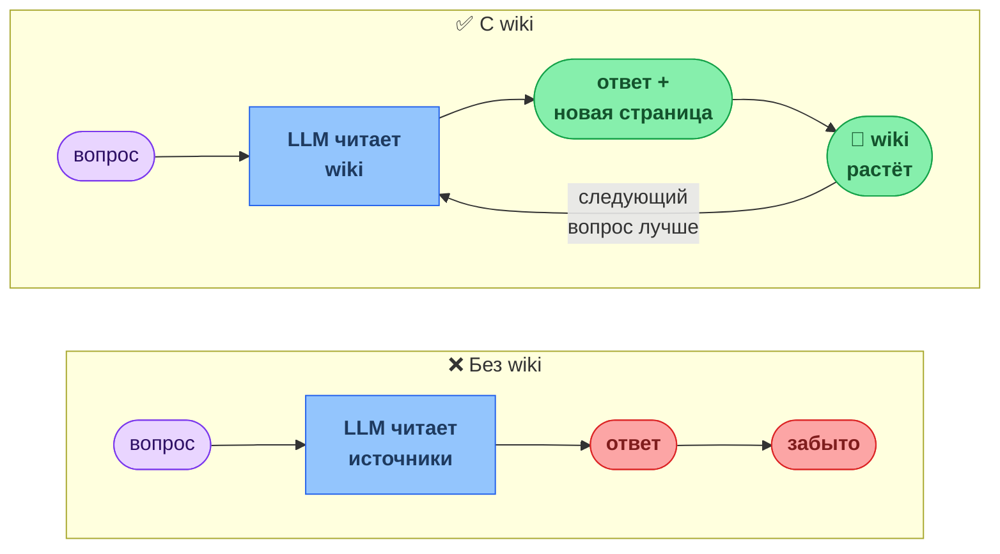
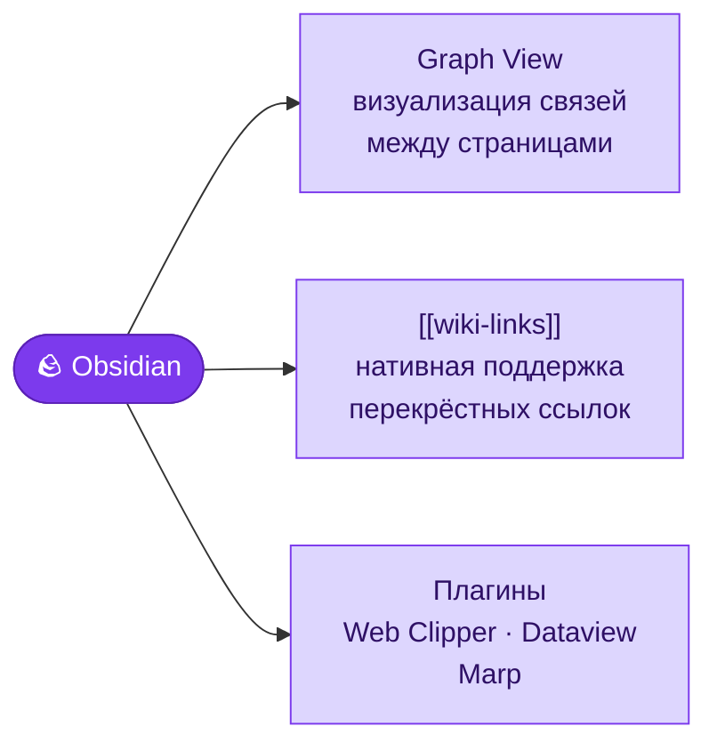
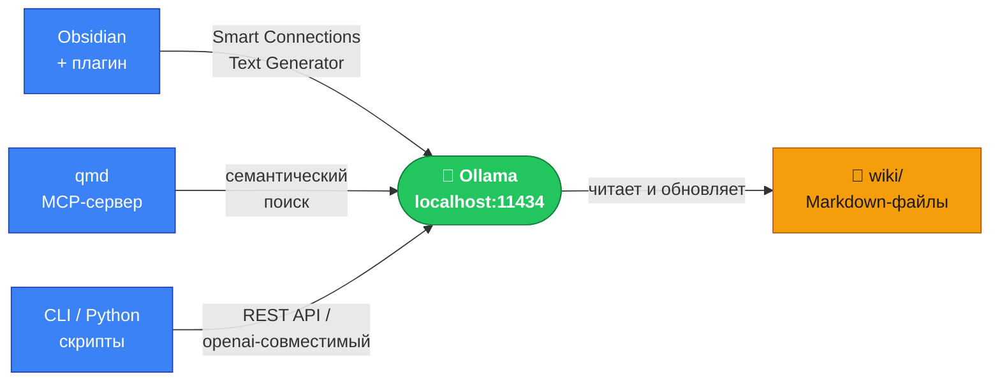

# LLM-Wiki: база знаний курса «Администрирование БД»

> Концепция предложена Андреем Карпаты.  
> Оригинальный гист: https://gist.github.com/karpathy/442a6bf555914893e9891c11519de94f  
> Статья на Habr: https://habr.com/ru/articles/1031970/  
> Сайт проекта: https://llm-wiki.net/

---

## Что такое LLM-wiki

LLM-wiki — это **самоорганизующаяся база знаний в формате Markdown**, которую поддерживает языковая модель. Идея в том, что знания накапливаются и связываются между собой постепенно, а не пересинтезируются заново при каждом вопросе.

Ключевое отличие от обычного чата с LLM:

| Обычный чат | LLM-wiki |
|-------------|----------|
| Каждый ответ генерируется с нуля | Знания накапливаются в файлах |
| Контекст теряется после сессии | Wiki остаётся и растёт между сессиями |
| Связи между темами — в голове LLM | Связи зафиксированы как перекрёстные ссылки |
| «Расскажи мне о X» | «Обнови страницу X, добавь связь с Y» |

Аналогия Карпаты: **wiki — это кодовая база, LLM — это программист**, который её поддерживает. Ты — архитектор: решаешь, что добавить, задаёшь направление.

---

## Архитектура: три слоя



### Слой Sources — неизменяемый

Первичные документы курса: лекции, лабораторные, экзамен, темы докладов. LLM читает их при ingestion и при ответах на вопросы, но **никогда не изменяет**.

### Слой Wiki — живая база знаний

Markdown-страницы, созданные и поддерживаемые LLM. Каждая страница — синтез из источников, а не копипаст. Страницы связаны перекрёстными ссылками `[[путь/к/странице]]`.

Два служебных файла в корне wiki:

- **`index.md`** — каталог всех страниц с однострочным описанием. Точка входа для навигации.
- **`log.md`** — append-only журнал изменений. Новые записи идут в начало. Позволяет понять, что менялось и когда.

### Слой Schema — конфигурация LLM

`wiki/schema.md` — это CLAUDE.md для этой wiki. Он говорит LLM:
- Как устроена структура директорий и типы страниц
- Какие соглашения по формату
- Какие workflows выполнять (Ingest, Query, Lint, Update)
- Как обновлять index.md и log.md
- Как самому эволюционировать schema.md

**Читай schema.md первым при каждой работе с wiki.**

---

## Структура этой wiki



---

## Как работать с wiki

### Быстрый старт (новая сессия)



### Три основных режима работы

#### 1. Ingest — добавить новый источник

Ты даёшь LLM новый материал: статью, документ, новую лекцию, внешний источник.

LLM выполняет полный цикл:
- читает источник
- обсуждает ключевые идеи (если режим интерактивный)
- создаёт или обновляет wiki-страницы (один источник может затронуть 10–15 страниц)
- обновляет glossary, index, log

**Пример команды:**
```
Добавь в wiki эту статью о pg_partman. Обнови связанные страницы.
```

#### 2. Query — задать вопрос

LLM ищет ответ по wiki, синтезирует с цитатами. Если ответ большой и ценный — автоматически создаёт новую страницу, чтобы знание не потерялось.

**Примеры:**
```
Объясни разницу между RBAC и RLS в контексте eshop.
Какие zero-downtime паттерны применимы для таблицы orders?
Составь сравнительную таблицу стратегий rollback.
```

#### 3. Lint — проверить здоровье wiki

Периодически просишь LLM проверить wiki на проблемы: противоречия между страницами, устаревшие утверждения, orphan-страницы, пробелы в покрытии.

**Пример:**
```
Запусти lint wiki. Найди orphan-страницы и концепции без своей страницы.
```

---

## Принцип накопления знаний

Карпаты называет это **compounding knowledge** — знания накапливаются, а не пересинтезируются:



Каждый ответ на вопрос, каждый ingested источник делают следующие ответы лучше — потому что wiki становится точнее и полнее.

---

## Разделение ролей

| Кто                    | Что делает                                                                                   |
| ---------------------- | -------------------------------------------------------------------------------------------- |
| **Ты** (преподаватель) | Добавляешь источники, задаёшь вопросы, направляешь акценты, решаешь что важно                |
| **LLM**                | Читает, синтезирует, поддерживает wiki, обновляет перекрёстные ссылки, обслуживает глоссарий |
| **Wiki**               | Хранит и связывает накопленные знания между сессиями                                         |

Цитата Карпаты: *«The LLM writes and maintains all of it. You're in charge of sourcing, exploration, and asking the right questions.»*

---

## Инструментарий

Инструменты, упомянутые Карпаты в статье. Все опциональны — wiki работает и без них, в любом текстовом редакторе.

### Obsidian — IDE для wiki

**Сайт:** https://obsidian.md  
**Подробная статья:** [[tools/obsidian]]  
**Назначение:** Основной инструмент навигации и редактирования wiki.

Obsidian нативно понимает `[[wiki-links]]` и строит граф связей между страницами. Именно это делает его предпочтительным ридером для LLM-wiki — можно визуально видеть, какие страницы изолированы (orphans), а какие хорошо связаны.



**Ключевые возможности для LLM-wiki:**

| Функция | Что даёт |
|---------|----------|
| Graph View | Визуализирует orphan-страницы и перегруженные хабы — помогает проводить Lint |
| `[[wiki-links]]` автодополнение | Быстро вставлять ссылки на существующие страницы без опечаток |
| Backlinks panel | Видеть все страницы, ссылающиеся на текущую — основа Lint-проверки |
| Local search | Полнотекстовый поиск по всей wiki без внешних инструментов |

Подробно о настройке, плагинах, горячих клавишах и workflows — [[tools/obsidian]].

---

### Web Clipper — захват источников

**Сайт:** https://obsidian.md/clipper  
**Назначение:** Браузерное расширение для сохранения статей, страниц документации и веб-источников напрямую в папку `sources/` или как новый raw-документ для последующего Ingest.

Сохраняет страницу как Markdown с метаданными (URL, дата, заголовок). После сохранения — стандартный цикл Ingest: передаёшь LLM, он синтезирует wiki-страницы.

---

### qmd — поиск по wiki

**Репозиторий:** https://github.com/tobi/qmd  
**Назначение:** Локальный поисковик по Markdown-файлам с гибридным поиском BM25 + векторный поиск + LLM-ранжирование.

Актуален когда wiki вырастает до 50+ страниц и простой `grep` перестаёт находить нужное контекстуально. Работает как CLI и как **MCP-сервер** — LLM может использовать его инструментально при ответах на вопросы.

```
# CLI: найти страницы о стратегиях rollback
qmd search "стратегии отката при ошибке миграции"

# MCP: LLM сам вызывает qmd через tool_use при Query-сессии
```

**Принцип работы:**
- BM25 — точный поиск по ключевым словам
- Векторный поиск — семантическое сходство (находит «PITR» по запросу «восстановление на момент времени»)
- LLM-ранжирование — финальный отбор самых релевантных результатов

---

### Marp — презентации из wiki

**Сайт:** https://marp.app  
**Obsidian-плагин:** https://github.com/sabermi/obsidian-marp  
**Назначение:** Превращает Markdown-страницы wiki в слайды.

Полезно для курса: можно взять wiki-страницу по теме лекции и экспортировать в PDF/HTML-презентацию без переписывания. Синтаксис — обычный Markdown с разделителем `---` между слайдами.

```markdown
---
marp: true
theme: default
---

# Модели управления доступом

DAC · RBAC · ABAC · MAC · ReBAC

---

## RBAC в PostgreSQL

- Роли как профили: `NOLOGIN`
- Наследование через `INHERIT`
- `GRANT app_readonly TO analyst_ivanova`
```

---

### Dataview — запросы по метаданным

**Репозиторий:** https://github.com/blacksmithgu/obsidian-dataview  
**Назначение:** Obsidian-плагин для динамических запросов к YAML-фронтматтеру страниц wiki.

Позволяет строить динамические индексы и дашборды прямо внутри wiki без ручного обновления:

```dataview
TABLE source, topic
FROM "concepts"
WHERE contains(source, "lec_03")
SORT file.name ASC
```

Результат — автоматически обновляемая таблица «все концепции из третьей лекции». Полезно для преподавателя: быстро видеть покрытие тем по лекциям.

---

### Lint как workflow, а не инструмент

Карпаты подчёркивает: **проверка здоровья wiki — это задача для LLM**, а не для отдельного статического анализатора. LLM читает страницы, понимает смысл и находит:

- смысловые противоречия между страницами (статический линтер не найдёт)
- устаревшие утверждения, которые опровергает более новый источник
- концепции, упомянутые в тексте, но без собственной страницы
- пробелы в покрытии курса

Для механической проверки (битые ссылки, форматирование) — достаточно встроенного поиска Obsidian или `grep`.

---

## Подключение локальной Ollama

Ollama позволяет запустить LLM локально и использовать её для всех wiki-операций (Ingest, Query, Lint) без облака и без передачи данных на внешние серверы.

### 1. Установка Ollama

```bash
# Windows / macOS — скачать установщик:
# https://ollama.com/download

# Linux
curl -fsSL https://ollama.com/install.sh | sh

# Проверить что запущено
ollama --version
ollama list          # пустой список пока
```

После установки Ollama автоматически запускает REST API на `http://localhost:11434`.

### 2. Выбор модели

Для работы с wiki нужна модель, хорошо понимающая русский язык и умеющая писать структурированный Markdown.

| Модель | Размер | Русский | Контекст | Когда использовать |
|--------|--------|---------|----------|--------------------|
| `qwen2.5:7b` | 4.7 GB | ✓✓✓ | 128k | Основная рабочая лошадка — хороший баланс скорости и качества |
| `qwen2.5:14b` | 9 GB | ✓✓✓ | 128k | Лучше для сложных Ingest и Lint при наличии RAM |
| `llama3.1:8b` | 4.9 GB | ✓✓ | 128k | Альтернатива если Qwen не подходит |
| `gemma3:9b` | 5.4 GB | ✓✓ | 128k | Хорош для генерации связного текста |
| `mistral:7b` | 4.1 GB | ✓ | 32k | Быстрый, но контекст короче |

```bash
# Скачать рекомендуемую модель
ollama pull qwen2.5:7b

# Проверить
ollama run qwen2.5:7b "Напиши одно предложение о PostgreSQL VACUUM"
```

### 3. Подключение через Obsidian

Полная инструкция по настройке vault и плагинов — [[tools/obsidian]].

Установи один из плагинов в Obsidian: **Settings → Community plugins → Browse**.

#### Вариант A: Smart Connections
**Репозиторий:** https://github.com/brianpetro/obsidian-smart-connections

Умеет работать с локальными эмбеддингами и Ollama. Строит семантический граф поверх wiki, находит релевантные страницы при вопросах.

```
Settings → Smart Connections → Smart Chat Model
  → выбрать "Ollama"
  → Model: qwen2.5:7b
  → Base URL: http://localhost:11434
```

#### Вариант B: Text Generator
**Репозиторий:** https://github.com/nhaouari/obsidian-textgenerator-plugin

Вызывает Ollama из контекстного меню прямо в редакторе — удобно для обновления отдельных страниц wiki.

```
Settings → Text Generator → LLM Provider → Ollama
  → Model: qwen2.5:7b
  → Server URL: http://localhost:11434
```

Использование: выдели текст на wiki-странице → ПКМ → Generate Text → введи инструкцию для LLM.

### 4. Подключение через qmd + Ollama

qmd поддерживает локальные эмбеддинги и запускается как MCP-сервер, который LLM использует инструментально при Query.

```bash
# Установить qmd
pip install qmd   # или: cargo install qmd (если Rust)

# Проиндексировать wiki
qmd index C:\MY_GIT\dba\wiki --model ollama/qwen2.5:7b

# Запустить как MCP-сервер
qmd serve --mcp --port 3333

# Поиск из командной строки
qmd search "стратегии rollback при ошибке миграции"
```

После запуска MCP-сервера его можно подключить к Claude Code или любому MCP-совместимому клиенту.

### 5. Прямая работа через REST API

Ollama совместим с OpenAI API — любой инструмент, поддерживающий OpenAI, работает с Ollama без изменений.

```bash
# Прямой запрос через curl
curl http://localhost:11434/api/generate \
  -d '{
    "model": "qwen2.5:7b",
    "stream": false,
    "prompt": "Прочитай эту wiki-страницу и найди orphan-концепции без своей страницы:\n\n'"$(cat wiki/index.md)"'"
  }'
```

```python
# Python — openai-совместимый клиент
from openai import OpenAI

client = OpenAI(
    base_url="http://localhost:11434/v1",
    api_key="ollama",          # значение не важно, но поле обязательно
)

wiki_page = open("wiki/concepts/wal-mvcc.md").read()

response = client.chat.completions.create(
    model="qwen2.5:7b",
    messages=[
        {"role": "system", "content": open("wiki/schema.md").read()},
        {"role": "user",   "content": f"Обнови эту страницу wiki:\n\n{wiki_page}"},
    ]
)
print(response.choices[0].message.content)
```

### 6. Типовой Ingest-скрипт (CLI)

Простой bash-скрипт для пакетного ingestion источников через Ollama CLI:

```bash
#!/usr/bin/env bash
# ingest.sh — передать лекцию в Ollama для обновления wiki

SCHEMA=$(cat wiki/schema.md)
SOURCE=$1           # путь к файлу источника, например lectures/lec_09/lec_09.md
SOURCE_TEXT=$(cat "$SOURCE")

ollama run qwen2.5:7b "$(cat <<PROMPT
Ты — LLM-редактор wiki. Следуй инструкциям из schema.md.

--- schema.md ---
$SCHEMA

--- Новый источник для Ingest: $SOURCE ---
$SOURCE_TEXT

Задача: перечисли, какие страницы wiki нужно создать или обновить,
и предложи содержимое для каждой.
PROMPT
)"
```

```bash
chmod +x ingest.sh
./ingest.sh lectures/lec_09/lec_09.md
```

### 7. Архитектура с Ollama



---

## Технические детали

- **Формат:** чистый Markdown, никаких специальных инструментов не требуется
- **Просмотр:** любой Markdown-ридер; рекомендуется Obsidian — [[tools/obsidian|настройка и workflows]]
- **Версионирование:** git-репозиторий (история изменений wiki сохраняется в коммитах)
- **Внутренние ссылки:** `[[путь/от/корня-wiki]]` — без расширения `.md`
- **Язык:** русский; технические термины и идентификаторы — на языке оригинала

---

## Ссылки

| Ресурс | Описание |
|--------|----------|
| [Андрей Карпаты — оригинальный гист](https://gist.github.com/karpathy/442a6bf555914893e9891c11519de94f) | Первоисточник концепции LLM-wiki: три слоя, Ingest/Query/Lint, schema как CLAUDE.md |
| [Статья на Habr](https://habr.com/ru/articles/1031970/) | Разбор подхода на русском языке с примерами и обсуждением |
| [llm-wiki.net](https://llm-wiki.net/) | Сайт проекта: шаблоны, примеры готовых wiki, сообщество |
