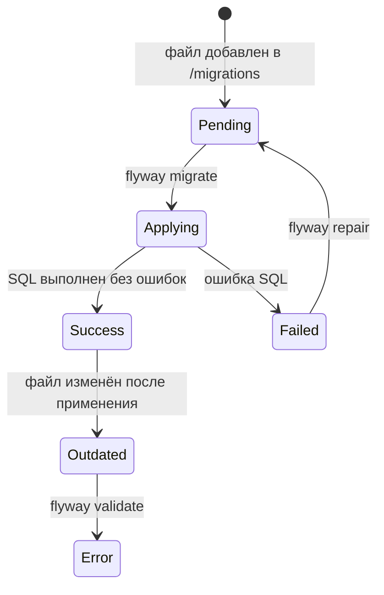

# Runbook деплоя миграции

**Источник:** лаб. 09 — «Управление миграциями»  
**Кто создаёт:** системный аналитик совместно с DBA  
**Когда использовать:** в день production-деплоя каждой значимой миграции

---

## Зачем этот документ

Runbook делает деплой воспроизводимым. Без него каждый деплой — уникальный акт, зависящий от памяти исполнителя. Runbook также фиксирует точку отката — если что-то пошло не так, DBA не думает, что делать, а читает следующий шаг.

> **Запомнить:** Runbook пишется до деплоя, а не в процессе. Заполненный «до» раздел означает, что бэкап сделан и команда уведомлена — это ворота, через которые нельзя пройти без выполнения.

---

## Шаблон Runbook деплоя

```markdown
# Runbook деплоя: V003__create_promo_codes.sql

| Поле                | Значение                              |
|---------------------|---------------------------------------|
| Дата деплоя         | 2024-11-15                            |
| Ответственный DBA   | ___________                           |
| Ответственный SA    | Иванова А.В.                          |
| Migration Plan      | [ссылка на план]                      |
| Окно деплоя         | 14:00–16:00 (рабочие часы с поддержкой) |

---

## 1. Подготовка (выполнить ДО деплоя)

- [ ] Создать бэкап БД
```powershell
$pg   = "C:\Program Files\PostgreSQL\18\bin"
$date = Get-Date -Format "yyyyMMdd_HHmm"
& "$pg\pg_dump.exe" -U postgres -Fc eshop -f "C:\backup\eshop\eshop_pre_V003_$date.dump"
```

- [ ] Проверить состояние миграций
```powershell
flyway info
# Ожидаемое: V001, V002 — Success; V003 — Pending
```

- [ ] Уведомить команду: "Деплой V003 начинается в 14:00. Возможны кратковременные блокировки."

- [ ] Проверить свободное место на диске
```powershell
Get-PSDrive C | Select-Object Used, Free
# Нужно минимум 2× размера БД для бэкапа
```

---

## 2. Выполнение

```bash
# Шаг 1: Проверка файлов миграции
flyway validate

# Ожидаемый вывод:
# Flyway OSS Edition ... successfully validated 3 migrations

# Шаг 2: Применить миграцию
flyway migrate

# Ожидаемый вывод:
# Successfully applied 1 migration to schema "public"
# (execution time 00:02.123s)
```

- [ ] Зафиксировать время начала и окончания: ______ — ______

---

## 3. Верификация

```sql
-- 1. Flyway зафиксировал успех:
SELECT version, description, success, execution_time
FROM flyway_schema_history
ORDER BY installed_rank DESC LIMIT 3;

-- Ожидаемое: latest строка с success=true

-- 2. Объекты созданы (проверки из Migration Plan):
SELECT count(*) FROM information_schema.tables WHERE table_name = 'promo_codes';
-- Ожидаемое: 1

SELECT indexname FROM pg_indexes WHERE tablename = 'promo_codes';
-- Ожидаемое: idx_promo_codes_code

SELECT column_name FROM information_schema.columns
WHERE table_name = 'orders' AND column_name = 'promo_code_id';
-- Ожидаемое: 1 строка

-- 3. Smoke-test: базовые операции работают
INSERT INTO promo_codes (code, discount_percent) VALUES ('SAVE10', 10.00);
SELECT * FROM promo_codes;
DELETE FROM promo_codes WHERE code = 'SAVE10';
```

- [ ] Все проверки прошли
- [ ] Приложение работает нормально (проверить health endpoint / базовый тест)

---

## 4. Откат (если верификация не прошла)

```sql
-- Rollback-SQL из Migration Plan:
ALTER TABLE orders DROP COLUMN IF EXISTS promo_code_id;
DROP INDEX IF EXISTS idx_promo_codes_code;
DROP TABLE IF EXISTS promo_codes;
```

```powershell
# После отката: сбросить FAILED-статус в Flyway
flyway repair

# Проверить состояние:
flyway info
# Ожидаемое: V003 снова Pending
```

```powershell
# Если откат не помог — восстановить из бэкапа:
$pg = "C:\Program Files\PostgreSQL\18\bin"
& "$pg\pg_restore.exe" -U postgres -d eshop "C:\backup\eshop\eshop_pre_V003_*.dump"
```

- [ ] Уведомить команду: "Деплой V003 откатан. Причина: ___________."

---

## 5. После деплоя

- [ ] Уведомить команду: "Деплой V003 успешно завершён в ______."
- [ ] Закрыть тикет / задачу
- [ ] Обновить CHANGELOG / release notes
- [ ] Проверить мониторинг через 30 мин (нет ли роста медленных запросов)
```

---

## Разница Migration Plan vs Runbook деплоя

| | Migration Plan | Runbook деплоя |
|--|----------------|----------------|
| **Когда** | За 1–3 дня до деплоя | В день деплоя |
| **Для кого** | DBA + тимлид (ревью) | DBA (выполнение) |
| **Содержит** | Что меняется, почему, риски, rollback SQL | Пошаговые команды с ожидаемым выводом |
| **Аналог** | RFC / change request | Инструкция по эксплуатации |

---

## Состояния миграций Flyway



> **Запомнить:** нельзя изменять файл миграции после того, как она применена (Success). Flyway проверяет checksum. Если файл изменился — `flyway validate` вернёт ошибку и `flyway migrate` заблокируется.

---

> **Связанные страницы:** [[artifacts/migration-plan]], [[tools/flyway]], [[procedures/migration-workflow]], [[procedures/rollback-strategies]]
