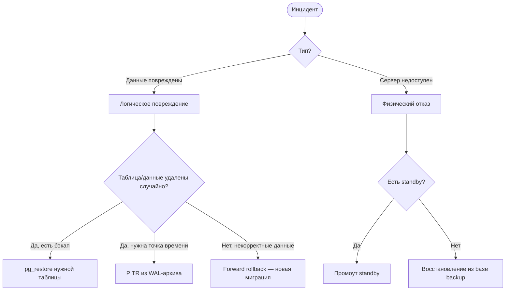

# Failover Runbook

**Источник:** лаб. 04 — «Восстановление после сбоев»  
**Кто создаёт:** системный аналитик совместно с DBA  
**Назначение:** пошаговые действия при отказе БД; чёткое разграничение — что делает DBA, что делает аналитик

---

## Зачем этот документ

При инциденте нет времени думать. Runbook написан заранее и выполняется по шагам. Аналитик не должен лезть в PostgreSQL руками — его задача: диагностировать симптомы, передать информацию DBA, координировать уведомления.

> **Запомнить:** Runbook — не техническая документация для DBA. Это **совместный** документ, где у каждой роли своя колонка. Аналитик читает его наравне с DBA.

---

## Шаблон: контакты и эскалация

```markdown
## Контакты

| Роль            | Имя          | Телефон       | Мессенджер      |
|-----------------|--------------|---------------|-----------------|
| DBA on-call     | _________    | ___________   | @____________   |
| Разработчик     | _________    | ___________   | @____________   |
| Системный аналитик | _________ | ___________   | @____________   |
| Руководитель    | _________    | ___________   | @____________   |

Порядок эскалации: DBA → Разработчик → Руководитель (если DBA недоступен > 15 мин)
```

---

## Шаблон: индикаторы сбоя

```markdown
## Кто что видит первым

| Симптом                              | Кто замечает первым | Действие        |
|--------------------------------------|---------------------|-----------------|
| 500 Internal Server Error в приложении | Пользователь / аналитик | Сообщить DBA |
| pg_stat_activity: idle in transaction > 5 мин | DBA (мониторинг) | Расследовать |
| Внезапная потеря таблицы / данных    | Аналитик (запрос не работает) | Сообщить DBA |
| Сервер недоступен (SSH не отвечает)  | DBA | Сценарий Б |
```

---

## Сценарий А: логическое повреждение данных

*Пример: случайный DROP TABLE или некорректный UPDATE без WHERE*

### Действия DBA

```sql
-- 1. Немедленно: зафиксировать время инцидента
SELECT now();  -- записать в лог инцидента

-- 2. Проверить наличие активных транзакций
SELECT pid, now() - query_start AS duration, state, query
FROM pg_stat_activity
WHERE state != 'idle'
ORDER BY duration DESC;

-- 3. Оценить масштаб потери
SELECT schemaname, tablename, n_live_tup, n_dead_tup
FROM pg_stat_user_tables
WHERE tablename = 'orders';

-- 4. Вариант А: восстановить из логического бэкапа
pg_restore -U postgres -d eshop -t orders /backups/eshop_latest.dump

-- 4. Вариант Б: PITR (если есть WAL-архив)
-- Остановить PostgreSQL, развернуть base backup, настроить recovery.conf
```

### Действия аналитика

```markdown
- [ ] Зафиксировать точное время обнаружения (скриншот / лог)
- [ ] Описать симптомы: какой запрос/отчёт перестал работать
- [ ] Уведомить команду: "БД eshop частично недоступна с HH:MM, причина выясняется"
- [ ] Ответить на вопросы DBA о последних изменениях (миграции, нагрузка)
- [ ] Не пытаться "починить" данные самостоятельно
```

---

## Сценарий Б: физический отказ сервера

*Пример: сервер не отвечает, SSH недоступен*

### Действия DBA

```bash
# 1. Проверить standby (если есть репликация)
psql -h standby-host -U postgres -c "SELECT pg_is_in_recovery();"
# true = это standby, можно промоутировать

# 2. Промоут standby в primary
pg_ctl promote -D /var/lib/postgresql/data
# или через Patroni:
patronictl failover eshop

# 3. Обновить строку подключения в приложении
# 4. Проверить репликационное отставание перед промоутом:
SELECT now() - pg_last_xact_replay_timestamp() AS replication_lag;
```

### Действия аналитика

```markdown
- [ ] Уведомить: "Производственная БД недоступна с HH:MM, идёт восстановление"
- [ ] Собрать: что последнее делали пользователи (для оценки потерянных данных)
- [ ] Согласовать с руководством допустимое время простоя
- [ ] Подготовить постмортем-шаблон (заполнить после восстановления)
```

---

## Дерево решений (Mermaid)



---

## Пост-восстановление

```markdown
## После устранения инцидента

1. Зафиксировать RPO: потеряли данных с ______ по ______
2. Зафиксировать RTO: простой с ______ по ______ = ___ мин
3. Постмортем (не позднее 24 ч): что произошло, почему, как предотвратить
4. Обновить этот runbook, если обнаружились пробелы
```

---

## Контрольные вопросы (для подготовки к сдаче)

1. Чем отличается RPO от RTO? В каких единицах измеряется каждый?
2. Почему аналитик не должен самостоятельно восстанавливать данные в БД?
3. Когда использовать PITR вместо pg_restore?
4. Что такое «forward rollback» и когда он применяется?

---

> **Связанные страницы:** [[concepts/backup-recovery]], [[procedures/failover-runbook]], [[artifacts/backup-policy]], [[roles/dba-vs-sa]]
