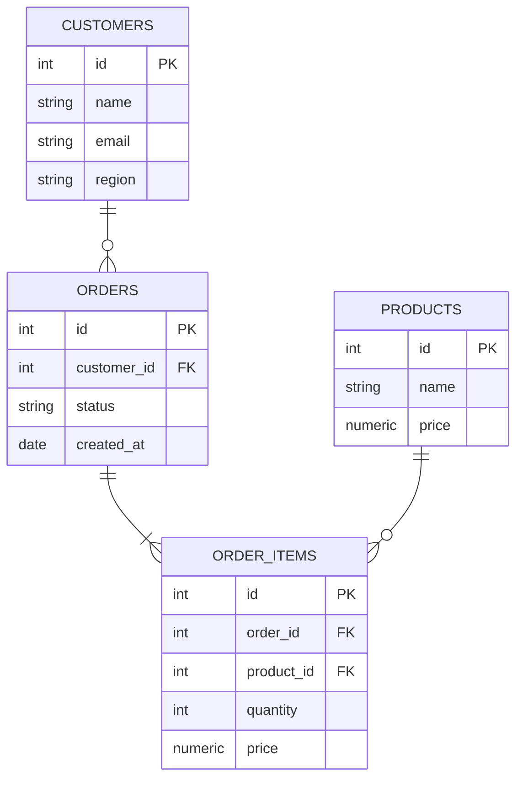

# Итоговый отчёт по проекту eshop

**Источник:** лаб. 10 — «Итоговый проект»  
**Кто создаёт:** системный аналитик  
**Назначение:** портфолио всех компетенций курса; основа для устной защиты

---

## Зачем этот документ

Итоговый отчёт — не пересказ лекций, а доказательство практических навыков. Каждый раздел должен содержать реальные данные из вашего eshop: числа, SQL-запросы, выводы, решения.

> **Запомнить:** на защите преподаватель спросит «почему» по любому пункту. «Мы создали индекс» — недостаточно. «Мы создали частичный индекс по status='pending' потому что 90% запросов фильтруют только pending-заказы, и это снизило время с 80 до 5 мс» — правильно.

---

## Структура отчёта

### Раздел 1: Описание БД

```markdown
## 1. База данных eshop

### Назначение
[Описание бизнес-контекста: что хранит БД, кто пользователь, какие операции]

### ERD



### Объёмы данных (на момент итоговой работы)

| Таблица     | Строк |
|-------------|-------|
| customers   |       |
| orders      |       |
| order_items |       |
| products    |       |
```

---

### Раздел 2: Модель доступа

```markdown
## 2. Роли и RLS

### Роли

| Роль            | Тип   | Привилегии                    |
|-----------------|-------|-------------------------------|
| eshop_readonly  | GROUP | SELECT на все таблицы + RLS   |
| eshop_app       | GROUP | CRUD на все таблицы + RLS     |
| analyst_ivanova | LOGIN | MEMBER OF eshop_readonly      |
| app_backend     | LOGIN | MEMBER OF eshop_app           |

### RLS-политики

[Перечислить политики с SQL-определением]

```sql
CREATE POLICY customers_by_region ON customers
    FOR SELECT TO eshop_readonly
    USING (region = current_setting('app.current_region', true));
```

### Применяемая модель
[Объяснить: RBAC + RLS как элемент ABAC. Почему выбрана эта модель.]
```

---

### Раздел 3: Стратегия резервного копирования

```markdown
## 3. Резервное копирование

### RPO/RTO
- RPO: ___ (допустимая потеря данных)
- RTO: ___ (допустимое время восстановления)

### Расписание

[Вставить таблицу из artifacts/backup-policy.md]

### Тестирование восстановления

[Описать: когда тестировали, что делали, результат]
```

---

### Раздел 4: Мониторинг

```markdown
## 4. Мониторинг

### Ключевые метрики и пороги

| Метрика                | Запрос (pg_stat_*)       | Порог тревоги |
|------------------------|--------------------------|---------------|
| Cache hit ratio        | pg_stat_database         | < 95%         |
| Dead tuples (bloat)    | pg_stat_user_tables      | dead_pct > 10% |
| Idle in transaction    | pg_stat_activity         | > 5 мин       |
| Медленные запросы      | pg_stat_statements       | mean_ms > 1000 |

### Инструменты
[pgBadger: как настроен, какие отчёты генерируются]
```

---

### Раздел 5: Производительность

```markdown
## 5. Оптимизация производительности

### Созданные индексы

| Индекс              | Тип      | Таблица | Колонки        | Обоснование |
|---------------------|----------|---------|----------------|-------------|
| idx_orders_status   | Частичный| orders  | status ('pending') | 90% запросов |
| idx_oi_order        | B-tree   | order_items | order_id  | FK без индекса |

### Настройки autovacuum

[Какие параметры изменили и почему]

### PgBouncer

[Решение: внедрён / не внедрён. Обоснование. Если внедрён — режим, pool_size, измеренный эффект]
```

---

### Раздел 6: Информационная безопасность

```markdown
## 6. Информационная безопасность

### Реализованные меры

[Пройтись по чек-листу artifacts/security-checklist.md, отметить выполненное]

### pgAudit

```ini
pgaudit.log = 'write,ddl,role'
pgaudit.log_catalog = off
```

### 152-ФЗ

[Категория ПДн: общие. 3-й уровень защищённости. Локализация: РФ.
Чувствительные поля: customers.phone — зашифрованы через pgcrypto.]
```

---

### Раздел 7: Управление миграциями

```markdown
## 7. Миграции (Flyway)

### История миграций

```sql
SELECT version, description, installed_on, execution_time, success
FROM flyway_schema_history
ORDER BY installed_rank;
```

[Вставить таблицу с реальными данными]

### Описание одного инцидента / нестандартной ситуации

[Например: миграция упала с ошибкой FK, применили flyway repair, исправили SQL]
```

---

### Раздел 8: Zero-Downtime паттерны

```markdown
## 8. Zero-Downtime паттерны

| Операция          | Опасный вариант          | Безопасный вариант         |
|-------------------|--------------------------|----------------------------|
| ADD NOT NULL      | ADD COLUMN NOT NULL       | ADD COLUMN NULL → UPDATE → SET NOT NULL |
| RENAME COLUMN     | ALTER TABLE RENAME COLUMN | New column → backfill → drop old |
| CREATE INDEX      | CREATE INDEX              | CREATE INDEX CONCURRENTLY  |
| DROP TABLE        | DROP TABLE                | Проверить зависимости → DROP |
| ALTER COLUMN TYPE | ALTER COLUMN TYPE         | New column → backfill → rename → drop |

### Применённые паттерны в eshop

[Перечислить, какие конкретные паттерны применялись в лабораторных работах]
```

---

### Раздел 9: Выводы

```markdown
## 9. Выводы

[Что узнали, что было сложнее всего, какие решения приняты и почему,
что бы сделали иначе при повторном проекте]
```

---

## Вопросы к защите (устный экзамен)

На защите преподаватель задаёт 2–3 вопроса из этого списка:

1. Объясните разницу между логическим и физическим бэкапом. Когда использовать каждый?
2. Почему RLS не заменяет GRANT? Приведите пример из вашего проекта.
3. Что произойдёт, если изменить файл миграции после его применения в prod?
4. Как вы измеряли эффект от создания индекса? Покажите EXPLAIN ANALYZE.
5. Почему autovacuum не запускался на таблице orders? Что вы изменили?
6. Какие ограничения вводит PgBouncer в transaction mode? Какие отключили в коде?
7. Объясните разницу RPO и RTO на примере вашего регламента бэкапов.
8. Что фиксирует pgAudit и зачем хранить логи 1 год?
9. Как добавить NOT NULL колонку в таблицу с миллионами строк без downtime?
10. Какой уровень защищённости ПДн у вашей БД и почему?

---

> **Связанные страницы:** [[artifacts/index]], [[course/eshop-schema]], [[roles/dba-vs-sa]], [[concepts/security]]
