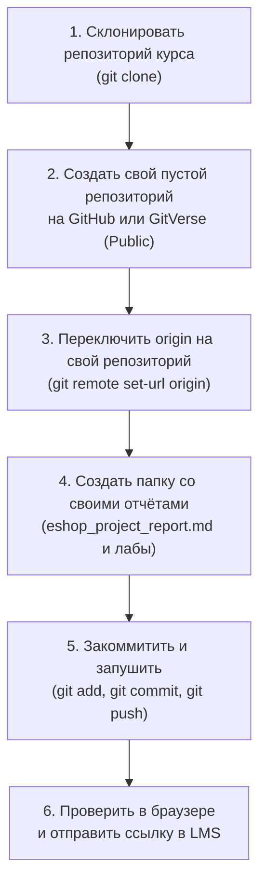

# Шпаргалка: Git и регламент сдачи работ

Практическое руководство для студентов курса «Администрирование баз данных»: команды для работы с миграциями, MR-процесс и **пошаговая инструкция по сдаче проектных отчётов через GitHub / GitVerse**.

---

## 🚀 Пошаговый сценарий: сдача отчётов через GitHub / GitVerse

> 💡 **Важно:** Файлы отчётов **не нужно отправлять на почту или прикреплять архивами в LMS**. Все работы сдаются в виде ссылки на ваш публичный Git-репозиторий на **GitHub** или **GitVerse**. Это формирует ваше профессиональное портфолио и фиксирует историю изменений через коммиты.



### Шаг 1. Первоначальная настройка Git на локальной машине

Перед началом работы убедитесь, что в Git указаны ваши реальные имя и email:

```bash
git config --global user.name "Иван Иванов"
git config --global user.email "ivanov@edu.example.ru"
git config --global init.defaultBranch main
```

---

### Шаг 2. Клонирование учебного репозитория курса

Склонируйте базовый репозиторий курса к себе на рабочий компьютер:

```bash
# Клонируем проект в локальную папку
git clone <URL_РЕПОЗИТОРИЯ_КУРСА> dba-project
cd dba-project
```

---

### Шаг 3. Создание своего репозитория на GitHub или GitVerse

1. Перейдите на выбранную платформу:
   - **GitHub:** [https://github.com/new](https://github.com/new)
   - **GitVerse:** [https://gitverse.ru/](https://gitverse.ru/)
2. Задайте имя репозитория, например: `dba-eshop-portfolio` или `dba-coursework`.
3. Установите тип видимости: **Public** (публичный, чтобы преподаватель мог проверить работу).
4. ⚠️ **Внимание:** **НЕ** ставьте галочки «Add a README file», «Add .gitignore» или «Choose a license». Репозиторий должен быть создан **полностью пустым**, чтобы избежать конфликта историй при первом push.

---

### Шаг 4. Перенаправление remote на ваш собственный репозиторий

В вашем локальном склонированном репозитории перенастройте удалённый адрес (`origin`) на созданный вами репозиторий:

```bash
# 1. Проверяем текущий адрес (он указывает на учебный репозиторий курса)
git remote -v

# 2. Переключаем origin на URL вашего личного репозитория:
# Для GitHub (HTTPS):
git remote set-url origin https://github.com/<ВАШ_АККАУНТ>/dba-eshop-portfolio.git
# Либо для GitVerse (HTTPS):
git remote set-url origin https://gitverse.ru/<ВАШ_АККАУНТ>/dba-eshop-portfolio.git

# 3. (Опционально) Добавляем ссылку на репозиторий курса как upstream,
# чтобы иметь возможность подтягивать новые материалы лекций:
git remote add upstream <URL_РЕПОЗИТОРИЯ_КУРСА>

# 4. Проверяем обновлённые remotes:
git remote -v
```

---

### Шаг 5. Размещение файлов отчётов и проектных артефактов

1. Создайте в корне проекта персональную папку со своими отчетами, либо положите итоговый отчет в корень репозитория:
   - Итоговый проектный отчёт: `eshop_project_report.md` (структура по [шаблону](../artifacts/project-report.md)).
   - Все отчёты и чек-листы по лабораторным работам (лаб. 01–10) разместите в папке `reports/` (например, `reports/lab_01.md`, `reports/lab_02.md` ... или `reports/<Фамилия_ИО>/`).
   - Убедитесь, что все ваши SQL-миграции Flyway сохранены в папке `migrations/` (`V001`–`V008`).

---

### Шаг 6. Фиксация изменений (Commit) и отправка (Push)

```bash
# Проверяем состояние файлов
git status

# Добавляем файлы отчётов и наработок в индекс
git add eshop_project_report.md
git add reports/
git add migrations/

# Создаём коммит с понятным описанием
git commit -m "feat: add eshop final project report and lab solutions"

# Убеждаемся, что текущая ветка называется main
git branch -M main

# Отправляем изменения в ваш удалённый репозиторий
git push -u origin main
```

> 🔑 **Авторизация при push:**
> - **GitHub:** Начиная с 2021 года GitHub не принимает пароль от аккаунта в консоли. Используйте **Personal Access Token (classic)** с правами `repo` (Settings → Developer Settings → Personal access tokens → Tokens classic) либо SSH-ключ.
> - **GitVerse:** Поддерживает авторизацию по логину/паролю аккаунта или токену доступа.

---

### Шаг 7. Проверка публикации и сдача ссылки

1. Откройте в браузере страницу вашего репозитория на GitHub или GitVerse.
2. Проверьте:
   - Файл `eshop_project_report.md` доступен и открывается.
   - Диаграммы Mermaid и таблицы Markdown отображаются корректно.
   - Все файлы лабораторных отчётов на месте.
3. Скопируйте ссылку на ваш репозиторий (например, `https://github.com/ivanov/dba-eshop-portfolio`) и вставьте её в поле ответа в LMS / форму сдачи зачёта.

---

### Частые проблемы и их решение (Git Troubleshooting)

- **Ошибка `failed to push some refs to ...` (конфликт с README на сервере):**  
  Если вы случайно создали репозиторий с галочкой «Initialize with README», удалённая ветка содержит коммит, которого нет локально.  
  *Решение:*
  ```bash
  git pull origin main --allow-unrelated-histories --no-rebase
  # Сохраните открывшееся сообщение коммита слияния, затем:
  git push -u origin main
  ```
- **Как подтянуть обновления из репозитория курса (если преподаватель обновил лекции/лабы):**
  ```bash
  git fetch upstream
  git merge upstream/main --no-edit
  git push origin main
  ```
- **Случайно закоммитили лишний файл или дамп базы:**
  ```bash
  # Убрать файл из git, оставив его на диске:
  git rm --cached big_dump.sql
  git commit -m "chore: remove dump from tracking"
  git push origin main
  ```

---

## 1. Первоначальная настройка

```bash
git config --global user.name  "Имя Фамилия"
git config --global user.email "email@example.com"
git config --global core.editor "code --wait"    # VS Code как редактор
git config --list                                 # проверить настройки
```

---

## 2. Базовый рабочий цикл

```bash
git status                   # что изменилось
git diff                     # изменения в unstaged файлах
git diff --staged            # изменения в staged файлах

git add <файл>               # добавить конкретный файл
git add migrations/          # добавить всю папку
git add -p                   # интерактивно выбирать части изменений

git commit -m "feat: add orders table migration V003"
git push origin <ветка>      # отправить изменения в remote
git pull --rebase            # получить изменения и перебазировать
```

---

## 3. Ветвление

```bash
git branch                          # список веток (локальные)
git branch -a                       # все ветки (включая remote)

git switch -c feature/add-orders    # создать и переключиться (современный синтаксис)
git checkout -b feature/add-orders  # то же, старый синтаксис

git switch main                     # переключиться на main
git switch -                        # вернуться на предыдущую ветку

git branch -d feature/add-orders    # удалить ветку после merge
git push origin --delete feature/add-orders  # удалить remote-ветку
```

---

## 4. Просмотр истории

```bash
git log                             # полная история
git log --oneline                   # сжатый вид (1 строка на коммит)
git log --oneline --graph --all     # дерево веток

git log --oneline -10               # последние 10 коммитов
git log --follow migrations/        # история папки
git log --author="Иванова"          # коммиты конкретного автора

git show <hash>                     # подробности коммита
git show HEAD                       # последний коммит
git show HEAD~2                     # 2 коммита назад
```

---

## 5. Сравнение

```bash
git diff main..feature/add-orders         # разница между ветками
git diff HEAD~1                           # изменения последнего коммита
git diff <hash1> <hash2>                  # между двумя коммитами
git diff --name-only main..HEAD           # только имена изменённых файлов
```

---

## 6. Отмена изменений

```bash
# Ещё не добавлено в index (unstaged)
git restore <файл>                  # отменить изменения в файле
git restore .                       # отменить все изменения в рабочей директории

# Добавлено в index (staged), но не закоммичено
git restore --staged <файл>         # убрать из staged, сохранить изменения
git reset HEAD <файл>               # то же, старый синтаксис

# Уже закоммичено
git revert <hash>                   # новый коммит, отменяющий изменения (безопасно)
git reset --soft HEAD~1             # отменить коммит, сохранить изменения staged
git reset --mixed HEAD~1            # отменить коммит, сохранить изменения unstaged
# git reset --hard — ДЕСТРУКТИВНО, безвозвратно удаляет изменения
```

> **Правило:** `git revert` — безопасный способ отмены опубликованных коммитов.  
> `git reset --hard` — только для локальных, ещё не запушенных изменений.

---

## 7. Stash — временное сохранение

```bash
git stash                           # убрать незакоммиченные изменения «в ящик»
git stash push -m "WIP: V004 draft" # с именем
git stash list                      # список stash-ей
git stash pop                       # восстановить последний stash (и удалить из списка)
git stash apply stash@{1}           # восстановить конкретный stash (не удалять)
git stash drop stash@{0}            # удалить stash
git stash clear                     # удалить все stash-и
```

---

## 8. Remote-репозитории

```bash
git remote -v                        # список remote
git remote add origin <url>          # добавить remote
git fetch origin                     # скачать изменения без слияния
git pull origin main                 # fetch + merge
git pull --rebase origin main        # fetch + rebase (предпочтительно)
git push -u origin feature/my-branch # первый push с привязкой upstream
```

---

## 9. Merge и Rebase

```bash
# Merge: сохраняет историю веток
git switch main
git merge feature/add-orders
git merge --no-ff feature/add-orders   # всегда создавать merge-коммит

# Rebase: линейная история (перед отправкой в MR)
git switch feature/add-orders
git rebase main                         # перебазировать на актуальный main
# При конфликте:
git add <файл>
git rebase --continue
# Для отмены:
git rebase --abort
```

---

## 10. Теги

```bash
git tag                              # список тегов
git tag v1.0.0                       # лёгкий тег на текущий коммит
git tag -a v1.0.0 -m "Release 1.0"  # аннотированный тег
git push origin v1.0.0               # запушить тег
git push origin --tags               # запушить все теги
git tag -d v1.0.0                    # удалить тег локально
```

---

## 11. Поиск и диагностика

```bash
git blame <файл>                     # кто и когда изменил каждую строку
git log -S "orders_discount"         # найти коммит, где появилась строка
git log --grep="V003"                # найти по сообщению коммита
git bisect start                     # бинарный поиск сломавшего коммита
git bisect bad                       # текущий коммит — плохой
git bisect good <hash>               # <hash> — хороший
git bisect reset                     # завершить bisect
```

---

## 12. Типовой workflow для миграций (Flyway + MR)

```bash
# 1. Создать ветку под задачу
git switch -c feature/V009-add-region-to-orders

# 2. Написать миграцию
# → создать migrations/V009__add_region_to_orders.sql

# 3. Закоммитить
git add migrations/V009__add_region_to_orders.sql
git commit -m "migration: add region column to orders (V009)"

# 4. Актуализировать относительно main
git fetch origin
git rebase origin/main

# 5. Запушить и открыть MR
git push -u origin feature/V009-add-region-to-orders
# → открыть Pull Request / Merge Request в GitHub / GitLab

# 6. После merge — удалить ветку
git switch main
git pull --rebase
git branch -d feature/V009-add-region-to-orders
```

> **Правило именования:** `feature/V{N}-{краткое-описание}` — номер версии Flyway в имени ветки исключает конфликты версий.

---

## 13. .gitignore для проекта с Flyway

```gitignore
# Среды и секреты
.env
*.local

# Flyway history (генерируется автоматически)
flyway.conf        # если содержит пароли

# Дампы и бэкапы — не в git
*.dump
*.backup
*.sql.gz

# IDE
.idea/
.vscode/
*.iml
```

---

## 14. Справочник символов статуса (git status)

| Символ | Значение                                    |
|--------|---------------------------------------------|
| `??`   | Untracked — новый файл, не добавлен в git   |
| `A`    | Added — добавлен в index                    |
| `M`    | Modified — изменён                          |
| `D`    | Deleted — удалён                            |
| `R`    | Renamed — переименован                      |
| `C`    | Copied                                      |
| `U`    | Unmerged — конфликт слияния                 |

---

> **Источники:** [[lectures/lec_12]] (MR-процесс для миграций), [[tools/flyway]]  
> **Связанные страницы:** [[cheatsheets/mermaid]], [[procedures/migration-workflow]]
