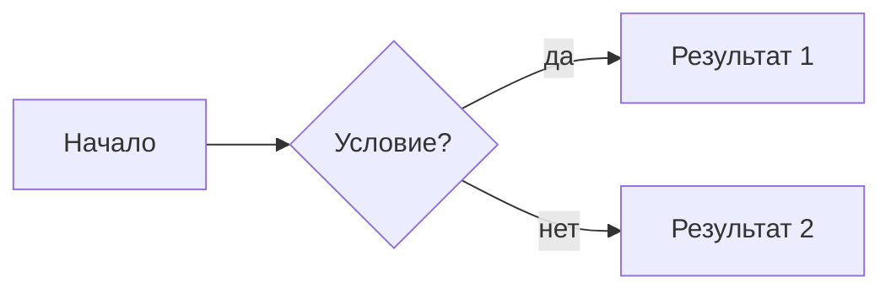

# Markdown — шпаргалка

GitHub-flavored Markdown (GFM) и расширения Obsidian. Используется во всех файлах курса: лекциях, лабораторных, докладах, wiki-страницах.

---

## Заголовки

```markdown
# H1 — название страницы (один на файл)
## H2 — раздел
### H3 — подраздел
#### H4 — детали
```

> В wiki один `#` = одна страница. Не начинай файл с H2.

---

## Текст

```markdown
**жирный**          _курсив_          ~~зачёркнутый~~

`inline code`       ==выделено==      > цитата / callout

Абзац отделяется пустой строкой.
Одиночный перенос строки — не абзац (в GFM строки сливаются).
Два пробела в конце строки  
→ принудительный перенос.
```

---

## Списки

```markdown
- элемент
  - вложенный (2 пробела или таб)
    - ещё глубже

1. нумерованный
2. второй
   1. вложенный нумерованный

- [x] выполнено (task list, GFM)
- [ ] не выполнено
```

---

## Ссылки и изображения

```markdown
[текст](https://example.com)
[относительная ссылка](../concepts/wal-mvcc.md)
[якорь на раздел](../concepts/wal-mvcc.md#checkpoint)


```

**Obsidian wiki-ссылки:**

```markdown
[[concepts/wal-mvcc]]                    ← ссылка
[[concepts/wal-mvcc|WAL и MVCC]]         ← ссылка с псевдонимом
![[diagrams/arch.png]]                   ← встроить изображение
```

---

## Таблицы (GFM)

```markdown
| Колонка 1 | Колонка 2 | Колонка 3 |
| --------- | :-------: | --------: |
| слева     |   центр   |    справа |
| текст     |  текст    |    текст  |
```

Выравнивание: `:---` = левое (по умолчанию), `:---:` = центр, `---:` = правое.

**Хорошая практика** — выравнивать пробелами в raw для читаемости:

```markdown
| Роль    | Ответственность                  | Артефакт          |
| ------- | -------------------------------- | ----------------- |
| DBA     | Настройка PostgreSQL, индексы    | Runbook           |
| SA      | Требования, ERD, доступ          | Матрица доступа   |
```

---

## Блоки кода

````markdown
```sql
SELECT id, email FROM customers WHERE active = true;
```

```powershell
$pg = "C:\Program Files\PostgreSQL\18\bin"
& "$pg\psql.exe" -U postgres -d eshop
```

```yaml
services:
  postgres:
    image: postgres:18
```
````

Поддерживаемые идентификаторы языков: `sql`, `powershell`, `bash`, `python`, `yaml`, `json`, `markdown`, `mermaid`, `plantuml`.

---

## Mermaid-диаграммы

````markdown

````

Полный справочник синтаксиса: [[mermaid|Mermaid шпаргалка]]

---

## Callout-блоки (Obsidian)

Obsidian рендерит специальные цитаты как цветные блоки:

```markdown
> [!NOTE]
> Обычная заметка.

> [!WARNING]
> Предупреждение — выделяется жёлтым.

> [!DANGER]
> Критично — выделяется красным.

> [!TIP]
> Совет — выделяется зелёным.
```

В GitHub эти блоки отображаются как обычные цитаты — содержимое не теряется.

**Простые callout-блоки (совместимы и в Obsidian, и в GitHub):**

```markdown
> **Командная строка (psql / PowerShell).**

> **Лекции по теме:** [Лек. 08](../../lectures/lec_08/lec_08.md)

> **Практика →** [Лаб. 06](../../labs/lab_06/lab_06.md)
```

---

## Горизонтальные разделители

```markdown
---
```

Три дефиса на отдельной строке. Также является разделителем YAML frontmatter.

---

## YAML Frontmatter (Obsidian / Marp)

```markdown
---
title: Название страницы
tags: [postgresql, backup, lec_05]
---
```

В wiki этого курса frontmatter не обязателен, но нужен для Marp-презентаций:

```markdown
---
marp: true
theme: default
paginate: true
---
```

---

## Экранирование

```markdown
\*  \`  \_  \#  \[  \]  \(  \)  \|  \\
```

Чтобы показать символ буквально — поставь `\` перед ним.

---

## Частые ошибки

| Проблема | Причина | Исправление |
| -------- | ------- | ----------- |
| Таблица не рендерится | Нет пустой строки перед таблицей | Добавить пустую строку |
| Жирный не работает | `**текст **` — пробел перед `**` | `**текст**` без пробела |
| Список стал абзацем | Нет пустой строки после предыдущего текста | Добавить пустую строку |
| Код в таблице | Pipe `\|` внутри ячейки ломает таблицу | Экранировать `\|` или использовать `<code>\|</code>` |
| Mermaid не рендерится | Нет пустой строки перед блоком ` ``` ` | Добавить пустую строку |

---

> **Связанные страницы:** [[mermaid|Mermaid шпаргалка]] · [[git|Git шпаргалка]] · [[../tools/obsidian|Obsidian — настройка vault]]
