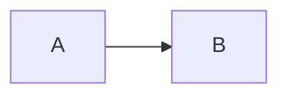
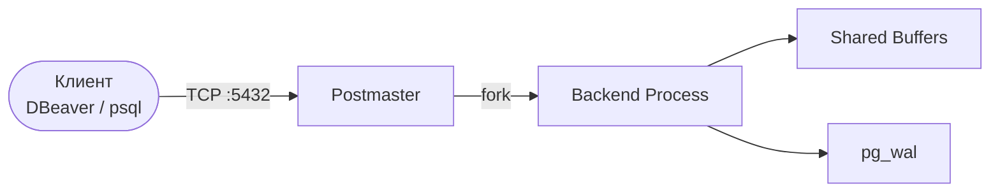
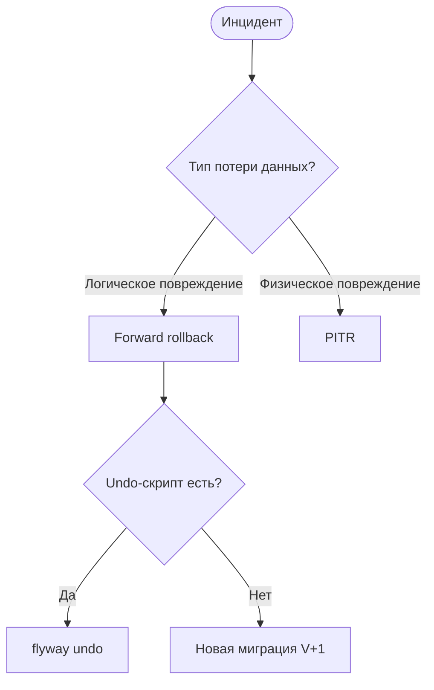
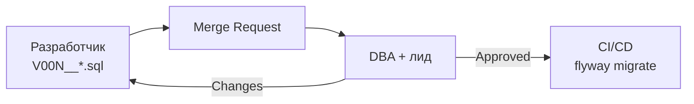
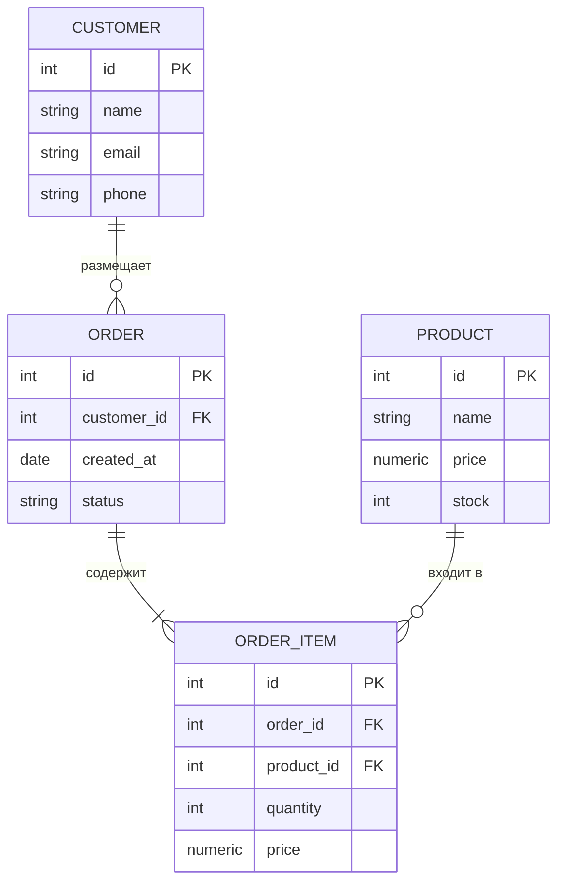
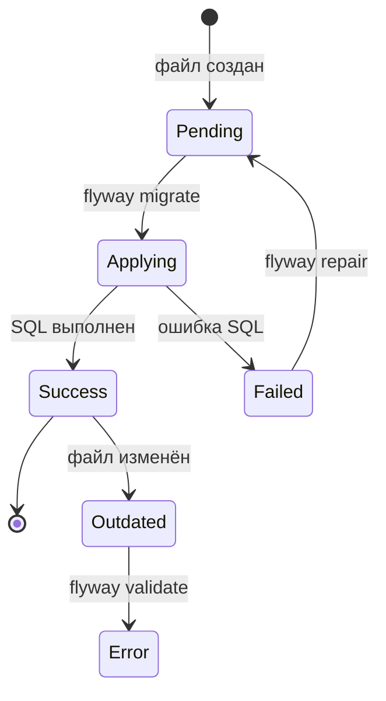
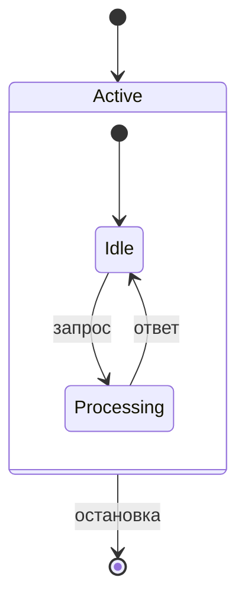

# Шпаргалка: Mermaid-диаграммы

В курсе используются три типа: **flowchart**, **erDiagram**, **stateDiagram-v2**.

---

## 1. flowchart — блок-схемы и архитектурные схемы

Самый распространённый тип. Используется для схем архитектуры, процессов, деревьев решений.

### 1.1. Направление



| Ключевое слово | Направление             | Когда использовать                     |
|----------------|-------------------------|----------------------------------------|
| `LR`           | Слева → направо         | Пайплайны, потоки данных               |
| `RL`           | Справа → налево         | Редко                                  |
| `TB` или `TD`  | Сверху → вниз           | Иерархии, деревья решений              |
| `BT`           | Снизу → вверх           | Редко                                  |

### 1.2. Формы узлов

```
[Прямоугольник]          — таблица, сервис, компонент
(Скруглённый)            — мягкий блок
([Стадион])              — приложение, клиент
{Ромб}                   — условие / ветвление
[(Цилиндр)]              — база данных
((Круг))                 — точка старта/финиша
>Асимметричный]          — примечание
```

```mermaid
flowchart LR
    App([Приложение])  -->|TCP 5432| PGB[PgBouncer]
    PGB               -->|сокет|    DB[(PostgreSQL)]
    DB                -->|WAL|      Standby[(Standby)]
```

### 1.3. Типы стрелок

| Синтаксис         | Вид            | Применение                  |
|-------------------|----------------|-----------------------------|
| `A --> B`         | →              | Обычная связь               |
| `A -->|текст| B`  | → текст →      | С подписью                  |
| `A --- B`         | ──             | Без направления             |
| `A -.-> B`        | - - →          | Опциональная / слабая связь |
| `A ==> B`         | ═══►           | Акцентированная связь       |
| `A --текст--> B`  | → текст →      | Альтернативный синтаксис    |

### 1.4. subgraph — группировка

```mermaid
flowchart TB
    subgraph Cluster["Patroni Cluster"]
        P[Primary] -->|WAL| S1[Standby 1]
        P          -->|WAL| S2[Standby 2]
    end
    ETCD[(etcd)] --- P
    ETCD         --- S1
    HAProxy[HAProxy] -->|write| P
    HAProxy          -->|read|  S1
```

```
subgraph id["Заголовок группы"]
    ...узлы и рёбра внутри...
end
```

### 1.5. Переносы строк в подписях

Используй `\n` внутри подписей узла или `<br/>` в HTML-подписях:

```
PB["pg_basebackup\n(базовая копия)"]
LOG["Файл журнала<br/>data\log\*.log"]
```

### 1.6. Реальные примеры из курса

**Архитектура PostgreSQL (lec_01):**


**Дерево решений при инциденте (lab_04):**


**MR-процесс Flyway (lec_12):**


---

## 2. erDiagram — диаграммы сущность-связь

Используется для отображения схемы БД. Встречается в lec_01 (eshop), lab_01 (Chinook).

### 2.1. Базовый синтаксис



### 2.2. Атрибуты сущности

```
ENTITY {
    type   name   [PK|FK|UK]   ["comment"]
}
```

| Маркер | Значение             |
|--------|----------------------|
| `PK`   | Primary Key          |
| `FK`   | Foreign Key          |
| `UK`   | Unique Key           |

Доступные типы: `int`, `string`, `float`, `numeric`, `date`, `datetime`, `boolean`, `text` — любая строка.

### 2.3. Типы связей (кардинальность)

```
ENTITY_A  <связь_слева><линия><связь_справа>  ENTITY_B : "метка"
```

| Символ | Значение              |
|--------|-----------------------|
| `\|`   | Ровно один            |
| `o`    | Ноль или один         |
| `{`    | Один или много (правая сторона) |
| `}`    | Один или много (левая сторона)  |

| Запись          | Читается                   |
|-----------------|----------------------------|
| `\|o--o\|`      | Ноль или один — ноль или один |
| `\|o--\|{`      | Ноль или один — один или много |
| `\|\|--\|{`     | Ровно один — один или много   |
| `\|\|--o{`      | Ровно один — ноль или много   |

**Часто используемые:**
```
CUSTOMER ||--o{ ORDER       : ""   -- один клиент → ноль или много заказов
ORDER    ||--|{ ORDER_ITEM  : ""   -- один заказ → один или много позиций
```

---

## 3. stateDiagram-v2 — диаграммы состояний

Используется для жизненного цикла сущностей. В курсе — состояния миграции Flyway (lab_09).

### 3.1. Базовый синтаксис



| Элемент              | Синтаксис                          |
|----------------------|------------------------------------|
| Начальная точка      | `[*]`                              |
| Конечная точка       | `[*]` (в правой части перехода)    |
| Состояние            | `StateName`                        |
| Переход              | `A --> B`                          |
| Переход с подписью   | `A --> B : текст`                  |

### 3.2. Составные состояния



### 3.3. Примечания

```
note right of StateName
    Текст примечания
end note
```

---

## 4. Быстрый выбор типа диаграммы

| Что нужно показать                        | Тип диаграммы    |
|-------------------------------------------|------------------|
| Архитектура системы / поток данных        | `flowchart LR`   |
| Дерево решений / алгоритм                 | `flowchart TD`   |
| Кластер / группы компонентов              | `flowchart TB` + `subgraph` |
| Схема БД (таблицы и связи)                | `erDiagram`      |
| Жизненный цикл (состояния объекта)        | `stateDiagram-v2`|

---

## 5. Частые ошибки

| Ошибка                                         | Решение                                      |
|------------------------------------------------|----------------------------------------------|
| Пробелы в ID узла (`My Node`)                  | Взять в кавычки: `A["My Node"]`              |
| Спецсимволы в подписи (`(`, `)`, `{`)          | Взять в кавычки: `A["func()"]`               |
| Перенос строки в подписи не работает           | Использовать `\n` (не `\\n`)                 |
| erDiagram — связь не отображается              | Проверить кавычки вокруг метки: `: "метка"`  |
| stateDiagram: `[*]` не работает в начале файла | Убедиться, что используется `stateDiagram-v2`|

---

> **Источники:** [[lectures/lec_01]], [[lectures/lec_05]], [[lectures/lec_10]], [[lectures/lec_12]], [[labs/lab_01]], [[labs/lab_04]], [[labs/lab_09]], [[labs/lab_10]]  
> **Связанные страницы:** [[cheatsheets/git]], [[tools/obsidian]] — Marp-плагин для Obsidian превращает Mermaid-страницы в слайды
