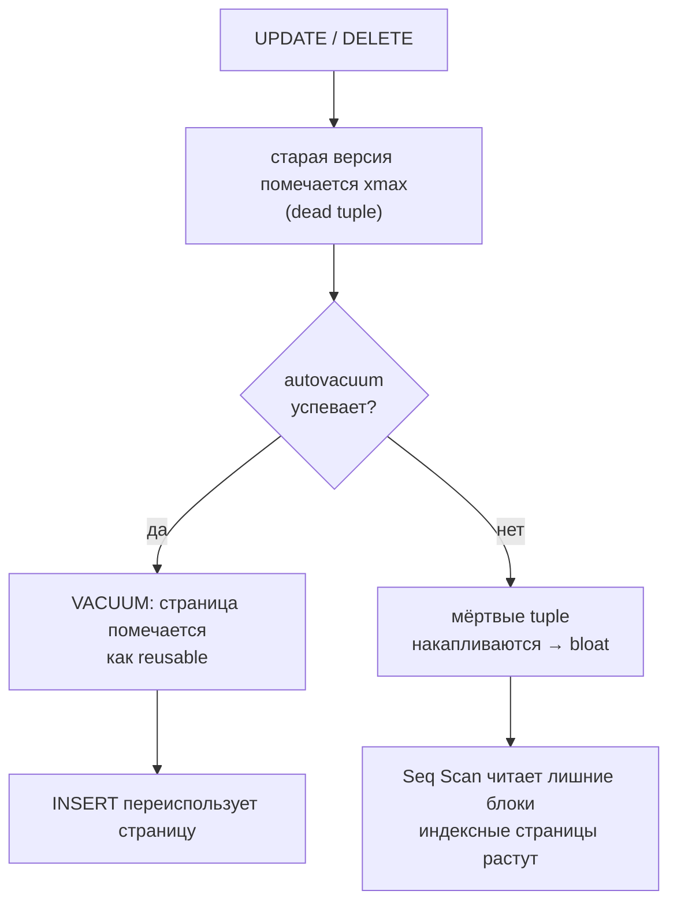

# Bloat и autovacuum

**Bloat** (раздутость таблицы) — мёртвые tuple и пустые страницы, которые остаются после `UPDATE`/`DELETE` и не освобождены VACUUM. В PostgreSQL bloat неизбежен из-за архитектуры MVCC: `UPDATE` не изменяет строку на месте, а создаёт новую версию и помечает старую как удалённую (`xmax`).

Если VACUUM не успевает за нагрузкой — таблицы и индексы растут без реального роста данных. Последствия: Seq Scan читает лишние страницы, Shared Buffers вытесняет полезные данные, бэкапы занимают больше места.

---

## Почему возникает bloat



`VACUUM` только помечает страницы как переиспользуемые. Место операционной системе **не возвращается** — только `VACUUM FULL` или `pg_repack` перезаписывают таблицу и возвращают дисковое пространство. `VACUUM FULL` требует `ACCESS EXCLUSIVE` (блокирует все запросы), поэтому для продакшна используют `pg_repack`.

---

## Мониторинг bloat

### pg_stat_user_tables

```sql
SELECT relname,
       n_live_tup,
       n_dead_tup,
       ROUND(100.0 * n_dead_tup / NULLIF(n_live_tup + n_dead_tup, 0), 1) AS dead_pct,
       last_autovacuum,
       last_autoanalyze
FROM   pg_stat_user_tables
WHERE  schemaname = 'public'
ORDER  BY dead_pct DESC NULLS LAST;
```

> `dead_pct > 20%` при объёме > 10 000 строк — сигнал для вмешательства.

### Размер таблицы vs данных

```sql
SELECT relname,
       pg_size_pretty(pg_total_relation_size(oid))  AS total,
       pg_size_pretty(pg_relation_size(oid))         AS heap,
       pg_size_pretty(pg_indexes_size(oid))           AS indexes
FROM   pg_class
WHERE  relnamespace = 'public'::regnamespace
  AND  relkind = 'r'
ORDER  BY pg_total_relation_size(oid) DESC
LIMIT  10;
```

---

## Формула autovacuum

```
порог = autovacuum_vacuum_threshold + autovacuum_vacuum_scale_factor × n_live_tup
      = 50 + 0.20 × n_live_tup   (значения по умолчанию)
```

Для `orders` с 200 000 строк: 50 + 0.20 × 200 000 = **40 050** мёртвых tuple до первого autovacuum.

При высоком темпе изменений (часто обновляемые таблицы) стандартный `0.20` слишком велик — VACUUM запускается слишком редко.

### Тонкая настройка на уровне таблицы

```sql
-- Применяется к конкретной таблице без изменения глобального postgresql.conf
ALTER TABLE orders SET (
    autovacuum_vacuum_scale_factor  = 0.01,   -- 1% вместо 20%
    autovacuum_analyze_scale_factor = 0.005
);

-- Проверить:
SELECT reloptions FROM pg_class WHERE relname = 'orders';
```

Для активных таблиц (`order_items`, `promo_codes`) рекомендуется `scale_factor = 0.01–0.05`.

---

## Принудительный VACUUM

```powershell
$pg = "C:\Program Files\PostgreSQL\18\bin"

# Ручной VACUUM с отчётом о прогрессе
& "$pg\psql.exe" -U postgres -d eshop -c "VACUUM VERBOSE orders;"

# ANALYZE — обновить статистику планировщика (без удаления dead tuples)
& "$pg\psql.exe" -U postgres -d eshop -c "ANALYZE orders;"

# VACUUM FULL — вернуть место ОС (БЛОКИРУЕТ таблицу!)
# Используйте только в окно обслуживания
& "$pg\psql.exe" -U postgres -d eshop -c "VACUUM FULL orders;"
```

> В продакшне вместо `VACUUM FULL` используйте **pg_repack** — перезаписывает таблицу онлайн без длинной блокировки.

---

## Пример из eshop

Таблица `order_items` получает интенсивные UPDATE (пересчёт скидок, изменение статусов). Без настройки autovacuum через неделю работы:

```sql
SELECT n_live_tup, n_dead_tup, dead_pct FROM (
    SELECT n_live_tup, n_dead_tup,
           ROUND(100.0 * n_dead_tup / NULLIF(n_live_tup + n_dead_tup, 0), 1) AS dead_pct
    FROM   pg_stat_user_tables
    WHERE  relname = 'order_items'
) t;

-- n_live_tup | n_dead_tup | dead_pct
-- -----------+------------+---------
--    500 000 |    115 000 |    18.7
```

18.7% dead tuples → Seq Scan читает на ~19% лишних страниц. Для B-tree индексов — аналогичный bloat.

**Решение:** снизить `scale_factor` до 0.02.

---

## Связь с VACUUM FREEZE

При достижении `autovacuum_freeze_max_age` (200 млн транзакций по умолчанию) PostgreSQL вынужден запустить агрессивный VACUUM FREEZE, который замораживает старые `xmin`, чтобы избежать wraparound. Большой bloat замедляет freeze — строки в мёртвых страницах тоже нужно проверить.

Признак надвигающегося wraparound: `age(datfrozenxid)` в `pg_database` близко к `autovacuum_freeze_max_age`.

```sql
SELECT datname,
       age(datfrozenxid) AS xid_age,
       current_setting('autovacuum_freeze_max_age') AS max_age
FROM   pg_database
ORDER  BY xid_age DESC;
```

---

> **Связанные страницы:** [[wal-mvcc]] · [[monitoring]] · [[indexes]]  
> **Источники:** [[../lectures/lec_05]], [[../lectures/lec_08]]
