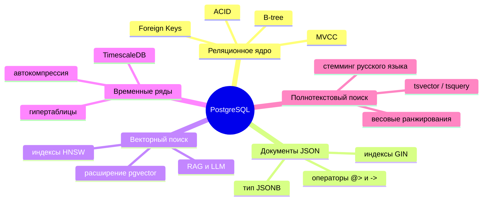

# Ландшафт современных систем управления базами данных (DBMS Landscape)

Классификация современных СУБД, паттерн многовариантного хранения данных (Polyglot Persistence) и критерии выбора технологии системным аналитиком при проектировании информационных систем.

---

## 1. Зачем системному аналитику ориентироваться в ландшафте СУБД

Эпоха универсальной «одной базы данных под все задачи предприятия» завершилась. Современные архитектуры строятся по принципу **Polyglot Persistence (многовариантное хранение данных)**: каждый сервис использует ту модель данных и тот тип СУБД, который оптимально решает его задачу.

Системный аналитик определяет:
- профиль рабочей нагрузки (OLTP vs OLAP);
- требования к консистентности (ACID vs BASE, теорема CAP);
- модель предметной области (реляционная, документоориентированная, графовая, векторная).

В рамках [[course/rpd|РПД «Администрирование баз данных»]] тема завершает курс (Тема 13) и формирует результаты по **ПК-5-И-2** (концептуальное и логическое проектирование систем) и **ПК-1-И-26** (обоснование выбора программного обеспечения).

---

## 2. Классификация СУБД и области применения

| Класс СУБД | Ключевые представители | Характер нагрузки | Применение в архитектуре |
|---|---|---|---|
| **Реляционные (OLTP)** | PostgreSQL, MySQL, Postgres Pro, Oracle | Транзакционная запись и точечное чтение с гарантией ACID, сложные связи (JOIN) | Ядро системы: профили пользователей, заказы, платежи, учет остатков |
| **Аналитические (OLAP)** | ClickHouse, Apache Doris, Google BigQuery | Поколоночное хранение, сжатие данных, агрегация миллиардов строк в секунду | Витрины данных, BI-отчеты, аудит кликстрима, веб-аналитика |
| **NewSQL (Distributed SQL)** | CockroachDB, YugabyteDB, TiDB | Горизонтально масштабируемый реляционный SQL с распределенным ACID | Международные геораспределенные финансовые системы |
| **Ключ-значение (Key-Value)** | Redis, Memcached, Tarantool | Сверхбыстрый доступ в оперативной памяти (In-Memory), структуры данных (TTL, pub/sub) | Кэширование запросов, хранение веб-сессий, очереди задач, счетчики |
| **Документные (Document)** | MongoDB, CouchDB | Хранение полуструктурированных JSON/BSON документов без жесткой схемы | Каталоги товаров с динамическими свойствами, профили настроек |
| **Временные ряды (Time-Series)** | TimescaleDB (расширение PG), InfluxDB, Prometheus | Запись непрерывных потоков метрик с временной меткой, автоматическое секционирование | Мониторинг инфраструктуры, IoT-телеметрия, финансовые тикеры |
| **Векторные (Vector)** | pgvector (расширение PG), Qdrant, Milvus | Поиск ближайших соседей по эмбеддингам (HNSW, IVFFlat) | Искусственный интеллект, RAG-системы, семантический поиск |

---

## 3. PostgreSQL как расширяемая мультимодельная платформа

Важнейший тренд современного стека — способность PostgreSQL заменять собой специализированные NoSQL/NewSQL СУБД с помощью механизма расширений (extensions):

Благодаря этому аналитик может значительно упростить инфраструктуру проекта на ранних этапах: вместо развертывания 4 отдельных серверов СУБД (Postgres + Redis + Elastic + Influx) начать с одного кластера PostgreSQL со специализированными расширениями.

---

## 4. Чек-лист системного аналитика: как выбрать СУБД

1. **Какой тип нагрузки доминирует?**
   - Много коротких точечных транзакций `INSERT/UPDATE/SELECT by ID` $\to$ **OLTP (PostgreSQL)**.
   - Массовая вставка пачками и тяжелые группировки `SELECT avg, sum GROUP BY` $\to$ **OLAP (ClickHouse)**.
2. **Критична ли согласованность (ACID)?**
   - Нельзя допустить расхождения баланса ни на копейку $\to$ **Строгий ACID (PostgreSQL)**.
   - Допустима кратковременная потеря данных ради миллисекундной скорости $\to$ **In-memory кэш (Redis)**.
3. **Меняется ли структура данных от сущности к сущности?**
   - Строгая схема, foreign keys, валидация $\to$ **Реляционные таблицы**.
   - Непредсказуемый набор атрибутов у разных категорий $\to$ **JSONB в PostgreSQL или MongoDB**.

---

> **Источники:** [[lectures/lec_13]], [[lectures/lec_01]], [PostgreSQL Feature Matrix](https://www.postgresql.org/).  
> **Связанные страницы:** [[course/rpd]], [[concepts/postgresql-architecture]], [[concepts/normalization]], [[tools/pgbench]].
