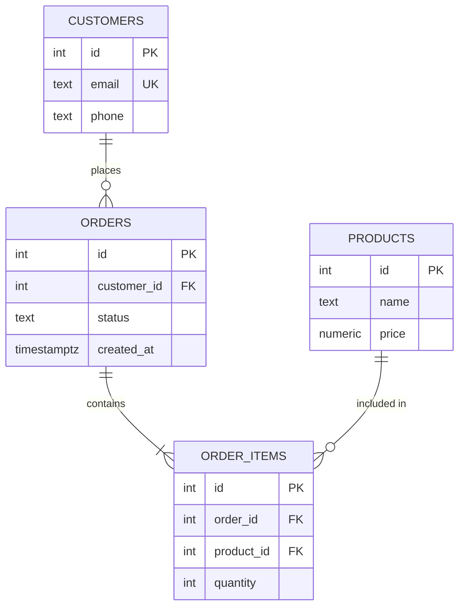

# ERD (Entity-Relationship Diagram)

ERD — диаграмма сущностей и связей, которая фиксирует таблицы, их атрибуты, первичные и внешние ключи и кардинальность связей; это основной язык обсуждения схемы между аналитиком и DBA.

---

## 1. Зачем аналитику ERD

ERD отвечает на вопросы, которые невозможно надежно удержать в голове:

- какие сущности есть в предметной области;
- как они связаны и сколько записей может быть на каждой стороне;
- где первичные и внешние ключи;
- какие ограничения должны попасть в миграцию.

Без ERD migration plan превращается в набор `CREATE TABLE`, а обсуждение требований — в спор о терминах. ERD — это контракт: если в диаграмме `ORDER ||--|{ ORDER_ITEM`, значит, заказ без позиций недопустим, и это должно быть выражено в схеме.

---

## 2. Нотация Crow's Foot

| Символ | Кардинальность | Смысл |
|---|---|---|
| `\|\|` | ровно один | Обязательная сторона «один» |
| `\|o` / `o\|` | ноль или один | Необязательная сторона «один» |
| `}\|` / `\|{` | один или много | Обязательная сторона «много» |
| `}o` / `o{` | ноль или много | Необязательная сторона «много» |

Связь читается с двух сторон. `CUSTOMER ||--o{ ORDER` означает: «у клиента может быть ноль или много заказов; каждый заказ принадлежит ровно одному клиенту».

---

## 3. Пример для eshop

---

## 4. Что проверять в ERD перед миграцией

- [ ] У каждой таблицы есть первичный ключ.
- [ ] Кардинальности совпадают с бизнес-правилами.
- [ ] На внешние ключи есть индексы (иначе `DELETE` родителя сканирует дочернюю таблицу).
- [ ] Нет циклических зависимостей, которые ломают порядок `CREATE`/`DROP`.
- [ ] Типы данных соответствуют требованиям (`NUMERIC` для денег, `TIMESTAMPTZ` для времени).
- [ ] Уникальные ограничения выражены в схеме, а не только в коде приложения.

---

## 5. Инструменты

| Инструмент | Подход |
|---|---|
| Mermaid | Код → диаграмма, встраивается в Markdown |
| PlantUML | Текстовый DSL, мощнее Mermaid |
| DBeaver | Автогенерация ERD из существующей схемы |
| draw.io | Визуальный редактор |
| dbdiagram.io | DBML, быстрое создание онлайн |

---

## 6. См. также

- [Нормализация](normalization.md) — как устранять аномалии в модели
- [Схема eshop](../course/eshop-schema.md) — сквозной проект курса
- [Привилегии](privileges.md) — кто получает доступ к таблицам
- [Migration Plan](../artifacts/migration-plan.md) — как ERD превращается в миграцию

---

> **Источники:** [[lec_01]], [[lec_12]], [[lab_02]]
