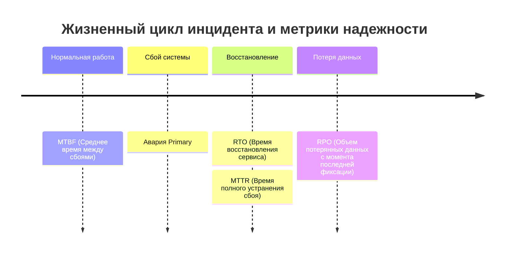

# Высокая доступность и отказоустойчивость (High Availability)

Концепции проектирования непрерывно доступных систем баз данных: метрики надежности (SLA, MTBF, MTTR, RPO, RTO), архитектуры резервирования, консенсус, защита от split-brain и процедуры переключения.

---

## 1. Зачем системному аналитику знать принципы HA

При разработке технического задания и функциональных требований аналитик является связующим звеном между бизнес-заказчиком и инфраструктурной командой (DBA/DevOps):
- бизнес требует «чтобы система работала 24/7 без сбоев»;
- аналитик переводит это в инженерные метрики (**SLA**, **RPO**, **RTO**);
- DBA и архитекторы на основе этих метрик подбирают топологию кластера (асинхронная репликация, синхронный кворум или распределенный кластер [[tools/patroni]]).

В рамках [[course/rpd|РПД «Администрирование баз данных»]] тема относится к индикаторам **ПК-1-И-40** (регламенты переключения на резерв) и **ПК-3-И-3** (координация процессов внедрения и сопровождения).

---

## 2. Ключевые метрики надежности

| Метрика | Расшифровка | Что измеряет | Типовое требование |
|---|---|---|---|
| **SLA** (Service Level Agreement) | Соглашение об уровне сервиса | Доля времени доступности системы (в девятках) | 99.9% (~8.7 ч простоя/год), 99.99% (~52 мин/год) |
| **MTBF** (Mean Time Between Failures) | Среднее время безотказной работы | Надежность компонентов до возникновения сбоя | Месяцы / годы непрерывной работы |
| **MTTR** (Mean Time To Recovery) | Среднее время восстановления | Время от деградации до полного возврата в штатный режим | < 15–30 минут |
| **RPO** (Recovery Point Objective) | Целевая точка восстановления | Максимально допустимый объем потерянных данных во времени | RPO = 0 (финансы); RPO < 5 мин (ритейл) |
| **RTO** (Recovery Time Objective) | Целевое время восстановления | Максимально допустимая длительность недоступности базы данных | RTO < 1 мин (автоматика); RTO < 30 мин (ручной) |

---

## 3. Таблица уровней доступности (SLA «девятки»)

| Уровень SLA | Допустимый простой в год | Допустимый простой в месяц | Архитектурное решение |
|---|---|---|---|
| **99.0%** (2 девятки) | 3 дня 15 часов | 7.3 часа | Одиночный сервер, восстановление из ежедневного бэкапа |
| **99.9%** (3 девятки) | 8 часов 45 минут | 43.8 минуты | Primary + Standby (асинхронная потоковая репликация, ручной failover) |
| **99.95%** (3.5 девятки) | 4 часа 22 минуты | 21.9 минута | Кластер с автоматическим failover ([[tools/patroni]] + etcd) |
| **99.99%** (4 девятки) | 52 минуты 35 секунд | 4.38 минуты | Мультизональный кластер, синхронные реплики, резервирование сети |

---

## 4. Проблема Split-Brain и кворум

**Split-Brain («раздвоение сознания»)** — катастрофическое состояние распределенного кластера, при котором из-за сетевого сбоя (Network Partition) изолированные узлы одновременно считают себя активным `primary` и принимают запросы на запись.

**Последствия:**
- расхождение данных (две ветви истории изменений);
- невозможность автоматического слияния данных без ручного вмешательства и потери записей.

### Защита через кворум (Quorum)
Чтобы избежать split-brain, автоматический кластер требует кворума большинства узлов:
$$\text{Кворум} = \left\lfloor \frac{N}{2} \right\rfloor + 1$$
Именно поэтому кластеры консенсуса (etcd, Consul, ZooKeeper) всегда разворачиваются на **нечетном количестве узлов (3, 5, 7)**:
- при $N=3$ кластер выдерживает отказ 1 ноды;
- если узел остался в меньшинстве ($1 < 2$), он принудительно лишается роли primary и переходит в режим чтения или перезагрузки.

---

> **Источники:** [[lectures/lec_10]], [[labs/lab_04]], [PostgreSQL High Availability Documentation](https://www.postgresql.org/docs/current/high-availability.html).  
> **Связанные страницы:** [[course/rpd]], [[tools/patroni]], [[concepts/replication]], [[procedures/failover-runbook]], [[artifacts/failover-runbook]].
