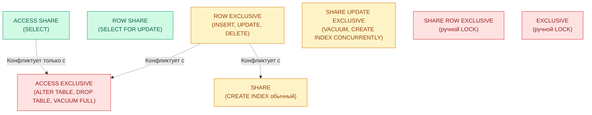

# Блокировки и конкурентный доступ (Locks & Concurrency)

Иерархия блокировок в PostgreSQL, механизмы разрешения конфликтов, очередь блокировок (Lock Queue), взаимоблокировки (Deadlocks) и правила безопасного выполнения DDL в высоконагруженных системах.

---

## 1. Зачем системному аналитику понимать блокировки

В многопользовательской реляционной СУБД параллельные транзакции конкурируют за одни и те же ресурсы: строки, таблицы и страницы в памяти.
Если аналитик и разработчик проектируют изменение схемы (DDL) или тяжелый отчет без учета блокировок, это приводит к инциденту категории P1:
- DDL-команда запрашивает эксклюзивную блокировку `ACCESS EXCLUSIVE`;
- транзакция встает во главу **очереди блокировок (Lock Queue)**;
- все последующие запросы на чтение (`SELECT`) выстраиваются за ней;
- пул соединений мгновенно исчерпывается (`max_connections`), и сервис полностью перестает отвечать клиентам.

В рамках дисциплины [[course/rpd|РПД]] эта тема лежит в основе индикаторов **ПК-1-И-26** (оптимизация работы и мониторинг) и **ПК-3-И-3** (безопасное внедрение изменений схемы).

---

## 2. Иерархия уровней блокировок таблиц

PostgreSQL использует многоуровневую модель блокировок объектов. Две блокировки конфликтуют, если они не могут удерживаться одновременно разными транзакциями на одном объекте.



### Матрица конфликтов основных операций

| Уровень блокировки | Типовые команды | С чем конфликтует |
|---|---|---|
| **ACCESS SHARE** | `SELECT` | Только с `ACCESS EXCLUSIVE` |
| **ROW EXCLUSIVE** | `INSERT`, `UPDATE`, `DELETE` | `SHARE`, `SHARE ROW EXCL`, `EXCLUSIVE`, `ACCESS EXCL` |
| **SHARE UPDATE EXCLUSIVE** | `VACUUM` (обычный), `ANALYZE`, `CREATE INDEX CONCURRENTLY` | Такой же `SHARE UPDATE EXCL`, `SHARE`, `EXCLUSIVE`, `ACCESS EXCL` |
| **SHARE** | `CREATE INDEX` (без CONCURRENTLY) | `ROW EXCLUSIVE` (блокирует любую запись!), `ACCESS EXCL` |
| **ACCESS EXCLUSIVE** | `ALTER TABLE`, `DROP TABLE`, `TRUNCATE`, `VACUUM FULL` | **Со всеми уровнями** (блокирует и чтение, и запись!) |

---

## 3. Очередь блокировок (Lock Queue) и каскадный отказ

Опасность представляет не столько длительность самого DDL, сколько порядок ожидания в очереди:

```mermaid
sequenceDiagram
    participant T1 as Транзакция 1 (длинный SELECT)
    participant T2 as Транзакция 2 (ALTER TABLE)
    participant T3 as Транзакция 3 (быстрый SELECT клиентов)

    T1->>PostgreSQL: BEGIN; SELECT ... FROM orders (держит ACCESS SHARE)
    Note over T1: Выполняется долго (аналитический отчет)
    T2->>PostgreSQL: ALTER TABLE orders ADD COLUMN region text;
    Note over T2: Запрашивает ACCESS EXCLUSIVE. Ждет завершения T1!
    T3->>PostgreSQL: SELECT total_amount FROM orders WHERE order_id = 42;
    Note over T3: Запрашивает ACCESS SHARE. Встает В ОЧЕРЕДЬ ЗА T2!
    Note over T3: Каскад: ВСЕ новые SELECT блокируются, сервис лежит!
```

---

## 4. Защита от зависания: таймауты `lock_timeout` и `statement_timeout`

Главное правило аналитика и DBA при написании планов миграции: **любая миграция схемы должна выполняться с жестким ограничением времени ожидания блокировки**.

```sql
-- Шаблон безопасного сценария миграции
BEGIN;

-- Если блокировка таблицы не получена за 2 секунды — немедленно прервать транзакцию!
-- Сервер не упадет в каскадное ожидание.
SET LOCAL lock_timeout = '2s';

-- Ограничение на время выполнения самого оператора
SET LOCAL statement_timeout = '10s';

-- Применение изменения
ALTER TABLE orders ADD COLUMN loyalty_points INTEGER DEFAULT 0;

COMMIT;
```

---

## 5. Взаимные блокировки (Deadlocks)

Взаимная блокировка возникает, когда две транзакции ждут освобождения ресурсов, удерживаемых друг другом:
- Транзакция A обновила строку `customer_id = 1` и пытается обновить `customer_id = 2`.
- Транзакция B обновила строку `customer_id = 2` и пытается обновить `customer_id = 1`.

PostgreSQL запускает фоновый процесс проверки `deadlock_timeout` (по умолчанию 1 секунда) и принудительно обрывает одну из транзакций с ошибкой:
`ERROR: deadlock detected`.

**Правило для аналитика:** при проектировании пакетных операций обновления данных всегда фиксировать **единообразный порядок сортировки записей** (например, строго по возрастанию первичного ключа: `ORDER BY id`).

---

> **Источники:** [[lectures/lec_04]], [[lectures/lec_07]], [[lectures/lec_13]], [[labs/lab_05]], [Документация PostgreSQL: Explicit Locking](https://www.postgresql.org/docs/current/explicit-locking.html).  
> **Связанные страницы:** [[course/rpd]], [[procedures/zero-downtime]], [[concepts/monitoring]], [[procedures/migration-workflow]].
