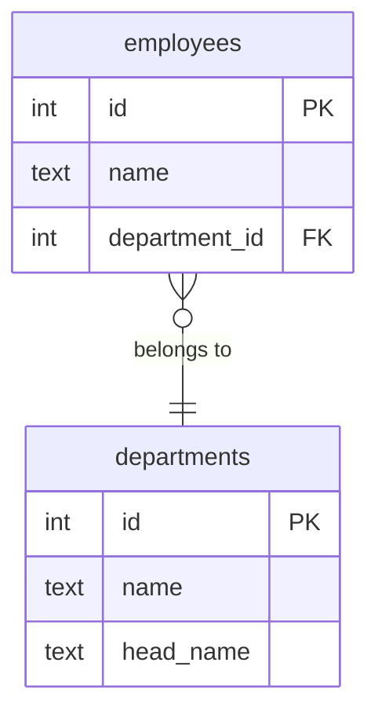

# Нормальные формы и нормализация

Нормализация — процесс проектирования реляционной схемы, устраняющий дублирование и аномалии при изменении данных. Каждая следующая форма строже предыдущей.

---

## Аномалии, которые устраняет нормализация

| Аномалия          | Пример                                                              |
| ----------------- | ------------------------------------------------------------------- |
| **Вставки**       | Нельзя добавить отдел, пока в нём нет сотрудников                  |
| **Удаления**      | Удаляем последнего сотрудника — теряем информацию об отделе        |
| **Обновления**    | Переименовали город — нужно обновить сотни строк вместо одной      |

---

## Нормальные формы

| Форма    | Условие                                                                 | Типичная аномалия                                  |
| -------- | ----------------------------------------------------------------------- | -------------------------------------------------- |
| **1НФ**  | Все атрибуты атомарны (нет списков, нет вложенных таблиц)               | «Телефоны через запятую» в одной ячейке            |
| **2НФ**  | 1НФ + каждый неключевой атрибут **полностью** зависит от всего ключа   | Дублирование при составном PK                      |
| **3НФ**  | 2НФ + нет транзитивных зависимостей между неключевыми атрибутами        | Изменение города тянет изменение региона           |
| **BCNF** | 3НФ + каждая нетривиальная функциональная зависимость — от суперключа  | Пересекающиеся потенциальные ключи                 |
| **4НФ**  | BCNF + нет многозначных зависимостей (MVD)                             | Декартово произведение в одной таблице             |
| **5НФ**  | 4НФ + нет зависимостей соединения (join dependency)                    | Таблица-«тройник» не раскладывается без потерь     |

> **Практическое правило:** для большинства OLTP-схем достаточно 3НФ. BCNF — хорошая цель для критичных таблиц. 4НФ и 5НФ применяются редко и только если аномалии реально проявляются.

---

## 1НФ — атомарность атрибутов

**Нарушение:** список значений в одной ячейке.

```sql
-- ❌ нарушает 1НФ
CREATE TABLE contacts (
    id    INT PRIMARY KEY,
    name  TEXT,
    phones TEXT   -- '+7-900-1, +7-900-2'
);

-- ✅ 1НФ
CREATE TABLE contacts (id INT PRIMARY KEY, name TEXT);
CREATE TABLE contact_phones (contact_id INT REFERENCES contacts(id), phone TEXT);
```

---

## 2НФ — полная зависимость от всего ключа

Актуальна только при **составном первичном ключе**.

**Нарушение:**

```
order_items(order_id, product_id, quantity, product_name)
                                            ↑
            product_name зависит только от product_id, не от всего ключа
```

**Решение:** вынести `product_name` в таблицу `products`.

---

## 3НФ — нет транзитивных зависимостей

**Нарушение:**

```
orders(id, customer_id, customer_city, customer_region)
                        ↑
       customer_city → customer_region  — транзитивная зависимость
```

**Решение:** справочник `cities(id, name, region)`.

---

## BCNF — Нормальная форма Бойса–Кодда

Усиление 3НФ: каждая функциональная зависимость `X → Y` должна иметь суперключ слева (`X`).

**Когда 3НФ ≠ BCNF:** таблица имеет два или более пересекающихся потенциальных ключа.

**Пример:**

```
courses(student, subject, teacher)
Ключ 1: (student, subject)
Ключ 2: (student, teacher)
Зависимость: teacher → subject   ← teacher не суперключ → нарушение BCNF
```

**Решение:** разбить на `teacher_subjects(teacher, subject)` + `student_teachers(student, teacher)`.

> **Важно:** BCNF иногда нельзя достичь без потери функциональных зависимостей. В таких случаях осознанно остаются в 3НФ.

---

## 4НФ — нет многозначных зависимостей

**Многозначная зависимость (MVD):** атрибут `A` независимо определяет множество значений `B` и множество значений `C`.

**Пример:**

```
employee_skills(employee, skill, language)
-- сотрудник независимо владеет N навыками И N языками
-- → декартово произведение: если 3 навыка и 2 языка — 6 строк вместо 5
```

**Решение:** разбить на `employee_skills(employee, skill)` + `employee_languages(employee, language)`.

---

## 5НФ — нет зависимостей соединения

Таблица в 5НФ не может быть разбита на три и более проекции без потерь данных. На практике встречается в сложных «тройниках»:

```
supplier_parts_projects(supplier, part, project)
-- только если все три комбинации независимы
```

Проверяется попыткой NATURAL JOIN трёх проекций — если появляются лишние строки, исходная таблица уже была в 5НФ.

---

## Денормализация

Намеренное нарушение нормальных форм — только при доказанной необходимости:

| Паттерн                    | Пример в eshop                                      | Компромисс                              |
| -------------------------- | --------------------------------------------------- | --------------------------------------- |
| Кэширующее поле            | `orders.total_amount` (вычислимо из `order_items`)  | Нужна синхронизация при изменении позиций |
| Текстовый код вместо FK    | `orders.region TEXT` вместо `region_id → regions`  | Нарушает 3НФ, упрощает схему в учебном проекте |
| Материализованное представление | `mv_daily_sales` для отчётов              | Устаревает, нужен `REFRESH`             |

---

## Упражнение: найдите нарушения

**Дана таблица:**

```sql
employees(id, name, department_id, department_name, department_head_name)
```

**Вопросы:**

1. В какой нормальной форме эта таблица?
2. Какие аномалии возможны? *(Подсказка: что произойдёт, если переименовать отдел?)*
3. Как разбить таблицу на 3НФ?

**Решение — ERD:**



**Ответы:**
- Таблица в **2НФ**: ключ простой (`id`), но `department_name` и `department_head_name` транзитивно зависят от `department_id`, а не от `id` напрямую — нарушение **3НФ**.
- **Аномалия обновления:** переименование отдела требует UPDATE во всех строках сотрудников этого отдела.
- **Аномалия удаления:** удаляем всех сотрудников отдела — теряем информацию об отделе и его руководителе.
- **Решение:** вынести `departments(id, name, head_name)`, в `employees` оставить только `department_id FK`.

---

> **Связанные страницы:** [[access-control-models]] · [[../course/eshop-schema|eshop Schema]] · [[../artifacts/access-matrix|Access Matrix]]  
> **Источники:** [[../lectures/lec_01]], [[../lectures/lec_02]]
