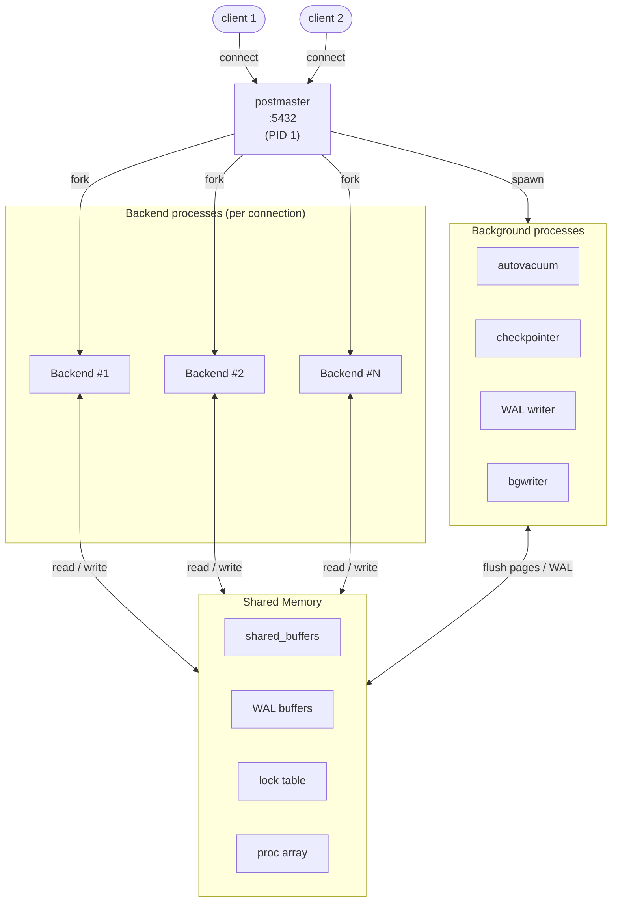

# PostgreSQL Architecture

PostgreSQL is a multi-process RDBMS where each client connection spawns a dedicated backend process; shared memory holds the buffer cache and lock tables that all backends access together.

## Process Model



| Process | Role |
| ------- | ---- |
| **postmaster** | Listens for connections; forks a backend per client; restarts crashed children |
| **backend** | One process per connection; executes queries; dies when client disconnects |
| **autovacuum launcher** | Wakes up every `autovacuum_naptime` (1 min); spawns worker per table when threshold exceeded |
| **checkpointer** | Flushes dirty pages to disk periodically; writes checkpoint record to WAL |
| **WAL writer** | Flushes WAL buffers to `pg_wal/` so backends don't have to block |
| **bgwriter** | Proactively writes dirty shared_buffers pages to reduce checkpoint I/O spike |
| **walsender** | Streams WAL to a standby replica |
| **walreceiver** | Receives WAL stream on the standby |

## Shared Memory Layout

| Area | Parameter | Default | Purpose |
| ---- | --------- | ------- | ------- |
| **shared_buffers** | `shared_buffers` | 128 MB | Page cache — target 25 % of RAM |
| WAL buffers | `wal_buffers` | auto | Transient WAL before write to disk |
| Lock table | — | fixed | Tracks heavyweight locks |
| Proc array | — | fixed | `pg_stat_activity` source |

## PGDATA Layout

```
$PGDATA/
├── base/           ← one sub-dir per database (named by OID)
│   └── 16384/      ← oid of database "eshop"
├── global/         ← cluster-wide system catalogs (pg_database, pg_authid…)
├── pg_wal/         ← WAL segment files (each 16 MB by default)
├── pg_hba.conf     ← client authentication rules (order matters)
├── postgresql.conf ← server parameters
├── postgresql.auto.conf ← ALTER SYSTEM overrides (takes precedence)
├── PG_VERSION      ← major version string
└── postmaster.pid  ← PID + port (exists while server is running)
```

Key rule: `postgresql.auto.conf` overrides `postgresql.conf` — never edit it manually.

## Key Parameters (postgresql.conf)

| Parameter | Typical value | Effect |
| --------- | ------------- | ------ |
| `shared_buffers` | 25 % RAM | Page cache size |
| `max_connections` | 100 | Max concurrent backends |
| `work_mem` | 4–64 MB | Sort / hash memory **per operation** (can multiply: 50 conns × 10 ops × 64 MB = 32 GB) |
| `maintenance_work_mem` | 256 MB–1 GB | VACUUM, CREATE INDEX |
| `checkpoint_completion_target` | 0.9 | Spread checkpoint I/O over 90 % of interval |
| `effective_cache_size` | 75 % RAM | Planner hint for OS page cache |
| `log_min_duration_statement` | 1000 | Log queries slower than 1 s |

## Connection Flow

```
Client
  │  TCP connect to :5432
  ▼
postmaster
  │  fork()
  ▼
backend process
  │  authentication (pg_hba.conf)
  │  parse SQL → plan → execute
  │  read/write shared_buffers
  │  write WAL on commit
  ▼
Client receives result
```

## See also

- [WAL & MVCC](wal-mvcc.md) — what WAL contains and why it enables PITR
- [Monitoring](monitoring.md) — querying `pg_stat_activity` and `pg_stat_bgwriter`
- [Backup & Recovery](backup-recovery.md) — pg_basebackup requires a running postmaster
