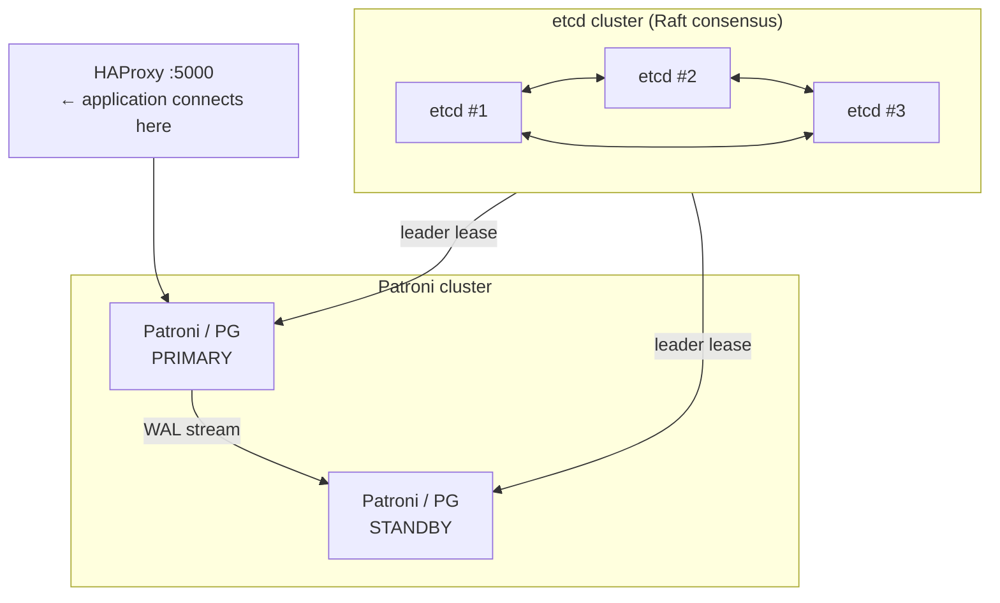

# Replication

PostgreSQL supports streaming replication (physical, byte-for-byte) and logical replication (row-level changes per table); Patroni automates failover using distributed consensus.

## Streaming Replication

The primary sends WAL records to standbys via a dedicated `walsender` process; each standby has a `walreceiver` that applies the WAL to its own PGDATA.

### Setup (Primary)

```ini
# postgresql.conf
wal_level                  = replica     # minimum for replication
max_wal_senders            = 5
wal_keep_size              = 1GB         # keep WAL until standby consumes it
synchronous_standby_names  = ''          # async by default
```

```sql
-- Create replication role
CREATE ROLE replicator WITH REPLICATION LOGIN PASSWORD 'rep_pass';
```

```
# pg_hba.conf
host  replication  replicator  10.0.0.2/32  scram-sha-256
```

### Setup (Standby)

```bash
# Take base backup from primary
pg_basebackup -h 10.0.0.1 -U replicator -D /var/lib/postgresql/data \
    --wal-method=stream --checkpoint=fast

# Create standby.signal (PG 12+)
touch /var/lib/postgresql/data/standby.signal
```

```ini
# postgresql.conf on standby
primary_conninfo = 'host=10.0.0.1 port=5432 user=replicator password=rep_pass'
```

### Monitoring Replication

```sql
-- On primary: replication lag
SELECT client_addr, state, write_lag, flush_lag, replay_lag
FROM   pg_stat_replication;

-- On standby: confirm receiving
SELECT status, receive_start_lsn, received_tli
FROM   pg_stat_wal_receiver;
```

## Hot Standby

When `hot_standby = on` (default since PG9), the standby accepts read-only queries while replaying WAL. Use for read scaling and reporting offload.

```ini
hot_standby = on      # on standby postgresql.conf
```

## Synchronous Replication

Guarantees the primary waits for at least one standby to confirm WAL flush before returning commit to the client. Higher durability, higher latency.

```ini
synchronous_standby_names = 'standby1'
synchronous_commit        = on   # or 'remote_write', 'remote_apply'
```

`synchronous_commit = remote_apply` is the strongest — standby must apply (replay) the WAL, not just flush.

## Logical Replication

Replicates individual tables by decoded row changes, not raw WAL bytes. Allows:
- Replication to a different PostgreSQL major version
- Selective table replication
- Replication to non-PostgreSQL targets

```sql
-- Primary: create publication
CREATE PUBLICATION orders_pub FOR TABLE orders, order_items;

-- Standby: create subscription
CREATE SUBSCRIPTION orders_sub
    CONNECTION 'host=10.0.0.1 dbname=eshop user=replicator password=rep_pass'
    PUBLICATION orders_pub;
```

### Limitations

- DDL is not replicated (schema changes must be applied manually)
- Sequences are not replicated
- `TRUNCATE` is replicated; does not cascade
- Tables must have a `PRIMARY KEY` or `REPLICA IDENTITY`

## Patroni — Automatic Failover

Patroni is a high-availability template that stores cluster state in a distributed consensus store (etcd, Consul, or ZooKeeper) and automatically elects a new primary.



### Failover Types

| Type | Trigger | Action |
| ---- | ------- | ------ |
| **Automatic** | Primary fails; standby detects missed heartbeat | etcd lease expires; best standby elected by Patroni |
| **Manual** | Planned maintenance | `patronictl switchover` — promotes standby gracefully |
| **Forced** | Manual override | `patronictl failover` — promotes even with data lag |

## See also

- [WAL & MVCC](wal-mvcc.md) — WAL is the foundation of streaming replication
- [Backup & Recovery](backup-recovery.md) — `pg_basebackup` is the starting point for a standby
- [Failover Runbook](../procedures/failover-runbook.md) — manual failover steps
