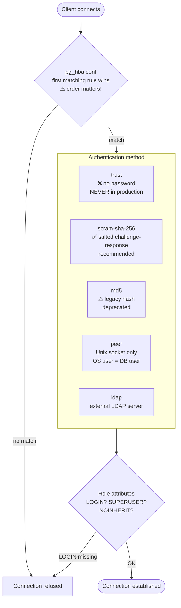

# Security

PostgreSQL security spans authentication (pg_hba.conf), authorisation (roles + RLS), auditing (pgAudit), transport encryption (TLS), and data encryption (pgcrypto); in Russia, the 152-ФЗ law governs personal data handling.

## Authentication Chain



### pg_hba.conf Structure

```
# TYPE  DATABASE  USER       ADDRESS         METHOD
host    eshop     app_backend 127.0.0.1/32   scram-sha-256
hostssl eshop     app_backend 10.0.0.0/24    scram-sha-256
local   all       postgres                   peer
```

Rules are evaluated top-to-bottom; first match wins. After editing: `SELECT pg_reload_conf();`.

## Roles and Privileges

### Role Hierarchy

```
GRANT eshop_readonly TO analyst_ivanova;   -- user inherits role's privileges
GRANT eshop_app      TO app_backend;

eshop_readonly: CONNECT + USAGE + SELECT (all tables in public)
eshop_app:      eshop_readonly + INSERT + UPDATE + DELETE
```

### Privilege Hierarchy

| Level | Required for |
| ----- | ------------ |
| `CONNECT` | Open a database connection |
| `USAGE` | Access objects in a schema |
| `SELECT` | Read rows from a table |
| `INSERT / UPDATE / DELETE` | Modify rows |
| `CREATE` | Create objects in a schema |

Missing `USAGE` on schema → `SELECT` on table fails even if granted.

### ALTER DEFAULT PRIVILEGES

Ensures new objects created by a role are automatically granted to consumers:

```sql
ALTER DEFAULT PRIVILEGES FOR ROLE postgres IN SCHEMA public
    GRANT SELECT ON TABLES TO eshop_readonly;
```

Without this, every new table needs manual `GRANT`.

## Row-Level Security (RLS)

RLS adds a WHERE clause to every query on the table, transparent to the application.

```sql
-- Enable RLS
ALTER TABLE customers ENABLE ROW LEVEL SECURITY;
ALTER TABLE customers FORCE ROW LEVEL SECURITY;   -- applies to table owner too

-- Policy: analyst can only see customers in their own region
CREATE POLICY region_policy ON customers
    FOR SELECT
    TO analyst_ivanova
    USING (region = current_setting('app.region'));

-- Application sets context before query:
SET app.region = 'MSK';
SELECT * FROM customers;   -- returns only MSK rows
```

If RLS is enabled with **no policies**, all rows are **denied** (except for superusers and the table owner without FORCE).

## pgAudit — SQL Audit

```ini
# postgresql.conf
shared_preload_libraries = 'pgaudit'
pgaudit.log              = 'write, ddl, role'
pgaudit.log_relation     = on
pgaudit.log_catalog      = off
```

Values for `pgaudit.log`:
- `read` — SELECT, COPY FROM
- `write` — INSERT, UPDATE, DELETE, TRUNCATE, COPY TO
- `ddl` — CREATE, ALTER, DROP
- `role` — GRANT, REVOKE, CREATE ROLE
- `all` — everything

### Object Audit (per table)

```sql
CREATE ROLE eshop_auditor;
GRANT SELECT ON customers, orders TO eshop_auditor;
-- then in postgresql.conf:
-- pgaudit.role = 'eshop_auditor'
```

Audit log entry format:
```
AUDIT: SESSION,1,1,WRITE,INSERT,TABLE,public.customers,...
```

## TLS — Transport Encryption

```ini
# postgresql.conf
ssl          = on
ssl_cert_file = 'server.crt'
ssl_key_file  = 'server.key'
```

Force SSL for a specific user/database in pg_hba.conf:
```
hostssl  eshop  app_backend  0.0.0.0/0  scram-sha-256
```

Check current connection:
```sql
SELECT ssl, cipher, bits FROM pg_stat_ssl WHERE pid = pg_backend_pid();
```

## pgcrypto — Data Encryption

```sql
CREATE EXTENSION pgcrypto;

-- Encrypt
UPDATE customers
SET phone_encrypted = pgp_sym_encrypt(phone, 'key_from_vault')
WHERE phone IS NOT NULL;

-- Decrypt
SELECT pgp_sym_decrypt(phone_encrypted, 'key_from_vault') AS phone
FROM   customers;
```

**Production rule:** never store the key in SQL. Inject it from application config or Vault.

## 152-ФЗ (Personal Data Law)

| Category | Examples | Protection level | Measures |
| -------- | -------- | ---------------- | -------- |
| **Special** | Medical, biometric | УЗ-1 / УЗ-2 | Highest controls |
| **General** | Full name, email, phone | УЗ-3 | Encryption, audit, localisation |
| **Public** | Voluntarily published data | УЗ-4 | Minimal |

eshop `customers` table (name + email + phone) → **general category → УЗ-3**.

Required measures for УЗ-3:
- Personal data stored on servers physically located in the Russian Federation
- Encryption of data at rest and in transit
- Audit log of all access to personal data (pgAudit)
- Designated responsible person for personal data processing
- Signed user consent for data collection

## Security Hardening Checklist

- [ ] `pg_hba.conf`: no `trust` lines for networked connections
- [ ] All passwords set with `scram-sha-256`
- [ ] `ssl = on`; `hostssl` for external connections
- [ ] pgAudit installed and logging `write, ddl, role`
- [ ] Audit logs retained ≥ 1 year
- [ ] PII columns encrypted with pgcrypto; key stored outside DB
- [ ] Port 5432 not exposed to internet (VPN / jump host only)
- [ ] RLS enabled on tables containing personal data
- [ ] `SUPERUSER` roles limited to DBA accounts only

## See also

- [pgAudit](../tools/pgaudit.md) — детальное руководство по настройке расширения аудита
- [Access Control Models](access-control-models.md) — DAC, RBAC, ABAC/RLS, MAC, ReBAC
- [PostgreSQL Architecture](postgresql-architecture.md) — pg_hba.conf location in PGDATA
- [Monitoring](monitoring.md) — `pg_stat_ssl`, `pg_stat_activity` for session monitoring
- [DBA vs SA](../roles/dba-vs-sa.md) — security configuration is DBA responsibility
- [РПД дисциплины](../course/rpd.md) — соответствие индикаторам ПК-1-И-31 и ПК-3-И-3
