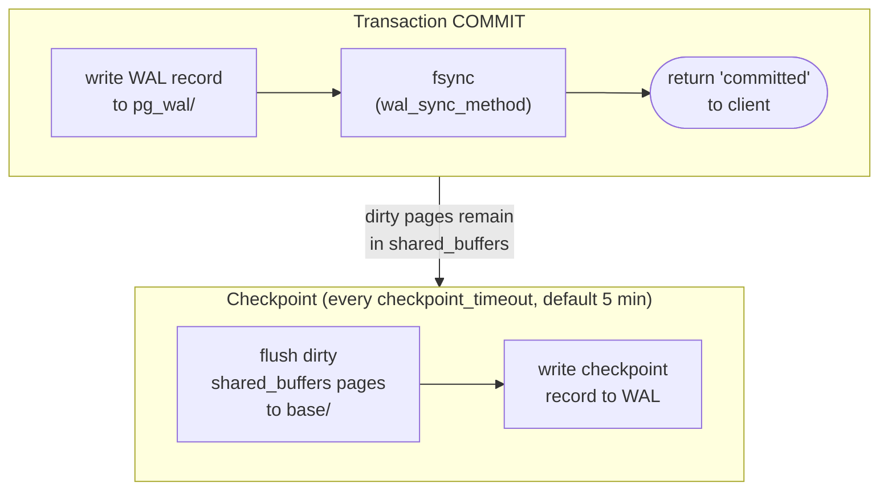

# WAL & MVCC

PostgreSQL writes every change to the Write-Ahead Log before touching data pages, enabling crash recovery and PITR; MVCC stores multiple row versions so readers never block writers.

## Write-Ahead Log (WAL)

**Rule:** changes are durable only when the WAL record is flushed to disk (`fsync`). Data pages may be written later.



### WAL Segment Files

- Location: `$PGDATA/pg_wal/`
- Default size: 16 MB each (configurable at `initdb`)
- Named by LSN (Log Sequence Number): `000000010000000000000001`

LSN is a monotonically increasing byte offset into the WAL stream. Used as recovery target in PITR (`recovery_target_lsn`).

### Why WAL enables PITR

If you have a base backup + all WAL segments since that backup, you can replay them to any LSN or timestamp — this is Point-In-Time Recovery.

```
base backup (t=0) ──► WAL segment 1 ──► WAL segment 2 ──► ... ──► WAL segment N
                                                          ▲
                                              target time (t=T) ← replay stops here
```

## MVCC (Multi-Version Concurrency Control)

Every row has hidden system columns:
- `xmin` — transaction ID that inserted this version
- `xmax` — transaction ID that deleted/updated (0 = visible)

### Visibility Rules

A row version is visible to transaction `T` if:
1. `xmin` is committed AND `xmin < T` (or `xmin = T`)
2. `xmax = 0` OR `xmax` is **not** committed (update/delete not yet committed)

This means:
- `SELECT` never blocks on `INSERT`/`UPDATE`/`DELETE`
- `DELETE` marks `xmax` but does NOT free the page — the old version stays
- `UPDATE` = `DELETE` old version + `INSERT` new version

### Dead Tuples

Old row versions that no snapshot can see anymore are **dead tuples**. They waste space and slow sequential scans.

```sql
-- How many dead tuples in a table?
SELECT relname, n_live_tup, n_dead_tup,
       round(100.0 * n_dead_tup / nullif(n_live_tup + n_dead_tup, 0), 1) AS dead_pct
FROM   pg_stat_user_tables
ORDER  BY n_dead_tup DESC;
```

Dead tuples are reclaimed by **VACUUM** (marks pages as reusable) or **VACUUM FULL** (rewrites the entire table — exclusive lock required).

### Transaction Isolation Levels

| Level | Dirty Read | Non-repeatable Read | Phantom Read |
| ----- | ---------- | ------------------- | ------------ |
| `READ COMMITTED` (default) | No | Yes | Yes |
| `REPEATABLE READ` | No | No | No (PG) |
| `SERIALIZABLE` | No | No | No |

## Autovacuum Trigger Threshold

```
threshold = autovacuum_vacuum_threshold + autovacuum_vacuum_scale_factor × reltuples
          = 50 + 0.20 × reltuples   (defaults)
```

For `orders` (200 000 rows) this is ≈ 40 050 dead tuples. For active tables, lower `scale_factor` per table:

```sql
ALTER TABLE orders SET (
    autovacuum_vacuum_scale_factor  = 0.01,
    autovacuum_analyze_scale_factor = 0.005
);
```

## See also

- [PostgreSQL Architecture](postgresql-architecture.md) — WAL writer background process
- [Backup & Recovery](backup-recovery.md) — WAL archiving, PITR setup
- [Monitoring](monitoring.md) — `pg_stat_user_tables.n_dead_tup`, checkpoint stats
- [Indexes](indexes.md) — `CREATE INDEX CONCURRENTLY` depends on MVCC snapshots
