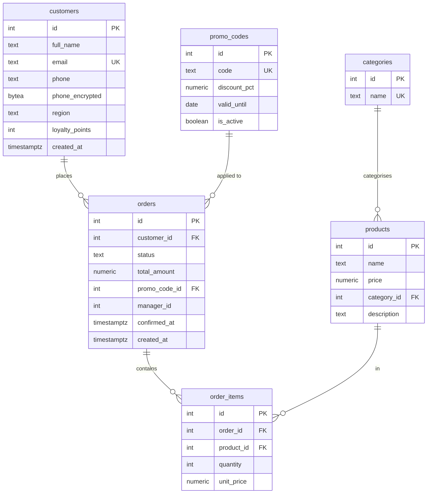

# eshop Schema

The eshop database is the cross-cutting project for the entire course — a simple online shop that grows from 4 tables in lab_02 to 8 tables by lab_10.

## ERD (after lab_10)



## Table Evolution

| Table | Added in | Purpose |
| ----- | -------- | ------- |
| `customers` | lab_02 | People who place orders |
| `products` | lab_02 | Items for sale |
| `orders` | lab_02 | Purchase transactions |
| `order_items` | lab_02 | Line items within an order |
| `categories` | lab_09 (V002) | Product grouping |
| `promo_codes` | lab_09 (V003) | Discount codes |
| `orders.promo_code_id` | lab_09 (V003) | FK to promo_codes |
| `orders.confirmed_at` | lab_10 (V007) | Timestamp added via 3-step pattern |
| `customers.full_name` | lab_10 (V008) | Renamed from `name` via 4-step pattern |
| `customers.loyalty_points` | lab_09 self-study (V004) | Loyalty programme |

## Data Volumes (after lab_06 seed)

| Table | Rows |
| ----- | ---- |
| customers | 20 000 |
| products | 1 000 |
| orders | 200 000 |
| order_items | 600 000 |

Order status distribution after lab_07 Part 0:

| Status | Count | % |
| ------ | ----- | -- |
| delivered | 170 033 | 85 % |
| cancelled | 10 098 | 5 % |
| shipped | 10 036 | 5 % |
| processing | 5 911 | 3 % |
| pending | 3 922 | 2 % |

## Role Model

```
postgres (superuser)
├── eshop_readonly          -- CONNECT + USAGE + SELECT on all tables
│   ├── analyst_ivanova     -- inherits eshop_readonly; has RLS region restriction
│   └── (other analysts)
└── eshop_app               -- eshop_readonly + INSERT + UPDATE + DELETE
    └── app_backend         -- application service account (password: backend_pass_2024)
```

### Role Creation (from lab_02)

```sql
CREATE ROLE eshop_readonly NOLOGIN;
GRANT CONNECT  ON DATABASE eshop TO eshop_readonly;
GRANT USAGE    ON SCHEMA public  TO eshop_readonly;
GRANT SELECT   ON ALL TABLES IN SCHEMA public TO eshop_readonly;
ALTER DEFAULT PRIVILEGES FOR ROLE postgres IN SCHEMA public
    GRANT SELECT ON TABLES TO eshop_readonly;

CREATE ROLE eshop_app NOLOGIN;
GRANT eshop_readonly TO eshop_app;
GRANT INSERT, UPDATE, DELETE ON ALL TABLES IN SCHEMA public TO eshop_app;

CREATE ROLE analyst_ivanova LOGIN PASSWORD 'ivanova_pass_2024';
GRANT eshop_readonly TO analyst_ivanova;

CREATE ROLE app_backend LOGIN PASSWORD 'backend_pass_2024';
GRANT eshop_app TO app_backend;
```

## RLS Policy (lab_02)

```sql
ALTER TABLE customers ENABLE ROW LEVEL SECURITY;
ALTER TABLE customers FORCE ROW LEVEL SECURITY;

CREATE POLICY region_policy ON customers
    FOR SELECT TO analyst_ivanova
    USING (region = current_setting('app.region'));

-- Usage:
SET app.region = 'MSK';
SELECT * FROM customers;   -- returns only Moscow customers
```

## Indexes (after lab_07)

| Index | Table | Columns | Type | Notes |
| ----- | ----- | ------- | ---- | ----- |
| `customers_pkey` | customers | id | B-tree | PK |
| `customers_email_key` | customers | email | B-tree | UNIQUE |
| `idx_customers_region` | customers | region | B-tree | lab_06 |
| `idx_customers_email_lower` | customers | LOWER(email) | Expression | lab_07 |
| `orders_pkey` | orders | id | B-tree | PK |
| `idx_orders_customer_id` | orders | customer_id | B-tree | lab_06 |
| `idx_orders_created_at` | orders | created_at | B-tree | lab_06 |
| `idx_orders_active` | orders | status | Partial (`pending`,`processing`) | lab_07 |
| `idx_orders_status_created` | orders | (status, created_at) | Composite | lab_07 |
| `idx_orders_total_amount` | orders | total_amount DESC | B-tree | lab_10 CONCURRENTLY |
| `order_items_pkey` | order_items | id | B-tree | PK |
| `idx_order_items_order` | order_items | order_id | B-tree | lab_06 |
| `idx_order_items_product` | order_items | product_id | B-tree | lab_07 CONCURRENTLY |

## Flyway Migration History

| Version | Description | Applied in |
| ------- | ----------- | ---------- |
| 1 | BASELINE: initial eshop schema | lab_09 |
| V002 | add_products_category | lab_09 |
| V003 | create_promo_codes | lab_09 |
| R__orders_summary_view | orders_summary view | lab_09 |
| V004 | add_customer_loyalty_points | lab_09 (self-study) |
| V005 | bad_migration (Failed) | lab_10 |
| V006 | fix_manager_id (forward rollback) | lab_10 |
| V007 | add_confirmed_at_safe | lab_10 |
| V008 | rename_customer_name | lab_10 |

## pgAudit Configuration (lab_08)

```ini
shared_preload_libraries = 'pgaudit'
pgaudit.log              = 'write, ddl, role'
pgaudit.log_relation     = on
pgaudit.log_catalog      = off
```

## TLS (lab_08)

`ssl = on` in postgresql.conf, `hostssl` for `app_backend` in pg_hba.conf.

## See also

- [Security](../concepts/security.md) — RLS, roles, pgAudit, TLS details
- [Indexes](../concepts/indexes.md) — index types and design rationale
- [Flyway](../tools/flyway.md) — migration naming and commands
- [Labs Overview](labs-overview.md) — which lab adds what
