# Рабочая программа дисциплины (РПД) «Администрирование баз данных»

Нормативная карточка утвержденной программы (Б1.В.ДВ.06.02, 09.03.03 «Прикладная информатика», ГУУ, 2026), матрица компетенций ПК-1, ПК-3, ПК-5 и сквозное сопоставление индикаторов со статьями базы знаний, лекциями и лабораторными работами.

---

## 1. Паспорт программы

| Параметр | Значение |
| --- | --- |
| **Код и наименование** | Б1.В.ДВ.06.02 «Администрирование баз данных» |
| **Направление подготовки** | 09.03.03 «Прикладная информатика» |
| **Профиль** | «Информационные технологии и системная аналитика» |
| **Уровень образования** | Бакалавриат, 4 курс, 7 семестр, очная форма |
| **Трудоемкость** | 4 зачетные единицы (144 академических часа) |
| **Аудиторные часы** | 58 ак. ч. (26 лекции + 26 лабораторные + 6 проектное обучение) |
| **Внеаудиторная контактная работа** | 7 ак. ч. (консультации) |
| **Самостоятельная работа (СРС)** | 79 ак. ч. |
| **Форма промежуточной аттестации** | Зачет (7 семестр) |
| **Нормативная основа** | ФГОС ВО 3++ по направлению 09.03.03; Профстандарт 06.011 «Администратор баз данных» |
| **Утвержденный документ** | `РПД_Администрирование_баз_данных_утв.docx` |

---

## 2. Цели и направленность курса

**Цель дисциплины** — подготовка системных аналитиков и специалистов по информационным системам к профессиональному взаимодействию с администраторами баз данных в проектных командах: изучению жизненного цикла схем баз данных, разработке планов и сценариев миграции данных, применению стратегий отката изменений и методов модификации структур данных без прерывания обслуживания пользователей, локальному развертыванию систем управления базами данных и сопровождению слоя данных в процессах непрерывной интеграции и развертывания программного обеспечения.

Дисциплина направлена на предотвращение рисков неконтролируемой модификации структур данных, исключение технологических простоев при обновлении информационных систем из-за несогласованных изменений и недопущение инцидентов, приводящих к потере информации. Обучающиеся приобретают навыки межфункционального взаимодействия с администраторами баз данных: разработка планов миграции данных, проектирование версионируемых сценариев изменения схем, проведение экспертной оценки и согласования изменений структуры данных в системах контроля версий, применение регламентов отката изменений и контроль надежности функционирования промышленных систем управления базами данных.

---

## 3. Матрица компетенций, индикаторов и покрытия материалами курса

В соответствии с Учебным планом ГУУ за дисциплиной закреплены три профессиональные компетенции: **ПК-1**, **ПК-3**, **ПК-5**.

| Компетенция и индикатор | Планируемые результаты обучения (З / У / В) | Темы лекций | Лабораторные работы | База знаний wiki |
|---|---|---|---|---|
| **ПК-1-И-17** (Разработка БД ИС) | **З:** жизненный цикл схемы, версионирование схемы, миграции. **У:** разработка сценариев модификации схемы, планы изменений. **В:** версионирование и верификация скриптов миграции в Git. | Тема 12, 13 | [[course/labs-overview#lab-09\|Лаб. 09]], [[course/labs-overview#lab-10\|Лаб. 10]] | [[tools/flyway]], [[procedures/migration-workflow]], [[procedures/zero-downtime]], [[artifacts/migration-plan]] |
| **ПК-1-И-26** (Оптимизация работы ИС) | **З:** архитектура СУБД, статистика, метрики производительности, оптимизатор запросов. **У:** анализ планов EXPLAIN, системных журналов, поиск узких мест. **В:** оптимизация запросов, индексы, пул соединений. | Тема 7, 8, 9 | [[course/labs-overview#lab-05\|Лаб. 05]], [[course/labs-overview#lab-06\|Лаб. 06]], [[course/labs-overview#lab-07\|Лаб. 07]] | [[concepts/indexes]], [[concepts/monitoring]], [[concepts/connection-pooling]], [[concepts/locks-concurrency]], [[tools/pgbadger]], [[tools/pgbench]], [[artifacts/explain-analysis]] |
| **ПК-1-И-31** (Управление доступом к данным) | **З:** модели доступа (RBAC/RLS), 152-ФЗ, безопасная конфигурация СУБД. **У:** настройка ролевой модели, разграничение прав, аудит событий безопасности. **В:** администрирование привилегий и политик безопасности строк. | Тема 3, 4, 11 | [[course/labs-overview#lab-02\|Лаб. 02]], [[course/labs-overview#lab-08\|Лаб. 08]] | [[concepts/security]], [[concepts/access-control-models]], [[tools/pgaudit]], [[artifacts/access-matrix]], [[artifacts/security-checklist]] |
| **ПК-1-И-40** (Организация репозитория хранения и бэкапы) | **З:** стратегии резервного копирования, PITR, целевые показатели RPO/RTO. **У:** настройка процедур бэкапа, регламенты восстановления данных. **В:** сопровождение репозитория миграций, регламенты отката изменений. | Тема 5, 6, 12 | [[course/labs-overview#lab-01\|Лаб. 01]], [[course/labs-overview#lab-03\|Лаб. 03]], [[course/labs-overview#lab-04\|Лаб. 04]] | [[concepts/backup-recovery]], [[concepts/wal-mvcc]], [[procedures/rollback-strategies]], [[procedures/failover-runbook]], [[artifacts/backup-policy]] |
| **ПК-3-И-3** (Техники внедрения ПО и БД) | **З:** методы обновления схем без простоя (zero-downtime), регламенты командного взаимодействия. **У:** рецензирование (review) проектных решений и MR миграций. **В:** координация развертывания и сопровождения БД в процессах поставки ПО. | Тема 1, 10, 13 | [[course/labs-overview#lab-04\|Лаб. 04]], [[course/labs-overview#lab-09\|Лаб. 09]], [[course/labs-overview#lab-10\|Лаб. 10]] | [[concepts/high-availability]], [[concepts/replication]], [[procedures/zero-downtime]], [[roles/dba-vs-sa]], [[roles/team-roles]], [[artifacts/deployment-runbook]] |
| **ПК-5-И-2** (Проектирование структур ИС) | **З:** принципы концептуального и логического проектирования реляционных структур данных, целостность данных. **У:** проектирование и нормализация схем БД, модификация моделей. **В:** инструменты проектирования данных (ERD, Crow's Foot), анализ модели. | Тема 1, 2, 9, 13 | [[course/labs-overview#lab-01\|Лаб. 01]], [[course/labs-overview#lab-02\|Лаб. 02]], [[course/labs-overview#lab-10\|Лаб. 10]] | [[concepts/normalization]], [[concepts/dbms-landscape]], [[course/eshop-schema]], [[tools/dbeaver]], [[tools/psql]] |

---

## 4. Тематический план дисциплины (13 недель)

```mermaid
gantt
    title Тематический план дисциплины (7 семестр, 144 ак. ч.)
    dateFormat  X
    axisFormat W%W
    section Блок 1: Архитектура и Доступ
    Тема 1. Роль DBA, архитектура СУБД, ERD         :active, 0, 1
    Тема 2. Установка СУБД, среда разработчика      :0, 2
    Тема 3. Роли, пользователи, аутентификация      :1, 3
    Тема 4. Привилегии, схемы, RLS (проект 1ч)      :2, 4
    section Блок 2: Надежность и Эксплуатация
    Тема 5. Резервное копирование (pg_dump, WAL)    :3, 5
    Тема 6. Восстановление, PITR (проект 1ч)       :4, 6
    Тема 7. Мониторинг, статистика, логирование     :5, 7
    Тема 8. Анализ запросов, EXPLAIN (проект 1ч)    :6, 8
    section Блок 3: Масштабирование и Эволюция
    Тема 9. Индексы, пулинг соединений, ПАО         :7, 9
    Тема 10. Отказоустойчивость, HA (проект 1ч)     :8, 10
    Тема 11. Информационная безопасность, аудит     :9, 11
    Тема 12. Версионирование Flyway (проект 1ч)     :10, 12
    Тема 13. Zero-downtime, откат, зачет (проект 1ч):11, 13
```

---

## 5. Программное обеспечение курса (Раздел 6 РПД)

| Категория | Инструменты | Назначение в курсе | Статьи wiki |
|---|---|---|---|
| **СУБД** | PostgreSQL (Postgres Pro / Community) | Основная реляционная СУБД для всех практических задач | [[concepts/postgresql-architecture]], [[concepts/wal-mvcc]] |
| **Клиенты и IDE** | DBeaver Community, psql | Графический и консольный интерфейсы взаимодействия с СУБД | [[tools/dbeaver]], [[tools/psql]] |
| **Управление схемами** | Flyway Community Edition | Инструмент версионирования схемы и автоматизации миграций | [[tools/flyway]], [[procedures/migration-workflow]] |
| **Пул соединений** | PgBouncer | Мультиплексирование клиентских подключений к СУБД | [[tools/pgbouncer]], [[concepts/connection-pooling]] |
| **Профилирование** | pgBadger, pgbench, auto_explain | Анализ журналов, нагрузочное тестирование и оптимизация запросов | [[tools/pgbadger]], [[tools/pgbench]], [[concepts/monitoring]] |
| **Отказоустойчивость** | Patroni, etcd | Архитектура высокой доступности и автоматического переключения | [[tools/patroni]], [[concepts/high-availability]], [[concepts/replication]] |
| **Информационная безопасность** | pgAudit, pgcrypto | Протоколирование действий пользователей и криптографическая защита | [[tools/pgaudit]], [[concepts/security]] |
| **Контроль версий** | Git | Совместная работа, рецензирование сценариев миграций в Merge Request | [[cheatsheets/git]], [[procedures/migration-workflow]] |

---

## 6. Система оценивания (Раздел 8 РПД)

Промежуточная аттестация проводится в форме **зачета** в 7 семестре.

- **«ЗАЧТЕНО»**: обучающийся демонстрирует знание архитектуры промышленных СУБД, принципов версионирования схем, моделей безопасности и отказоустойчивости; умеет развертывать СУБД, настраивать бэкапы, анализировать планы запросов и разрабатывать сценарии миграций без простоя; владеет специализированным ПО администрирования, средствами контроля версий и регламентами отката при сбоях.
- **«НЕЗАЧТЕНО»**: обучающийся не демонстрирует базовых знаний системных процессов СУБД, не способен развернуть экземпляр, разграничить права доступа или разработать валидный скрипт миграции.

> **Источники:** `РПД_Администрирование_баз_данных_утв.docx`, ФГОС ВО 09.03.03, Профстандарт 06.011 (приказ Минтруда РФ № 408н).  
> **Связанные страницы:** [[course/lectures-overview]], [[course/labs-overview]], [[course/eshop-schema]], [[roles/dba-vs-sa]], [[roles/team-roles]].
