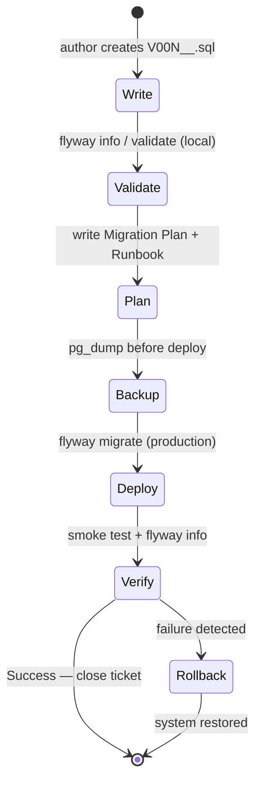

# Migration Workflow

A production schema change follows a six-step cycle: write → validate locally → create Migration Plan → backup → deploy → verify; any failed deployment triggers rollback before proceeding.

## The Cycle



## Step 1 — Write the Migration File

```sql
-- migrations/V003__create_promo_codes.sql
CREATE TABLE promo_codes (
    id           SERIAL PRIMARY KEY,
    code         TEXT NOT NULL UNIQUE,
    discount_pct NUMERIC(5,2) NOT NULL CHECK (discount_pct BETWEEN 1 AND 99),
    valid_until  DATE,
    is_active    BOOLEAN NOT NULL DEFAULT TRUE
);

ALTER TABLE orders ADD COLUMN promo_code_id INTEGER REFERENCES promo_codes(id);

INSERT INTO promo_codes (code, discount_pct, valid_until)
VALUES ('WELCOME10', 10.00, '2025-12-31');
```

Rules:
- Double underscore in filename
- One logical change per migration
- No `DROP TABLE` without a Runbook rollback step
- Use [zero-downtime patterns](zero-downtime.md) for `ADD NOT NULL`, `RENAME`, `CREATE INDEX`

## Step 2 — Validate Locally

```bash
flyway -configFiles=flyway.toml info      # check pending
flyway -configFiles=flyway.toml validate  # verify checksums
flyway -configFiles=flyway.toml migrate   # apply to dev DB
flyway -configFiles=flyway.toml info      # confirm Success
```

## Step 3 — Migration Plan

```markdown
## Migration Plan: V003 — Промокоды

**Version:** V003__create_promo_codes.sql
**Author:** [Name]
**Deploy date (planned):** 2024-10-15
**Type:** DDL + DML (CREATE TABLE + ALTER TABLE + INSERT)

### Changes
| Object      | Operation  | Risk  |
|-------------|------------|-------|
| promo_codes | CREATE TABLE | Low |
| orders      | ADD COLUMN   | Low |

### Rollback
- `ALTER TABLE orders DROP COLUMN promo_code_id;`
- `DROP TABLE promo_codes;`

### Post-deploy verification
```sql
SELECT COUNT(*) FROM promo_codes;   -- expected: 1
SELECT column_name FROM information_schema.columns
WHERE table_name = 'orders' AND column_name = 'promo_code_id';
SELECT version, success FROM flyway_schema_history WHERE version = '3';
```

### MR checklist
- [ ] Double underscore in filename
- [ ] cleanDisabled = true
- [ ] flyway validate passed
- [ ] DBA review done
```

## Step 4 — Pre-deploy Backup

```bash
pg_dump -h localhost -U postgres -Fc eshop -f backup_pre_v003.dump
```

Never skip this — it's your last line of defence for rollback via PITR.

## Step 5 — Deploy

```bash
flyway -configFiles=flyway.toml validate  # one more checksum check
flyway -configFiles=flyway.toml migrate
```

## Step 6 — Verify

```bash
flyway -configFiles=flyway.toml info      # V003 → Success
```

Run the SQL verification queries from the Migration Plan. Run application smoke tests.

## Handling a Failed Migration

```
V003 → Failed in flyway_schema_history
```

1. Fix the SQL (or write a corrective V004).
2. `flyway repair` — marks V003 as DELETED.
3. Reapply: `flyway migrate`.

If data is corrupted: restore from `backup_pre_v003.dump`:

```bash
pg_restore -h localhost -U postgres -d eshop --clean backup_pre_v003.dump
flyway repair
```

## Runbook Template

```markdown
## Runbook: deploy V003 on production

### Preparation
1. pg_dump -Fc eshop -f backup_pre_v003.dump
2. flyway info — no Failed migrations
3. Notify team in Slack

### Execution
4. flyway validate — no checksum errors
5. flyway migrate
6. flyway info — V003 = Success

### Verification
7. SQL checks from Migration Plan
8. Smoke test: add promo code, apply to order

### Rollback (if anything fails)
9. psql -c "ALTER TABLE orders DROP COLUMN IF EXISTS promo_code_id;"
10. psql -c "DROP TABLE IF EXISTS promo_codes;"
11. flyway repair
12. Restore from backup if data corrupted

### After deploy
13. Notify team: deploy complete
14. Close ticket
```

## See also

- [Flyway](../tools/flyway.md) — command reference, flyway.toml, naming convention
- [Rollback Strategies](rollback-strategies.md) — when to use forward rollback vs PITR
- [Zero-Downtime Patterns](zero-downtime.md) — safe DDL patterns to use in migrations
