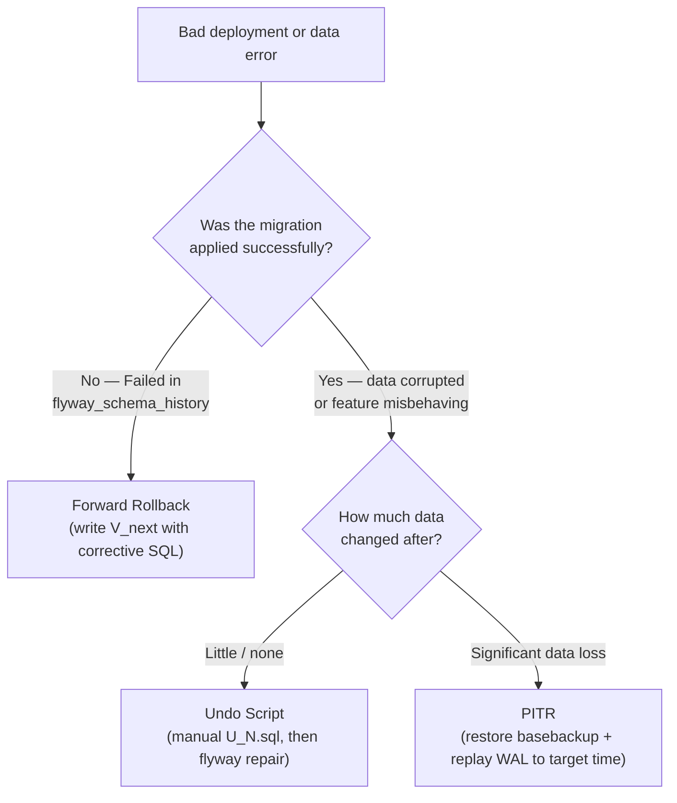

# Rollback Strategies

Three strategies exist for undoing a bad schema or data change: forward rollback (preferred), undo script, and PITR; the choice depends on what went wrong and how much data was modified after the error.

## Overview



## Strategy 1 — Forward Rollback (Recommended)

Write a new corrective migration that fixes the broken state. This is the simplest and safest approach for most cases.

**When to use:** migration failed or produced an undesired schema state; no significant data was lost.

**Example:** V005 tried to add `NOT NULL` without a default — failed for existing rows.

```sql
-- V006__fix_manager_id.sql
-- Corrective: add column properly, nullable first
ALTER TABLE orders ADD COLUMN IF NOT EXISTS manager_id INTEGER DEFAULT NULL;
```

```bash
flyway repair      # marks V005 as DELETED
flyway migrate     # applies V006
flyway info        # V005 Failed (deleted), V006 Success
```

**Advantages:**
- Always moves forward — no "undo" state ambiguity
- Works with Flyway Community (no Undo licence needed)
- History remains complete (V005 stays as Failed record)
- Safe when database is live with active traffic

## Strategy 2 — Undo Script

Write an explicit reversal script that undoes the structural changes of a specific migration.

**When to use:** the migration applied successfully but the feature is being rolled back (e.g. A/B test abandoned); no critical data loss.

**Flyway Teams** provides `flyway undo` (applies `U005__...sql` automatically).
**Flyway Community**: run the script manually.

```sql
-- U005__undo_bad_migration.sql  (run manually in psql/DBeaver)
ALTER TABLE orders DROP COLUMN IF EXISTS manager_id;
```

```bash
# After manual execution:
flyway repair   # marks V005 as DELETED in history
```

**Limitations:**
- Undo may be impossible if V005 deleted data that can't be recovered
- Some operations are hard to reverse (e.g. `DROP TABLE` → data is gone)
- Must be written at the same time as the migration, not after the fact

## Strategy 3 — PITR

Restore the database to the point in time just before the error occurred.

**When to use:** data was accidentally deleted or corrupted; the only way to recover the data is to replay WAL history.

**Cost:** all changes made between the backup point and "now" are lost. Users must re-enter data. This is the strategy of last resort.

### Steps

1. Stop the application (prevent new writes).
2. Identify the target time (just before the bad transaction).
3. Stop PostgreSQL.
4. Replace PGDATA with the last base backup.
5. Configure PITR in `postgresql.conf`:

```ini
restore_command        = 'cp /wal_archive/%f %p'
recovery_target_time   = '2024-10-15 14:29:00'
recovery_target_action = 'promote'
```

6. Create `recovery.signal`.
7. Start PostgreSQL — recovery plays WAL up to target time.
8. Verify data, then re-take a base backup.
9. Re-run any Flyway migrations that happened after the target time.
10. Re-enable application.

See [Backup & Recovery](../concepts/backup-recovery.md) for full PITR setup.

## Comparison

| | Forward Rollback | Undo Script | PITR |
| - | - | - | - |
| **Requires** | Write new SQL | Pre-written undo SQL | Base backup + WAL archive |
| **Data loss** | None | Possible (if V removed data) | All changes since backup |
| **Downtime** | Seconds (migration only) | Minutes | 10–60+ minutes |
| **Flyway licence** | Community | Teams (or manual) | N/A |
| **Best for** | Schema errors | Rolled-back features | Data loss / corruption |

## Pre-deploy Backup (always)

Before any migration to production:

```bash
pg_dump -h localhost -U postgres -Fc eshop -f backup_pre_V003.dump
```

This enables undo-by-restore if needed, making PITR a last resort rather than the only option.

## See also

- [Flyway](../tools/flyway.md) — `flyway repair`, migration states
- [Backup & Recovery](../concepts/backup-recovery.md) — PITR setup and WAL archiving
- [Migration Workflow](migration-workflow.md) — where rollback fits in the deploy cycle
- [Zero-Downtime Patterns](zero-downtime.md) — avoiding situations that require rollback
