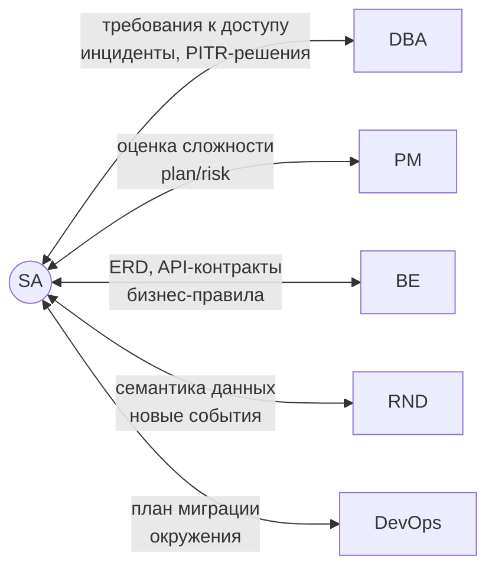

# Роли команды и взаимодействие с SA

В реальных проектах системный аналитик (SA) работает не изолированно — он связующее звено между бизнесом и всеми техническими ролями. Эта статья описывает шесть ключевых ролей и показывает, как SA взаимодействует с каждой из них на конкретных сценариях.

---

## Роли

### DBA — Database Administrator

Отвечает за жизненный цикл базы данных: установку, настройку, производительность, резервное копирование, безопасность и миграции схемы.

**Зона ответственности:** PostgreSQL-кластер, WAL, индексы, роли, pg_hba.conf, мониторинг.  
**Не отвечает за:** бизнес-смысл данных, требования к доступу, принятие решений об RTO/RPO без согласования с бизнесом.

---

### SA — System Analyst

Переводит бизнес-требования в технические спецификации и обратно. Владеет ER-моделью, бизнес-правилами и документацией.

**Зона ответственности:** требования, ERD, сценарии использования, приёмочные критерии, матрица доступа, классификация данных (152-ФЗ).  
**Не отвечает за:** реализацию SQL, конфигурацию сервера, код бэкенда.

---

### PM — Project Manager

Управляет объёмом, сроками и рисками. Принимает решения о приоритетах бэклога и окне для технических работ (деплой, миграции).

**Зона ответственности:** план проекта, ресурсы, коммуникация со стейкхолдерами, go/no-go решения.  
**Не отвечает за:** технические детали реализации, выбор архитектурных решений.

---

### BE — Backend Engineer

Разрабатывает серверную логику: API, бизнес-правила в коде, интеграции. Обращается к базе через ORM или SQL-запросы.

**Зона ответственности:** код приложения, API-контракты, логика транзакций, обработка ошибок.  
**Не отвечает за:** схему БД (только предлагает), политики доступа, конфигурацию сервера.

---

### RND — Data / Research Engineer

Строит аналитические пайплайны, отчёты, ML-модели. Работает с историческими данными и агрегатами.

> В некоторых командах роль называется Data Analyst, Data Engineer или просто аналитик данных.

**Зона ответственности:** аналитические запросы, витрины данных, качество данных, инсайты для бизнеса.  
**Не отвечает за:** OLTP-схему, бизнес-процессы, права доступа конечных пользователей.

---

### DevOps — Infrastructure / Platform Engineer

Обеспечивает работу CI/CD, контейнеризацию, мониторинг инфраструктуры, управление окружениями.

**Зона ответственности:** пайплайны деплоя, Docker/Kubernetes, переменные окружения, секреты, резервирование инфраструктуры.  
**Не отвечает за:** схему БД, SQL-код, бизнес-логику миграций.

---

## Матрица взаимодействия SA

---

## Use Stories: SA + DBA

### История 1 — Матрица доступа (лаб. 02)

> Аналитик собирает требования от отдела продаж: менеджеры должны видеть заказы своего региона, но не данные других регионов.

| Шаг | SA | DBA |
| --- | -- | --- |
| 1   | Составляет матрицу: роль `manager_read` → SELECT на `orders` с фильтром по region | — |
| 2   | Передаёт запрос на доступ по шаблону | Получает запрос, оценивает минимально необходимые привилегии |
| 3   | Согласует RLS-политику: `USING (region = current_setting('app.region'))` | Реализует RLS, проверяет тестовыми SELECT-запросами |
| 4   | Проводит приёмочное тестирование от имени менеджера | Фиксирует в runbook |

**Артефакт:** [[../artifacts/access-matrix|Access Matrix]]

---

### История 2 — Инцидент: пользователь не может войти

> Поддержка сообщает: пользователь `ivanova` получает `FATAL: password authentication failed`.

| Шаг | SA | DBA |
| --- | -- | --- |
| 1   | Собирает симптомы: когда началось, что изменилось, какая роль у пользователя | — |
| 2   | — | Проверяет `pg_hba.conf`, `pg_authid`, попытки входа в лог |
| 3   | Подтверждает, что `ivanova` — временный аналитик, права истекли вчера | Удаляет устаревшую роль или продлевает по заявке |
| 4   | Закрывает инцидент, обновляет матрицу доступа | — |

---

### История 3 — Медленные отчёты (лаб. 06)

> Руководитель жалуется: отчёт по продажам за квартал строится 40 секунд.

| Шаг | SA | DBA |
| --- | -- | --- |
| 1   | Идентифицирует запрос: отчёт X, таблицы `orders` + `order_items`, период последний квартал | — |
| 2   | — | Запускает EXPLAIN ANALYZE, находит Seq Scan на 2 млн строк |
| 3   | Подтверждает, что фильтр по `created_at` — ключевой для бизнеса | Создаёт индекс `CREATE INDEX CONCURRENTLY` |
| 4   | Повторяет тест: отчёт строится 1.2 с, фиксирует в отчёте о состоянии БД | — |

**Артефакт:** [[../artifacts/explain-analysis|EXPLAIN Analysis]]

---

## Use Stories: SA + PM

### История 4 — Оценка миграции (лаб. 09)

> PM спрашивает: «Можем ли мы добавить колонку `loyalty_tier` в `customers` к следующему спринту?»

| Шаг | SA | PM |
| --- | -- | -- |
| 1   | Анализирует схему: `customers` — 500K строк, колонка NOT NULL требует backfill | — |
| 2   | Готовит оценку: 2 дня разработки + 15 мин окно обслуживания в воскресенье | — |
| 3   | — | Согласует окно с бизнесом, добавляет в спринт с буфером |
| 4   | Пишет Migration Plan с rollback-сценарием | Согласует план, фиксирует go/no-go критерии |

**Артефакт:** [[../artifacts/migration-plan|Migration Plan]]

---

### История 5 — Risk-сессия перед релизом

> Команда планирует выкатить версию с 3 Flyway-миграциями в пятницу вечером.

| Шаг | SA | PM |
| --- | -- | -- |
| 1   | Поднимает риск: в пятницу поддержка не работает, откат займёт 2 часа | — |
| 2   | — | Переносит деплой на среду, уведомляет стейкхолдеров |
| 3   | SA добавляет в runbook раздел «что делать если миграция зависла» | PM подтверждает ответственных дежурных |

---

## Use Stories: SA + BE

### История 6 — Проектирование нового API (связь с ERD)

> BE собирается добавить API `GET /orders/{id}/items` и спрашивает, какие поля возвращать.

| Шаг | SA | BE |
| --- | -- | -- |
| 1   | Показывает ERD: `order_items` → `product_id` → `products.name`, `products.price` | — |
| 2   | Уточняет бизнес-правило: цена фиксируется **на момент заказа** в `order_items.price_at_purchase` | — |
| 3   | — | Использует `order_items.price_at_purchase`, не джойнит `products.price` |
| 4   | SA проверяет контракт: данные совпадают с бизнес-логикой, подписывает спецификацию | — |

---

### История 7 — Дебаг: дублирующиеся заказы

> BE сообщает: в таблице `orders` появились строки-дубли с одинаковым `customer_id` и `created_at`.

| Шаг | SA | BE |
| --- | -- | -- |
| 1   | Воспроизводит сценарий: двойной клик на «Оформить заказ» за 200 мс | — |
| 2   | Определяет решение: уникальный индекс + идемпотентный ключ на стороне клиента | — |
| 3   | — | Добавляет `idempotency_key UUID` в запрос; SA фиксирует в ERD |
| 4   | — | DBA добавляет `UNIQUE(idempotency_key)` индекс |

---

## Use Stories: SA + RND

### История 8 — Семантика колонки для аналитики

> RND строит дашборд и не понимает: `orders.status` имеет значения `1, 2, 3` — что они означают?

| Шаг | SA | RND |
| --- | -- | --- |
| 1   | Объясняет: `1=new`, `2=processing`, `3=shipped`, `4=delivered`, `5=cancelled` | — |
| 2   | Добавляет описание в глоссарий wiki и создаёт `orders_status_dict` view | — |
| 3   | — | Переписывает запросы через view, строит воронку конверсии по статусам |

---

### История 9 — Новые данные для ML-модели

> RND нужен лог событий `product_view` (просмотр товара) для модели рекомендаций.

| Шаг | SA | RND | BE |
| --- | -- | --- | -- |
| 1   | — | Формулирует требования: событие + user_id + product_id + timestamp | — |
| 2   | SA проектирует таблицу `product_events(event_type, user_id, product_id, ts)` | — | — |
| 3   | — | — | BE добавляет INSERT в обработчик страницы товара |
| 4   | SA согласует retention: 90 дней, потом `pg_partman` удаляет старые партиции | — | — |
| 5   | — | Начинает собирать данные, через неделю тренирует модель | — |

---

## Use Stories: SA + DevOps

### История 10 — Деплой миграций через CI/CD (лаб. 09)

> Команда переходит на Flyway в пайплайне GitHub Actions.

| Шаг | SA | DevOps |
| --- | -- | ------ |
| 1   | Описывает требования: миграции должны прогоняться на staging перед prod, с проверкой `flyway validate` | — |
| 2   | — | Добавляет step в `.github/workflows/deploy.yml`: `flyway migrate` для staging, ждёт approve для prod |
| 3   | SA пишет naming-конвенцию для SQL-файлов: `V<version>__<description>.sql` | — |
| 4   | — | Устанавливает секрет `FLYWAY_URL` в GitHub Secrets, SA проверяет что в staging используется не prod-база |

**Артефакт:** [[../artifacts/deployment-runbook|Deployment Runbook]]

---

### История 11 — Провизионирование staging-окружения

> Разработка готова к тестированию, но SA обнаруживает: staging-база содержит данные трёхмесячной давности.

| Шаг | SA | DevOps |
| --- | -- | ------ |
| 1   | Документирует требование: staging должен содержать свежий anonymized-дамп prod (не старше 7 дней) | — |
| 2   | — | Настраивает cron: `pg_dump prod → anonymize.py → pg_restore staging` каждое воскресенье |
| 3   | SA составляет список полей для анонимизации: `customers.email`, `customers.phone` (152-ФЗ) | — |
| 4   | — | Реализует анонимизацию через `UPDATE ... SET email = 'user_' || id || '@example.com'` |

---

## Сводная таблица: SA как связующее звено

| Взаимодействие | SA получает | SA отдаёт |
| -------------- | ----------- | --------- |
| SA ↔ DBA       | Статус кластера, результаты EXPLAIN | Требования к правам, RTO/RPO решения |
| SA ↔ PM        | Приоритеты, окна обслуживания | Оценки сложности, риски, план миграции |
| SA ↔ BE        | API-запросы, баг-репорты | ERD, бизнес-правила, спецификации |
| SA ↔ RND       | Запросы на данные, аномалии | Семантику данных, схему событий |
| SA ↔ DevOps    | Статус pipeline, секреты | Миграционный план, naming-конвенции |

---

## Принцип минимального знания

Каждая роль знает **достаточно** о смежных областях, чтобы задавать правильные вопросы, но не берёт на себя чужую ответственность:

- DBA не решает, какие поля шифровать — это решает SA по бизнес-классификации.
- BE не задаёт политики RLS — это задаёт SA по требованиям изоляции.
- PM не выбирает миграционную стратегию — SA согласует с DBA и предлагает PM go/no-go критерии.
- DevOps не решает, какие данные анонимизировать — SA предоставляет список (152-ФЗ).

---

> **Связанные страницы:**
> [[dba-vs-sa|DBA vs SA — матрица ответственности по темам курса]] ·
> [[../artifacts/access-matrix|Access Matrix]] ·
> [[../artifacts/migration-plan|Migration Plan]] ·
> [[../artifacts/deployment-runbook|Deployment Runbook]] ·
> [[../course/eshop-schema|eshop Schema — ERD проекта]]
