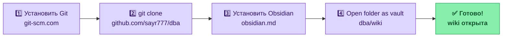
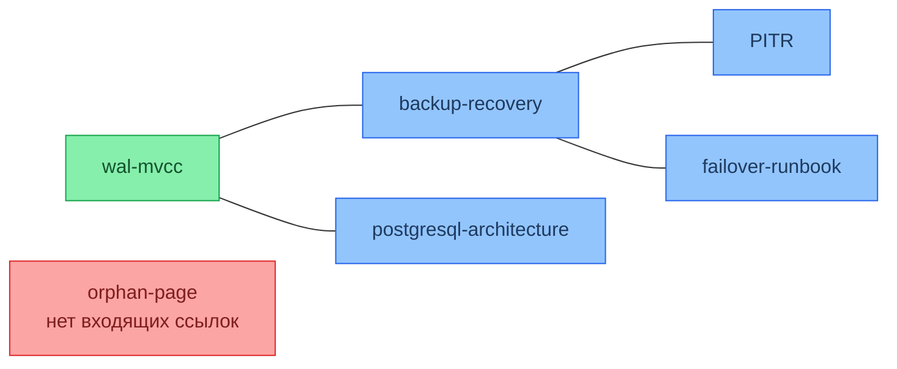

# Obsidian

Obsidian — локальный Markdown-редактор с нативной поддержкой `[[wiki-links]]`, графом связей и расширяемой системой плагинов. Это основной инструмент навигации и редактирования для этой LLM-wiki.

**Сайт:** https://obsidian.md (бесплатно для личного использования)

---

## Почему Obsidian для LLM-wiki

Obsidian понимает `[[wiki-links]]` так же, как их пишет LLM при обслуживании wiki. Это означает: каждая ссылка вида `[[concepts/wal-mvcc]]` становится кликабельной, строится в граф, отображается в панели backlinks. Статический Markdown-ридер этого не умеет.

| Возможность Obsidian | Роль в LLM-wiki                              |
| -------------------- | -------------------------------------------- |
| Graph View           | Визуальный Lint: orphan-страницы видны сразу |
| Backlinks panel      | Проверить, кто ссылается на текущую страницу |
| Outgoing links       | Проверить исходящие ссылки — нет ли битых    |
| Quick Switcher       | Быстрая навигация по wiki без мыши           |
| Canvas               | Визуальное планирование структуры wiki       |
| Community plugins    | Подключение Ollama, поиск, презентации       |

---

## Установка и первый запуск

### Шаг 1 — Установить Git

Git нужен для клонирования репозитория и получения обновлений wiki.

**Windows:**
1. Скачать установщик: https://git-scm.com/download/win
2. Запустить → все настройки оставить по умолчанию → Next → Install
3. Проверить установку — открыть **PowerShell** или **CMD**:
```powershell
git --version
# ожидаемый вывод: git version 2.xx.x
```

**macOS:**
```bash
# Через Homebrew (рекомендуется)
brew install git

# Или через Xcode Command Line Tools (появится диалог при первом вызове git)
git --version
```

**Linux (Ubuntu/Debian):**
```bash
sudo apt update && sudo apt install git -y
git --version
```

### Шаг 2 — Клонировать репозиторий

Репозиторий курса: **https://github.com/sayr777/dba**

```bash
# Перейти в папку где будут храниться материалы
# Windows — например:
cd C:\
mkdir MY_GIT && cd MY_GIT

# macOS / Linux:
cd ~
mkdir MY_GIT && cd MY_GIT

# Клонировать
git clone https://github.com/sayr777/dba.git
```

После клонирования структура будет:
```
MY_GIT/
└── dba/
    ├── wiki/          ← сюда открывать vault в Obsidian
    ├── lectures/      ← источники (не трогать)
    ├── labs/
    └── docs/
```

### Шаг 3 — Установить Obsidian

Скачать: https://obsidian.md/download

Доступны: Windows (.exe), macOS (.dmg), Linux (.AppImage / .deb / .snap), iOS, Android.

### Шаг 4 — Открыть vault

Vault уже настроен — директория `wiki/.obsidian/` существует с включёнными плагинами и настройками графа.

```
Obsidian → Open folder as vault → выбрать папку dba/wiki
```



Открывать нужно именно папку `wiki/`, а не весь репозиторий `dba/` — источники (`lectures/`, `labs/`) находятся снаружи vault намеренно: они immutable и не должны редактироваться через Obsidian.

### Шаг 5 — Получать обновления wiki

Когда в репозиторий добавятся новые материалы — забрать изменения одной командой:

```bash
# Перейти в папку репозитория
cd MY_GIT/dba        # Windows: cd C:\MY_GIT\dba

# Получить обновления
git pull
```

Obsidian подхватит изменения автоматически — перезапускать не нужно.

---

## Включённые core-плагины

В vault уже включены (`wiki/.obsidian/core-plugins.json`):

### Graph — граф связей

```
Ctrl+G  (или View → Open graph view)
```



Настройка графа уже сохранена в vault: **`showOrphans: true`** — изолированные страницы без входящих ссылок подсвечиваются. Именно это нужно для workflow [[../schema|Lint]].

**Что искать в графе:**
- Красные/изолированные точки — orphan-страницы, не связанные с остальными
- Большие хабы — страницы с множеством связей (обычно `concepts/`)
- Кластеры — тематические группы (artifacts, procedures)

Настройки графа (правая панель Graph View):
- `Show orphans` — включено по умолчанию в этом vault
- `Filters` → исключить `README`, `log`, `index` чтобы не засорять граф служебными файлами

### Backlinks — входящие ссылки

```
Открыть любую страницу → правая панель → Backlinks
```

Показывает все страницы wiki, которые ссылаются на текущую. Используется при Lint:
- Если backlinks пусты — страница orphan, нужно добавить ссылки из связанных страниц
- Если backlinks слишком много — страница перегружена, возможно стоит разбить

### Outgoing links — исходящие ссылки

```
Правая панель → Outgoing links
```

Разделяет ссылки на две категории:
- **Linked** — ссылки на существующие страницы (зелёные)
- **Unlinked** / **New note** — ссылки на несуществующие страницы (оранжевые)

Оранжевые ссылки — сигнал для создания новой страницы. LLM часто пишет `[[concepts/pitr]]` до того, как страница создана — Outgoing links покажет это.

### Quick Switcher — навигация без мыши

```
Ctrl+O  — открыть Quick Switcher
```

Нечёткий поиск по именам файлов. Для wiki с 30+ страницами — основной способ открывать нужную страницу. Поддерживает частичное совпадение: `wal` найдёт `concepts/wal-mvcc.md`.

### Outline — структура страницы

```
View → Outline  (правая панель)
```

Показывает заголовки H1–H4 текущей страницы. На длинных wiki-страницах (например, `artifacts/migration-plan.md`) позволяет быстро переходить к нужному разделу.

### Canvas — визуальное планирование

```
New file → Canvas (.canvas)
```

Бесконечная доска для визуального планирования структуры wiki. Полезно перед крупным Ingest: разложить карточки «какие страницы нужно создать / обновить» и связи между ними. Canvas-файлы хранятся в vault, но не являются wiki-страницами.

---

## Community-плагины для Ollama

Установка: `Settings → Community plugins → Turn on → Browse`.

### Smart Connections

**Репозиторий:** https://github.com/brianpetro/obsidian-smart-connections

Добавляет боковую панель чата, которая ищет релевантные wiki-страницы и отвечает на вопросы с их помощью. Поддерживает локальные модели через Ollama.

```
Settings → Smart Connections
  Smart Chat Model  → Ollama
  Model             → qwen2.5:7b
  Base URL          → http://localhost:11434
```

Использование — правая панель → Smart Chat:
```
"Какие zero-downtime паттерны применимы когда нужно добавить NOT NULL колонку?"
→ Obsidian находит procedures/zero-downtime.md, artifacts/migration-plan.md
→ Ollama отвечает с цитатами из этих страниц
```

### Text Generator

**Репозиторий:** https://github.com/nhaouari/obsidian-textgenerator-plugin

Вызывает Ollama прямо в редакторе через контекстное меню. Удобно для обновления конкретной страницы wiki по инструкции.

```
Settings → Text Generator
  LLM Provider  → Ollama
  Model         → qwen2.5:7b
  Server URL    → http://localhost:11434
```

Сценарий использования:
1. Открыть `concepts/indexes.md`
2. Выделить раздел который нужно обновить
3. `Ctrl+P` → Text Generator: Generate
4. Ввести: `Добавь подраздел про BRIN-индексы с примером для таблицы orders`

### Dataview

**Репозиторий:** https://github.com/blacksmithgu/obsidian-dataview

Динамические запросы к метаданным страниц. Полезно для преподавателя: автоматические таблицы покрытия тем без ручного обновления.

Установить Dataview, затем добавить в любую страницу:

````markdown
```dataview
TABLE file.mtime AS "Изменено"
FROM "artifacts"
SORT file.mtime DESC
```
````

Результат — таблица артефактов, отсортированная по дате последнего изменения. При каждом открытии страницы таблица обновляется автоматически.

Другие полезные запросы для этой wiki:

````markdown
```dataview
LIST
FROM "concepts"
WHERE !contains(file.inlinks, "")
```
````

### Marp (презентации)

**Репозиторий:** https://github.com/sabermi/obsidian-marp

Рендерит wiki-страницы как слайды прямо в Obsidian. Для курса: берёшь `course/lectures-overview.md` или любую `concepts/` страницу и экспортируешь в PDF для показа на лекции.

Добавить в начало wiki-страницы чтобы включить режим слайдов:
```markdown
---
marp: true
theme: default
paginate: true
---
```

Разделители слайдов — `---`. Все Mermaid-диаграммы в wiki рендерятся как слайды без изменений.

---

## Workflows в Obsidian

### Ingest нового источника

1. `Ctrl+O` → открыть `log.md` — проверить последние изменения
2. `Ctrl+O` → открыть `index.md` — найти похожие существующие страницы
3. Открыть целевую страницу или создать новую: `Ctrl+N`
4. Написать содержимое (с LLM или вручную)
5. Проверить Outgoing links — нет ли битых `[[ссылок]]`
6. Обновить `index.md` и `log.md`

### Query — поиск ответа

```
Ctrl+Shift+F  — полнотекстовый поиск по всей wiki
Ctrl+O        — Quick Switcher по именам файлов
```

Smart Connections (если установлен) — семантический поиск через боковую панель.

### Lint — проверка здоровья wiki

1. `Ctrl+G` → Graph View
2. Включить фильтр: исключить `log`, `index`, `README`, `glossary`
3. Найти изолированные точки (orphans) — добавить входящие ссылки
4. Для каждой orphan-страницы: открыть → правая панель → Backlinks → пусто = orphan
5. Найти оранжевые ссылки в Outgoing links → создать недостающие страницы
6. Записать исправления в `log.md` с типом `fix`

---

## Настройки редактора для wiki

Рекомендуемые настройки (`Settings → Editor`):

| Настройка | Значение | Зачем |
|-----------|----------|-------|
| Default view mode | Live Preview | Видеть рендер и Markdown одновременно |
| Strict line breaks | Off | Мягкие переносы не разбивают абзацы |
| Auto pair brackets | On | Удобно для `[[wiki-links]]` |
| Fold heading | On | Сворачивать разделы на длинных страницах |
| Spellcheck | Off | Технические термины не нужна проверка |

Настройки Files & Links:
```
Settings → Files & Links
  New link format         → Relative path to file
  Use [[Wikilinks]]       → On
  Detect all file extensions → Off
```

---

## Полезные горячие клавиши

| Действие | Клавиши |
|----------|---------|
| Открыть файл (Quick Switcher) | `Ctrl+O` |
| Поиск по всей wiki | `Ctrl+Shift+F` |
| Граф связей | `Ctrl+G` |
| Новый файл | `Ctrl+N` |
| Переключить Live Preview / Source | `Ctrl+E` |
| Вставить wiki-ссылку | `[[` → автодополнение |
| Command Palette | `Ctrl+P` |
| Назад / Вперёд по истории | `Alt+←` / `Alt+→` |

---

## Связь с источниками (lectures/, labs/)

Источники курса находятся **вне vault** (`C:\MY_GIT\dba\lectures\`, `C:\MY_GIT\dba\labs\`) — намеренно. Не добавляй их в vault: они immutable и должны оставаться без изменений.

Для чтения источников при Ingest — открывай их в VS Code или любом другом редакторе параллельно с Obsidian. Ссылки в wiki на источники записываются как `[[lectures/lec_03]]` — это wiki-ссылки на несуществующие в vault файлы, они останутся оранжевыми в Outgoing links. Это нормально.

---

> **Связанные страницы:** [[../README|README — описание подхода LLM-wiki]], [[../schema|schema.md — инструкция для LLM]], [[../cheatsheets/mermaid|Mermaid шпаргалка]], [[../cheatsheets/git|Git шпаргалка]]  
> **Инструменты:** [[flyway]], [[pgbadger]], [[pgbouncer]], [[dbeaver]]
