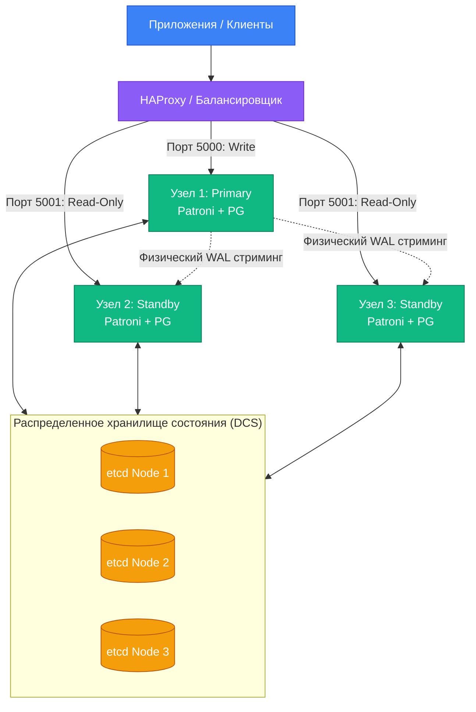

# Patroni

Шаблон оркестрации высокой доступности (HA) для PostgreSQL на базе распределённого консенсуса (DCS: etcd/Consul) с автоматическим failover и защитой от split-brain.

---

## 1. Зачем Patroni системному аналитику

При проектировании архитектуры корпоративных информационных систем аналитик формулирует требования к надежности: SLA (например, 99.95%), допустимое время простоя (RTO < 1 мин) и допустимую потерю данных (RPO = 0 или < 5 с). Ручной failover (вызов `pg_promote`) занимает 10–30 минут и требует дежурного DBA.

Patroni решает эту задачу автоматически:
1. Непрерывно отслеживает состояние primary-узла (heartbeat).
2. При сбое лидера через распределённый консенсус (etcd) проводит выборы нового primary среди реплик.
3. Переназначает лидерство, гарантируя отсутствие ситуации **Split-Brain** (когда две ноды считают себя primary и принимают запись).
4. Переконфигурирует оставшиеся реплики на новый узел.

В рамках [[course/rpd|РПД]] тема рассматривается в лекции 10 и формирует результаты по **ПК-1-И-40** и **ПК-3-И-3**.

---

## 2. Архитектура Patroni-кластера



- **etcd / Consul:** распределённое key-value хранилище, обеспечивающее кворум (Raft). В нём хранится ключ лидера с TTL (time-to-live).
- **Patroni daemon:** процесс на каждом узле СУБД, управляющий запуском, конфигурацией и статусом PostgreSQL.
- **HAProxy / Keepalived / VIP:** направляет трафик на актуальный primary через HTTP health check (`GET http://<node>:8008/primary`).

---

## 3. Основные команды patronictl

Системный аналитик и дежурный инженер используют CLI-утилиту `patronictl` для проверки статуса кластера и проведения регламентных работ:

```bash
# Просмотр топологии кластера и текущего лидера
patronictl -c /etc/patroni/eshop.yml list

# Пример вывода:
# +---------+-----------+---------+--------+----+-----------+
# | Cluster | Member    | Host    | Role   | TL | State     |
# +---------+-----------+---------+--------+----+-----------+
# | eshop   | pg-node-1 | 10.0.1.1| Leader |  2 | running   |
# | eshop   | pg-node-2 | 10.0.1.2| Sync   |  2 | streaming |
# | eshop   | pg-node-3 | 10.0.1.3| Replica|  2 | streaming |
# +---------+-----------+---------+--------+----+-----------+

# Плановое переключение роли primary (Switchover) без простоя
patronictl -c /etc/patroni/eshop.yml switchover

# Перезапуск узла после изменения параметров postgresql.conf
patronictl -c /etc/patroni/eshop.yml restart eshop pg-node-2
```

---

## 4. Разница между Switchover и Failover

| Параметр | Switchover (плановое переключение) | Failover (аварийное переключение) |
|---|---|---|
| **Инициатор** | Человек (регламентное окно обслуживания) | Автоматика Patroni при аварии primary |
| **Потери данных** | RPO = 0 (строго без потерь) | Зависят от режима репликации (синхронный/асинхронный) |
| **Время простоя** | Секунды (приложение переподключается) | Время истечения TTL ключа в etcd (обычно 10–30 с) |
| **Цель** | Обновление ОС/СУБД, регламентные работы | Восстановление доступности сервиса |

---

> **Источники:** [[lectures/lec_10]], [[labs/lab_04]], [Официальная документация Patroni](https://patroni.readthedocs.io/).  
> **Связанные страницы:** [[course/rpd]], [[concepts/high-availability]], [[concepts/replication]], [[procedures/failover-runbook]].
